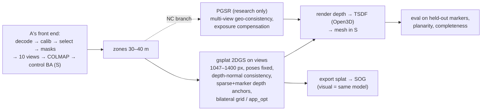
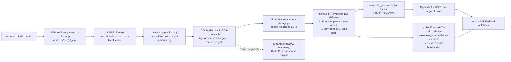
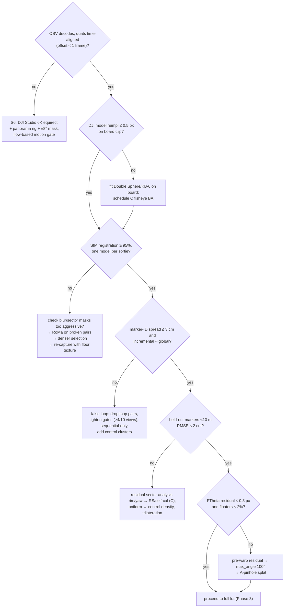

# A4: Full-system options for Avata 360 → metric model + photoreal splat

*Agent A4 (systems architecture). Written 2026-11-17. Inputs read in full: A1 (device), A3a (filtering), A3b (geometry), A3c (visualization); A2 Handoff only.*

> **Evidence conventions.** **[SRC]** means I read the source code in this session (gsplat `main` at `version.py` = 1.6.0: `rendering.py`, `cuda/include/Cameras.cuh`, `cuda/include/ExternalDistortion.cuh`, `examples/simple_trainer.py`) or a LICENSE file (gsplat, PPISP, pyceres, COLMAP, OpenMVS, LightGlue, ALIKED). **[OPENED]** means I fetched and read the paper or abstract page (export.arxiv.org or arXiv HTML). **[UPSTREAM]** means the claim comes from A1/A3a/A3b/A3c, which cite their own primary sources; I did not re-open it. **[CALC]** means my own derivation, with the formula shown. **[UNVERIFIED]** means I could not check it. Anything not tagged as a reported result is my assessment. `radiancefields.com` was blocked from this sandbox (proxy 403), so the one commercial reference from there remains a search snippet.

---

## 0. TL;DR

1. **The upstream recommendations fit together**, but only once five contracts are written down: (i) one lens model with three uses, (ii) one rule for turning poses into frames, (iii) one metric "survey frame", (iv) masks kept in fisheye space as the master copy, and (v) one frame-selection manifest. §1 defines all five. Without them, the most likely silent failures are a half-pixel offset, a world-normalisation transform, or a view-to-lens rotation applied twice. None of these would show up in reprojection error.
2. **Recommended system: Option A, "Survey-grade rig + anchored fisheye splat".** It runs: raw dual fisheye → 10-view pinhole rig in COLMAP 4.2 → marker and scale-bar control BA (pyceres) → OpenMVS mesh. The *same poses*, converted to per-lens fisheye poses, drive gsplat FTheta+UT on the raw fisheyes, with MCMC, PPISP and an A3b mesh-depth loss. Estimated effort is **~35–45 engineer-days** with Claude Code. Full-lot compute is about **2–3 days** on one 16 GB GPU, and **1–2 TB of NVMe** is the actual bottleneck.
3. **Option B, "Unified Gaussian surface"**: the same poses, then gsplat's Apache-licensed 2DGS (pinhole only) on the virtual views as both geometry and visual. It is cheaper and has one product, but the geometry evidence indoors is weaker and the visuals lose the rim band. **Option C, "Fisheye-native research"**: fisheye-coordinate self-calibrating BA with an IMU-driven rolling-shutter term, per-sector partial rig frames and rig-consensus loop gates. It has the highest novelty and the lowest maturity. Build A first; C is a set of drop-in upgrades to A's modules.
4. **A3b's accuracy expectation is somewhat optimistic.** Its own text says 1–2 cm in the TL;DR but 0.5–1.5 cm in its table. The published anchors at 0.5–1 cm are all *stills* with dense control or a total station. **Plan on 1–2 cm local RMSE and 0.05–0.3% global**, with 0.5–1 cm only as a stretch at marker clusters. The ≤1% project target still has a wide margin. Separately, proving 0.03% over 50 m needs a reference better than ~1.5 cm over 50 m, which a distance-only trilateration network may not deliver (§3).
5. **Licences:** the core stack is permissive: COLMAP (BSD), pycolmap/pyceres (BSD/Apache-2.0), gsplat (Apache-2.0), PPISP (Apache-2.0), ALIKED (BSD-3), LightGlue (Apache-2.0), SAM 2 (Apache-2.0), AprilTag (BSD-2) and the viewers (MIT). **OpenMVS is AGPL-3.0**: fine run as a separate executable for internal use, but a problem if the pipeline is offered as a network service. **PGSR, 2DGS-original, INRIA 3DGS, Doppelgangers++, MASt3R and IQA-PyTorch are non-commercial** and must stay in research-only branches. dji-osv-converter has no licence file, so use it as documentation only.
6. **One new piece of evidence for the splat stage:** the first evaluation of 3DGS on real >180° fisheyes (Gunes et al., VISAPP 2026) reports indoor 3DGUT at only **~21–22 dB PSNR at 200°**, with floaters [OPENED]. That is a realistic quality anchor for this project, and it makes the virtual-pinhole fallback (A3c S3) more than a formality.

---

## 1. Interface resolution: the contracts between A3a, A3b and A3c

### 1.1 Frames and conventions (single source of truth: `core/frames.py`)

| Symbol | Definition | Owner |
|---|---|---|
| `L_up`, `L_dn` | Lens frames. Origin at each lens's optical centre; +z along the optical axis; x right, y down in the raw 3840² image (OpenCV convention). This is the frame in which DJI's KB-5+tangential model is defined | calib |
| `R` (rig) | = `L_up` (reference sensor). `T_Ldn←R` holds the factory inter-lens rotation and the **calibrated translation b** | calib |
| `V_{l,k}` | Virtual pinhole view k ∈ {axial, obl0..3} of lens l. **Pure rotation** of its lens frame: `T_V←L = [R_k | 0]` | project |
| `W_c` | COLMAP world (arbitrary gauge, arbitrary scale) | sfm |
| `S` | **Survey frame**: metres; origin at marker M0; +z = −gravity (up); +x towards marker M1; right-handed. All delivered products live here | control |
| `Z_j` | Zone-local frame for splat training: `S` translated by the zone centroid **c_j** (translation only, no rotation or scale) | splat |

COLMAP stores `cam_from_world` (world→camera), and gsplat's rasterizer takes `viewmats` (world→camera, OpenCV axes) [SRC]. Both are OpenCV-convention world→camera, so **no axis flip is needed between them**. The only flip risk is gsplat's `simple_trainer`, which loads `camtoworlds` and inverts them; the custom dataset class must follow the same convention.

### 1.2 Contract 1: COLMAP rig poses of virtual views → per-lens fisheye poses for gsplat

A3b's rig is set up so that the 5 views of a lens share one optical centre (rotation-only `sensor_from_rig`) and the down group is offset by b. A3b also fixes the rig (`ba_refine_sensor_from_rig 0`). The conversion is therefore exact:

  T_{L_l←W} = (T_{V_{l,k}←L_l})⁻¹ · T_{V_{l,k}←W}   for any k,

then T_{L_l←S} = T_{L_l←W} · Sim3_{W←S} (with Sim(3), scale applies to translation only).

**Checks (unit test plus run-time assert):**
1. All 5 views of a lens must give the same `T_L←W` to within 1e-9 when the rig is fixed. If A3b's single experiment that frees the down-group translation is used, the 5 down views still share one centre only if the *rig* parameter is freed, not the per-view parameters. Assert this, and fail loudly otherwise.
2. A frame registered with only some views (A3a partial frames) still yields both lens poses, because the rig pose is per frame. A lens whose views are *all* absent from a frame gets no gsplat image for that frame. Gsplat should not train on an image that SfM could not see well.
3. gsplat gets `viewmats = T_{L_l←Z_j}`, `Ks` with fx = fy = 1, and (cx, cy) from the FTheta fit (FTheta reads only `Ks[2]` and `Ks[5]` [SRC]), plus one `ftheta_coeffs` per call. `ftheta_coeffs` is "shared for all cameras" [SRC], so **batch per lens**: one rasterization call for the up-lens images and one for the down-lens images in each step.

### 1.3 Contract 2: one lens model, three uses, and an explicit refit/residual check

The DJI factory model (KB-5 radial in θ plus Brown tangential on distorted coordinates; per unit and per firmware [UPSTREAM A1]) is the **master**. Everything else is derived from it, with a stored residual:

| Use | Derived form | Acceptance |
|---|---|---|
| Virtual-view renderer (SfM, MVS, markers, option B) | Exact bearing-vector inverse of the DJI model, then `cv2.remap` LUTs | Round-trip pixel → bearing → pixel ≤ 0.01 px. The DJI-model re-implementation against DJI Studio reference must be ≤ 0.5 px RMS (A3b), driven down from the community 2.1/3.9 px |
| COLMAP verification (θ < 85° only) | `RAD_TAN_THIN_PRISM_FISHEYE` with k₅ = s = 0 [UPSTREAM A3b] | Matches master ≤ 0.05 px; checks the p₁/p₂ sign convention |
| gsplat FTheta | `angle_to_pixeldist` polynomial of degree 5 (6 coefficients), then the affine `[[c,d],[e,1]]` (`linear_cde`), then the principal point [SRC `Cameras.cuh`]. **There are no tangential terms** | Fit on a dense θ–φ grid up to θ_max. Report RMS and max residual per θ ring |

**Refit procedure:** sample bearings on a 1° × 1° grid over θ ∈ [0, θ_max = 103°] and project them with the master. Least-squares fit (poly₀..₅, c, d, e, cx, cy) with the FTheta forward model. Then compute the residual field Δ(u, v) = master − FTheta.
- RMS ≤ 0.3 px and max ≤ 1 px (A3c's threshold): **use the raw images directly.**
- Otherwise, **pre-warp** each training image by Δ, which is a near-identity, sub-pixel remap, so that the image follows FTheta exactly. Bilinear resampling at sub-pixel shift costs far less sharpness than full re-projection.
- An alternative I have not tested: gsplat's `external_distortion_coeffs` (a "BivariateWindshield" ray-space polynomial up to order 5 [SRC]) may absorb the decentering without touching pixels. Treat it as an experiment.

**Half-pixel trap.** gsplat's FTheta model adds +0.5 to the principal point internally [SRC: `principal_point[0] += .5f`]. COLMAP's own pixel convention and DJI's (cx, cy) convention may differ by 0.5 px [UNVERIFIED for DJI]. Phase 0 includes a **synthetic render test**: render a known 3D grid through both the master model and gsplat FTheta, and require agreement within 0.05 px. A 0.5 px systematic offset at 18 px/deg is a 0.03° bias. It does not matter for splat quality, but it does matter if splat depth is ever compared to the mesh at the rim.

**Calibration versioning.** Every artefact records `calib_id` = hash(firmware, lens-protector state, fit run). If the experimental fisheye-coordinate BA (A3b §1.4 step 3) refines the intrinsics or b, that creates a **new calib_id**. Views and FTheta fits are then re-derived, and SfM is re-run from feature extraction. Stale views are the classic silent bug.

### 1.4 Contract 3: the shared metric frame after marker Sim(3) and control BA

Order of operations (A3b §3, made explicit):
1. COLMAP mapping in W_c (arbitrary scale). The global mapper runs as a cross-check.
2. Marker corners are triangulated as tracks in W_c.
3. **Control BA** in pyceres. Fixed rig. Reprojection residuals with a Cauchy loss, plus scale-bar residuals ‖X_i − X_j‖ − d_ij with σ = instrument σ for the 70% "control" distances, plus an optional gravity prior on frame roll and pitch. Scale-bar residuals are gauge-invariant under rotation and translation but fix scale. The gauge stays free.
4. **Sim(3)** (Umeyama on control-marker centres) to the trilaterated marker coordinates defines `S`. Because the BA already fixed scale, the Sim(3) scale should be 1 ± 1e-4. **Assert this**; a larger deviation means the trilateration and the BA disagree.
5. Every product (poses, sparse cloud, OpenMVS mesh, splat) is written in `S`. Splat training happens in `Z_j` = S − c_j to keep float32 precision and gsplat's `scene_scale`-dependent learning rates sane. Use `normalize_world_space=False` [SRC: default True in `simple_trainer`]. The exported `.ply` adds c_j back, and records `frame=S, calib_id, sim3_id` in a PLY comment.
6. **Do not feed refined poses back.** If the splat uses `pose_opt`, its poses are diagnostic only (A3c).

### 1.5 Contract 4: mask flow (master masks live in raw-fisheye pixel space)

| Mask layer | Produced by | Space | SfM (features) | MVS (fusion) | gsplat (loss) | Splat depth loss |
|---|---|---|---|---|---|---|
| Image circle + θ_max | calib | fisheye | warped to views; θ > **102°** masked | θ > **100°** masked | `max_angle` = 103° + mask θ > 102° | same |
| Airframe (hover-clip temporal median, dilated, plus prop ellipses) | calib (A3a stage 1) | fisheye | yes (`camera_mask_path` per view camera) | yes | yes | yes |
| Overlap/"seam" band | **No stitch seam exists in the raw rig.** The band θ ∈ 90–105° is the rim: worst MTF, extrapolated calibration | — | kept (it is the wall content A3b fought for) | kept up to 100° | kept | kept |
| Bad sectors (IMU-predicted blur > 2 px, or rel. sharpness < 0.6) | select | fisheye sectors | **hard** (per-image `mask_path`) | hard | **soft**: weight 0.3, not masked (A3a §5) | kept |
| Dynamic objects (Grounded-SAM-2 on virtual views → back-projected → OR-merged) | mask | detected on views, stored in fisheye | hard | hard | hard (dilated 10 px) | hard |
| Saturated lamps and specular blobs (luma > 0.95, dilated ×2) | mask | fisheye | hard | hard | down-weight only | hard |
| Reflection (wet floor, car glass) | mask | fisheye | prompt-based, hard | hard | **not masked** | hard |

Rules: views get **nearest-neighbour** warps of the fisheye master through the same remap LUT, OR-ed with "outside lens". A view that is more than 50% masked is dropped from the rig frame (A3a). Masks are versioned with the selection manifest.

### 1.6 Contract 5: the frame-selection manifest, with two contradictions resolved

`select/manifest.parquet` has one row per (frame, lens, sector). Columns: t, ω, predicted blur, relative sharpness, keep_sfm, keep_dense, sector_mask_bits, reason, held_out_block.

- **IMU gate (A3a vs A3b).** A3a rejects a *frame* above 3 px predicted horizon blur (ω ≈ 16°/s at 1/100 s [CALC: 18.3·ω·0.01]) and flags sectors above 2 px. A3b rejects frames with |ω| > 10°/s. **Resolution:** reject the whole frame at ω > 16°/s. Between 10 and 16°/s, mask the *rim sectors* only (yaw blur and rolling-shutter skew both concentrate there), and keep the lens centres. That keeps A3b's error bound on walls and keeps floor and ceiling marker observations, as A3a wants.
- **Frame density (A3a vs A3c).** A3a gives 4–7 rig-frames/m for SfM and 8–12/m for 3DGS. A3c gives one per 0.2–0.3 m (3.3–5/m) for 3DGS, sized for disk and RAM. **Resolution for Phase 1:** use **one set at 7/m** for SfM, MVS and splatting. Then every splat image has an SfM pose and no image-registration step is needed. Per-zone image counts stay small (a 35 m zone with ~2–3 lane passes has ~500–700 rig frames, i.e. 1–1.4 k fisheye images). Phase 2 ablates a 12/m dense set registered into the frozen map with `image_registrator`. Whether COLMAP 4.2 registers new *rig frames* (rather than single images) into a fixed model is [UNVERIFIED]; check it in Phase 2.
- **Held-out data is decided first** (A3a §7, A3c §6.1): 2 s blocks every ~20 s with ±1 s guard bands, plus one validation sortie. These rows are excluded from every arm. Held-out *markers* (not just held-out distances) are fixed at the same time (§3).

### 1.7 Two unknowns that touch every contract
- **Inter-lens exposure synchronisation** is [UNVERIFIED]. The rig model assumes both lenses expose at the same instant. Test it in Phase 0 by fitting a per-lens time offset against gyro rate in the overlap band. A one-frame offset during 10°/s yaw would be 0.4°, i.e. 7 px.
- **Rolling-shutter readout** (A1 unknown #2) is needed only for Option C and A3c's optional `viewmats_rs`.

---

## 2. Licence audit of the chosen stack

| Component | Licence | Verified | Consequence |
|---|---|---|---|
| COLMAP 4.2.1 / pycolmap | BSD (new) | [SRC LICENSE] | Free |
| pyceres | Apache-2.0 | [SRC LICENSE] | Free |
| ALIKED / LightGlue / LoMa | BSD-3 / Apache-2.0 (SuperPoint weights excluded) / MIT | [SRC] / [SRC] / [UPSTREAM A3b] | Free. Don't use SuperPoint weights commercially |
| OpenOSV (decoder base) | Apache-2.0 | [UPSTREAM A1] | Free |
| dji-osv-converter docs | **no licence file** | [UPSTREAM A1] | Read as documentation; **clean-room** the code |
| AprilTag 3 | BSD-2 | [UPSTREAM A3b] | Free |
| SAM 2 / Grounded-SAM-2 | Apache-2.0 | [UPSTREAM A3a] | Free (Ultralytics YOLO is AGPL: avoid) |
| **OpenMVS** | **AGPL-3.0** | [SRC LICENSE] | Call it as an external binary. Internal use is fine. Offering the pipeline as a network service triggers source-disclosure duties. Fallback: COLMAP PatchMatch (BSD) |
| gsplat (FTheta, UT, MCMC, 2DGS, bilateral grid) | Apache-2.0 | [SRC LICENSE] | Free. gsplat's MCMC is a re-implementation; the original 3DGS-MCMC repo is INRIA-derived |
| PPISP | Apache-2.0 | [SRC LICENSE] | Free |
| DN-Splatter, SpotLessSplats (gsplat) | Apache-2.0 | [UPSTREAM A3b/A3a] | Free |
| splat-transform / SuperSplat / Spark | MIT | [UPSTREAM A3c] | Free |
| **PGSR** | research / non-profit only | [UPSTREAM A3b] | Research branch only (Option B variant) |
| **INRIA 3DGS, 2DGS (original repo), GOF, RaDe-GS, Hierarchical 3DGS** | non-commercial | [UPSTREAM A2/A3c] | Not used. gsplat's `rasterization_2dgs` replaces 2DGS-original |
| **Doppelgangers++, MASt3R(-SfM), IQA-PyTorch** | CC BY-NC-SA 4.0 / PolyForm NC | [UPSTREAM A3a/A3b] | Research branch only. Doppelgangers (v1) is MIT |
| ffmpeg | LGPL/GPL by build | [UNVERIFIED for the chosen build] | Use as an external tool |

**Verdict:** Option A without PGSR is entirely usable commercially, apart from the AGPL network-service caveat on OpenMVS. Options B and C have permissive cores; their NC components are optional comparison arms.

---

## 3. Sanity check of A3b's expected accuracy

A3b claims **0.5–1.5 cm local RMSE (< 10 m) and 0.03–0.2% global** with distributed markers [UPSTREAM A3b §5.3]. Here is the evidence it cites, re-read against our conditions:

| Anchor | Conditions | Result | How far it transfers |
|---|---|---|---|
| Barazzetti 2018 | **Stills** (~24 MP), 10.9 m room, total station, 6 GCPs | 4.6–7.2 mm per axis | Far from our case: stills, total station, ~3× more px/deg, no video codec |
| Perfetti 2024 | Rigs and spherical stills, staircase, full control | ~1 cm; 5–10 cm drift when partially unconstrained | Supports ~1 cm *with control throughout* |
| Gómez-López 2025 | **360° video**, raw fisheye in Metashape, dark, 30 m | ~2 cm in lit areas; > 10 cm at far end | The closest analogue, and it gives 2 cm *where lit* |
| A3b's [CALC] | σ_Z ≈ Z²σ_θ/B = 25·0.48e-3/3 ≈ 4 mm | Random error only | Ignores systematic terms |

**Why 0.5–1.5 cm is optimistic** (assessment):
1. **Internal inconsistency.** A3b's TL;DR plans for 1–2 cm while its table says 0.5–1.5 cm.
2. **Systematic terms the random calculation omits:** remap and calibration residual (target ≤ 0.5 px ≈ 0.5 mrad); RS skew of ~2 px during 10°/s yaw [UPSTREAM A3b §1.5]; possible inter-lens time offset; H.265 at 0.10 bpp biasing corner positions. Each is ~0.5–1 mm at 2 m alone, but they are *correlated* along the trajectory, so they do not average out the way the 1/√N argument assumes.
3. **Every sub-cm anchor is stills-based.** The only video anchor gives 2 cm.
4. **Checkpoint independence.** If held-out *distances* share endpoints with control distances, the checkpoint is partly fitted. Hold out whole **markers** (≥ 25% of marker IDs, spread out), not only distances.

**Global 0.03–0.2%:** at 50 m, 0.03% is 1.5 cm. That is the same as the local error at the two endpoints (√2 · 1 cm ≈ 1.4 cm), so 0.03% is a *floor*, not an expectation. It also needs a reference better than ~1 cm over 50 m. A distance-only trilateration network along an elongated aisle has weak geometry perpendicular to the aisle [assessment], so its own error at 50–100 m may reach 0.5–1 cm. Measure long check lines **directly** with a laser distance meter where line-of-sight exists, or borrow a total station.

**Planning numbers adopted for this design:**

| Quantity | Option A, distributed control (≤ 10–15 m) | Stretch | Control at ends only |
|---|---|---|---|
| Held-out marker distances < 10 m | **1–2 cm RMSE** | 0.7 cm | 2–4 cm |
| Lines 20–100 m | **0.05–0.3%** | 0.03% | 0.3–1% |
| Mesh vs checkpoints, textured surfaces | 1–3 cm | — | — |
| Mesh, bare concrete (OpenMVS) | 2–5 cm, with holes | — | — |

The project target (≤ 1% global, a few cm local) stays comfortably within reach. The optimism matters only for how strict the phase gates are.

---

## 4. End-to-end precedents and the system-level long list

**Systems that already combine these stages** (examples):
- **Drone 360° indoor 3DGS** (Chen et al., ECCV 2024 workshop) [UPSTREAM A3a]: stitched equirect at 1–3 fps → 8 cubemap faces → COLMAP → 3DGS, with the drone body inpainted. This is the nearest published *drone* pipeline. It is visual only, uses no metric control, and stitched input carries the seam error.
- **IM360** (Jung et al., ICCV 2025) [UPSTREAM A3b]: spherical SfM with dense matching → DebSDF on cubemap faces → textured mesh. Stills only, with human-chosen pairs.
- **RIGOR** (2026) [UPSTREAM A3b]: 4-view virtual rig + feed-forward DA3 + Sim(3) graph. Decimetre-level and scale-free.
- **ORBIT** (CVPR 2026) [UPSTREAM A3b]: builds 360° ground truth with rig-of-perspective-views SfM. This is the same decomposition as our SfM stage.
- **Gunes et al.** (VISAPP 2026) [OPENED]: the first 3DGS evaluation on real 200° dual-fisheye. 3DGUT reached 22.16/20.91 dB PSNR on two indoor scenes at 200° and was stable when cropped to 160°, while Fisheye-GS improved at 160°. 3DGUT showed floaters. SfM initialisation "often fails" at such wide angles, and UniK3D monocular depth was a workable initialiser. The authors' **FIORD** dataset (SCIA 2025) [OPENED] provides dual-200° fisheye captures with **LiDAR ground truth**, which makes it a dry-run benchmark for our splat and dense code before any drone footage exists.
- **Gómez-López 2025** [UPSTREAM A3b]: raw fisheye video frames in Metashape, pre-calibrated intrinsics, inter-sensor distances as scale bars. This is the closest *metric* precedent.
- **Commercial reference:** a paid tool, "360 Gaussian Pro", reportedly ingests raw DJI and Insta360 dual-fisheye with a custom COLMAP/GLOMAP build [UNVERIFIED: search snippet only; page blocked].

**System long list (10) and screen:**

| # | System configuration | Screen |
|---|---|---|
| S1 | Raw rig (10 views) + COLMAP incremental + control BA + OpenMVS + gsplat FTheta | **Keep → Option A** |
| S2 | S1, but the splat is trained on the virtual pinholes | Keep as A's fallback (A-pinhole) |
| S3 | Raw rig + gsplat 2DGS on views as geometry *and* visual | **Keep → Option B** |
| S4 | S3 with PGSR | Fold into B as an NC variant |
| S5 | Fisheye-coordinate self-cal BA + RS + per-sector partial frames + rig-consensus loops + FTheta-RS splat | **Keep → Option C** |
| S6 | DJI Studio equirect → `pycolmap.panorama` (seam masked) → same back end | Drop as an option; it is the **decode-failure fallback** in the decision tree (seam masks lose long-range walls [UPSTREAM A3b]) |
| S7 | Native equirect / per-lens half-equirect spherical SfM | Drop: COLMAP's own changelog calls native spherical "less accurate"; kept as a speed path inside C |
| S8 | IM360-style spherical SfM + neural SDF | Drop: no code verified, stills-based, slow SDF on 16 GB |
| S9 | Feed-forward (VGGT/MapAnything/DA3/RIGOR) backbone | Drop as backbone: dm-level and no metric scale; kept for diagnosing broken segments in C |
| S10 | Metashape (spherical/fisheye + scale bars) | Drop: commercial; a one-off accuracy reference if a licence exists |

---

## 5. Option A (recommended): survey-grade rig + anchored fisheye splat

**Idea.** Measurement and visualization are two products that share one calibration, one pose set and one frame. Geometry comes from classical, auditable tools. The splat is trained on the *raw* fisheyes, without resampling, and is held to the mesh by a depth loss. This combines the primaries of A3a, A3b and A3c, with the §1 contracts as glue.

```mermaid
flowchart LR
  subgraph IN[Ingest and calibrate]
    OSV[".OSV<br/>2×3840² HEVC10 + protobuf"] --> DEC["decode + meta<br/>quats 1–4 kHz, ISO, shutter"]
    HOV["hover board clip"] --> CAL["calib: DJI KB5+tan verify,<br/>b, R_up-dn, airframe mask,<br/>FTheta refit + residual"]
  end
  DEC --> SEL["select: IMU gate 16°/s frame,<br/>10–16°/s rim sectors → parallax 7/m<br/>→ sharpest/window per lens+sector"]
  CAL --> VV
  SEL --> MSK["masks: fixed ∪ dynamic(SAM2) ∪<br/>lamps ∪ bad sectors (fisheye master)"]
  MSK --> VV["virtual views: 5/lens, 90°, 2094²<br/>+ warped masks + rig_config.json"]
  VV --> SFM["COLMAP 4.2: ALIKED+LightGlue,<br/>geometry-aware pairs, loop gates,<br/>incremental (Caspar BA) ‖ global(gravity)"]
  VV --> MK["AprilTag 36h11 on views<br/>→ corner tracks"]
  MK --> CBA
  SFM --> CBA["control BA (pyceres):<br/>70% scale bars, Cauchy reproj<br/>→ Sim3 → frame S"]
  CBA --> DNS["OpenMVS per zone:<br/>Densify → Mesh → Refine (+COLMAP PM alt)"]
  CBA --> POSE["per-lens fisheye poses T_L←S<br/>(contract 1.2)"]
  DNS --> MESH["metric mesh + cloud (S)"]
  MESH --> GS
  POSE --> GS["gsplat per zone: FTheta+UT, MCMC 3M,<br/>PPISP per lens, mesh-depth L1,<br/>no world-normalise, pose_opt off"]
  MSK --> GS
  MESH --> EV["eval: held-out markers, repeatability,<br/>planarity, loop gap, NVS per region,<br/>splat-vs-mesh depth"]
  GS --> EV
  GS --> DEL["export .ply (S) → Streamed SOG;<br/>mesh + markers overlay"]
```



### 5.1 Stage table

| Stage | Tool | In → Out | Key parameters | Filtering hooks |
|---|---|---|---|---|
| Decode | OpenOSV-derived Python + ffmpeg/NVDEC | `.OSV` → per-lens frames (on demand) + `meta.parquet` | Identify tracks by content; time offset IMU↔frames by gyro-vs-flow cross-correlation | Flags exposure/WB changes |
| Calibrate (once per unit and firmware) | pyceres DJI model / Double Sphere; AprilGrid | hover clip → `calib/<id>.yaml`, masks, FTheta fit | Acceptance per §1.3; b with σ ≤ 3 mm | Airframe mask |
| Select | numpy/OpenCV | frames + meta → `manifest.parquet` | §1.6 thresholds; window ±0.25 s; hovers collapsed | IMU gate, parallax, sharpness, sectors |
| Mask | Grounded-SAM-2 + SAM 2 on views; saturation | → fisheye master masks | Dilation 10 px; cars only if moving | Dynamic/specular/lamps |
| Project | `cv2.remap` LUTs (float32, cached per calib_id) | fisheye → 10 × 2094² views (8-bit JPEG q95 after a fixed D-Log M curve) + masks | Axial + 4 oblique at θc = 62°; down group yaw +45° | Drop views > 50% masked |
| SfM | COLMAP 4.2.1 | views → `sparse/W_c` | `PINHOLE` fixed; 2048 ALIKED kp/view; **custom pair list** (§5.3); `loop_detection_min_index_distance` ≈ 60 s; gravity `PosePrior` | Loop gates: marker-ID, ≥ 3/10 rig consensus, gravity |
| Markers | AprilTag 3 | views → corner obs | Slant range 1.5–5 m; sub-px refine | Reject detections in masked sectors |
| Control | pyceres on pycolmap | → `S` poses, points, residual report | Scale-bar σ = instrument; hold out ≥ 25% of markers | — |
| Dense | OpenMVS (external) | undistorted views per zone → cloud, mesh | `--resolution-level 1` (~1047 px); zones 30–40 m + 5 m overlap | `StereoFusion`-equivalent masks; θ > 100° masked |
| Splat | gsplat `main` (pinned commit) + custom fisheye dataset | raw fisheye (data_factor 2) + poses + mesh → `.ply` per zone | §1.2/1.3; `cap_max` 3 M; depth λ 0.1 → 0.05; PPISP sensors fixed after zone 1 | Soft bad-sector weights; hard dynamic masks |
| Eval/report | Open3D, numpy, HTML | everything → `report.html` | §8 metrics | Ablation registry |

### 5.2 Data contracts specific to A
Contracts 1–5 from §1 apply unchanged. In addition:
- **OpenMVS input** comes from COLMAP `image_undistorter` (a no-op re-export, since views are already pinhole). Masks are passed as per-view masks; whether OpenMVS reads them natively is [UNVERIFIED], so apply them by zeroing pixels. Mesh output is PLY in `S`.
- **Splat depth target**: ray-cast the OpenMVS mesh through each lens's FTheta model (Open3D `RaycastingScene` with per-pixel bearings) at data_factor 2. Store as float16 `.npy` beside each image, plus a confidence mask (hit, angle of incidence < 75°, not in a reflection mask).

### 5.3 Compute on 16 GB (full lot ≈ 60×100 m, 1.0–1.5 km of trajectory, 4–6 sorties) [CALC unless stated]
- **Frames:** 7/m × 1.25 km ≈ **8.8 k rig frames** → 88 k virtual views and 17.5 k fisheye images.
- **Disk (the real bottleneck):** views as JPEG q95 at ~1.5 MB → ~130 GB. Fisheye training images as 16-bit PNG at 1920² (~12 MB) → ~210 GB. Depth targets ~7 GB. OpenMVS working directories are tens of GB per zone. **Plan 1–2 TB NVMe**; do not keep all decoded frames.
- **SfM database:** if ALIKED descriptors are stored as float32 (128-d) [UNVERIFIED dtype], 2048 kp × 512 B ≈ 1 MB/view → ~90 GB for one database. **Run one database per sortie** (~15–20 k views) and merge models through shared marker IDs and the anchor area.
- **Matching:** naive `expand_rig_images` with 10 neighbours means 100 view pairs per frame pair, about 9 M pairs. A **geometry-aware pair list** (only view pairs whose frusta can overlap, given the fixed rig and a ≤ 1 m baseline) keeps ~30–35, i.e. ~3 M pairs. At an assumed 3–5 ms per LightGlue pair [UNVERIFIED throughput], that is **~3–4 h** in total. Feature extraction is ~1–2 h.
- **Mapping:** incremental with Caspar GPU BA, per sortie: **~2–6 h each** [assessment]. The global mapper cross-check takes ~0.5 h per sortie. Control BA (CPU, a few million residuals) takes 10–60 min.
- **OpenMVS:** ~12–20 zones × 1–3 h (Densify at level 1 with ~1.5–2.5 k views per zone) [assessment]. Needs **32–64 GB system RAM**; GPU use is modest.
- **gsplat FTheta+UT:** per zone 1–1.4 k images, 30–60 k steps, `cap_max` 3 M at 1920² → **~1.5–3 h per zone**. UT plus MCMC is slower than EWA [OPENED: Gunes 2026 notes the extra cost]. Peak VRAM ~8–12 GB [UPSTREAM A3c sizing]. Total ~25–50 h.
- **Wall-clock for the full lot: ~2.5–4 days**, all on one GPU, and resumable per stage.

### 5.4 Expected accuracy and quality
- **Geometry:** see §3. Held-out markers at 1–2 cm (< 10 m) and 0.05–0.3% (20–100 m). Mesh 1–3 cm on textured surfaces; floors and ceilings are hole-prone. Evidence: Gómez-López (video, 2 cm lit), Perfetti (1 cm with control), and A3b's own calculation.
- **Visual:** a realistic anchor is **PSNR 21–24 dB / LPIPS 0.20–0.35** on held-out *blocks* (not frame-skip). The Gunes 200° indoor numbers were 20.9–22.2 dB with 3DGUT [OPENED]. Our capture is dimmer and more compressed, but we have PPISP and a mesh-depth prior. Uncertainty is ±2 dB. Rim-band floaters are the main visual risk.

### 5.5 Risks → fallbacks
| Risk | Signal | Fallback |
|---|---|---|
| OSV decode or quaternion parsing slips | Parser cannot find attitude fields for this firmware | DJI Studio 6K unstabilised equirect → `pycolmap.panorama` with ±8° mask (S6); IMU gate replaced by derotated-flow magnitude |
| DJI model re-implementation > 0.5 px | Board residuals | Fit Double Sphere / own KB-6 on the board clip; promote C's fisheye BA |
| FTheta residual > 0.3 px | Refit report | Pre-warp by residual field; else train the splat on views (A-pinhole) |
| Folded map | Marker-ID spread > 3 cm, incremental ≠ global, long-line errors in whole bay widths | Tighten gates, remove the loop pairs, re-map sequential-only, add control |
| Textureless aisle breaks the chain | Registration < 95%, multiple models | RoMa on the broken pairs; denser selection locally; add floor texture (A1) at re-capture |
| OpenMVS holes on concrete | Completeness < 80% | Per-region PGSR/2DGS fill (research branch) or planar fill, never in evaluated regions |
| Rim floaters in splat | Floater fraction > 2% | `max_angle` 100°; stronger depth loss on rim; A-pinhole |
| VRAM | OOM | `cap_max` 2 M, data_factor 2, `packed=True`, smaller zones |

### 5.6 Effort (engineer-days with Claude Code)
Decoder and metadata 4–5; calibration (board fit, b, masks, FTheta refit, contract tests) 5–7; selection 2–3; masks 2–3; projection and rig JSON 2; SfM orchestration (pairs, gates, merge) 5–7; markers and control BA 4–6; OpenMVS and zoning 2–3; gsplat fisheye dataset, depth loss and PPISP wiring 5–7; evaluation and report 3–4. **Total ≈ 35–45 days.** Main dependencies: COLMAP 4.2.1, pycolmap, pyceres, OpenMVS, gsplat (pinned `main`), SAM 2, AprilTag, Open3D.

---

## 6. Option B: unified Gaussian surface on the virtual-view rig

**Idea.** Replace OpenMVS *and* the separate splat with one surface-aligned Gaussian model per zone. It is trained on A's virtual pinhole views with A's fixed metric poses and serves as both the mesh source (TSDF fusion of rendered depth) and the viewer asset. gsplat's `rasterization_2dgs` is Apache-2.0 but **takes pinhole `Ks` only** [SRC], so B must use views rather than raw fisheyes. PGSR (best published geometry among GS methods: DTU 0.52 mm, TnT F1 0.52 [UPSTREAM A3b]) is the research-only variant.



**Stage differences from A.**
- Dense+splat becomes one 2DGS training per zone (30 k steps; views at 1047–1400 px; MCMC unavailable for 2DGS in gsplat [UNVERIFIED]; default strategy).
- Mesh by TSDF at 1–2 cm voxels.
- Masks: per-view warped masks only.
- Filtering hooks: the bad-sector masks become hard (the views are the training set).

**Contracts.** These are A's §1 contracts minus 1.2 and 1.3-gsplat: no fisheye poses or FTheta are needed. **This is B's main simplification.** Depth anchors come from triangulated sparse points and marker corners, so the surface is tied to the control.

**Compute.** About 12–20 zones × ~1–1.5 h (2DGS at ~1.2 k px with ~1.5–2.5 k views per zone), plus TSDF ~10 min per zone. Roughly **half of A's dense+splat time**, and no 64 GB RAM need. VRAM ~10–14 GB at 1400 px with 2.5 k views, since views must stream from disk.

**Expected accuracy and quality.**
- Poses and markers are identical to A, because B changes only dense geometry.
- Surfaces: on DTU/TnT, 2DGS (CD 0.80 mm, F1 0.32) is weaker than PGSR (0.52/0.52), and neither has verified *indoor metric* numbers [UPSTREAM A3b]. Expect 1.5–4 cm against checkpoint-adjacent surfaces, *better completeness* on bare floors than OpenMVS (planar bias), and **eroded thin pipes**.
- Visual: 2DGS trades some PSNR for geometry (assessment: −0.5 to −1.5 dB versus 3DGS). Training on resampled views loses ~10–20% resolution [UPSTREAM A1] and the rim's native sampling. Expect noticeably below A's splat.

**Risks → fallbacks.**
- Planar bias hides real drainage falls → evaluate planarity against a hand level; fall back to A's OpenMVS for evaluated regions.
- Floaters in 2DGS → depth-normal weight up.
- Licence (if PGSR wins) → keep 2DGS as the shippable path.

**Effort.** Front end as A (~27–35 d) + 2DGS/TSDF integration 4–6 d + PGSR comparison arm 2–3 d ≈ **33–44 days.** Fewer moving parts at run time, but similar build effort, because the front end dominates.

---

## 7. Option C: fisheye-native research system

**Idea.** Keep A's skeleton, but move the *measurement* into raw fisheye coordinates, where the DJI model is valid to θ ≈ 105°. Make every stage aware of direction-dependent quality. Each component is a module that **replaces one A module behind the same contract**, so C is reached incrementally.



**Key contracts beyond §1.**
- (a) **Track lifting:** each COLMAP 2D observation in view V_{l,k} maps to raw fisheye pixel `u = π_DJI(R_k⁻¹ · π_pinhole⁻¹(x))`. The lifted observation carries `calib_id_in`.
- (b) **Fisheye BA output** is a new `calib_id`, with intrinsics, b and RS readout. It is accepted only if held-out marker RMSE improves by more than the bootstrap CI (A3b's own acceptance rule).
- (c) **RS row time:** t_row = t_frame + (row/H)·t_readout per lens, with the row direction per lens measured (A1 unknown #2). gsplat gets `viewmats_rs` at rows 0 and H [SRC: `rolling_shutter`, `viewmats_rs` exist in `rasterization`].

**Compute.** A, plus the fisheye BA: tens of millions of residuals, CPU, **~2–8 h per sortie** [assessment]. Re-running views, SfM and dense after a calibration update roughly **doubles** A's wall-clock (~5–7 days for the full lot).

**Expected accuracy and quality.**
- If self-calibration works, the systematic terms of §3 shrink: RS during yaw, calibration error at the rim, time offset. The 0.5–1.5 cm band becomes plausible.
- Evidence is indirect. Perfetti 2024 found that estimating interior and relative orientation in BA with a rig constraint was best in stable conditions, and that pre-calibration may be preferable in less stable ones [UPSTREAM A3b]. No open RS-BA exists for 360° or fisheye rigs [UPSTREAM A3b].
- Visual: A + RS-correct rendering, likely +0.2–0.8 dB on yaw segments [assessment, unvalidated].
- **Uncertainty is high in both directions.** Self-calibration on dim, compressed video can also *absorb* errors into intrinsics.

**Risks → fallbacks.**
- Self-cal overfits → freeze intrinsics, free only b and the time offset.
- RS readout unknown → leave RS out.
- Partial frames shorten tracks → cap dropped area at 30%.
- Feed-forward models have licence or quality limits → diagnosis only.

**Effort.** A (35–45 d) + per-sector selection 3–4 + loop gates 3–5 + track lifting and fisheye BA 8–12 + RS in BA and in gsplat 4–6 + extra evaluation 3 ≈ **56–75 days**.

**Licences.** As A. RIGOR is Apache-2.0 (use the ideas, not necessarily the code). MapAnything is Apache-2.0. DA3 weights licence is [UNVERIFIED]. UniK3D licence is [UNVERIFIED].

---

## 8. Comparison, recommendation, decision tree

### 8.1 Option comparator (1–5; higher is always better, so effort 5 means *least* effort and compute 5 means *least* compute)

| Criterion | A: Rig + anchored fisheye splat | B: Unified 2DGS surface | C: Fisheye-native research | One-line reasons (A / B / C) |
|---|---|---|---|---|
| accuracy | 4 | 3 | 4 | Classical MVS + control BA, proven anchors / GS surfaces lack indoor metric evidence, planar bias / potentially 5 if self-cal works, unproven |
| visual_quality | 5 | 3 | 5 | Raw fisheye, no resampling, PPISP / resampled views, 2DGS PSNR penalty / A + RS-correct rendering |
| robustness | 4 | 3 | 3 | Every stage has a mature fallback / single model couples geometry and appearance failures / more free parameters to go wrong |
| effort | 3 | 3 | 1 | 35–45 d / 33–44 d / 56–75 d |
| compute | 3 | 4 | 2 | ~2.5–4 GPU-days, 64 GB RAM for OpenMVS / about half of A's dense+splat / ~2× A |
| maturity | 4 | 3 | 1 | COLMAP/OpenMVS mature; FTheta-UT recent / gsplat 2DGS less used / custom BA + RS |
| novelty | 2 | 3 | 5 | Integration / unified product / per-sector selection, fisheye self-cal BA, RS rig |

**Protocol score** (Fit ×3, Evidence ×2, Implementability ×2, Accuracy ×3, Maturity ×1; max 55):

| | Fit | Evid. | Impl. | Acc. | Mat. | **Total** | Justification |
|---|---|---|---|---|---|---|---|
| A | 5 | 4 | 4 | 5 | 4 | **50** | Matches all scenario constraints / each stage's evidence is upstream-verified / permissive except OpenMVS AGPL / meets target with margin / every stage has a fallback |
| C | 5 | 2 | 2 | 4 | 1 | **36** | Physically most faithful / no published RS fisheye-rig BA / large custom code / could beat A, uncertain / unproven |
| B | 3 | 3 | 4 | 3 | 3 | **35** | Loses raw-fisheye visuals and thin structures / DTU/TnT only / simple / surfaces biased / moderate |

### 8.2 Recommendation
**Build Option A**, with the virtual-view splat (A-pinhole) as a same-week fallback, and treat C's modules as Phase 2+ ablations. B is worth one zone as a comparison arm, because it answers a useful question: "does one Gaussian model suffice?"

**Switch conditions:**
- **→ A-pinhole** if the FTheta residual stays above 0.3 px after pre-warping, or if rim floaters exceed 2% of pixels, or if A-pinhole's held-out rim LPIPS is within 0.01 of A's (A3c's own criterion).
- **→ B for delivery** if OpenMVS completeness on floors stays below 70% *and* 2DGS meets the same marker-adjacent accuracy within 0.5 cm, or if AGPL becomes a blocker.
- **→ promote C's fisheye BA** if board residuals of the factory model exceed 0.5 px, or if held-out marker RMSE is stuck above 2 cm with residuals concentrated in rim sectors or yaw segments (the RS signature).
- **→ S6 (stitched equirect)** only if OSV decoding fails for this firmware.

### 8.3 Decision tree for development



---

## 9. Experiment and validation plan

| Phase | Scope | Success criteria (numeric) |
|---|---|---|
| **0a. Dry run (no drone)** | FIORD dual-200° fisheye scenes with LiDAR GT [OPENED]; synthetic render tests | FTheta vs master-model synthetic agreement ≤ 0.05 px (half-pixel test); pose-conversion test exact to 1e-9; gsplat FTheta trains on FIORD indoor at ≥ 20 dB (Gunes reports ~21–22 dB for 3DGUT [OPENED]) |
| **0b. Pilot capture** | One aisle + 2 bays (~20×30 m), hover calibration clip, 2 sorties, ≥ 6 marker clusters, ≥ 30 laser distances incl. 3 > 20 m | Quaternion time offset estimated to ≤ 5 ms; DJI model re-implementation ≤ 0.5 px RMS on board; b with σ ≤ 3 mm; airframe mask stable (IoU ≥ 0.95 between two hover halves); tag decode ≥ 90% at 1.5–5 m |
| **1. Baseline end-to-end (A) on pilot** | All A stages, one zone | Registration ≥ 95% of SfM rig frames in one model; held-out markers < 10 m **RMSE ≤ 2 cm**, max ≤ 4 cm; lines > 20 m ≤ 0.3%; split-sortie repeatability ≤ 1.5 cm; Sim(3) scale after control BA 1 ± 1e-4; OpenMVS floor completeness ≥ 80% within 5 cm; splat block-holdout PSNR ≥ 21 dB, LPIPS ≤ 0.35; median |splat − mesh depth| ≤ 3 cm; floater fraction ≤ 2% |
| **2. Ablations** | Pilot data; ≥ 2 sorties; 3 seeds for splats | Each filtering/pose stage kept only if held-out marker error and registration do not worsen beyond bootstrap 95% CI; PSNR/LPIPS break ties (A3a protocol). Comparisons budget-matched |
| **3. Full lot** | 4–6 sorties, marker cluster every ≤ 10–15 m, ≥ 25% markers held out, ≥ 3 lines > 50 m measured directly | Registration ≥ 95%; **zero folded bays** (no checkpoint error ≥ 0.5 bay width; marker-ID spread ≤ 3 cm across passes); sequential-only loop gap ≤ 0.5% of loop length before closure and ≤ 2 cm at markers after; local RMSE ≤ 2 cm; every line > 20 m ≤ 0.3% (hard project limit 1%); sortie-to-sortie repeatability ≤ 3 cm; cross-zone splat depth discontinuity ≤ 2 cm in overlaps |

### 9.1 Ablations that would make this publishable
1. **Per-sector IMU-blur selection with partial rig frames** (A3a's gap) vs whole-frame selection vs budget-matched uniform sampling. Metrics: registration through turns, marker observations retained, held-out marker error. *Contribution: direction-aware frame curation for up/down dual-fisheye rigs.*
2. **Input representation for metric 360° SfM:** raw-fisheye 10-view rig vs stitched-equirect rig (seam masked and unmasked) vs native/half-equirect spherical. Checkpoints are stratified by elevation, so the **seam-band error is measured directly**. As far as I found, the first metric evaluation of this on a dual-fisheye drone.
3. **Loop gates in repetitive garages:** marker IDs provide **free ground-truth labels** for true and false revisits, giving precision/recall for marker-ID, rig-consensus (k of 10 views), gravity, Doppelgangers (MIT) and global-vs-incremental disagreement. *Contribution: a "garage doppelganger" benchmark.*
4. **Self-calibrating fisheye-coordinate BA with an IMU rolling-shutter term** (C) vs fixed factory calibration. Report checkpoint error split by yaw rate.
5. **Splatting > 180° rigs:** FTheta-UT raw vs virtual pinhole; `max_angle` ∈ {90°, 97°, 103°}; mesh-depth vs monocular (UniK3D/DA) vs no depth prior; PPISP per lens vs bilateral grid. Metrics per region (poles vs rim band) and splat-vs-mesh depth residual.
6. **Dataset release:** Avata 360 OSV + calibration clip + marker coordinates + laser distances, given ORBIT's finding that 360° video SfM still fails often [UPSTREAM A3b].

---

## 10. Repository and module architecture

```
geoflight/
  pyproject.toml              # pinned: colmap/pycolmap 4.2.1, pyceres, gsplat@<sha>, open3d
  configs/
    base.yaml                 # all thresholds of §1 (θ_max per consumer, ω gates, frames/m)
    capture/<site>_<date>.yaml
    exp/<ablation>.yaml       # overlays; one file per ablation arm
  geoflight/
    core/      frames.py (SE3/Sim3 typed, frame tags), calib_id.py, manifest.py, run.py (stage DAG, content-hash cache), log.py
    ingest/    osv_demux.py, meta_proto.py, timesync.py
    calib/     dji_model.py (bearing ↔ px, θ ≤ 105°), board_fit.py, rig_fit.py (b, R), airframe_mask.py, ftheta_fit.py
    select/    imu_blur.py (per-sector), parallax.py, sharpness.py, holdout.py, manifest_builder.py
    mask/      fixed.py, dynamic_sam2.py, specular.py, compose.py (fisheye master)
    project/   views.py (remap LUTs), rig_config.py, warp_masks.py
    sfm/       database.py, pairs.py (geometry-aware), gates.py, mapper.py, merge.py
    control/   apriltag.py, marker_tracks.py, trilateration.py, control_ba.py, sim3.py
    dense/     zones.py, openmvs.py, colmap_pm.py, tsdf.py, region_select.py
    splat/     dataset_fisheye.py, depth_target.py, train.py, export.py, twodgs.py (Option B)
    research/  lift_tracks.py, fisheye_ba.py, rs_model.py   (Option C)
    eval/      checkpoints.py, repeatability.py, planarity.py, loops.py, nvs.py, depth_residual.py
    report/    build_html.py, plots.py
  tests/       contract tests: pose conversion, half-pixel FTheta, round-trip remap, mask warp, Sim3 scale
  runs/<YYYYMMDD>_<capture>_<exp>/<NN_stage>/  {manifest.json, metrics.json, artefacts…}
```

**Configuration:** YAML with overlay composition (OmegaConf/Hydra-style), validated by pydantic models. The resolved config is frozen into each stage's `manifest.json`, together with the git SHA, input content hashes, `calib_id`, `sim3_id` and tool versions. A stage is re-run only if its hash changes, so ablations reuse upstream stages for free.

**Run-directory convention:** `00_ingest 01_calib 02_select 03_mask 04_views 05_sfm 06_control 07_dense 08_splat 09_eval 10_report`. Large intermediates (decoded frames, views) live in `cache/<content-hash>/` and are deleted by policy.

| Module | Logs (metrics.json + plots) |
|---|---|
| ingest | track map, frame count, IMU rate, time offset ± σ, exposure/WB change flags |
| calib | board RMS per lens per θ ring, b ± σ, R_up-dn, FTheta RMS/max per ring, mask area % |
| select | kept/dropped by reason, frames/m along trajectory, sector-mask fraction, held-out list |
| mask | % pixels per layer per lens, dynamic tracks |
| views | per-view masked %, views dropped |
| sfm | registered % per sortie, models count, track length, reproj (diagnostic only), loop pairs accepted/rejected by gate, incremental-vs-global pose diff |
| control | scale-bar residuals, held-out marker errors (signed, % of distance vs distance plot), Sim3 scale, marker-ID spread |
| dense | completeness, planarity per bay, per-zone runtime/RAM |
| splat | PSNR/SSIM/LPIPS per region (poles vs rim), `cc_*` separately, depth residual, floater %, Gaussians, VRAM, time |
| eval/report | one HTML with all gates of §9 marked pass/fail |

---

## 11. Interactive component suggestions

1. **Pipeline explorer:** the Option A diagram as clickable nodes. Clicking a stage shows its input/output contract (§1), key parameters, filtering hooks, risks and fallback (§5.5), and its Phase gate. A toggle overlays B and C to show which modules they swap.
2. **Option comparator:** sliders weighting accuracy, visual quality, robustness, effort, compute, maturity and novelty, applied to the §8.1 scores. A live ranking plus the protocol score.
3. **Frame-chain debugger:** an animated rig with the up/down lens, 10 virtual frusta and the transform chain V → L → R → W_c → S → Z_j. Hovering shows each 4×4 matrix and where the half-pixel and world-normalisation traps sit.
4. **Accuracy-budget calculator:** inputs are px/deg, calibration residual, RS readout, yaw rate, control spacing and reference accuracy. Outputs are local RMSE and % error vs distance, against the §3 anchors (Barazzetti, Perfetti, Gómez-López).
5. **Compute and disk planner:** lot size, frames/m, views per lens, keypoints and descriptor dtype → views, pairs, DB size, disk, GPU-hours per stage.
6. **Decision-tree walker:** the §8.3 tree as a questionnaire fed by a run's `metrics.json`.

---

## Handoff

- **Recommended system: Option A.** Raw dual-fisheye → 10-view pinhole rig (two centres, fixed rig) → COLMAP 4.2.1 → pyceres control BA with scale bars → frame `S` → OpenMVS mesh. The same poses become per-lens fisheye poses for gsplat FTheta+UT (MCMC, PPISP per lens, mesh-depth loss, `normalize_world_space=False`). Fallbacks: the A-pinhole splat; S6 stitched equirect only if OSV decoding fails.
- **Pose contract:** T_{L←W} = (T_{V←L})⁻¹·T_{V←W} (identical for all 5 views of a lens; assert). Then apply the Sim(3) to `S`, and train in zone-local `Z_j` = S − c_j. COLMAP and gsplat both use OpenCV world→camera, so no axis flip.
- **Lens contract:** the DJI KB-5+tangential model is the master. Views are rendered from it. FTheta (degree-5 θ→pixel polynomial + `linear_cde`, **no tangential terms**, +0.5 px principal-point shift inside gsplat) is refit with a stored residual: ≤ 0.3 px RMS uses raw images, otherwise pre-warp. Every artefact carries a `calib_id`.
- **Mask contract:** the master masks live in fisheye space. Views get nearest-neighbour warps. θ_max: SfM 102°, MVS 100°, splat `max_angle` 103°. Bad sectors are hard for SfM/MVS and soft for splatting. Parked cars are not masked.
- **Selection contract:** whole-frame reject at ω > 16°/s; rim-sector mask at 10–16°/s; one 7 rig-frames/m set for all consumers in Phase 1, with a 12/m splat set as a Phase 2 ablation. Held-out blocks and **held-out markers** are fixed before any filtering.
- **Accuracy plan:** 1–2 cm local and 0.05–0.3% global (A3b's 0.5–1.5 cm and 0.03% are stretch values). Long check lines must be measured directly, because trilateration may not reach 0.03%.
- **Licences:** the core is permissive. OpenMVS is AGPL (external binary; no network service). PGSR, INRIA-derived code, Doppelgangers++ and MASt3R are research-only branches. dji-osv-converter is documentation only.
- **Compute:** ~2.5–4 GPU-days for the full lot on 16 GB; **1–2 TB NVMe** and 64 GB RAM. Use one COLMAP database per sortie with geometry-aware pair lists (~3 M pairs).
- **Realistic splat quality:** ~21–24 dB PSNR on block hold-outs (3DGUT on real 200° indoor fisheye gave ~21–22 dB [Gunes2026]). Use FIORD for a dry run before drone data.
- **Publishable core:** per-sector IMU-blur partial rig frames; metric seam-band study (raw rig vs stitched); marker-labelled false-loop benchmark; fisheye self-cal BA with an IMU rolling-shutter term; dataset release.

```json
[
  {"key": "gsplatSrc", "title": "gsplat main source: rendering.py (ftheta, with_ut, rolling_shutter, viewmats_rs, external_distortion_coeffs, rasterization_2dgs), cuda/include/Cameras.cuh (FThetaCameraModel), cuda/include/ExternalDistortion.cuh (BivariateWindshield), examples/simple_trainer.py (normalize_world_space, ppisp, depth_loss); version.py 1.6.0", "authors": "nerfstudio team and contributors", "venue": "GitHub source", "year": 2026, "url": "https://github.com/nerfstudio-project/gsplat", "code": "https://github.com/nerfstudio-project/gsplat", "license": "Apache-2.0", "type": "repo", "verified": true},
  {"key": "PPISPRepo", "title": "PPISP repository LICENSE", "authors": "NVIDIA (nv-tlabs)", "venue": "GitHub repository", "year": 2026, "url": "https://github.com/nv-tlabs/ppisp", "code": "https://github.com/nv-tlabs/ppisp", "license": "Apache-2.0", "type": "repo", "verified": true},
  {"key": "pyceres", "title": "pyceres: Python bindings for Ceres Solver (LICENSE)", "authors": "cvg (ETH Zurich)", "venue": "GitHub repository", "year": 2026, "url": "https://github.com/cvg/pyceres", "code": "https://github.com/cvg/pyceres", "license": "Apache-2.0", "type": "repo", "verified": true},
  {"key": "COLMAPLicense", "title": "COLMAP LICENSE (new BSD)", "authors": "COLMAP contributors", "venue": "GitHub repository", "year": 2026, "url": "https://github.com/colmap/colmap", "code": "https://github.com/colmap/colmap", "license": "BSD-3-Clause", "type": "repo", "verified": true},
  {"key": "OpenMVS", "title": "OpenMVS: open Multi-View Stereo reconstruction library (LICENSE)", "authors": "cdcseacave et al.", "venue": "GitHub repository", "year": 2026, "url": "https://github.com/cdcseacave/openMVS", "code": "https://github.com/cdcseacave/openMVS", "license": "AGPL-3.0", "type": "repo", "verified": true},
  {"key": "LightGlueRepo", "title": "LightGlue repository LICENSE", "authors": "Philipp Lindenberger, Paul-Edouard Sarlin, Marc Pollefeys", "venue": "GitHub repository", "year": 2023, "url": "https://github.com/cvg/LightGlue", "code": "https://github.com/cvg/LightGlue", "license": "Apache-2.0", "type": "repo", "verified": true},
  {"key": "ALIKEDRepo", "title": "ALIKED repository LICENSE", "authors": "Xiaoming Zhao", "venue": "GitHub repository", "year": 2023, "url": "https://github.com/Shiaoming/ALIKED", "code": "https://github.com/Shiaoming/ALIKED", "license": "BSD-3-Clause", "type": "repo", "verified": true},
  {"key": "Gunes2026", "title": "3D Gaussian Splatting with Fisheye Images: Field of View Analysis and Depth-Based Initialization", "authors": "Ulas Gunes, Matias Turkulainen, Mikhail Silaev, Juho Kannala, Esa Rahtu", "venue": "VISAPP 2026 (arXiv 2508.06968)", "year": 2026, "url": "https://arxiv.org/abs/2508.06968", "code": null, "license": null, "type": "paper", "verified": true},
  {"key": "FIORD", "title": "FIORD: A Fisheye Indoor-Outdoor Dataset with LIDAR Ground Truth for 3D Scene Reconstruction and Benchmarking", "authors": "Ulas Gunes, Matias Turkulainen, Xuqian Ren, Arno Solin, Juho Kannala, Esa Rahtu", "venue": "SCIA 2025 (arXiv 2504.01732)", "year": 2025, "url": "https://arxiv.org/abs/2504.01732", "code": null, "license": null, "type": "paper", "verified": true},
  {"key": "Seam360GS", "title": "Seam360GS: Seamless 360° Gaussian Splatting from Real-World Omnidirectional Images", "authors": "Shin et al. [UNVERIFIED full author list]", "venue": "ICCV 2025", "year": 2025, "url": "https://arxiv.org/abs/2508.20080", "code": null, "license": null, "type": "paper", "verified": false},
  {"key": "Gaussian360Pro", "title": "Laskos Releases 360 Gaussian Pro With a Rebuilt COLMAP", "authors": "Radiance Fields (news)", "venue": "radiancefields.com", "year": 2026, "url": "https://radiancefields.com/laskos-releases-360-gaussian-pro-with-a-rebuilt-colmap", "code": null, "license": "commercial", "type": "secondary", "verified": false},
  {"key": "A1", "title": "A1: The DJI Avata 360 as a measurement instrument", "authors": "GeoFlight agent A1", "venue": "internal research file", "year": 2026, "url": "research/A1_device.md", "code": null, "license": null, "type": "secondary", "verified": true},
  {"key": "A2", "title": "A2: Foundations (Handoff section)", "authors": "GeoFlight agent A2", "venue": "internal research file", "year": 2026, "url": "research/A2_foundations.md", "code": null, "license": null, "type": "secondary", "verified": true},
  {"key": "A3a", "title": "A3a: Data filtering and quality-aware selection", "authors": "GeoFlight agent A3a", "venue": "internal research file", "year": 2026, "url": "research/A3a_filtering.md", "code": null, "license": null, "type": "secondary", "verified": true},
  {"key": "A3b", "title": "A3b: Geometric accuracy, from camera model to verified metric mesh", "authors": "GeoFlight agent A3b", "venue": "internal research file", "year": 2026, "url": "research/A3b_geometry.md", "code": null, "license": null, "type": "secondary", "verified": true},
  {"key": "A3c", "title": "A3c: Photoreal, explorable visualization of the parking lot", "authors": "GeoFlight agent A3c", "venue": "internal research file", "year": 2026, "url": "research/A3c_visualization.md", "code": null, "license": null, "type": "secondary", "verified": true},
  {"key": "COLMAPChangelog", "title": "COLMAP Changelog (4.0.0 to 4.2.1)", "authors": "COLMAP contributors", "venue": "COLMAP docs", "year": 2026, "url": "https://github.com/colmap/colmap/blob/main/CHANGELOG.rst", "code": "https://github.com/colmap/colmap", "license": "BSD-3-Clause", "type": "docs", "verified": false},
  {"key": "COLMAPRigs", "title": "COLMAP documentation: Rig Support", "authors": "COLMAP contributors", "venue": "colmap.github.io", "year": 2026, "url": "https://colmap.github.io/rigs.html", "code": "https://github.com/colmap/colmap", "license": "BSD-3-Clause", "type": "docs", "verified": false},
  {"key": "Wu2025_3DGUT", "title": "3DGUT: Enabling Distorted Cameras and Secondary Rays in Gaussian Splatting", "authors": "Qi Wu, Janick Martinez Esturo, Ashkan Mirzaei, Nicolas Moenne-Loccoz, Zan Gojcic", "venue": "CVPR 2025", "year": 2025, "url": "https://arxiv.org/abs/2412.12507", "code": "https://github.com/nv-tlabs/3dgrut", "license": "Apache-2.0", "type": "paper", "verified": false},
  {"key": "Deutsch2026", "title": "PPISP: Physically-Plausible Compensation and Control of Photometric Variations in Radiance Field Reconstruction [title as given upstream, UNVERIFIED]", "authors": "Deutsch et al. [UNVERIFIED]", "venue": "CVPR 2026", "year": 2026, "url": "https://github.com/nv-tlabs/ppisp", "code": "https://github.com/nv-tlabs/ppisp", "license": "Apache-2.0", "type": "paper", "verified": false},
  {"key": "Huang2024_2DGS", "title": "2D Gaussian Splatting for Geometrically Accurate Radiance Fields", "authors": "Binbin Huang, Zehao Yu, Anpei Chen, Andreas Geiger, Shenghua Gao", "venue": "SIGGRAPH 2024", "year": 2024, "url": "https://arxiv.org/abs/2403.17888", "code": "https://github.com/hbb1/2d-gaussian-splatting", "license": "Gaussian-Splatting License (non-commercial); gsplat re-implementation Apache-2.0", "type": "paper", "verified": false},
  {"key": "PGSR", "title": "PGSR: Planar-based Gaussian Splatting for Efficient and High-Fidelity Surface Reconstruction", "authors": "Danpeng Chen, Hai Li, Weicai Ye, Yifan Wang, Weijian Xie, Shangjin Zhai, Nan Wang, Haomin Liu, Hujun Bao, Guofeng Zhang", "venue": "IEEE TVCG 2024", "year": 2024, "url": "https://arxiv.org/abs/2406.06521", "code": "https://github.com/zju3dv/PGSR", "license": "Research/non-profit only", "type": "paper", "verified": false},
  {"key": "Chen2024Drone360", "title": "Scalable Indoor Novel-View Synthesis using Drone-Captured 360 Imagery with 3D Gaussian Splatting", "authors": "Yuanbo Chen, Chengyu Zhang, Jason Wang, Xuefan Gao, Avideh Zakhor", "venue": "ECCV 2024 Workshop", "year": 2024, "url": "https://arxiv.org/abs/2410.11285", "code": null, "license": null, "type": "paper", "verified": false},
  {"key": "IM360", "title": "IM360: Large-scale Indoor Mapping with 360 Cameras", "authors": "Dongki Jung, Jaehoon Choi, Yonghan Lee, Dinesh Manocha", "venue": "ICCV 2025", "year": 2025, "url": "https://arxiv.org/abs/2502.12545", "code": null, "license": null, "type": "paper", "verified": false},
  {"key": "RIGOR", "title": "RIGOR: Rig-Informed Geometry for Omnidirectional Reconstruction", "authors": "Tingjun Huang, Dmitry Rudshin, Mathieu Meyer, Pietro Bonazzi, Marc Pollefeys, Emilia Szymanska", "venue": "arXiv 2609.13504", "year": 2026, "url": "https://arxiv.org/abs/2609.13504", "code": "https://github.com/TangentH/RIGOR", "license": "Apache-2.0", "type": "paper", "verified": false},
  {"key": "ORBIT", "title": "ORBIT++: Benchmarking SfM in the Wild with 360° Video", "authors": "Sara Sabour, Linyi Jin, Richard Tucker, Amir Hertz, Marcus Brubaker, Saurabh Saxena, Junhwa Hur, Andrea Tagliasacchi, Deqing Sun, David J. Fleet, Richard Szeliski, Noah Snavely", "venue": "CVPR 2026", "year": 2026, "url": "https://arxiv.org/abs/2608.22039", "code": null, "license": null, "type": "paper", "verified": false},
  {"key": "Barazzetti2018", "title": "Can we use low-cost 360 degree cameras to create accurate 3D models?", "authors": "L. Barazzetti, M. Previtali, F. Roncoroni", "venue": "ISPRS Archives XLII-2", "year": 2018, "url": "https://doi.org/10.5194/isprs-archives-XLII-2-69-2018", "code": null, "license": "CC BY 4.0", "type": "paper", "verified": false},
  {"key": "Perfetti2024", "title": "Multi-Camera Rig and Spherical Camera Assessment for Indoor Surveys in Complex Spaces", "authors": "Luca Perfetti, Nazarena Bruno, Riccardo Roncella", "venue": "Remote Sensing 16(23), 4505", "year": 2024, "url": "https://doi.org/10.3390/rs16234505", "code": null, "license": "CC BY 4.0", "type": "paper", "verified": false},
  {"key": "GomezLopez2025", "title": "Analysis of the Photogrammetry Use of Videos from 360-Degree Multicameras in Heritage-Related Scenes: Case of the Necropolis of Qubbet El-Hawa (Aswan, Egypt)", "authors": "José Miguel Gómez-López, José Luis Pérez-García, Antonio Tomás Mozas-Calvache, Diego Vico-García", "venue": "ISPRS Archives XLVIII-M-9-2025", "year": 2025, "url": "https://doi.org/10.5194/isprs-archives-XLVIII-M-9-2025-533-2025", "code": null, "license": "CC BY 4.0", "type": "paper", "verified": false},
  {"key": "Doppelgangers", "title": "Doppelgangers: Learning to Disambiguate Images of Similar Structures", "authors": "Ruojin Cai, Joseph Tung, Qianqian Wang, Hadar Averbuch-Elor, Bharath Hariharan, Noah Snavely", "venue": "ICCV 2023", "year": 2023, "url": "https://arxiv.org/abs/2309.02420", "code": "https://github.com/RuojinCai/doppelgangers", "license": "MIT", "type": "paper", "verified": false},
  {"key": "SAM2", "title": "SAM 2: Segment Anything in Images and Videos", "authors": "Nikhila Ravi et al.", "venue": "arXiv 2408.00714", "year": 2024, "url": "https://arxiv.org/abs/2408.00714", "code": "https://github.com/facebookresearch/sam2", "license": "Apache-2.0", "type": "paper", "verified": false}
]
```
