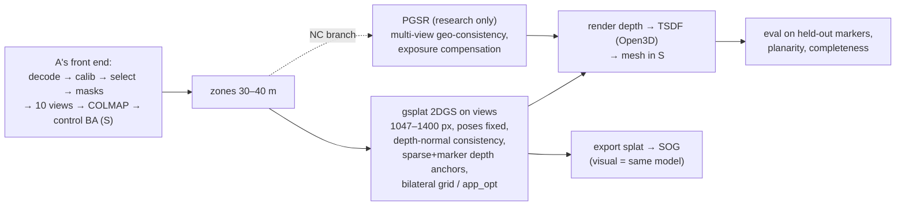
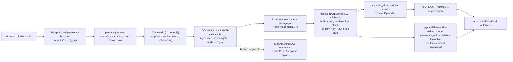
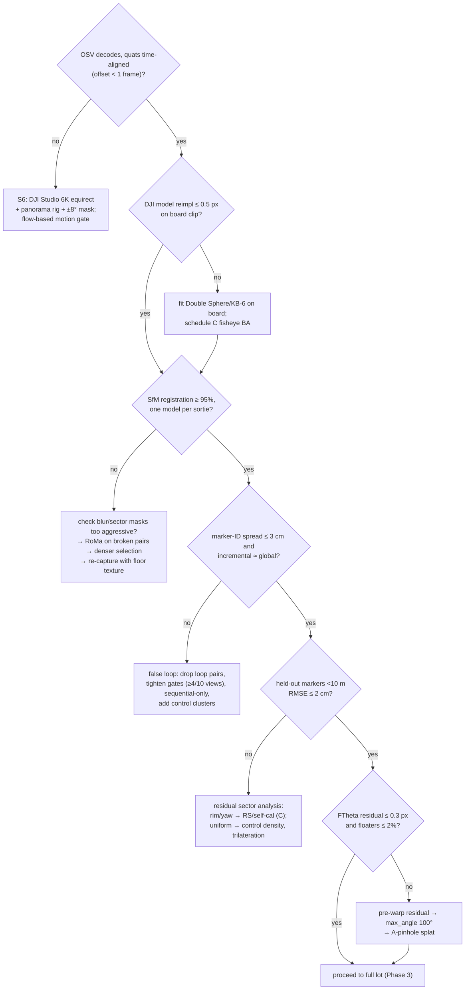

# From Avata 360 flight video to a metric 3D model of an underground car park

*A research report on camera, filtering, geometry, visualization and full-system design. Version 1, assembled 2026-11-17 from six research chapters (agents A1–A4).*

## Executive summary

**What the camera implies.** The DJI Avata 360 is not a "panorama camera" in the usual sense. In 360° mode its two fisheye lenses (2 × 1/1.1″ sensors, f = 2.5 mm, f/1.9, 200° each, fixed focus rated 1.5 m–∞) point **up and down**, so the stitch seam runs along the **horizon**. In a parking garage that is where walls, pillars, cars and wall-mounted signs sit (Ch. 1 key takeaways, §1.2). The `.OSV` file holds the **two unstitched 3840×3840 10-bit fisheye streams**, a **per-unit factory lens calibration** and **high-rate fused attitude quaternions**, so we can skip DJI's stitch entirely and work from the raw fisheyes with a gravity prior (§1.4). The costs are low angular resolution (~18 px/deg, about 3× coarser than a Mavic-class camera), heavy H.265 compression (~0.10 bit/pixel at 8K60), noise at the ISO 800–3200 a dim garage needs, 100 Hz flicker from 50 Hz mains, an unknown rolling-shutter readout and an unpublished inter-lens baseline (§1.5, §1.7). DJI's own manual says the drone's vision positioning can fail over repeating patterns and asphalt and fall back to ATTI (no position hold), which is a flight-safety issue as much as a data issue (§1.5.8).

**Recommended system (Option A, §6.5).** Decode the raw fisheyes and resample each into five pinhole "virtual views". COLMAP 4.2 cannot represent rays more than 90° off-axis in any perspective or fisheye model, and the horizon band of this lens lies at 90°–105° (§4.1). Reconstruct the ten views per frame as a **COLMAP rig with two optical centres**, which has no stitch seam by construction. Use sequential matching, conservative loop acceptance and gravity priors. Add AprilTag markers and laser/tape scale bars inside a final control bundle adjustment, holding out whole markers as checkpoints. Then build a dense mesh with OpenMVS. Convert the **same metric poses** into per-lens fisheye poses and train a **gsplat** Gaussian splat directly on the raw fisheyes (FTheta camera with the unscented transform, MCMC densification, PPISP exposure and vignetting compensation, mesh-depth loss), so the visualization lives in the same survey frame as the mesh (§5.8, §6.1). Before SfM, select frames per lens and per angular sector using the IMU angular rate, parallax spacing and sharpness, rather than dropping whole frames (§3.9).

**Expected outcome.** With a marker cluster every 10–15 m, plan on **1–2 cm RMSE on held-out marker distances under 10 m and 0.05–0.3% of distance globally**, which meets the ≤1% target with margin. Sub-centimetre results are a stretch goal: every published sub-cm anchor uses stills with dense control (§6.3). Expect splat quality of only ~21–24 dB PSNR on held-out blocks; the one published evaluation of splatting on real 200° indoor fisheye reports ~21–22 dB (§6.3, [Gunes2026]). Estimated effort: **~35–45 engineer-days** with Claude Code. Full-lot compute: **~2.5–4 GPU-days** on 16 GB, with **1–2 TB of NVMe** as the real bottleneck (§6.5.3).

**Top risks.**
1. **False loop closures** between identical pillars and bays fold the map while reprojection error stays low. Defences: temporal priors, marker-ID and rig-consensus gates, comparing incremental against global SfM, and held-out checkpoints (§4.2, §3.4).
2. **Unknown sensor timing and geometry.** The rolling-shutter readout, the inter-lens baseline and the accuracy of the factory calibration must all be measured. If they are poor, the errors are systematic and do not average out (§1.7, §6.3).
3. **Dim, flickering light and H.265 compression** remove concrete texture, so SfM registration and dense completeness on bare floors may fall short. Mitigations are capture discipline (1/100 s, slow flight, added light) and planar or depth priors outside the evaluated regions (§1.6, §4.4).
4. **Indoor flight safety**: possible ATTI drift and obstacle-sensing limits near pillars (§1.5.8).
5. **Licences**: OpenMVS is AGPL, and PGSR, the INRIA 3DGS code and MASt3R are non-commercial. Keep them out of anything shipped (§6.2).

The main **research opportunity** is direction-aware, per-sector frame selection with partial rig frames. Two further opportunities follow from the markers: a metric study of the seam band, and a garage "doppelganger" benchmark labelled for free by the marker IDs (Ch. 7).

## How to read this report

- **Ch. 2** is the learning chapter: read it first if photogrammetry or 3DGS is new. Ch. 1 and Chs. 3–5 each open with **key takeaways** and then follow the method-selection protocol: long list → screening → deep dives → weighted scores → primary, runner-up and experimental picks. **Ch. 6** turns these picks into buildable systems. **Ch. 7** collects the open questions.
- **Citations** are keys in square brackets (e.g. [Kerbl2023]) that resolve in the References section. Chapters also carry **evidence tags**: **[DJI-SPEC] / [DJI-FAQ] / [DJI-MANUAL]** mean the claim was checked on that official DJI page; **[OPENED]** means the cited page was fetched and read; **[SRC]** means verified in the source code (COLMAP 4.2.1, gsplat main, nerfstudio, 3dgrut); **[ABS]** means only the abstract was read; **[SNIPPET]** means taken from search-result text only (treat as unverified); **[CALC]** marks the authors' own calculation; **[UNVERIFIED]** marks a claim that could not be verified. *Assessment* labels mark opinion rather than reported results.
- **Terminology** (one name per concept): *virtual view* means a pinhole image resampled from a raw fisheye. *Rig frame* is the set of virtual views from one video frame. *Horizon band* or *rim band* is the part of each fisheye beyond ~80–90° off-axis. *Survey frame* `S` is the metric coordinate frame defined by the markers. *Checkpoint* means a held-out marker or distance that is never used in the adjustment.

## Editorial notes: cross-chapter consistency

These notes record where the chapters disagreed and how the disagreement was resolved.

1. **Accuracy expectation.** Ch. 4's takeaways plan for 1–2 cm locally and 0.05–0.2% globally, but its handoff table gave 0.5–1.5 cm and 0.03–0.2%. Ch. 6 re-read the anchors (§6.3): every sub-cm result is stills-based, and the only 360°-video anchor reports ~2 cm where lit [GomezLopez2025]. **This report adopts 1–2 cm local and 0.05–0.3% global as the plan, with 0.5–1 cm and 0.03% as stretch values.** Where the old figures appear in Ch. 4, read them as stretch values.
2. **EUCM and angles beyond 90°.** Ch. 1 says downstream models must handle θ > 90° "(EUCM/Double-Sphere/bearing vectors)", while Ch. 4 says COLMAP's EUCM cannot. Both are correct. The EUCM and Double Sphere *models* can represent rays beyond 90° [Khomenko2016][Usenko2018], but **COLMAP's implementation** rejects points without positive camera-frame depth. The orchestrator confirmed this in `src/colmap/sensor/models/eucm.h` (`ImgFromCam` calls `HasProjectableDepth(w)`). Hence the virtual-view rig in Ch. 4.
3. **What the splat trains on.** Ch. 4 says to reuse the pinhole virtual views for 3DGS. Ch. 5 recommends training gsplat on the raw fisheyes with the FTheta + unscented-transform path. Ch. 6 resolves this: the **raw fisheye is primary**, using poses converted from the rig (§6.1.2) and a stored FTheta refit residual (§6.1.3). The virtual-view splat ("A-pinhole") is the fallback, with explicit switch criteria (§6.8.2).
4. **Frame density.** Ch. 3 recommends 4–7 rig frames/m for SfM and 8–12/m for splatting. Ch. 6 uses **one 7/m set for all consumers in Phase 1** and treats the 12/m splat set as a Phase 2 ablation (§6.1.6).
5. **Licences.** Ch. 4 recommends PGSR as the textureless-surface variant, and Ch. 2 lists it as research-only. It therefore stays in a **research branch** (§6.2). Option B uses gsplat's own Apache-licensed 2DGS rasterizer, not the original 2DGS code.
6. **Chapter length.** The research chapters exceed their word targets, mainly because of their tables. They are kept nearly whole so that every claim stays next to its citation; duplicated background was left in place where it carries a chapter-specific citation.


# Chapter 1: The camera and drone

> **How to read the evidence in this file.** The first pass could reach only GitHub. In the second pass I opened the official DJI pages: the **Specs** page [DJISpecs], the **FAQ** [DJIFAQ] (both fetched from `dji.com/uk/...`; the US site returns 404 for this product) and the **User Manual v1.0 (2026.03)** PDF on `dl.djicdn.com` [DJIManual]. I also opened the ExifTool DJI tag page and the Gyroflow v1.7.0 notes on gyroflow.xyz. Still unreachable: DPReview (Cloudflare challenge), the review sites (Engadget, Digital Camera World, CineD, heliguy and others), and DJI's newer manual and release-notes host (`terra-1-g.djicdn.com`).
> - **[DJI-SPEC] / [DJI-FAQ] / [DJI-MANUAL]**: verified on the official DJI page or PDF I opened.
> - **[OPENED]**: other pages I fetched and read, mostly GitHub repositories, pull requests, issues and release notes from community reverse-engineering of the `.OSV` format, plus exiftool.org and gyroflow.xyz.
> - **[SNIPPET]**: taken only from web-search result text (reviews). Formally **[UNVERIFIED]**. After the second pass this tag remains only on review claims.
> - **[TRANSFER]**: measured on the **DJI Osmo 360**, which appears to share the camera architecture, and carried over to the Avata 360 by inference.
> - **[CALC]**: numbers I derive myself. Each shows its formula so it can be re-checked.

---

### Key takeaways

1. In 360° mode the two lenses point **up and down**, not front and back. So the stitch seam lies on the **horizon**, and that is exactly where walls, pillars, cars and wall-mounted markers appear in a parking lot [OPENED: OpenOSV PR #3][SNIPPET: reviews]. This one fact drives most of the recommendations below.
2. `.OSV` is an MP4 holding **two unstitched 3840×3840 10-bit HEVC fisheye streams**, plus protobuf metadata. The metadata carries a **per-unit factory lens calibration** (an f-θ / Kannala–Brandt-type model with 5 radial and 2 tangential terms, and per-lens extrinsic angles) and **~1–4 kHz fused attitude quaternions** [OPENED: dji-osv-converter docs, OpenOSV PR #3]. **Work from the dual-fisheye streams rather than DJI's stitched equirectangular output whenever possible.**
3. Native angular resolution is about **18 px/deg** (fx ≈ 1040–1047 px/rad) [OPENED/CALC]. A perspective view matched to that resolution, with a 90° field of view, is only about **2100×2100 px**, roughly 3× coarser per degree than a Mavic-class camera. At 2 m this gives about 1 mm/px, which is fine for cm-level work, but marker detection range is limited.
4. Seam parallax scales as ≈ b/d. The inter-lens baseline b is **not published**. For a plausible b of about 2–4 cm, the seam disparity is about 1–2° (20–40 px in 8K equirect) at 1 m and about 0.3–0.5° at 5 m [CALC, b UNVERIFIED]. Community measurement on Avata 360 footage shows **0.7° mean / 2.2° max parallax and 12–13 px doubling at 6K** [OPENED: PR #3].
5. Low light with 50 Hz mains means flicker at 100 Hz. Record at **25/50 fps with a 1/100 s shutter** (or 1/50 s at 25 fps), fly slowly, and expect ISO of about 800–3200 in a typical garage [CALC].
6. Indoor flight runs on vision positioning plus a downward 3D ToF sensor, with no GNSS. Omnidirectional obstacle sensing works **only in 360° mode** (the side and rear sensing uses the two fisheye cameras), needs **≥1 lux and visible texture**, and single-lens mode has forward sensing only [DJI-FAQ][DJI-MANUAL]. The manual explicitly lists **surfaces with repeating identical patterns**, monochrome, reflective and transparent surfaces as cases where the vision system fails. If vision and GNSS are both unavailable the drone drops to **ATTI mode** (no position hold) [DJI-MANUAL].
7. The lenses are **fixed focus, rated 1.5 m to ∞** (f = 2.5 mm, f/1.9) [DJI-SPEC]. Garage geometry often puts surfaces closer than 1.5 m. The defocus there is modest in video (≈1 binned pixel at 1 m, ≈2 px at 0.5 m [CALC, §1.5.9]), but it is one more reason to stay ≥1 m from walls and to keep markers ≥1.5 m from the lens.
8. Official ISO ceilings depend on mode: 360° video goes to **ISO 12 800 in D-Log M** in every mode, and to 25 600 in Normal colour except at 8K 48–60 fps. 360° photos stop at ISO 6400 [DJI-SPEC]. DJI says there is **no separate HDR video mode**; "HDR" in marketing refers to the sensor's dynamic range (up to 13.5 stops claimed) [DJI-FAQ].

---

### 1.1 Hardware and specifications

#### 1.1.1 Spec table

| Item | Value | Evidence |
|---|---|---|
| Announced | March 26, 2026 ("DJI's first 360° drone, as of March 2026") | [DJI-FAQ]; date [SNIPPET: DroneGirl, DroneLife, CineD]; shared context |
| Camera architecture | Two fisheye prime lenses on a **single-axis mechanical gimbal (tilt)**, mechanical range −95° to 173°. In 360° mode the gimbal stays stationary and only the "360° Virtual Gimbal" view moves (tilt and roll −180° to 180°). In single-lens mode the gimbal tilts (−30° to 60° with RC 2/RC-N2/RC-N3; −60° to 60° with goggles + motion controller). The gimbal rotates to 360° mode automatically on the first takeoff and rotates back to the locked position on landing. Lens-up/lens-down orientation in 360° mode is shown only in manual figures; it is confirmed from file metadata | [DJI-SPEC][DJI-MANUAL]; orientation [OPENED: PR #3] |
| Sensors | 2 × **1/1.1-inch square CMOS**, 64 MP effective per sensor. DJI: "optimized pixel arrangement" raises the vertical pixel count to 4000 (versus 3000 on a rectangular sensor), and each sensor's 360° imaging area equals a 1-inch 4:3 sensor. The Osmo 360 debug track names an OmniVision **OV68A40** [TRANSFER] | [DJI-SPEC][DJI-FAQ]; [OPENED: osv-format-notes] |
| Pixel pitch | DJI states **2.4 µm** pixels. 64 MP on a ~10 mm square implies ~1.2 µm native pitch, so 2.4 µm is the **2×2-binned** (quad-Bayer, 4000×4000 ≈ 16 MP) pitch used for video. Consistency check: f / pitch = 2.5 mm / 2.4 µm ≈ 1040 px/rad, which matches the factory fx ≈ 1038–1047 px of the 3840-px streams [CALC] | [DJI-FAQ]; [CALC] |
| Dynamic range | "Up to 13.5 stops" (DJI claim, not a lab measurement) | [DJI-FAQ] |
| Lens | FOV **200°**; focal length **2.5 mm** (7.8 mm equivalent); **f/1.9**; focus mode **FF (fixed focus)**; focus range **1.5 m to ∞**. No ND filters supported. Front elements are user-replaceable (replacement lens kit) | [DJI-SPEC][DJI-FAQ] |
| Per-lens video stream | 3840×3840, HEVC Main10, yuv420p10le, 59.94 fps tested | [OPENED: PR #3 (Avata 360); osv-format-notes (Osmo 360)] |
| Factory intrinsics (one unit, fw 01.00.06.00) | Up ("slave") lens fx 1046.98, cx/cy 1906.92/1911.23. Down ("master") lens fx 1038.19, cx/cy 1926.75/1923.78. Extrinsic Euler angles stored (pitch ≈ 90.1°). Firmware 01.00.06.00 slightly re-calibrated fx/cx | [OPENED: PR #3] |
| 360° video | 8K (2:1) 7680×3840 and 6K (2:1) 6000×3000, each at **60/50/48/30/25/24 fps** | [DJI-SPEC][DJI-FAQ] |
| Single-lens video | 4K 4:3 3840×2880 and 4K 16:9 3840×2160 @ 60/50/48/30/25/24 fps; 2.7K 4:3 2688×2016 and 2.7K 16:9 2688×1512 @ up to **120** fps. The 4:3 modes need Goggles 3/N3 with RC Motion 3 or FPV RC 3. **Video only** (no photos). FOV presets: "Natural Wide" only with RC 2/RC-N2/RC-N3; "Standard (Dewarp)/Wide/Natural Wide" with goggles. **No FOV in degrees is published.** One review gives "28 mm equivalent" [SNIPPET, UNVERIFIED] | [DJI-SPEC][DJI-MANUAL] |
| Bitrate / codec | Max **180 Mbps**; **OSV** for 360° video, **MP4 (HEVC/H.265)** for single-lens video; exFAT; 42 GB internal storage plus microSD (UHS-I U3 or faster required). Sidecar `.LRF` proxy and `.SRT` observed in files. Per-mode bitrates are not published | [DJI-SPEC][DJI-FAQ][DJI-MANUAL]; sidecars [OPENED: orbis-reframe #34, OpenOSV] |
| Colour | **Normal** and **D-Log M** only. No HLG listed. DJI: "an HDR mode [is] unnecessary"; the marketing term "8K/60fps HDR" refers to sensor dynamic range. 10-bit is observed in the files (Main10), but the spec page does not state bit depth | [DJI-SPEC][DJI-FAQ]; 10-bit [OPENED: PR #3] |
| Shutter | Video **1/8000–1/25 s**; photo **1/8000–1/30 s** | [DJI-SPEC] |
| ISO | 360° video: 8K@60/50/48: **100–12 800** (Normal and D-Log M); 8K@30/25/24 and 6K@all frame rates: **100–25 600 Normal, 100–12 800 D-Log M**. 360° photo: **100–6400**. Single-lens video: 100–12 800. *This resolves the first-pass conflict: both 12 800 and 25 600 were right, for different modes.* | [DJI-SPEC] |
| Exposure control | Pro (manual) mode exists for photo and video; the camera panel exposes EV, shutter and ISO | [DJI-FAQ][DJI-MANUAL] |
| Stills | 360° single shot: **30 MP** (JPEG 7776×3888; DNG 7680×3840) and **120 MP** (JPEG 15520×7760; DNG 15360×7680). JPEG/DNG. 120 MP uses multi-frame **SmartPhoto** by default (scene recognition/HDR), disabled when the aircraft or gimbal moves or in Pro mode. DJI Studio does not yet edit 360° RAW photos (third-party software required) | [DJI-SPEC][DJI-MANUAL][DJI-FAQ] |
| Weight / size | Takeoff weight approx. **455 g**; 246×199×55.5 mm; battery ≈149 g, ≥2700 mAh, 14.32 V, ≥38.67 Wh. EU class C1 | [DJI-SPEC] |
| Flight time | Max flight **≈23 min** (wind tunnel, 21.6 km/h forward); max hover **≈22 min**; reviewers report 18–20 min in practice [SNIPPET] | [DJI-SPEC] |
| Speeds | Horizontal: **Cine 6 m/s, Normal 12 m/s by default (adjustable to 16 m/s), Sport 18 m/s**. Ascent 2/6/10 m/s, descent 1.5/6/10 m/s (Cine/Normal/Sport). *This resolves the speed conflict: reviewers quoting 12 m/s and the 16 m/s spec line are both right.* Max pitch 48°. Obstacle avoidance and the vision system are **disabled in Sport mode**. No manual (M/acro) mode | [DJI-SPEC][DJI-MANUAL][DJI-FAQ] |
| Obstacle sensing | Omnidirectional vision system + **forward LiDAR** + **downward 3D infrared (ToF)**. Ranges: forward 0.5–20 m (FOV 90°×90°); backward, lateral and upward 0.5–18 m; downward 0.5–20 m (FOV 90°×90°). Lateral, rear (and by implication upward) sensing uses the **fisheye cameras**, so omnidirectional sensing exists **only in 360° mode**; single-lens mode has forward sensing only. Needs discernible texture and ≥1 lux. The LiDAR misses obstacles below 10% reflectivity and glass | [DJI-SPEC][DJI-FAQ][DJI-MANUAL] |
| Positioning | GNSS: GPS + Galileo + BeiDou. Hover accuracy: vision ±0.1 m vertical / ±0.3 m horizontal; GNSS ±0.5 / ±1.5 m. 3D ToF effective height 10 m, precise hover range 0.3–10 m, ToF FOV 60°×60°. Operating environment for vision: **diffuse surfaces with discernible patterns, diffuse reflectivity >20% (e.g. concrete), lux >1**. Without GNSS the downward vision system works best at 0.5–30 m height. Falls back to **ATTI** if vision and GNSS both fail | [DJI-SPEC][DJI-MANUAL] |
| Other light thresholds (manual) | FocusTrack and QuickShots: caution below 5 lux. APAS: extra caution below **300 lux** | [DJI-MANUAL] |
| Embedded motion data | Fused attitude quaternion per frame, plus a high-rate quaternion batch (≈4 kHz on the Avata 360 clip; ≈1 kHz / ~33 per frame on the Osmo 360), gravity vector, shutter time, gain, sensor temperature. Gyroflow 1.7.0 also reads per-frame ISO, shutter, WB and, on the Avata 360, aperture and focal length | [OPENED: PR #3; osv-format.md; Gyroflow v1.7.0 notes] |
| Flight log | Flight telemetry is saved to an internal recorder, read with **DJI Assistant 2 (Consumer Drones Series)** | [DJI-MANUAL] |

#### 1.1.2 Dual-lens geometry and baseline

DJI does not publish the separation between the two optical centres, and the metadata decoded so far holds only **rotations** between the lenses, with **no translation** [OPENED: PR #3, osv-format-notes]. Back-to-back 360 modules of this sensor class are usually a few centimetres thick. I therefore use **b ≈ 2–4 cm** as a working range [UNVERIFIED estimate]. **Measuring b is open unknown #1** (see §1.7). The second pass searched again: the official spec page, FAQ and user manual v1.0 give no baseline, minimum stitching distance or lens-to-lens dimension, and no review I could reach measured one. For reference only, Insta360 publishes minimum stitching "safety distances" of about 0.6 m (sides) and 0.8 m (bottom) for its handheld X-series cameras [SNIPPET: Insta360 online manual], which is a different (smaller, front/back) module. One indirect method: stitch with DJI Studio at several distances, or fit b as a free parameter in a two-camera rig calibration (COLMAP rig / Kalibr) against a target at known distance.

#### 1.1.3 Stills as an alternative?

The 120 MP 360° still has an equatorial sampling of 15520/360 ≈ **43 px/deg**, about twice the video's [CALC]. That would come from the unbinned 64 MP readout. DNG avoids H.265 artefacts altogether.

The drawbacks are throughput (one shot every few seconds, while hovering), a longest shutter of 1/30 s, a maximum photo ISO of **6400** [DJI-SPEC], and multi-frame processing: by default the 120 MP single shot uses **SmartPhoto**, which "needs to take multiple shots continuously" and merges them (scene recognition or HDR). SmartPhoto is skipped when the aircraft or gimbal moves, when the drone cannot hover stably, and in **Pro/manual mode** [DJI-MANUAL]. For measurement stills, shoot in Pro mode, so each still is closer to a single exposure (whether the 120 MP output is still a multi-frame/remosaic product in Pro mode is not documented). Note that the DNG sizes differ from the JPEG ones (15360×7680 vs 15520×7760) [DJI-SPEC], and DJI Studio cannot yet edit 360° RAW photos [DJI-FAQ]. **Verdict:** stills are not a replacement for video coverage. They are a **valuable supplement** at control stations: hover near each marker cluster and take 120 MP DNGs. Those images then anchor scale and give the highest-resolution observations of the markers. (Assessment.)

---

### 1.2 How a dual-fisheye 360 camera forms an image

#### 1.2.1 Fisheye projection models

A pinhole camera maps a ray at angle θ from the optical axis to radius r = f·tan θ. This diverges at 90°, so it cannot represent a 200° lens. Fisheye models replace tan θ with a function that stays finite:

| Model | r(θ) | Notes |
|---|---|---|
| Equidistant | f·θ | Constant angular sampling. COLMAP `SIMPLE_FISHEYE` / `FISHEYE` [OPENED: COLMAP fisheye.h] |
| Equisolid | 2f·sin(θ/2) | Equal-area; common in real lenses |
| Stereographic | 2f·tan(θ/2) | Conformal |
| Kannala–Brandt (KB) [Kannala2006] | f·(θ + k₁θ³ + k₂θ⁵ + k₃θ⁷ + k₄θ⁹) | A polynomial in θ that fits any of the above. OpenCV fisheye and COLMAP `OPENCV_FISHEYE` use 4 terms |
| Unified / MEI [Mei2007], EUCM [Khomenko2016], Double-Sphere [Usenko2018] | project onto a unit sphere, then a pinhole shifted by ξ (α, β) | Closed-form inverse. With ξ > 1 they cover >180° fields. COLMAP ships an `eucm` model family [OPENED: COLMAP models.h] |

**DJI's own model** has been reverse-engineered from DJI Studio by community projects [OPENED: osv-format-notes]. It is "f-θ" with five odd radial terms, θ_d = θ + k₁θ³ + … + k₅θ¹¹, followed by Brown tangential terms p₁, p₂, then u = fx·x″ + cx. In other words it is **KB-5 + tangential**. The same project reports that it fits DJI's reference to **2.1/3.9 px RMS** on the two lenses. A different tool fits the MEI model with ≤0.33 px residual, but drops the tangential terms [OPENED: orbis-reframe #34].

**Why a ~200° lens.** Each lens must see past its own 180° hemisphere so the two images overlap. The overlap band lets the stitcher (a) find correspondences to align the lenses, (b) blend exposure and colour differences, and (c) hide the drone body and the camera housing. DJI's Osmo 360 stitcher uses an overlap ratio of 0.038 × 360° ≈ 13.7°, giving an effective 193.7° per lens and a ~292 px blend band at 8K [OPENED: osv-format-notes, constants.md] [TRANSFER].

**Sanity check on the Avata 360 calibration** [CALC]: fx ≈ 1047 px/rad and an image 3840 px wide (radius ≈ 1920 px). Under the equidistant approximation, the image-circle edge lies at θ ≈ 1920/1047 ≈ 1.83 rad ≈ **105°**, matching a ~200–210° lens. The angular sampling is about 1047 px/rad = **18.3 px/deg** near the axis.

**Tooling caveat (assessment).** Many implementations (OpenCV `cv::fisheye`, and COLMAP models that go through the normalized plane u/w) parametrise rays through z > 0. Rays with θ ≥ 90° then cannot be represented. COLMAP's own equirectangular model notes that its normalized-plane inverse is valid only for Z > 0 [OPENED: COLMAP spherical.h]. On this drone the θ ∈ [90°, 100°] band of each lens is **the horizon**, so a model that clips it throws away the walls. Check that whatever model downstream agents choose works on bearing vectors (EUCM, Double-Sphere, spherical), not on tan θ.

#### 1.2.2 Stitching and seam parallax

The two lenses have **different optical centres**, separated by baseline b along the (vertical) optical axis. A stitcher pretends both share one centre, the midpoint. A scene point P at horizontal range d, lying on the horizon plane, is seen from the upper lens at depression angle atan((b/2)/d) and from the lower lens at elevation atan((b/2)/d). The **angular disagreement** at the seam is

  δ(d) ≈ 2·atan(b/(2d)) ≈ **b/d** (radians).

A stitcher tuned for a reference distance d₀ (stitch distance, or optical-flow "parallax-aware" seams) leaves a residual

  δ_res(d) ≈ b·|1/d − 1/d₀|.

The error grows as **1/d**, so it is negligible for a sky-and-landscape drone and serious at 1–5 m.

| Distance d | δ for b = 2 cm | δ for b = 4 cm | Pixels in 8K equirect (21.3 px/deg), b = 3 cm |
|---|---|---|---|
| 0.5 m | 2.3° | 4.6° | ~73 px |
| 1 m | 1.15° | 2.3° | ~37 px |
| 2 m | 0.57° | 1.15° | ~18 px |
| 5 m | 0.23° | 0.46° | ~7 px |
| 10 m | 0.11° | 0.23° | ~4 px |

[CALC; b UNVERIFIED]

**Reported measurement** [OPENED: PR #3, community test on an outdoor Avata 360 clip, 6K export, scene distances unknown]: the seam runs along the horizon. Overlap NCC was 0.70–0.71, mean parallax 0.71–0.73° (max 2.2°), and residual doubling 12–13 px (~0.75°). This is consistent with b/d ≈ 0.013, for example b ≈ 3 cm at d ≈ 2.4 m.

**Consequence for metric reconstruction (assessment).** Stitched equirectangular frames are **not a central projection** near the seam. A point at 1–2 m can be displaced by tens of pixels, and the displacement depends on depth and on the optical-flow seam the stitcher chose for that clip. That is a systematic, scene-dependent error which bundle adjustment cannot model. Two remedies:
1. Treat the two fisheyes as a **2-camera rigid rig** with separate intrinsics and a calibrated relative pose (rotation from the factory metadata, translation measured). This removes the error by construction.
2. If equirect must be used, **mask a band of ±~8–10° around the horizon** in feature extraction. This costs exactly the wall content.

#### 1.2.3 Equirectangular projection

Longitude λ ∈ [−π, π) and latitude φ ∈ [−π/2, π/2] map linearly to pixels [OPENED: COLMAP spherical.h]:

  x = (λ/2π + 0.5)·W, y = (0.5 − φ/π)·H, with W = 2H.

Vertical sampling is uniform at H/π px/rad. Horizontal sampling at latitude φ is W/(2π·cos φ) px per radian of *true arc*: rows near the poles are hugely **oversampled**. The pixel solid angle is ∝ cos φ.

- 8K: 7680/360 = **21.3 px/deg** at the equator. At φ = 60° a row is oversampled ×2, and at φ = 80° ×5.8.
- The band |φ| > 60° takes up **1/3 of the image rows** but only **13.4% of the sphere** (1 − sin 60°) [CALC].
- On this drone the poles are the **ceiling and floor**. Those surfaces are textureless and they get the highest-resolution *native* sampling, because they sit at each fisheye's centre. Walls sit at the fisheye **rim**, where lens MTF, chromatic aberration and vignetting are worst (shading falls to 0.76 at the rim on the Osmo 360 [OPENED: osv-format.md] [TRANSFER]).
- Native 18.3 px/deg versus 8K equirect 21.3 px/deg means the 8K equirect slightly **upsamples** the sensor at the equator. 6K equirect (16.7 px/deg) roughly matches native resolution [CALC].

#### 1.2.4 Reframing, the "virtual gimbal", and horizon levelling

In 360° mode the mechanical gimbal "remains stationary" and only the camera view is adjusted, through the **360° Virtual Gimbal** (tilt and roll −180° to 180°, up to 100°/s) [DJI-MANUAL][DJI-SPEC]. Stabilization and horizon handling in this mode are therefore entirely digital. DJI Fly offers two gimbal modes in 360° mode: **Follow** (view kept level relative to the horizontal plane) and **FPV** (view rolls with the aircraft) [DJI-MANUAL]. Community re-implementations of DJI's RockSteady and HorizonSteady equivalents for OSV apply **one rotation R per frame to the stitched sphere** [OPENED: levelling.md]:

  R(f) = bridge · raw(f)ᵀ · smooth(f) · bridgeᵀ · K.

Here raw(f) is the per-frame fused IMU quaternion, smooth(f) is a Gaussian-smoothed version (σ = 15 frames), and "horizon" mode rebuilds the basis from the gravity "up". DJI's actual pipeline is closed. Its behaviour matches these re-implementations to ≤0.24° in level and to comparable jitter [OPENED: levelling.md] [TRANSFER from Osmo 360].

**Is it a pure rotation?** For a perfect central spherical camera, yes, and then it is harmless to SfM: each frame simply gets a different orientation. It is *not* harmless in three ways (assessment):
1. **Resampling** blurs and aliases, which costs another ~10–20% of effective resolution.
2. The stitch is non-central (§1.2.2), so rotating it does not undo the depth-dependent seam error. Levelling moves the seam *to* the horizon on this drone, because the lens axis is vertical.
3. Any **rolling-shutter correction** (per-row warping) is non-rigid. The community converter ships RS correction disabled, because it measured worse than no correction on the Osmo 360 [OPENED: levelling.md].

Reframed 16:9 "flat" exports are a further crop plus rotation, and sometimes a non-perspective "dewarp" (Engadget notes edge softness) [SNIPPET]. **Do not use reframed exports for photogrammetry.**

#### 1.2.5 Which stabilization?

The official spec names the EIS modes only for **single-lens mode**: RockSteady 3.0 (all controllers) and a switch between RockSteady 3.0 and **HorizonBalancing** (goggles with RC Motion 3 or FPV RC 3) [DJI-SPEC]. Single-lens footage is therefore an electronically stabilized, possibly dewarped crop, a poor measurement source. For 360° mode DJI names no EIS mode. Levelling and smoothing are a property of the virtual gimbal view and the 360° editors. In the OSV workflow, stabilization is a **post-processing choice in DJI Studio** (or in third-party tools), applied to stitched output. It is not baked into the dual-fisheye streams: the raw streams are recorded in the sensor frame, and attitude is stored separately [OPENED: OpenOSV, osv-format.md]. Which gimbal mode (Follow or FPV) is chosen should not affect the recorded dual-fisheye streams, only the default view and the attitude flags in the metadata, but this is untested [UNVERIFIED]. **Recommendation:** for photogrammetry, export **unstabilized**, or better, decode the raw fisheyes. Use the stored attitude quaternions as **rotation/gravity priors** instead of baking them into pixels.

---

### 1.3 How it differs from regular drone footage

| Quantity | Avata 360, 360° mode | Mavic-class 4K perspective camera (≈72° HFOV) |
|---|---|---|
| Coverage | Full sphere (minus any body occlusion) | ~1.1 sr (≈9% of sphere) [CALC: Ω = 4·asin(sin36°·sin27°)] |
| Angular resolution | ~18 px/deg native; 21.3 px/deg 8K equirect | ~46 px/deg at 3840 px wide; ~63 px/deg for 5280-px stills [CALC; Mavic HFOV UNVERIFIED] |
| 90° perspective crop, matched to native | W = 2·(180/π)·18.3 ≈ **2100 px** square (~4.4 MP). Cropping at 8K-equirect resolution gives ~2440 px, but that is upsampled | n/a |
| Bitrate per steradian | 180 Mbps / 4π ≈ **14 Mbps/sr** | ~150 Mbps / 1.08 ≈ **140 Mbps/sr** |
| Bits per pixel per frame (60 fps) | 180e6 / (2·3840²·60) ≈ **0.10 bpp** | 150e6 / (3840·2160·60) ≈ 0.30 bpp |
| Optical model | Two non-central fisheyes, or a non-central stitched sphere | Near-ideal pinhole + Brown distortion, mechanically stabilized |
| Rolling shutter | Two sensors, readout unknown, and readout direction relative to the scene differs per lens | One sensor, gimbal-stabilized |

[CALC]

**Why 360° helps SfM.** Every frame sees in every direction, so rotations are well constrained (no "looking at a blank wall" degeneracy). Any feature-rich direction can carry tracking when the others are textureless. Fast yaw does not leave the field of view. Loop closures can happen from any heading. Translation-vs-rotation ambiguity is reduced, because bearing vectors span the whole sphere (the classic argument for spherical/omnidirectional SfM; see IM360, RIGOR in the shared context).

**Why it hurts.**
- About 3× fewer pixels per degree, so each feature is localized ~3× worse in angle. One pixel subtends 1/18.3° ≈ 0.95 mrad, i.e. ≈ **1.9 mm at 2 m** [CALC]. That is still well under the cm target, but marker detection range shrinks (see §1.6).
- The model is non-pinhole and non-central (seams).
- Compression is ~10× tighter per steradian.
- Two rolling shutters, both fixed to an FPV airframe.
- The seam sits on the most useful band of the scene.

---

### 1.4 Files and data access

#### 1.4.1 What is inside `.OSV`

An `.OSV` is a plain ISO-BMFF/MP4 [OPENED: OpenOSV, osv-format.md, osv-format-notes]:
- **Two HEVC Main10 video tracks, one per fisheye lens, unstitched**, each 3840×3840 10-bit. Stitching happens in software.
- AAC audio, an MJPEG thumbnail, sensor debug tracks (`dbgi`) and two or more **`CAM meta` protobuf tracks**.
- A sidecar `.LRF` low-resolution proxy and an `.SRT` file are written alongside [OPENED: orbis-reframe #34].
- Track numbering changes between firmware versions, so identify streams by content [OPENED: osv-format.md].

**Unstitched fisheye is therefore available directly**, e.g. `ffmpeg -i X.OSV -map 0:v:0 …` (assessment; the exact mapping differs by firmware). Third-party extractors: OpenOSV (Apache-2.0), dji-osv-converter (no licence file found), osv2mov, osv2mkv, osvcut, osmo360-reframe (Osmo 360-focused; Avata 360 support in OpenOSV is "opens, untested on Avata" [OPENED: OpenOSV]).

**Export options:** DJI names **DJI Fly** (mobile) and **DJI Studio** (desktop) as the editors for Avata 360 footage, and states that panoramic videos "must be edited before you can share them as regular videos" [DJI-FAQ][DJI-MANUAL]. DJI Studio stitches and exports equirect MP4 (a 6000×3000 export was used as reference in PR #3), with three "stitching optimisation" options per one review [SNIPPET]. LightCut is not mentioned in DJI's Avata 360 pages; its support is [UNVERIFIED]. The official pages say nothing about exporting unstitched fisheye or about stitch-distance settings. Normal NLEs do not read OSV natively [SNIPPET: heliguy]. Files can be copied over USB with the aircraft powered off, by card reader, or by QuickTransfer to a phone [DJI-MANUAL][DJI-FAQ].

#### 1.4.2 Metadata

Avata 360 (fw 01.00.06.00, one clip) [OPENED: PR #3]:
- **Clip header**: product name and schema, per-lens calibration in "slots 3/4" (`native_refine_far`), IMU rate field.
- **Per-frame**: one attitude quaternion per frame (field `3.4.14.4` on that clip).
- **High-rate**: fused attitude batch `3.3.2.1.3` at **≈4 kHz** (42 331 samples over 10.6 s).
- A possible **drone-frame quaternion**, separate from the camera's (unverified lead).
- Field numbering **differs from the Osmo 360** (e.g. the attitude sits in fields 22/23 vs 9/10), and differed between clips in that thread. Parsers are still immature.

Osmo 360 (closely related) [OPENED: osv-format.md] [TRANSFER]:
- Per-frame quaternion (world-up = +Z) that matches DJI's levelling to 0.24°.
- Accelerometer "gravity" vector that can disagree with the quaternion by **up to 52°** during manoeuvres, so do not use it raw for gravity.
- Per-frame shutter time (µs), gain, WB gains, sensor temperature, and a per-unit **camera-to-IMU mount rotation**.

**Parsers:**
- **ExifTool**: re-checked on exiftool.org (current version 13.64, 16 Nov 2026). The "DJI Protobuf Tags" table has an Osmo 360 protocol (`dvtm_oq101`: serial number, model, FNumber, frame number, timestamp, ISO, shutter speed, colour temperature, accelerometer X/Y/Z, GPS; **no quaternion**) and an Avata 2 protocol, but **no Avata 360 protocol** [OPENED: ExifTool DJI tag names page; also DJI.pm source in the first pass]. Unknown djmd tags can be dumped with the `Unknown` option (1, or 2 to include dbgi debug tags), which is a cheap first look at Avata 360 files.
- **Gyroflow v1.7.0** (re-checked on gyroflow.xyz/download): lists "DJI Osmo 360 … and DJI Avata 360" under **"Motion data only"**: Gyroflow cannot play these files, so you open a playable copy as the video and load the original under *Motion data → Open file*. The same notes say Gyroflow now reads per-frame ISO, shutter speed and white balance from DJI files, "plus the aperture and focal length on the Avata 360" [OPENED: Gyroflow v1.7.0 notes on gyroflow.xyz and GitHub releases]. The Gyroflow README's DJI list (Avata, Avata 2, O3/O4 Air Unit, Action, Neo) does not yet include the 360 models [OPENED: Gyroflow README]. Gyroflow's dual-fisheye support for the Osmo 360 is an open enhancement for 2.0 [OPENED: gyroflow #1164].
- **telemetry-parser** README does not yet list them [OPENED].
- DJI flight logs (`.txt`/`.DAT`) are on telemetry-parser's TODO list [OPENED]. The manual says flight telemetry and aircraft status are saved to an internal recorder and read with **DJI Assistant 2 (Consumer Drones Series)** [DJI-MANUAL]. Whether it contains VIO velocity or position indoors is [UNVERIFIED].

**Why it matters:** the quaternions give per-frame **gravity direction** (good to ~0.1–0.3°) and relative rotation priors. That supports gravity-aligned SfM (RIGOR-style projection; pitch/roll priors), lets you reject folded maps whose implied gravity is inconsistent, and supports rolling-shutter modelling. Positions are **not** in the camera metadata indoors (no GNSS).

#### 1.4.3 Published calibration

DJI publishes no lens profile, but every file carries a **per-unit factory calibration** that can be read (§1.1.1). Firmware updates have changed it slightly (fx 1046.81 → 1046.98) [OPENED: PR #3]. Two caveats: lens protectors/ND filters change it (OpenOSV has separate "Lens Protectors / ND" profiles [OPENED]), and **no translation between lenses** is stored.

---

### 1.5 Characteristics that limit *this* task

#### 1.5.1 Rolling shutter
**Mechanism.** Each sensor reads rows sequentially. No readout time has been published or measured for the Avata 360 or Osmo 360 [UNVERIFIED]. The **upper bound** is the frame period: <16.7 ms at 60 fps [CALC]. For comparison, the first pass quoted "10.9 ms for a competing 8K 360 camera" from a CineD snippet. A second search shows that snippet is about the **Insta360 Luna Ultra**, where CineD reports **25.3 ms in 8K mode** and 10.9 ms only in a 4K25 tele mode [SNIPPET: CineD lab test; page not reachable]. So no sensor-class figure exists, and a long (>15 ms) full-frame readout at 8K is plausible. Neither DJI nor any reachable review publishes a readout for the Avata 360 or the Osmo 360. With lenses facing up and down, rows sweep across *horizontal* directions differently for the two lenses, and yaw produces a shear/twist around the vertical axis. The Osmo 360 metadata stores ~33 high-rate quaternions **spanning the readout**, which is exactly what RS correction needs [OPENED: osv-format-notes].
**Effect.** At 60°/s yaw and ~10 ms readout, skew ≈ 0.6° ≈ 11 px; at ~16 ms (frame-period bound at 60 fps) it is ≈1° ≈ 18 px [CALC]. This produces geometric inconsistency between frames and biased poses.
**Mitigation.** Capture: slow, smooth yaw (≤15–20°/s), no FPV flips. Processing: drop frames with high angular rate (use the IMU); model RS with the high-rate quaternions as a later step; measure readout (§1.7).

#### 1.5.2 Motion blur
**Mechanism.** Blur ≈ (ω + v/d)·t_exp, in angle. At 18 px/deg, 1/100 s and ω = 30°/s → 0.3° ≈ **5.5 px**. Translation at 1 m/s and d = 2 m → 0.29° ≈ 5 px [CALC].
**Effect.** Features are lost, corners are biased, and marker detection fails.
**Mitigation.** Keep total ≤1–2 px: v ≈ 0.3 m/s at 2 m, ω ≤ 5–10°/s, at 1/100 s. Select frames by sharpness (Laplacian variance) and IMU angular rate. Add light.

#### 1.5.3 Noise and compression
**Mechanism.** In a garage at about 50–150 lux (EV100 ≈ 4.3–5.9), f/1.9 and 1/100 s (EV ≈ 8.5 at ISO 100) need **ISO ≈ 800–2000** [CALC: ISO ≈ 100·2^(8.5−EV)]. Then H.265 at 0.10 bpp smooths away fine texture first, and fine texture is exactly what concrete offers.
The ISO ceiling is **12 800 in D-Log M** in every 360° mode, and 25 600 in Normal colour (except 8K at 48–60 fps) [DJI-SPEC], so the camera will not run out of gain in a garage; noise, not the ISO limit, is the constraint. DJI claims 2.4 µm (binned) pixels and up to 13.5 stops of dynamic range [DJI-FAQ]; there is no independent measurement I could open.
**Effect.** Fewer and less repeatable keypoints on floors and walls. Block artefacts create false matches. The photometric loss in 3DGS fits compression noise.
**Mitigation.** Prefer **30/25 fps over 60/50 fps** if the bitrate cap stays at 180 Mbps (≈ doubles bpp; verify that DJI does not lower the bitrate at lower frame rates [UNVERIFIED]). Use **6K rather than 8K** if the 6K bitrate is equal, because 6K is near native sampling. Use D-Log M 10-bit (less quantization in shadows) with a **fixed** exposure; if ISO above 12 800 were ever needed, only Normal colour allows it. Add light. Use 120 MP DNG stills at stations.

#### 1.5.4 Stitch-seam parallax at close range
**Mechanism.** See §1.2.2: δ ≈ b/d, with the seam **on the horizon**.
**Effect.** At 1–5 m, 7–40 px of depth-dependent misregistration along the band that holds pillars, walls and wall markers. This causes distorted or doubled geometry and biased scale if markers sit on the seam.
**Mitigation.** Process the **two raw fisheyes as a rig** and do not use stitched output. If equirect must be used, mask the seam band. Place markers **on the floor and ceiling or well above/below the horizon band** as seen from flight height. Fly at mid-height so walls are seen obliquely by each lens. Treat any measurement that crosses the seam as suspect.

#### 1.5.5 Exposure, white balance, HDR and flicker
**Mechanism.** Auto exposure and WB drift between garage zones. For video DJI says there is **no HDR mode** (the sensor's range is used directly) [DJI-FAQ], so multi-exposure video merging is not a concern; the 120 MP SmartPhoto still mode does merge frames [DJI-MANUAL]. 50 Hz mains (Israel) → **100 Hz** flicker from fluorescent and cheap LED lights. A shutter that is not a multiple of 10 ms produces banding (rolling shutter × flicker) and frame-to-frame brightness pulsing.
**Effect.** Matching across exposure changes gets harder. Banding creates fake "texture" that moves. 3DGS gets floaters and inconsistent colour.
**Mitigation.** Use **manual exposure**: shutter **1/100 s** (or 1/50 s at 25 fps), fixed ISO, **locked WB**. Record at **25 or 50 fps** (PAL family). At 60 fps 1/60 s is the longest shutter possible, and that is not flicker-safe. (No HDR video switch exists; for stills use Pro mode, which disables SmartPhoto/HDR [DJI-MANUAL].) Neither the manual nor the spec mentions an anti-flicker setting. Downstream: per-image exposure/appearance compensation in 3DGS.

#### 1.5.6 Stabilization and reframing
**Mechanism.** §1.2.4. A per-frame rotation is harmless in principle, but resampling, the non-central seam and any RS warp are not.
**Mitigation.** Disable stabilization in export (or use the raw fisheyes). Never use reframed or "flat" outputs. Use the IMU quaternions as **priors**, not as pixel warps.

#### 1.5.7 Nadir/zenith and the "invisible drone"
**Mechanism.** The airframe (props, guards, arms) lies roughly in the **horizontal plane** around the up/down camera module. It therefore falls in or near the overlap band, and the stitcher hides it by choosing pixels from the lens that sees past it [SNIPPET: reviewers note the challenge of concealing the aircraft between the lenses; extreme attitudes expose the seam]. The manual confirms the mechanism: "parts of the aircraft" may appear in the live view but "will not appear in the final footage" [DJI-MANUAL], i.e. they are removed in stitching. The exact occluded sector in the raw fisheyes is **unknown** [UNVERIFIED]; no measurement is published.
**Effect.** In raw fisheyes, parts of the airframe are visible near the rim of each lens. Those static-in-image pixels will produce **fake static features** that corrupt SfM. In stitched output the region is synthesized, i.e. not real measurement.
**Mitigation.** Build a **fixed per-lens mask** from a static recording (§1.7) and apply it to all frames. Exclude the blend band.

#### 1.5.8 Indoor flight: positioning and safety
**Mechanism.** No GNSS, so hover relies on the downward vision and ToF sensors. Vision needs light (lux >1) and diffuse surfaces with discernible patterns and >20% reflectivity, e.g. concrete [DJI-SPEC]. The downward vision system works best at 0.5–30 m height without GNSS [DJI-MANUAL]. Obstacle sensing is vision-based, ≥1 lux, needs texture, and works only in 360° mode, because side and rear sensing uses the fisheye cameras [DJI-FAQ]. The manual lists where the vision system "cannot work properly": monochrome surfaces, highly reflective, water or transparent surfaces, moving objects, frequent and drastic lighting changes, <1 lux, surfaces that strongly reflect or absorb infrared (mirrors, **asphalt**), textureless surfaces, **repeating identical patterns**, and thin obstacles. The forward LiDAR misses obstacles below 10% reflectivity and glass [DJI-MANUAL]. Almost every item on that list occurs in an underground car park. With vision and GNSS both unavailable the aircraft enters **ATTI mode**: no automatic hover or braking, and the manual tells the pilot to land as soon as possible, especially in confined spaces [DJI-MANUAL]. APAS (assisted bypass) calls for extra caution below **300 lux** [DJI-MANUAL]. Vision positioning and obstacle avoidance are off in Sport mode [DJI-MANUAL].
**Effect.** Drift, toilet-bowling, or unexpected braking or bypass near pillars. Risk to people and cars. Some lots have low clearance (~2.1–2.5 m) [UNVERIFIED typical value].
**Mitigation.** Fly with permission, outside opening hours, in **Cine mode** (6 m/s max; keeps vision positioning and obstacle sensing on) and **360° mode** (the only mode with omnidirectional sensing), never Sport, with a spotter. Before flight, check whether DJI Fly reports vision positioning available; if it shows ATTI, do not fly there. Add texture under the flight path (taped markers or mats) and lighting. Keep 0.5–1 m from surfaces. Do short battery-limited sorties (~15 min usable). Practise in a bright section first. The prop-guard (cinewhoop) design reduces contact risk but does not remove it.

#### 1.5.9 Fixed focus and close range
**Mechanism.** Both lenses are fixed focus, rated **1.5 m to ∞**, with f = 2.5 mm and f/1.9 [DJI-SPEC]. If the lens is set near its hyperfocal distance H with a near limit of H/2 = 1.5 m, then H ≈ 3 m, and the implied circle of confusion is c = f²/(N·H) = 6.25/(1.9·3000) ≈ 1.1 µm, about one *native* 64 MP pixel [CALC; the focus setting is inferred, not published]. The blur-spot diameter at distance d is then b ≈ (f²/N)·(1/d − 1/H) ≈ 3.3 mm²·(1/d − 1/3 m):
- d = 1.5 m: ≈1.1 µm (≈0.5 binned 2.4 µm pixel);
- d = 1 m: ≈2.2 µm (≈0.9 binned px);
- d = 0.5 m: ≈5.5 µm (≈2.3 binned px) [CALC].
**Effect.** In 3840-px video, defocus is negligible beyond ~1 m and mild below it. It adds to seam parallax (§1.2.2) and motion blur (§1.5.2), which are all worst at the same short range. Stills at 120 MP (native pitch) are affected about twice as much in pixels.
**Mitigation.** Keep ≥1 m from surfaces in general and ≥1.5 m from markers used for scale. Prefer marker detections from frames where the marker is 1.5–5 m away.

#### 1.5.10 Summary table: Limitations → effect → mitigation

| Limitation | Mechanism | Effect on reconstruction | Capture-side mitigation | Processing-side mitigation |
|---|---|---|---|---|
| Seam on horizon | Non-coincident centres, δ ≈ b/d; lenses up/down | 7–40 px depth-dependent errors on walls and pillars at 1–5 m; doubled features | Markers off the horizon band (floor/ceiling); mid-height flight | Use raw dual fisheye as a 2-cam rig; else mask ±8–10° seam band |
| Low angular resolution | ~18 px/deg native | ~3× worse angular precision than a Mavic; small markers unreadable beyond a few m | Larger markers; fly closer to markers; 120 MP stills at stations | 6K-equivalent processing; sub-pixel marker refinement in raw fisheye |
| Compression | 0.10 bpp at 8K60 | Fine texture lost; block artefacts | 25/30 fps; D-Log M; more light | Frame selection; don't over-trust low-texture regions |
| Noise | ISO 800–3200 in dim light | Fewer, noisier keypoints | Add light (LED panels on tripods); fixed ISO | Learned matchers robust to noise; denoise before features (with care) |
| Motion blur | t_exp × (ω + v/d) | Lost tracks, biased corners | ≤0.3–0.5 m/s, ≤10°/s yaw, 1/100 s | Sharpness + IMU-rate frame selection |
| Rolling shutter | Unknown readout (<16.7 ms at 60 fps), 2 sensors | Pose bias and inconsistency during yaw | Smooth, slow yaw; no flips | Drop high-ω frames; RS model with high-rate quaternions |
| Flicker | 100 Hz light vs shutter | Banding; brightness pulsing | 1/100 s or 1/50 s; 25/50 fps | Per-frame exposure compensation |
| Auto exposure/WB/HDR | Camera adapts | Photometric inconsistency | Manual exposure, locked WB, HDR off | Appearance embeddings in 3DGS |
| Stabilization/reframe | Per-frame resample; possible RS warp | Blur; non-rigid errors | — | Don't use stabilized/reframed exports; use IMU as priors |
| Fixed focus (1.5 m–∞) | f = 2.5 mm, f/1.9, FF | ~1–2 px defocus at 0.5–1 m; worse in 120 MP stills | Stay ≥1 m from surfaces, ≥1.5 m from scale markers | Weight or reject close-range marker detections |
| Airframe in view | Body near the horizon band | Static fake features | Record a static mask clip | Per-lens fixed mask |
| No GNSS / VIO limits | Vision+ToF positioning, ≥1 lux, >20% reflectivity, fails on repetitive/reflective/IR-absorbing (asphalt) surfaces; ATTI fallback | Drift, unsafe flight; no metric prior | Lighting, texture, Cine mode, 360° mode, spotter | Scale from markers only; gravity from IMU |
| Repetition | Identical bays and pillars | False loops, folded map | Unique markers (ArUco/AprilTag IDs) in every bay; continuous trajectory | Sequential matching + verified loops; marker-ID constraints |
| Reflective surfaces / moving objects | Specular cars, wet floor, people | Wrong matches, floaters | Empty lot; dry floor | Masks (segmentation) for cars/people |

---

### 1.6 Capture protocol (underground lot)

**Pre-flight (one time per device)**
1. Update firmware and record the version (calibration changes with firmware). Remove lens protectors or record which ones are fitted. The front elements are user-replaceable [DJI-FAQ]; re-calibrate after any replacement.
2. **Calibration clip**: DJI states that photo and video capture are **not supported before takeoff** [DJI-MANUAL] and that handheld shooting is not supported [DJI-FAQ]. So the first-pass idea of a motors-off, hand-held calibration clip does not work. Instead, **hover** (Cine mode, in a bright, textured, safe space) in front of large wall- or stand-mounted AprilGrid/ChArUco boards at ~1, 1.5, 2 and 4 m, and yaw/translate slowly so the boards pass through both lenses and **through the seam**. Use it to check the factory intrinsics, estimate the **inter-lens translation b**, and build the airframe mask. (Whether a recording started in flight continues after landing is untested; any bench trick that records with motors off is [UNVERIFIED].)
3. **Readout clip**: film a 100 Hz flickering light or a fast-panning vertical edge to estimate rolling-shutter readout (§1.7).

**Camera settings (measurement pass)**
- 360° mode (single-lens mode loses omnidirectional sensing and coverage, and its footage is EIS-processed [DJI-SPEC]).
- **6K or 8K at 25 fps** (both offered at 24/25/30/48/50/60 fps [DJI-SPEC]; 50 fps if blur demands it), **Pro mode**: **1/100 s**, ISO fixed as low as the light allows (target ≤1600; the D-Log M ceiling is 12 800 [DJI-SPEC]), WB locked (e.g. 4000–5000 K to match the lamps), **D-Log M** (10-bit in files), no digital effects. There is no HDR video switch to turn off [DJI-FAQ]. Verify which combination gives the highest bitrate (DJI publishes only the 180 Mbps maximum).
- Record the `.OSV` (+ `.LRF`, `.SRT`). Never rely on reframed recordings.

**Lighting**
Add 2–4 portable LED panels (flicker-free, high CRI), static during each pass, so the lighting stays consistent. Better a constant, even field than bright spots.

**Markers (as seen by a 360 camera)**
- Angular size: a marker needs about ≥40–60 px across in the fisheye to decode robustly [assessment]. At 18 px/deg that means ≥2.5–3.5° subtended. So **A3 (~30 cm) markers are readable to about 5–6 m; Ch. 6 (~20 cm) to about 3–4 m** [CALC: size/(d·tan(θ))].
- Keep scale markers **≥1.5 m** from the lens when they are observed (the rated near focus limit, §1.5.9).
- Placement: mostly on the **floor** (seen at the down-lens centre, best resolution and away from the seam; at 1.2–1.5 m flight height, the floor right below is just inside the focus limit, so prefer detections from 1.5–5 m slant range) and on **pillars at heights well away from flight height** (e.g. flight at 1.5 m, markers at 0.3 m and 2.3 m). Avoid the horizon band.
- Use unique IDs in every bay to break repetition. Measure held-out marker-to-marker distances with tape or laser (see project accuracy target). Add ≥3 distances >20 m for the ≤1% global check.

**Flight**
- Mode: **Cine** (vision positioning and obstacle sensing stay on; never Sport, where they are disabled [DJI-MANUAL]). Speed **0.3–0.5 m/s**, yaw ≤10°/s, no rolls or flips. Keep nearly constant attitude; let the 360 camera do the "looking around".
- Height: ~1.2–1.8 m (between car roofs and the ceiling services) so floor and ceiling both lie within ~1–2 m of a lens centre. Keep ≥0.75 m from pillars and walls (seam parallax and safety).
- Path: lawnmower lanes down each driving aisle, plus **closed loops** around each block of bays. Revisit a start "anchor" area every 1–2 minutes for drift and loop control. Overlap is not a concern for 360 video at 25 fps; spacing between kept frames of 0.15–0.3 m is ample (assessment).
- Battery sorties of ≤15 min, each beginning and ending at a shared, marker-rich anchor area so separate flights can be merged.

**Supplement**
At each marker cluster or junction, **hover 3–5 s and take 120 MP DNG stills in Pro mode** (Pro mode disables the multi-frame SmartPhoto merge [DJI-MANUAL]; DNG is 15360×7680 [DJI-SPEC]) (or capture them with a handheld Osmo 360 / tripod if allowed). These give the highest-resolution marker observations and a rigid, blur-free "backbone".

---

### 1.7 Open unknowns: measure on the actual device

1. **Inter-lens baseline b** (translation between optical centres). Not in the DJI spec, FAQ or manual, and not in any reachable review (second pass). Method: calibrate as a 2-camera rig with a board passing through the overlap band.
2. **Rolling-shutter readout time** per mode (8K60, 6K25…), and the row direction for each lens. Not published by DJI; no lab test (CineD/DPReview-style) found for the Avata 360 or Osmo 360 in the second pass. Method: 100 Hz flicker banding (count bands per frame) or a fast-pan edge test.
3. **Actual bitrate** per mode/frame rate (`ffprobe`), and whether 25 fps gets the full 180 Mbps.
4. **Airframe visibility**: which pixels of each fisheye show props, guards or arms. DJI confirms parts of the aircraft can appear in the live view and are removed from the final (stitched) footage [DJI-MANUAL], but publishes no sector. Method: hover clip in a uniform, textured room; temporal-median mask (a motors-off clip is not possible, see §1.6).
5. **Accuracy of the factory calibration** versus your own fit (reprojection on an independent board). Effect of lens protectors.
6. **ISO/noise curve**: which ISO preserves enough concrete texture after H.265. Method: record a static scene at ISO 400/800/1600/3200 and count repeatable keypoints.
7. **Vision-positioning behaviour** in the target lot at its real lux: hover drift over 60 s, obstacle-braking distances near pillars.
8. **Metadata schema for your firmware**: which fields hold attitude and per-frame exposure. Validate quaternion-derived gravity against a level surface.
9. **Single-lens mode FOV and projection**: DJI names the presets ("Natural Wide"; with goggles also "Standard (Dewarp)" and "Wide") but gives no angles [DJI-SPEC]. One review says "28 mm equivalent" [SNIPPET, UNVERIFIED]. FocusTrack fixes the 360° reframed view at 104° [DJI-MANUAL], which is a reframe, not a lens FOV. If single-lens mode is a dewarped crop with mechanical tilt, it may give higher px/deg for marker close-ups, but it is EIS-processed.
10. Whether 120 MP stills in **Pro mode** are single exposures. DJI says SmartPhoto (multi-frame) is the default and is disabled in Pro mode [DJI-MANUAL], but the 120 MP path may still be a remosaic of the quad-Bayer sensor.
11. **Real defocus at 0.5–1.5 m** (fixed focus rated 1.5 m–∞): measure MTF/edge width on a board at those distances.
12. Whether the Avata 360 has any **anti-flicker** setting (none in the manual or spec) and how the rolling shutter interacts with 100 Hz light at 1/100 s.

---


# Chapter 2: Foundations

### Key takeaways

- The whole pipeline is one optimisation story: features → matches → relative geometry (epipolar constraints, RANSAC) → triangulation and PnP → **bundle adjustment**, which jointly refines cameras and points by minimising reprojection error (§2.1, §2.2).
- **Reprojection error measures self-consistency, not accuracy.** A map folded by a false loop closure can still have low reprojection error. Accuracy must be measured on **held-out checkpoints** in metric units (§2.1, §2.2).
- Monocular and 360° video recover geometry only **up to scale**, and errors drift along the trajectory. Markers or measured distances should enter bundle adjustment as constraints; a post-hoc Sim(3) alignment fixes scale but not bending (§2.1).
- 3D Gaussian Splatting [Kerbl2023] is a differentiable rasteriser of anisotropic Gaussians optimised for **appearance**. Its geometry is not automatically metric or accurate, and vanilla 3DGS does **not** handle exposure changes without appearance modelling (§2.4).
- For 360° input, current tools are usually more accurate when panoramas are rendered into **perspective rigs** than when a native spherical model is used. COLMAP 4.1's release notes say this directly. It is the starting point for the camera-model choice in Ch. 4 (§2.5).

**How to read this chapter.** Sections §2.1–§2.5 build the mental model stage by stage, in the same order as the pipeline: camera geometry → sparse reconstruction (SfM/SLAM) → dense geometry → neural and splat-based representations → the 360° special case. Each subsection pairs intuition with the minimum math needed to read papers, and ends with a short *"Why it matters here"* note tying it to the scenario (underground, repetitive, dim, no GNSS, 360°, accuracy-first, 16 GB GPU). §2.6 is a four-week learning path; the glossary is at the end of the report, and the sources are in the References.

**Verification note.** For most of this session the network allowed only GitHub-hosted content plus a web-search index; arXiv, CVF and Semantic Scholar became reachable near the end. Paper metadata (authors, venue, year) and licences were checked against the **official repositories' READMEs, BibTeX blocks and LICENSE files**, the COLMAP `CHANGELOG.rst` and `doc/rigs.rst` / `doc/cameras.rst`, and, where reachable, arXiv abstract pages, CVF open-access records and Semantic Scholar metadata. Each JSON entry's `note` field says how it was checked. Classic textbook facts (pinhole model, epipolar constraint, Levenberg–Marquardt) are standard material; their canonical sources are cited but, where marked, were not re-opened in this session.

---

### 2.1 Core vocabulary and geometry

#### 2.1.1 The pinhole camera, homogeneous coordinates, intrinsics and extrinsics

**Intuition.** A camera is a function that maps 3D points to 2D pixels. The pinhole model says every ray passes through one point (the *centre of projection*), and the image is where those rays hit a plane at distance $f$ (the *focal length*). Everything else in this chapter (SfM, bundle adjustment, NeRF ray marching, Gaussian splat projection) is built on this one function and its inverse.

**Homogeneous coordinates.** We append a 1 to a point: $\tilde{\mathbf{x}} = (u, v, 1)^\top$ for a pixel, $\tilde{\mathbf{X}} = (X, Y, Z, 1)^\top$ for a 3D point. Two homogeneous vectors that differ only by a non-zero scale represent the same point: $(u,v,1) \sim (2u, 2v, 2)$. This makes perspective division (dividing by depth) a linear operation followed by one normalisation, and it lets translations be written as matrix multiplications. Points at infinity (directions, vanishing points) get last coordinate 0.

**The projection equation.**
$$\lambda \,\tilde{\mathbf{x}} = \mathbf{K}\,[\mathbf{R}\mid\mathbf{t}]\,\tilde{\mathbf{X}}, \qquad \mathbf{K} = \begin{pmatrix} f_x & s & c_x\\ 0 & f_y & c_y \\ 0&0&1\end{pmatrix}$$

- $\mathbf{R}\in SO(3)$, $\mathbf{t}\in\mathbb{R}^3$ are the **extrinsics**: they transform world coordinates into the camera frame ($\mathbf{X}_c = \mathbf{R}\mathbf{X}_w + \mathbf{t}$). The camera centre in world coordinates is $\mathbf{C} = -\mathbf{R}^\top\mathbf{t}$. COLMAP stores this "world-to-camera" convention; many graphics codebases (NeRF/3DGS loaders) use camera-to-world. Mixing them up is the single most common bug when moving poses between tools.
- $\mathbf{K}$ holds the **intrinsics**: focal lengths in pixels ($f_x, f_y$), principal point ($c_x, c_y$), skew $s$ (≈0 for modern sensors).
- $\lambda$ is the depth $Z_c$; dividing by it is the perspective division.
- $\mathbf{P} = \mathbf{K}[\mathbf{R}\mid\mathbf{t}]$ is the $3\times4$ **camera (projection) matrix**, 11 degrees of freedom.

**Back-projection.** The inverse is not a point but a ray: pixel $\mathbf{x}$ maps to the set $\{\mathbf{C} + d\,\mathbf{R}^\top\mathbf{K}^{-1}\tilde{\mathbf{x}} : d>0\}$. Depth is lost. Recovering it requires a second view (triangulation), a sensor (LiDAR), or a learned prior (monocular depth). NeRF and 3DGS renderers start from exactly this ray. [HZ2004] [Szeliski2022]

*Why it matters here.* Accuracy at the cm level requires intrinsics that are right to a fraction of a pixel. A focal-length error rescales depth along every ray, which shows up as global scale or "bending" error that reprojection error cannot always reveal.

#### 2.1.2 Distortion, fisheye and spherical cameras

Real lenses bend rays. **Radial distortion** (barrel/pincushion) is modelled as a polynomial in the normalised radius $r$: $\mathbf{x}_d = \mathbf{x}(1 + k_1 r^2 + k_2 r^4 + \dots)$, plus **tangential** terms $p_1,p_2$ for decentred lenses (the Brown–Conrady model, COLMAP's `OPENCV`). This works up to roughly 100–120° field of view.

**Fisheye** lenses (the Avata 360's are ~200° each) cannot be described as a distorted pinhole, because points at 90° or more off-axis would project to infinity. Fisheye models instead map the **angle** $\theta$ between the ray and the optical axis to an image radius: equidistant $r = f\theta$, equisolid, stereographic, or a polynomial $r = f(\theta + k_1\theta^3 + \dots)$ (Kannala–Brandt, COLMAP's `OPENCV_FISHEYE`). Unified/omnidirectional models (UCM, EUCM, double-sphere) project onto a unit sphere first and then onto a plane from a shifted centre. COLMAP lists `SIMPLE_RADIAL_FISHEYE`, `RADIAL_FISHEYE`, `OPENCV_FISHEYE`, `FOV`, `THIN_PRISM_FISHEYE` and `RAD_TAN_THIN_PRISM_FISHEYE` in its camera documentation, and its 4.1.0 release added EUCM and spherical (equirectangular) models [COLMAP-changelog] [COLMAP-cameras].

**Spherical (equirectangular) cameras.** A 360° camera is most naturally a *bearing-vector* sensor: each pixel is a unit vector $\mathbf{b}\in S^2$. The equirectangular image stores the longitude $\phi\in[-\pi,\pi)$ along $u$ and the latitude $\theta\in[-\pi/2,\pi/2]$ along $v$:
$$u = \tfrac{W}{2\pi}(\phi + \pi), \quad v = \tfrac{H}{\pi}(\tfrac{\pi}{2} - \theta), \qquad \mathbf{b} = (\cos\theta\sin\phi,\; -\sin\theta,\; \cos\theta\cos\phi)$$
(axis conventions vary by tool; always check). There is no focal length or principal point in the usual sense, and no single image plane, so plane-based tricks (homographies, rectification) must be redone on the sphere.

*Why it matters here.* The Avata 360 footage you receive is an equirectangular image **stitched** from two fisheyes. Stitching assumes all scene points are far away (or at one chosen depth). In a parking garage, pillars and cars are 1–5 m away, so the two lenses' 2–3 cm baseline produces **parallax at the stitch seam**: the equirectangular image is *not* a perfect central projection there. Section 5 returns to this.

#### 2.1.3 Epipolar geometry: essential and fundamental matrices

**Intuition.** If a 3D point is seen in image 1 at $\mathbf{x}_1$, its match in image 2 must lie on a line (the *epipolar line*): the image of the back-projected ray from view 1. This collapses a 2D search to 1D and gives a test for whether a match is geometrically plausible.

For calibrated cameras, with normalised coordinates $\hat{\mathbf{x}} = \mathbf{K}^{-1}\tilde{\mathbf{x}}$ and relative pose $(\mathbf{R},\mathbf{t})$ from view 1 to view 2:
$$\hat{\mathbf{x}}_2^\top \mathbf{E}\,\hat{\mathbf{x}}_1 = 0, \qquad \mathbf{E} = [\mathbf{t}]_\times \mathbf{R}$$
$\mathbf{E}$ is the **essential matrix** (5 DoF: 3 rotation + 2 for the direction of $\mathbf{t}$, because the length of $\mathbf{t}$ cancels). It is estimated from 5 correspondences [Nister2004]. For uncalibrated pixels, $\mathbf{F} = \mathbf{K}_2^{-\top}\mathbf{E}\mathbf{K}_1^{-1}$ is the **fundamental matrix** (7 DoF; 7- or 8-point algorithm). Note that **the scale of $\mathbf{t}$ is unobservable from two images**, which is the first appearance of the scale ambiguity (§2.1.6).

Degenerate cases matter in practice: pure rotation (no baseline) makes $\mathbf{E}$ undefined, and a dominant plane (floor!) makes $\mathbf{F}$ ambiguous, in which case a homography explains the matches better. COLMAP checks for both during initialisation [Schoenberger2016SfM].

**On the sphere** the constraint is the same with bearing vectors: $\mathbf{b}_2^\top \mathbf{E}\,\mathbf{b}_1 = 0$. The "epipolar line" becomes an **epipolar great circle**, and the epipoles are two antipodal points that are both inside the 360° image. (§2.5.2.)

#### 2.1.4 Triangulation, PnP and RANSAC

**Triangulation** intersects two or more back-projected rays to get a 3D point. Because noisy rays never meet exactly, we solve a least-squares problem. The linear (DLT) method stacks $\mathbf{x}_i \times (\mathbf{P}_i\tilde{\mathbf{X}}) = 0$ and takes the SVD null vector; the "gold standard" minimises reprojection error. Uncertainty depends on the **triangulation angle**: depth error grows roughly as $\sigma_Z \approx Z^2\sigma_{px}/(f\,B)$ for baseline $B$. Small baselines (a drone moving slowly towards a wall) produce elongated uncertainty ellipsoids along the viewing ray.

**PnP (Perspective-n-Point)** is the reverse: given known 3D points and their 2D projections, find the camera pose. P3P needs 3 points (up to 4 solutions); EPnP and others handle $n\geq4$ efficiently [Lepetit2009]. Incremental SfM uses PnP to *register* each new image against the existing map.

**RANSAC** [Fischler1981] makes these estimators robust to wrong matches: repeatedly sample a minimal set (5 points for $\mathbf{E}$, 3 for P3P), fit a model, count inliers within a threshold, keep the best. The number of iterations needed for confidence $p$ with inlier ratio $w$ and sample size $s$ is $N = \log(1-p)/\log(1-w^s)$; this is why minimal solvers with small $s$ matter. Modern variants (LO-RANSAC, MAGSAC++, GC-RANSAC) refine the model locally or soften the threshold.

*Why it matters here.* RANSAC rejects *random* outliers. It does **not** reject *consistent* wrong matches, e.g. pillar P3 matched to the identical-looking pillar P7 across many features. Such matches form their own geometrically consistent inlier set. This is the mechanism behind false loop closures in repetitive scenes.

#### 2.1.5 Bundle adjustment

**The cost function.** Bundle adjustment (BA) jointly refines all camera parameters $\{\mathbf{K}_i,\mathbf{R}_i,\mathbf{t}_i\}$ and 3D points $\{\mathbf{X}_j\}$ to minimise reprojection error:
$$\min_{\{\mathbf{P}_i\},\{\mathbf{X}_j\}} \sum_{(i,j)\in\mathcal{O}} \rho\!\left(\big\|\pi(\mathbf{P}_i,\mathbf{X}_j) - \mathbf{x}_{ij}\big\|^2_{\Sigma_{ij}}\right)$$
where $\pi$ is the full projection (including distortion), $\mathcal{O}$ the set of observations, $\Sigma_{ij}$ the measurement covariance, and $\rho$ a robust loss (Huber, Cauchy) that down-weights outliers. "Bundle" refers to the bundle of rays through each camera centre. The classic reference is Triggs et al.'s survey [Triggs2000].

**Levenberg–Marquardt (LM).** Linearise residuals $\mathbf{r}(\boldsymbol{\theta}+\boldsymbol{\delta}) \approx \mathbf{r} + \mathbf{J}\boldsymbol{\delta}$ and solve
$$(\mathbf{J}^\top\mathbf{J} + \mu\,\mathbf{D})\,\boldsymbol{\delta} = -\mathbf{J}^\top\mathbf{r}.$$
Small $\mu$ ≈ Gauss–Newton (fast near the optimum); large $\mu$ ≈ gradient descent (safe far away). $\mu$ is adapted per step depending on whether the cost decreased. For ML readers: this is a second-order trust-region method on a sum of squares, not SGD. It converges in tens of iterations, but only to the *local* minimum near the initialisation, which is why SfM spends so much effort on good initial poses.

**Sparsity and the Schur complement.** Each residual depends on one camera and one point, so $\mathbf{J}^\top\mathbf{J}$ has a block "arrowhead" structure: a large block-diagonal point block $\mathbf{V}$, a smaller camera block $\mathbf{U}$, and off-diagonal blocks $\mathbf{W}$. Eliminating points gives the **reduced camera system** $(\mathbf{U} - \mathbf{W}\mathbf{V}^{-1}\mathbf{W}^\top)\boldsymbol{\delta}_c = \dots$, whose size is set by the number of cameras, not points. Ceres Solver (used by COLMAP) exploits this; COLMAP 4.1.0 also added a GPU BA backend, Caspar, which its changelog says is often 1–2 orders of magnitude faster than the Ceres CUDA backend on medium-to-large problems [COLMAP-changelog].

**Gauge freedom.** Reprojection error is unchanged if you apply any similarity transform $\mathbf{S}\in\mathrm{Sim}(3)$ (rotation, translation, uniform scale: 7 DoF) to all cameras and points together. The normal equations are therefore rank-deficient by 7. Solvers fix the gauge by holding one camera fixed and the scale (e.g. one baseline) fixed, or by damping. Practically: *BA alone can never tell you where the origin is, which way is up, or how big anything is.* Those come from external information (GCPs, IMU gravity, known distances).

#### 2.1.6 The scale ambiguity of monocular reconstruction, and Sim(3) alignment

Multiply every 3D point and every camera translation by $s>0$: all projections are unchanged. A single moving camera therefore reconstructs the scene **up to an unknown global scale**, and in long sequences, scale can also **drift** (different parts of the trajectory end up at slightly different scales) unless loops are closed or constraints added. Visual-inertial systems recover metric scale from accelerometer data; stereo rigs from a known baseline; our scenario has neither GNSS nor (usable) IMU logs by default, so **scale must come from measured markers or known dimensions**.

**Sim(3) alignment** finds the similarity $(s,\mathbf{R},\mathbf{t})$ that best maps reconstructed points $\mathbf{p}_k$ to reference points $\mathbf{q}_k$:
$$\min_{s,\mathbf{R},\mathbf{t}} \sum_k \|\mathbf{q}_k - (s\mathbf{R}\mathbf{p}_k + \mathbf{t})\|^2$$
which has a closed-form solution via SVD of the cross-covariance (Umeyama's method). Three non-collinear points suffice; in practice use many, well spread. **Caveat:** a single global Sim(3) fixes scale *at the alignment points* but cannot fix *drift* or *bending* in between. To constrain those, the markers must enter the bundle adjustment as constraints (GCPs), not just a post-hoc alignment.

#### 2.1.7 Ground control points, checkpoints, accuracy vs precision, reprojection vs true error

- **Ground control points (GCPs)** are surveyed points whose coordinates are used *inside* the adjustment to fix datum and scale (and reduce drift).
- **Checkpoints (CPs)** are surveyed points that are **withheld** from the adjustment and used only for evaluation. Accuracy must be reported on checkpoints; reporting it on GCPs is like reporting training loss. For this project: printed markers, a subset used as GCPs/scale bars, the rest as checkpoints, with tape/laser distances as ground truth.
- **Accuracy** = closeness to the true value (bias + spread). **Precision** = repeatability/spread (e.g. the standard deviation BA reports from its covariance). A reconstruction can be extremely precise and wrong: consistently 2% too large, or consistently folded.
- **Reprojection error** (mean pixel distance between observed and projected features) measures **self-consistency** of the model with the observations it was fit to. It does **not** measure accuracy. A map folded by a false loop closure, or uniformly mis-scaled, can have sub-pixel reprojection error. True error requires external ground truth: checkpoint RMSE, distance errors between markers, or comparison with a laser scan.
- **Checkpoint RMSE** $=\sqrt{\tfrac1N\sum_k\|\hat{\mathbf{q}}_k - \mathbf{q}_k\|^2}$, usually also reported per axis, plus relative **distance error** $|\hat d - d|/d$ for marker pairs (our ≤1% target).

---

### 2.2 The classic photogrammetry and 3D reconstruction pipeline

The canonical pipeline is: **images → features → matches → sparse SfM (poses + sparse points) → dense MVS (depth maps) → fusion → mesh → texture**. Neural methods (§2.3–2.4) mostly replace the last three stages and *still consume SfM poses*. Bad poses poison everything downstream.

#### 2.2.1 Features and matching

**Hand-crafted features.**
- **SIFT** [Lowe2004] detects blobs in a difference-of-Gaussians scale space and describes each with a 128-D histogram of gradient orientations, normalised for rotation and scale. Still COLMAP's default and still very competitive for accuracy.
- **ORB** [Rublee2011] is a fast binary descriptor (oriented FAST corners + rotated BRIEF), compared with Hamming distance. It is the backbone of ORB-SLAM. Fast but less distinctive than SIFT.

**Learned features and matchers.**
- **SuperPoint** [DeTone2018]: a CNN that jointly detects keypoints and describes them, trained self-supervised via synthetic shapes and homographic adaptation.
- **SuperGlue** [Sarlin2020] and its faster successor **LightGlue** [Lindenberger2023] are attention-based *matchers*: given two sets of keypoints, they reason jointly about which match, using context. LightGlue adapts its depth to pair difficulty. Code and weights are Apache-2.0; the README notes SuperPoint itself has a more restrictive (non-commercial) licence.
- **Detector-free / dense matchers**: **LoFTR** [Sun2021] matches on a coarse transformer feature grid and refines; it works where keypoint detectors find nothing (low texture). **RoMa** [Edstedt2024] regresses a dense warp with DINOv2 features and is among the most robust matchers; code MIT (DINOv2 Apache-2.0).
- **MASt3R** [Leroy2024] grounds matching in 3D: it predicts dense 3D pointmaps *and* local descriptors for an image pair, yielding matches that are robust to large viewpoint change. Licence CC BY-NC-SA 4.0 (non-commercial).
- COLMAP 4.2.0 added **LoMa** learned extraction/matching via ONNX [COLMAP-changelog].

**Vocabulary trees and loop detection.** Exhaustive matching is $O(N^2)$ pairs. Image retrieval quantises descriptors into "visual words" with a hierarchical k-means **vocabulary tree** [Nister2006] and ranks candidate pairs by TF-IDF similarity; learned global descriptors (NetVLAD and successors) do the same with a CNN. For video, **sequential matching** (each frame with its next $k$ neighbours) plus retrieval-based **loop detection** is standard. Retrieval proposes pairs; geometric verification (RANSAC on $\mathbf{E}$/$\mathbf{F}$) accepts them.

*Why it matters here.* In a parking garage, retrieval will happily propose "bay 12 ↔ bay 31" because they *look* the same, and geometric verification may accept it. Dim light also reduces SIFT keypoint counts and pushes towards learned matchers, but learned matchers are *better* at matching repeated structure, which can make false loop closures *more* likely, not less. Robust pipelines combine temporal priors (sequential video), conservative loop acceptance, and checks of the pose graph.

#### 2.2.2 Structure from Motion (SfM)

SfM recovers camera poses (and often intrinsics) plus a sparse point cloud from unordered or ordered images.

**Incremental SfM** (Bundler [Snavely2006] → VisualSFM [Wu2013] → COLMAP [Schoenberger2016SfM]): pick a well-conditioned initial pair, triangulate, then repeatedly register the next best image with PnP, triangulate new points, and run local/global BA. Robust and accurate, but slow for large sets and prone to drift and to order-dependent failures; errors early on are baked in.

**Global SfM**: estimate all relative poses first, then solve for all absolute orientations at once (**rotation averaging**, robustly over the view graph), then all positions (**translation averaging**, harder because pairwise translations have unknown scale), then one BA. Faster and less drift-prone, historically less robust. **GLOMAP** [Pan2024] replaced translation averaging with a joint **global positioning** of cameras and points and reported accuracy comparable to or better than COLMAP's incremental mapper at much higher speed. Since COLMAP 4.0.0, GLOMAP is integrated into COLMAP as the global mapper, and 4.2.0 added multi-component support (disconnected view-graph components are reconstructed separately) [COLMAP-changelog].

**Hierarchical SfM** partitions the view graph into clusters, reconstructs each, and merges them. Useful at large scale; merges are another place where repetitive scenes can mis-register.

**Rigs and multi-camera SfM.** A rig is several cameras with fixed relative poses (`sensor_from_rig`). Modelling the rig reduces unknowns (one pose per *frame*, not per camera) and adds strong constraints. COLMAP has first-class rig support, and its 360° workflow treats virtual perspective views rendered from each panorama as a rig with known extrinsics [COLMAP-rigs].

#### 2.2.3 SLAM versus SfM

**Visual SLAM** (Simultaneous Localisation and Mapping) processes a video stream causally and in real time: track the current frame against a local map, insert keyframes, run local BA, detect loops, and correct drift with **pose-graph optimisation** or global BA. **ORB-SLAM3** [Campos2021] supports monocular, stereo, RGB-D, visual-inertial and fisheye cameras, multi-map "atlas" operation and place recognition; licence GPLv3.

| | SfM | SLAM |
|---|---|---|
| Input | unordered or ordered images, offline | video stream, online |
| Goal | max accuracy | real-time, bounded latency |
| Optimisation | (repeated) full BA | local BA + pose graph / occasional full BA |
| Typical failure | registration gaps, slow | tracking loss under fast motion/low texture, drift |

**Drift** is the accumulation of small relative-pose errors; it grows with trajectory length. **Loop closure** recognises a revisited place and adds a constraint that redistributes accumulated error around the loop. It is powerful *and* dangerous: one false loop closure in a repetitive garage glues two different bays together, "folding" the map, and subsequent optimisation will happily make it self-consistent. **Visual-inertial** odometry fuses IMU data, which gives metric scale, gravity direction and robustness to fast rotation. Whether usable IMU data can be extracted from the Avata 360's files is a question for other agents.

*For this project:* SLAM-style sequential processing is a good fit for FPV video (strong temporal priors, fewer spurious long-range pairs), while offline SfM/BA is needed for the final accuracy.

#### 2.2.4 Dense reconstruction

SfM gives poses and a sparse cloud. **Multi-view stereo (MVS)** estimates a depth (and normal) for *every* pixel.

- **Plane-sweep stereo**: for each candidate depth plane, warp neighbouring images into the reference view and compute photo-consistency (e.g. NCC); pick the best depth per pixel. Simple and GPU-friendly; basis of many learned MVS networks (cost volumes).
- **PatchMatch MVS**: initialise per-pixel depth/normal hypotheses randomly, then *propagate* good hypotheses to neighbours and *refine* by random perturbation, exploiting spatial coherence. COLMAP's dense stereo adds pixel-wise view selection and geometric consistency [Schoenberger2016MVS]; OpenMVS and ACMM-family methods are other implementations.
- **Depth fusion**: merge per-view depth maps into one point cloud, keeping points consistent across views (COLMAP's `stereo_fusion`).
- **TSDF fusion** [Curless1996]: accumulate a truncated signed distance to the surface in a voxel grid, averaging over views; extract the zero level set with marching cubes. Common for RGB-D and for extracting meshes from rendered depths (2DGS, GOF use variants).
- **Meshing**: **Screened Poisson** [Kazhdan2013] fits an implicit indicator function to oriented points (watertight, smooth, may hallucinate surfaces in holes); **Delaunay/graph-cut** meshing (OpenMVS) labels tetrahedra inside/outside using visibility; **advancing-front** grows a surface over the points (COLMAP 4.1.0 added an advancing-front mesher [COLMAP-changelog]).
- **Texturing**: project images onto mesh faces, choose the best view per face, blend seams.

**Tools.** COLMAP (BSD, SfM + MVS + meshing) [Schoenberger2016SfM]; OpenMVS [OpenMVS] (AGPL-3.0; densify, mesh, refine, texture); Meshroom/AliceVision (MPL-2.0) [Griwodz2021]; OpenDroneMap/ODM [ODM] (AGPL-3.0; aerial-mapping oriented, GNSS-centric). Commercial reference points: Agisoft Metashape and RealityScan (formerly RealityCapture), both widely used in surveying and known for strong GCP workflows. *(Assessment, not measured here.)*

*Why it matters here.* Classical MVS relies on photo-consistency, which fails on **textureless** concrete (no signal), **specular** car paint and wet floors (view-dependent appearance), and **moving** objects. Expect holes on floors/ceilings and noise on cars. Planar priors (garages are mostly planes) are therefore valuable. Classical MVS remains the accuracy reference for *textured* surfaces.

#### 2.2.5 Evaluation metrics

- **Accuracy** (precision, in the benchmark sense): for each reconstructed point, distance to the nearest ground-truth point; report mean/median or the fraction below a threshold $\tau$.
- **Completeness** (recall): for each ground-truth point, distance to the nearest reconstructed point.
- **F-score**: harmonic mean of precision and recall at threshold $\tau$, $F = 2PR/(P+R)$. Popularised for full scenes by Tanks and Temples [Knapitsch2017].
- **Chamfer distance**: the mean of the two directed nearest-neighbour distances, $\mathrm{CD} = \tfrac12\big(\tfrac{1}{|A|}\sum_{a}\min_b\|a-b\| + \tfrac{1}{|B|}\sum_{b}\min_a\|a-b\|\big)$ (some papers use squared distances; check the definition). DTU reports this.
- **ATE / RPE** for trajectories [Sturm2012]: ATE aligns the estimated trajectory to ground truth (rigidly, or by Sim(3) for monocular) and reports RMSE of position differences, which captures global consistency; RPE measures the error of relative motion over a fixed interval $\Delta$, which captures local drift.
- **Checkpoint RMSE and marker-distance error** (§2.1.7): the survey-style metrics that match this project's acceptance criterion.
- **Rendering metrics** (for the visualisation goal only): PSNR, SSIM, LPIPS on held-out views. These say nothing about metric accuracy.

---
### 2.3 Neural and learned reconstruction

#### 2.3.1 NeRF and the volume rendering equation

**NeRF** [Mildenhall2020] represents a scene as an MLP $F_\Theta(\mathbf{x},\mathbf{d}) \mapsto (\sigma, \mathbf{c})$: volume density $\sigma$ at position $\mathbf{x}$ and view-dependent colour $\mathbf{c}$ for viewing direction $\mathbf{d}$. A pixel's colour is the expected colour along its camera ray $\mathbf{r}(t) = \mathbf{o} + t\mathbf{d}$:
$$C(\mathbf{r}) = \int_{t_n}^{t_f} T(t)\,\sigma(\mathbf{r}(t))\,\mathbf{c}(\mathbf{r}(t),\mathbf{d})\,dt, \qquad T(t) = \exp\!\Big(-\!\int_{t_n}^{t}\sigma(\mathbf{r}(s))\,ds\Big).$$
$T(t)$ is the **transmittance**: the probability that light travels from $t_n$ to $t$ unblocked. Discretised with samples $t_i$ and spacings $\delta_i$:
$$\hat C = \sum_i T_i\,\alpha_i\,\mathbf{c}_i,\quad \alpha_i = 1 - e^{-\sigma_i\delta_i},\quad T_i = \prod_{j<i}(1-\alpha_j).$$
This **alpha-compositing** form is exactly what 3DGS also uses, with Gaussians instead of ray samples. The whole thing is differentiable, so $\Theta$ is fitted by gradient descent on a photometric loss against the training images, **given known camera poses** (from COLMAP).

**Positional encoding.** MLPs are biased towards low frequencies ("spectral bias"). NeRF maps each coordinate through $\gamma(p) = (\sin 2^0\pi p, \cos 2^0\pi p, \dots, \sin 2^{L-1}\pi p, \cos 2^{L-1}\pi p)$ so the network can represent fine detail; Tancik et al. later analysed this as Fourier features [Tancik2020].

**Mip-NeRF 360** [Barron2022]. Important for vocabulary: **"360" here means unbounded scenes captured by a camera orbiting a central object (with background extending to infinity), *not* panoramic/360° input images.** It adds (i) a non-linear *scene contraction* that maps unbounded space into a bounded ball, (ii) *online distillation* with a small proposal MLP to place samples, and (iii) a *distortion regulariser* that suppresses floaters. It builds on mip-NeRF's cone tracing with integrated positional encoding, which is a principled anti-aliasing scheme. Its "Mip-NeRF 360 dataset" became the standard 3DGS benchmark.

**Instant-NGP** [Mueller2022] replaced most of the MLP with a **multiresolution hash encoding**: $L$ grids of increasing resolution, each storing trainable feature vectors in a hash table of size $T$; collisions are tolerated and resolved implicitly by training. Training dropped from hours to seconds-to-minutes. Licence: NVIDIA source-code licence (non-commercial use; commercial via NVIDIA).

**Zip-NeRF** [Barron2023] combines mip-NeRF 360's anti-aliasing with hash-grid speed, using multisampling to approximate cone integrals over the grid. It was long the quality reference for NeRF on unbounded scenes.

*Why it matters here.* NeRFs give photoreal views but geometry is a by-product of density, poorly constrained in textureless or specular regions. They are training-time and memory heavy relative to 3DGS. For this project they are mainly vocabulary and background for neural surfaces.

#### 2.3.2 Neural implicit surfaces: NeuS, VolSDF, Neuralangelo

Density fields do not define a crisp surface. Neural surface methods instead learn a **signed distance function** (SDF) $f(\mathbf{x})$ and convert it to density for volume rendering, so the surface is the zero level set and can be extracted with marching cubes.

- **NeuS** [Wang2021NeuS] derives an *unbiased* SDF→opacity conversion using a logistic density $\phi_s(f)$ whose sharpness $s$ is learned, so that the rendering weight peaks exactly at the surface.
- **VolSDF** [Yariv2021] defines density as a scaled Laplace CDF of the negative SDF, $\sigma(\mathbf{x}) = \alpha\,\Psi_\beta(-f(\mathbf{x}))$, and derives an error bound to guide sampling.
- **Neuralangelo** [Li2023] combines multiresolution hash grids with numerical gradients and coarse-to-fine optimisation to recover high-detail surfaces at large scale. Licence: NVIDIA source-code licence (non-commercial).
- **Eikonal loss** $\mathbb{E}\,(\|\nabla f\|-1)^2$ keeps $f$ a valid distance field in all of these.

Trade-off: smooth, watertight geometry with good hole-filling on textureless areas; slow training (hours to days), and smoothness priors can erase thin structures. IM360 (shared context) is an example that pairs spherical SfM with neural surface reconstruction for large indoor 360° scenes [Jung2025IM360].

#### 2.3.3 Feed-forward 3D: DUSt3R, MASt3R, VGGT and successors

A new family of large networks predicts 3D structure from images **in one forward pass**, without per-scene optimisation or known intrinsics.

- **DUSt3R** [Wang2024DUSt3R] (CVPR 2024): given two images, a ViT predicts a dense **pointmap** for each, i.e. a 3D point per pixel, both expressed in the *first* camera's frame, plus confidence. Relative pose, intrinsics and depth fall out of the pointmaps. For more than two views, pairwise predictions are fused by a *global alignment* optimisation. It does not use SuperGlue or any keypoint matcher. Code and checkpoints: CC BY-NC-SA 4.0 (non-commercial), with training-data licence caveats.
- **MASt3R** [Leroy2024] (ECCV 2024): adds a dense local-feature head to DUSt3R for accurate, reciprocal matching. **MASt3R-SfM** [Duisterhof2025] (3DV 2025) builds a full SfM pipeline on it. CC BY-NC-SA 4.0.
- **VGGT** [Wang2025VGGT] (CVPR 2025): a 1B-parameter transformer that takes many views at once and outputs camera parameters, depth maps, pointmaps and point tracks. Since July 2025 the code and a separate commercial checkpoint permit commercial use (excluding military); the original checkpoint remains non-commercial.
- **π³** [Wang2025Pi3]: removes the reference-view dependence with a permutation-equivariant architecture.
- **MapAnything** [Keetha2026] (3DV 2026): a feed-forward model that predicts **metric** 3D geometry and can accept optional inputs such as intrinsics, poses or depth; an Apache-2.0 model variant is offered.

**What they predict and their limits.** They predict *plausible* geometry from learned priors. Strengths: robustness where classical matching fails (low texture, wide baselines), excellent initialisation, very fast. Limits for this project: (1) working resolution is typically ~512 px on the long side, far below 8K; (2) memory grows with the number of views, so long videos need chunking (VGGT-Long-style approaches); (3) accuracy is generally below BA-refined SfM on well-textured scenes, so the outputs are best used as an *initialisation* or matcher and then refined with BA; (4) "metric" predictions are learned scale estimates, not survey-grade, and must still be checked against markers; (5) most assume pinhole input, so equirectangular frames need to be split into perspective views first; (6) several have non-commercial licences.

---

### 2.4 3D Gaussian Splatting in depth

3DGS [Kerbl2023] (Kerbl, Kopanas, Leimkühler, Drettakis; ACM TOG 42(4), SIGGRAPH 2023) replaced NeRF's implicit field with an **explicit set of millions of 3D Gaussians**, rendered by fast rasterisation instead of ray marching. Training takes minutes to tens of minutes; rendering runs in real time (≥30 fps at 1080p per the paper).

#### 2.4.1 Representation

Each Gaussian $k$ has:
- **mean** $\boldsymbol{\mu}_k\in\mathbb{R}^3$;
- **covariance** $\boldsymbol{\Sigma}_k = \mathbf{R}_k\mathbf{S}_k\mathbf{S}_k^\top\mathbf{R}_k^\top$, parameterised by a scale vector $\mathbf{s}_k$ (stored as log-scales; $\mathbf{S}=\mathrm{diag}(\mathbf{s})$) and a unit quaternion $\mathbf{q}_k$ ($\to\mathbf{R}_k$). This factorisation keeps $\boldsymbol\Sigma$ positive semi-definite during gradient descent, which optimising $\boldsymbol\Sigma$ directly would not;
- **opacity** $o_k\in(0,1)$ (stored as a logit);
- **colour** as **spherical-harmonic (SH)** coefficients, degree 3 by default (16 coefficients per channel, 48 floats), so colour can vary with viewing direction (a cheap model of specularity).

The density is $G_k(\mathbf{x}) = \exp\!\big(-\tfrac12(\mathbf{x}-\boldsymbol\mu_k)^\top\boldsymbol\Sigma_k^{-1}(\mathbf{x}-\boldsymbol\mu_k)\big)$.

#### 2.4.2 EWA projection, tile rasterisation and alpha compositing

**Projection.** Following EWA splatting [Zwicker2001], a 3D Gaussian under a *locally affine* approximation of the projection becomes a 2D Gaussian with covariance
$$\boldsymbol\Sigma'_k = \mathbf{J}\,\mathbf{W}\,\boldsymbol\Sigma_k\,\mathbf{W}^\top\mathbf{J}^\top,$$
where $\mathbf{W}$ is the world-to-camera rotation and $\mathbf{J}$ the Jacobian of the perspective projection at the Gaussian's centre (keeping the upper-left $2\times2$). **This linearisation is exact only for pinhole projection near the centre**; it degrades for wide-angle, fisheye and spherical cameras and cannot model rolling shutter. That limitation motivates 3DGUT/3DGRT (§2.4.4).

**Tile-based rasterisation.** The screen is split into 16×16-pixel tiles. Each projected Gaussian (culled to its ~3σ extent) is duplicated for every tile it overlaps, with a key combining tile ID and depth; one GPU radix sort orders everything; each tile then walks its depth-sorted list front to back.

**Alpha compositing.** For pixel $\mathbf{p}$,
$$C(\mathbf{p}) = \sum_{k\in\mathcal{N}} \mathbf{c}_k\,\alpha_k \prod_{j<k}(1-\alpha_j),\qquad \alpha_k = o_k\exp\!\big(-\tfrac12(\mathbf{p}-\boldsymbol\mu'_k)^\top\boldsymbol\Sigma'^{-1}_k(\mathbf{p}-\boldsymbol\mu'_k)\big).$$
Same form as NeRF's discrete volume rendering, with Gaussians replacing ray samples. Processing stops when accumulated opacity saturates. Sorting is per Gaussian centre, not per pixel, which is an approximation and causes **popping** when ordering changes with viewpoint.

**Differentiability.** The backward pass re-traverses the sorted lists back to front, propagating gradients to $\boldsymbol\mu, \mathbf{s}, \mathbf{q}, o$ and SH coefficients. Everything is custom CUDA.

#### 2.4.3 Optimisation

- **Initialisation**: Gaussians are created at the **SfM sparse points**, with colour from the points and scale from nearest-neighbour distances. 3DGS therefore inherits COLMAP's poses *and* its sparse coverage. Poor SfM in textureless regions means few seeds there.
- **Loss**: $\mathcal{L} = (1-\lambda)\,\mathcal{L}_1 + \lambda\,\mathcal{L}_{\text{D-SSIM}}$ with $\lambda = 0.2$.
- **Adaptive density control** (every 100 iterations from iteration 500 to 15,000 by default in the reference code [Kerbl2023]): Gaussians whose view-space positional gradient exceeds a threshold (default 0.0002) are densified. **Clone** small ones (under-reconstruction: copy and move along the gradient). **Split** large ones (over-reconstruction: replace with two smaller samples drawn from the original). **Prune** Gaussians with very low opacity or excessive size.
- **Opacity reset**: periodically set all opacities to a small value so that unnecessary Gaussians (especially floaters near cameras) can be pruned.
- **Schedule**: 30,000 iterations by default; the reference README asks for 24 GB VRAM to train to paper quality, with options for smaller GPUs [Kerbl2023]. gsplat reports reproducing the original with up to 4× less GPU memory [Ye2025gsplat], which is directly relevant to the 16 GB budget.
- **Alternative densification**: MCMC-style relocation (available in gsplat) treats Gaussians as samples and caps their number, which is useful for memory control.

**Common failure modes.**
- **Floaters**: semi-transparent blobs in free space that explain view-specific effects (exposure changes, reflections, moving objects) for a few training views.
- **Needles/spikes**: highly anisotropic Gaussians that look fine from training views but streak from novel ones.
- **Popping**: sudden changes when sort order flips.
- **Overfitting to training views**: good PSNR on training views but artefacts off-trajectory. FPV footage samples a narrow corridor of viewpoints, which makes this likely.
- **Specular/reflective surfaces**: SH colour cannot represent mirror-like reflections, so 3DGS often "paints" a reflected scene *behind* the surface, which wrecks geometry on car paint, glass and wet floors.

#### 2.4.4 The extension landscape (grouped)

**Anti-aliasing.** **Mip-Splatting** [Yu2024Mip] adds a 3D smoothing filter (bounded by the maximal sampling rate of the training views) and a 2D Mip filter to remove aliasing/dilation artefacts when zooming or changing resolution.

**Surfaces and geometry.**
- **SuGaR** [Guedon2024]: regularises Gaussians to align with the surface, extracts a mesh (Poisson), optionally binds Gaussians to the mesh for joint refinement. CVPR 2024.
- **2DGS** [Huang2024] (SIGGRAPH 2024): replaces 3D ellipsoids with oriented 2D disks (surfels) with ray–splat intersection, adding depth-distortion and normal-consistency losses; meshes via TSDF fusion of rendered depth. Consistently better geometry than 3DGS, slightly lower rendering quality.
- **GOF** (Gaussian Opacity Fields) [Yu2024GOF] (ACM TOG 2024): defines a view-independent opacity field from the Gaussians and extracts its level set directly (via a tetrahedral grid), suitable for unbounded scenes.
- **PGSR** [Chen2024PGSR]: flattens Gaussians into planes, renders unbiased depth and normals, and adds single- and multi-view geometric consistency plus exposure compensation. Particularly interesting for planar-dominated scenes like parking garages. Licence: research/non-profit only.
- **RaDe-GS** [Zhang2024RaDe]: rasterises depth and normal maps for general Gaussians efficiently; the README says it is accepted to ACM TOG and now integrates PGSR's multi-view regularisation.
- Licence caveat: SuGaR, 2DGS, GOF, Mip-Splatting and RaDe-GS ship the **Inria/MPII Gaussian-Splatting licence** (non-commercial research and evaluation) because they derive from the reference code.

**Appearance and in-the-wild.** Real captures have exposure, white-balance and vignetting changes; vanilla 3DGS does **not** handle these, it bakes them into floaters or colour errors. Remedies: per-image appearance embeddings (NeRF-W style), per-image affine colour transforms, **bilateral grids** [Wang2024BilaRF] (integrated in gsplat), and the exposure-compensation option added to the INRIA code in its October 2024 update [Kerbl2023]. **WildGaussians** [Kulhanek2024] (NeurIPS 2024) adds DINO-feature-based appearance and uncertainty modelling to handle transient occluders such as people and cars. For flickering artificial light, appearance modelling is not optional.

**Camera models: fisheye, 360°, rolling shutter.**
- **3DGRT** [MoenneLoccoz2024] (ACM TOG / SIGGRAPH Asia 2024) ray-traces Gaussian particles with hardware ray tracing, so any camera model and secondary effects are possible, at higher cost.
- **3DGUT** [Wu2025_3DGUT] (CVPR 2025) keeps rasterisation but replaces the EWA linearisation with an **unscented transform**: project sigma points of each Gaussian through the *exact* nonlinear camera model (including distortion and time-dependent rolling-shutter effects) and refit a 2D Gaussian. Code Apache-2.0 (3dgrut), and integrated into gsplat.
- **Fisheye-GS** adapts the projection Jacobian to the equidistant fisheye model; 3DGUT's README follows its ScanNet++ preprocessing.
- **Omnidirectional splatting**: **OmniGS** [Li2025OmniGS] (WACV 2025) and **ODGS** [Lee2024ODGS] (NeurIPS 2024; MIT licence) rasterise Gaussians directly into equirectangular images.
- **Rolling shutter and motion blur**: *Gaussian Splatting on the Move* [Seiskari2024] (ECCV 2024) models both in a differentiable renderer using velocity estimates, and refines poses.

**Scale and compression.** **Hierarchical 3DGS** [Kerbl2024Hier] (ACM TOG 2024) builds a level-of-detail hierarchy and trains large scenes in chunks, which is the natural route for a whole garage on 16 GB. A large compression literature (quantisation, pruning, SH distillation, anchor-based scaffolds) shrinks models by 10–50×; see the surveys [Chen2024Survey].

**Tooling.**
- **INRIA reference code** [Kerbl2023]: canonical, non-commercial licence, CUDA.
- **gsplat** [Ye2025gsplat] (Apache-2.0; JMLR 2025): a library of CUDA kernels with Python bindings; supports 3DGUT, fisheye/FTheta camera models, MCMC densification, bilateral grids and PPISP appearance compensation (per its README news).
- **nerfstudio** [Tancik2023] (Apache-2.0): a modular framework; its `splatfacto` method is built on gsplat and accepts COLMAP data.

#### 2.4.5 Why 3DGS geometry is not automatically metric or accurate

1. **Scale and frame are inherited from SfM.** 3DGS has no notion of metres; its scale is whatever the input poses had. If SfM drifted or folded, the splat faithfully reproduces that error.
2. **The objective is photometric.** The loss rewards matching training pixels, not placing Gaussians on surfaces. Any arrangement that renders correctly from the training views is a valid minimum. Reflections get painted behind surfaces, textureless walls get arbitrary depth, and floaters fill free space.
3. **There is no single surface.** Gaussians are semi-transparent volumes; "depth" must be defined (expected depth, median depth, opacity level set), and different definitions disagree by centimetres. 2DGS/GOF/PGSR/RaDe-GS exist to address exactly this.
4. **Coverage bias.** FPV trajectories see floors and ceilings at grazing angles; geometry there is weakly constrained.
5. **Evaluation mismatch.** High PSNR on held-out views does not imply geometric accuracy.

**Practical consequence for this project:** treat SfM + BA (with GCPs) as the metric backbone, MVS or a geometry-regularised splatting method as the dense-geometry source *validated on checkpoints*, and vanilla 3DGS as the visualisation layer.

---

### 2.5 Spherical / 360° specifics

#### 2.5.1 Equirectangular and cubemap representations

- **Equirectangular (ERP)**: longitude/latitude grid (§2.1.2). Easy to store and stream; heavy, non-uniform distortion: a pixel at latitude $\theta$ covers a solid angle proportional to $\cos\theta$, so the poles are hugely oversampled and objects there are stretched horizontally. Local features computed on ERP pixels are not rotation/scale-invariant in the usual sense.
- **Cubemap**: six 90°-FoV pinhole images on the faces of a cube centred at the camera. Each face is an ordinary perspective image, so all classical tools work, at the cost of seams between faces and features that straddle edges. Variants render overlapping views (e.g. 8–12 views with >90° FoV, or RIGOR's four-view virtual rig per gravity-aligned panorama [RIGOR2026]) to keep features away from edges.
- **Dual-fisheye (raw)**: the two native lens images. They avoid stitching artefacts and are a central model per lens; they need a two-camera rig model with a small baseline and fisheye intrinsics. Whether the Avata 360 exposes raw dual-fisheye video in a usable form is a question for the hardware agent.

The mapping ERP → cubemap face is: for each face pixel, form the ray $\mathbf{K}_{face}^{-1}\tilde{\mathbf{x}}$, rotate it by the face rotation, convert to $(\phi,\theta)$, and sample the ERP with bilinear/bicubic interpolation.

#### 2.5.2 Spherical epipolar geometry

With bearing vectors the essential-matrix constraint holds unchanged: $\mathbf{b}_2^\top[\mathbf{t}]_\times\mathbf{R}\,\mathbf{b}_1 = 0$. Geometrically, all rays from both centres to a 3D point lie in the epipolar plane, and that plane cuts each sphere in a **great circle**. Errors must be measured as **angles** on the sphere (or in a local tangent plane), not in ERP pixels, because a pixel near the pole subtends a much smaller angle than one at the equator. Benefits of the full sphere: wide field of view makes rotation estimation very well conditioned and reduces the forward-motion ambiguity typical of narrow cameras. Costs: lower angular resolution per pixel (8K ERP spreads 7,680 pixels over 360°, roughly 21 px/degree, versus ~40–60 px/degree for a typical 4K perspective video with 70–90° FoV), and seam/stitching artefacts.

#### 2.5.3 Why perspective rigs often beat native spherical models in current SfM tools

COLMAP 4.1.0's changelog says the new spherical (equirectangular) camera models enable native reconstruction of 360° images but are "generally faster but less accurate than rendering perspective views", as in its `panorama_sfm` example [COLMAP-changelog]. Its docs describe the recommended workflow: render virtual pinhole images (similar to a cubemap) and treat them as a rig with known extrinsics and intrinsics, which makes reconstruction more robust [COLMAP-rigs]. Plausible reasons (assessment):
1. **Feature detectors and descriptors** (SIFT, SuperPoint, …) are designed and trained for perspective images; ERP distortion changes local appearance with latitude.
2. **Pixel-space residuals** in ERP are anisotropic and latitude-dependent unless the solver works in angular/tangent-plane errors.
3. **Rig constraints** with known relative poses are strong regularisers, and rig BA is mature.
4. **Learned matchers and MVS** (and feed-forward models) assume pinhole input.

The ORBIT benchmark [ORBIT2026] (accepted at CVPR 2026; arXiv version titled ORBIT++) tracks web-sourced 360° videos to obtain reference trajectories, then crops them into challenging perspective clips; COLMAP and other state-of-the-art SfM methods still struggle on those clips. IM360 [Jung2025IM360] integrates the spherical camera model into every core SfM component, with dense matching designed for 360° images, for large indoor scenes. RIGOR [RIGOR2026] takes the rig route: it treats each gravity-aligned panorama as a four-view virtual rig fed to a frozen feed-forward perspective backbone, uses the rig to detect inconsistent predictions and verify loop closures, and corrects drift with a Sim(3) pose graph.

#### 2.5.4 360° datasets

- **Matterport3D** [Chang2017] (3DV 2017): RGB-D data captured throughout 90 properties with a Matterport Pro camera (colour and depth images, camera poses, textured meshes, floor plans, semantics). Access requires signing terms of use.
- **Stanford 2D-3D-Semantics (2D-3D-S)** [Armeni2017]: indoor office areas with equirectangular RGB, depth, normals and semantics; licence agreement required.
- **360Loc** [Huang2024_360Loc] (CVPR 2024): omnidirectional visual-localisation benchmark with 360° mapping images and cross-device queries (360°, pinhole and several fisheye variants generated from the 360° images) (scenes include one named `atrium`). Useful for testing 360° localisation pipelines.
- **ORBIT** [ORBIT2026] (CVPR 2026): pose-estimation benchmark of challenging clips cropped from web 360° videos, with reference trajectories from panoramic rig-based SfM.
- Others to look at, not verified here: Structured3D (synthetic panoramas), 360VO/360 SLAM datasets, TartanAir panorama sequences (COLMAP 4.2.0 notes mention TartanAir panoramas in its reconstruction benchmarks [COLMAP-changelog]). **[UNVERIFIED]** beyond that note.

None of these is a dim, repetitive underground garage captured by an FPV drone; the project will likely need its own small benchmark with surveyed markers.

---
### 2.6 Curated learning path (week 1 → week 4)

Level: **B** = beginner to the subfield, **I** = intermediate, **A** = advanced/paper-level. Times are rough estimates for focused study. Each week ends with a hands-on milestone. Resources marked † were not opened in this session (network limits); they are canonical and the reader should confirm current URLs.

#### Week 1 — Camera geometry, epipolar geometry, estimation (goal: derive and implement projection, triangulation, RANSAC)

| # | Resource | Why | Level | Time |
|---|---|---|---|---|
| 1 | Hartley & Zisserman, *Multiple View Geometry*, 2nd ed., ch. 6 (camera models), 9 (epipolar geometry/F), 12 (triangulation) [HZ2004]† | The reference text; notation used by most papers | I | 8 h |
| 2 | Szeliski, *Computer Vision: Algorithms and Applications*, 2nd ed., ch. 2 (image formation), 7–8 (features, alignment), 11 (SfM) [Szeliski2022] | Gentler, modern, free PDF for personal use from the author's site | B–I | 8 h |
| 3 | Cyrill Stachniss, *Photogrammetry I* lectures (Uni Bonn, YouTube) [Stachniss-Photo] | Photogrammetrist's view: DLT, P3P, calibration, accuracy vs precision | B | 6 h (selected videos) |
| 4 | TUM *Computer Vision II: Multiple View Geometry* (Cremers) [TUM-MVG] | Clean derivations of E/F, 8-point, reconstruction from two views | I | 6 h |
| 5 | CMU 16-385 *Computer Vision* lecture slides on cameras, two-view geometry and SfM [CMU16385] | Compact slides with good figures; assignments implement 8-point and triangulation | B–I | 4 h |
| 6 | Fischler & Bolles, RANSAC (1981) [Fischler1981]† | Original robust estimation paper; short and readable | B | 1 h |
| 7 | Nistér, five-point relative pose (2004) [Nister2004]† | Why 5 points and how minimal solvers are built | A | 2 h (skim) |
| 8 | Lepetit et al., EPnP (2009) [Lepetit2009]† | The standard efficient PnP | I | 1.5 h |
| 9 | Kannala–Brandt / COLMAP camera-model docs [COLMAP-cameras] | Distortion and fisheye models as actually implemented | I | 1 h |
| 10 | Exercise: write a NumPy pinhole + equirectangular projector, DLT triangulation, 5-point/8-point + RANSAC on synthetic data | Turns notation into intuition; reused for widgets | I | 6 h |

**Milestone:** given synthetic cameras and noisy matches, recover relative pose and triangulate; plot error vs baseline and noise.

#### Week 2 — SfM, bundle adjustment, SLAM, MVS, evaluation (goal: run and diagnose COLMAP end to end)

| # | Resource | Why | Level | Time |
|---|---|---|---|---|
| 1 | Triggs et al., *Bundle Adjustment — A Modern Synthesis* [Triggs2000] | Cost functions, sparsity, gauge freedom, quality control; read §§2.1–2.6 and gauge section | A | 4 h |
| 2 | Schönberger & Frahm, *Structure-from-Motion Revisited* (CVPR 2016) [Schoenberger2016SfM] | The design of COLMAP's incremental mapper | I | 2 h |
| 3 | Pan et al., *Global Structure-from-Motion Revisited* (GLOMAP, ECCV 2024) [Pan2024] | Modern global SfM; now COLMAP's global mapper | I | 2 h |
| 4 | COLMAP documentation: tutorial, rigs, 360° panorama section, changelog [COLMAP-rigs] [COLMAP-changelog] | What the tool actually does; 360° workflow; version-specific behaviour | B | 3 h |
| 5 | Stachniss, *Photogrammetry II* lectures (BA, SfM, dense reconstruction) [Stachniss-Photo] | Least-squares adjustment, GCPs, error propagation from a surveying viewpoint | I | 5 h |
| 6 | Campos et al., ORB-SLAM3 (T-RO 2021) [Campos2021] | Reference visual/visual-inertial SLAM; loop closure and multi-map | I | 2.5 h |
| 7 | Sarlin et al., hloc / *From Coarse to Fine* (CVPR 2019) and LightGlue (ICCV 2023) [Sarlin2019] [Lindenberger2023] | Learned features/matchers plugged into COLMAP | I | 3 h |
| 8 | Schönberger et al., *Pixelwise View Selection for Unstructured MVS* (ECCV 2016) [Schoenberger2016MVS] | PatchMatch MVS as in COLMAP | A | 2 h |
| 9 | Kazhdan & Hoppe, Screened Poisson (2013) [Kazhdan2013]† and Curless & Levoy, VRIP/TSDF (1996) [Curless1996]† | The two meshing/fusion workhorses | I | 3 h |
| 10 | Knapitsch et al., Tanks and Temples (TOG 2017) [Knapitsch2017] | Precision/recall/F-score evaluation of full pipelines | I | 1.5 h |
| 11 | Sturm et al., TUM RGB-D benchmark (IROS 2012) [Sturm2012] | ATE/RPE definitions used everywhere | B | 1 h |
| 12 | Szeliski 2nd ed., ch. 12–13 (depth estimation, 3D reconstruction) [Szeliski2022] | MVS and fusion in context | I | 4 h |
| 13 | Hands-on: COLMAP on a short indoor video (sequential matcher), then on cubemap views of a 360° clip via `panorama_sfm`; inspect reprojection error, track lengths, and a deliberately induced false loop closure | Builds diagnostic instincts | I | 8 h |

**Milestone:** a COLMAP reconstruction of a small indoor space, scaled with two measured distances, with a third held-out distance reported as error.

#### Week 3 — Neural fields, neural surfaces, feed-forward 3D (goal: read NeRF-family papers fluently)

| # | Resource | Why | Level | Time |
|---|---|---|---|---|
| 1 | Mildenhall et al., NeRF (ECCV 2020) [Mildenhall2020] | Volume rendering equation and positional encoding | I | 2.5 h |
| 2 | Tewari et al., *Advances in Neural Rendering* (Eurographics 2022 STAR) [Tewari2022] | Survey of concepts and representations before 3DGS | I | 4 h |
| 3 | Tancik et al., Fourier features (NeurIPS 2020) [Tancik2020]† | Why positional encoding works | A | 1.5 h |
| 4 | Barron et al., Mip-NeRF 360 (CVPR 2022) [Barron2022] | Unbounded scenes, contraction, distortion loss; source of the standard benchmark | A | 2.5 h |
| 5 | Müller et al., Instant-NGP (TOG 2022) [Mueller2022] | Hash grids; the speed revolution | I | 2 h |
| 6 | Barron et al., Zip-NeRF (ICCV 2023) [Barron2023] | Anti-aliasing + grids; quality reference | A | 2 h (skim) |
| 7 | Wang et al., NeuS (2021) [Wang2021NeuS] and Yariv et al., VolSDF (NeurIPS 2021) [Yariv2021] | SDF-based volume rendering | A | 3 h |
| 8 | Li et al., Neuralangelo (CVPR 2023) [Li2023] | Large-scale neural surfaces | I | 1.5 h |
| 9 | Wang et al., DUSt3R (CVPR 2024) [Wang2024DUSt3R] and Leroy et al., MASt3R (ECCV 2024) [Leroy2024] | Pointmap regression and 3D-grounded matching | I | 3 h |
| 10 | Wang et al., VGGT (CVPR 2025) [Wang2025VGGT]; skim π³ [Wang2025Pi3] and MapAnything [Keetha2026] | Current feed-forward frontier and its limits | I | 3 h |
| 11 | CMU 16-825 *Learning for 3D Vision* (Tulsiani) [CMU16825] | Course framing of representations and differentiable rendering; PyTorch3D assignments | I | 6 h (selected lectures) |
| 12 | nerfstudio docs and paper (SIGGRAPH 2023) [Tancik2023] | Hands-on framework for NeRF and splatfacto | B | 3 h |

**Milestone:** train nerfacto/splatfacto in nerfstudio on the week-2 COLMAP output; run VGGT or MASt3R on 20 cubemap frames and compare its poses with COLMAP's after Sim(3) alignment.

#### Week 4 — 3D Gaussian Splatting and 360°-specific methods (goal: modify a 3DGS training loop)

| # | Resource | Why | Level | Time |
|---|---|---|---|---|
| 1 | Kerbl et al., 3DGS (TOG/SIGGRAPH 2023) [Kerbl2023], paper + reference README | The method and its default hyper-parameters | I | 3 h |
| 2 | Zwicker et al., EWA Volume Splatting (IEEE Vis 2001) [Zwicker2001] | Where $\mathbf{J}\mathbf{W}\boldsymbol\Sigma\mathbf{W}^\top\mathbf{J}^\top$ comes from | A | 2 h |
| 3 | Chen & Wang, *A Survey on 3D Gaussian Splatting* [Chen2024Survey] | Map of the extension landscape | I | 3 h |
| 4 | gsplat repository, docs and JMLR paper [Ye2025gsplat] | The library to build on; 3DGUT, MCMC, bilateral grid, memory savings | I | 4 h |
| 5 | Yu et al., Mip-Splatting (CVPR 2024) [Yu2024Mip] | Anti-aliasing; frequency reasoning for splats | A | 1.5 h |
| 6 | Huang et al., 2DGS (SIGGRAPH 2024) [Huang2024] | Geometry-accurate splats; depth-distortion and normal losses | A | 2 h |
| 7 | Chen et al., PGSR [Chen2024PGSR] and Yu et al., GOF [Yu2024GOF] | Planar and opacity-field surfaces; most relevant to garages | A | 3 h |
| 8 | Wu et al., 3DGUT (CVPR 2025) [Wu2025_3DGUT] and Moënne-Loccoz et al., 3DGRT [MoenneLoccoz2024] | Exact camera models, rolling shutter in splatting | A | 3 h |
| 9 | Seiskari et al., *Gaussian Splatting on the Move* (ECCV 2024) [Seiskari2024] | Motion blur and rolling shutter from natural camera motion | I | 1.5 h |
| 10 | Kulhanek et al., WildGaussians (NeurIPS 2024) [Kulhanek2024] and Wang et al., BilaRF (TOG 2024) [Wang2024BilaRF] | Appearance/exposure and transients | I | 2.5 h |
| 11 | Kerbl et al., Hierarchical 3DGS (TOG 2024) [Kerbl2024Hier] | Chunked training for large scenes | A | 1.5 h |
| 12 | OmniGS (WACV 2025) [Li2025OmniGS] and ODGS (NeurIPS 2024) [Lee2024ODGS] | Native equirectangular splatting | I | 2 h |
| 13 | IM360 (ICCV 2025) [Jung2025IM360], RIGOR (2026) [RIGOR2026], ORBIT (CVPR 2026) [ORBIT2026] | State of the art and open problems for 360° SfM | A | 3 h |
| 14 | Hands-on: in gsplat, train on cubemap views; add a bilateral grid; render depth and compare marker distances with the COLMAP+MVS result | Experiences why photoreal ≠ metric | A | 10 h |

**Milestone:** a short written comparison: same scene, SfM+MVS vs 2DGS/PGSR vs vanilla 3DGS, scored on held-out marker distances, plus PSNR on held-out frames.

---


# Chapter 3: Data filtering and quality-aware selection

> **Evidence notes.** `arxiv.org` itself was unreachable from this sandbox, so arXiv metadata and abstracts were read through the official arXiv API mirror (`export.arxiv.org`). Full PDFs were read for WildGaussians, SpotLessSplats, NeRF On-the-go, Doppelgangers, PocketGS (v3 HTML) and the drone-360 indoor 3DGS paper. COLMAP behaviour was checked in the official docs and in the source on GitHub. Classic papers marked *(metadata only)* were confirmed through Semantic Scholar (title, authors, venue, DOI), but I did not open their full text. Anything else I could not open is tagged **[UNVERIFIED]**. Reported results are labelled **Reported**; my own reasoning is labelled **Assessment** or **[CALC]**.

---

### Key takeaways

1. **Filtering here means selecting by *lens and angular sector*, not by whole frame.** The Avata 360 records two fisheyes that face up and down, so yaw blur, seam parallax and defocus all collect in the **horizon band at each lens rim**. The zenith and nadir centres stay sharp. Dropping whole frames because the horizon is smeared throws away good floor and ceiling observations, and those are exactly where the scale markers live (Ch. 1).
2. **Primary recommendation:** a cheap, physics-first selector, run before SfM. Gate on the IMU angular rate from the OSV quaternions. Space frames by parallax (target **~4–7 kept rig-frames per metre** for SfM). Within each window keep the sharpest frame, scored per lens and per sector by gradient energy. Apply fixed per-lens masks for the airframe, image-circle border and blend band, plus text-prompted dynamic-object masks. Feed **partial rig frames** to COLMAP: its rig model explicitly allows a frame with only a subset of sensors [COLMAP-rigs].
3. **Use soft weighting in 3DGS, not hard removal.** Train on a denser set (~8–12 frames/m) with a robust loss (SpotLessSplats-style) and per-image appearance or bilateral-grid compensation. Published ablations show robust masking helps when distractors are common and is neutral or slightly harmful when they are rare [Kulhanek2024]. Over-aggressive thresholds delete rarely seen geometry [SabourSLS2024].
4. **No-reference IQA models (BRISQUE, NIQE, MUSIQ, CLIP-IQA) are not recommended as selectors.** They were built to predict *human* opinion scores. I found no study linking them to SfM or MVS success (§3.1.1), and the scenario's noise and compression confound them.
5. **Per-region quality on 360° frames is an open gap.** I found no paper that scores quality per cubemap face, virtual view or fisheye sector and then keeps partial frames in rig SfM. §3.2 and §3.9 sketch how to do it with an **IMU-predicted blur map**. That is a plausible small research contribution.
6. **Every filter must be judged by final metrics** under a fixed, filter-independent test set: held-out marker distances, registration rate, loop consistency, and held-out-view PSNR/LPIPS. Compare against **budget-matched uniform subsampling** (§3.7).

---

### 3.1 Frame-level selection

#### 3.1.1 Blur and sharpness metrics: which ones track SfM/MVS success?

**Families.**
- **Hand-crafted focus measures.** These include variance of the Laplacian, Tenengrad (Sobel gradient energy), sums of absolute differences, and FFT high-frequency energy ratios. The standard survey compares dozens of these operators for shape-from-focus [Pertuz2013] *(metadata only)*. They are fast and monotonic in blur *for a fixed scene*. Their weakness is that they are **content-dependent**: a textureless concrete ceiling scores low even when it is perfectly sharp, while a noisy frame scores *high*, because noise is high-frequency.
- **Photogrammetry-specific blur metrics.** Sieberth, Wackrow and Chandler built SIEDS for UAV image sets. It compares each image with a self-generated reference and gives a value that is only meaningful *relative to the same dataset*, not as an absolute threshold [Sieberth2016] *(metadata only)*. Their earlier ISPRS work found that blur significantly affects photogrammetric processing and can stop automatic processing altogether, which motivated filtering blurred frames out of the sequence [Sieberth2015].
- **Learned no-reference IQA.** BRISQUE [Mittal2012] and NIQE [Mittal2013] use natural-scene statistics; both *(metadata only)*. MUSIQ is a multi-scale transformer trained on human-rated IQA datasets such as KonIQ-10k and SPAQ [Ke2021]. CLIP-IQA prompts CLIP zero-shot to judge both quality ("look") and abstract perception ("feel") [Wang2023CLIPIQA]. **All of them regress human opinion scores.** The common toolbox, IQA-PyTorch, is under a **PolyForm Noncommercial** licence [IQAPyTorch].
- **Task-based ("matchability") measures.** These count repeatable keypoints, or matches that survive verification against a neighbour frame. Hartmann, Havlena and Schindler learned to predict which keypoints will match, so SfM can discard unmatchable ones early [Hartmann2014].

**What correlates with SfM success?** I searched specifically for studies that correlate NR-IQA scores with SfM or MVS outcomes and found none (gap, §3.9). From first principles (Assessment), SfM depends on **repeatable, well-localised corners**. Motion blur destroys corners along the blur direction and biases their positions. Noise creates unrepeatable responses. H.265 at ~0.10 bpp smooths away fine texture first. A metric that rewards noise, or that rates "pleasant-looking" footage highly, therefore points the wrong way. The ranking I recommend:
1. **Task metric**: the number of verified matches to the previous kept frame, per lens and per sector. This is the closest proxy for what SfM needs, but it costs a matching pass.
2. **Gradient energy or Laplacian variance, computed *after* light denoising and *normalised within a temporal window*** (relative, as Sieberth notes). PocketGS uses exactly this pattern: a sparse-grid gradient-energy score, with the best frame chosen in an 8-frame window and a replacement only if it is 5% better [Guo2026PocketGS]. The LichtFeld 360 plugin offers Tenengrad or Laplacian scoring of 360° frames, picking the best per interval [LichtFeld360].
3. **IMU-predicted blur** (§3.1.2, §3.2). This does not depend on the scene at all, so it complements (2) on textureless surfaces.

**Examples of relevant work.**
- *PocketGS* [Guo2026PocketGS]: on-device 3DGS. It uses a displacement gate (≥0.05 m), a gradient-energy sharpness score, and keeps the best frame in an 8-frame window. Reported: a full on-phone pipeline with <3 GB peak memory on MobileScan. The paper reports no separate ablation of the selector, so its effect is not isolated.
- *MM3DGS SLAM* [Sun2024MM3DGS]: keyframes when covisibility falls below a threshold, and uses NIQE to pick the best-quality frame within a window. This is a case where NR-IQA *is* used as a selector, but again without a reported ablation.
- *Sieberth et al.* [Sieberth2015, Sieberth2016]: blur detection designed for UAV photogrammetry, with dataset-relative thresholds.

#### 3.1.2 Exposure, noise and compression scoring in dim scenes

Ch. 1 recommends manual exposure: 1/100 s, fixed ISO and WB, D-Log M, Pro mode. DJI has **no HDR video mode** [Ch. 1]. **Assessment:** under those settings, exposure scoring mainly needs to catch *anomalies*, not drift.
- **Read exposure from metadata first.** The OSV metadata carries per-frame shutter, gain/ISO and WB, and Gyroflow 1.7.0 reads per-frame ISO and shutter for the Avata 360 [Ch. 1]. Flag any frame where these change. A change means the capture protocol failed.
- **Flicker.** Look for a spectral peak in each frame's row-mean profile; rolling shutter turns 100 Hz flicker into horizontal bands. Also look for periodicity in the per-frame mean-luma time series. Frames with banding should be **down-weighted in 3DGS rather than dropped for SfM**, because SIFT/ALIKED descriptors are largely invariant to smooth intensity ramps (Assessment).
- **Noise.** Estimate noise σ from the median absolute deviation of a high-pass residual in flat regions. With ISO fixed, σ is roughly constant, so use it to *normalise* the sharpness score, not to reject frames.
- **Compression.** HEVC frame type is available from `ffprobe` (`pict_type`). **Hypothesis [UNVERIFIED for this camera]:** I- and P-frames hold more texture than B-frames at the same bitrate. When two candidates in a window tie on sharpness, prefer the I/P frame. This is cheap to test with the ablation in §3.7.
- **Saturation.** Report the fraction of clipped pixels per sector. Lamps saturate. Mask the clipped blobs, dilated by a few pixels, rather than dropping the frame (§3.3.3).

#### 3.1.3 Redundancy removal and motion-based keyframing

SLAM keyframe policies are the template. ORB-SLAM adds keyframes generously and later culls those whose map points are ≥90% seen by other keyframes, a "survival of the fittest" policy [MurArtal2015]. Gaussian Splatting SLAM triggers keyframes when the covisibility of Gaussians with the last keyframe drops [Matsuki2024]. For an offline video pipeline the equivalent signals are:
- **Rotation-only motion (hovering and yawing in place).** A 360° camera turning in place gains *no* parallax, so those frames add nothing to geometry. Detect them from the IMU angular rate combined with low median optical-flow translation after derotation (rotate flow by the IMU ΔR, then measure what is left).
- **Hovering.** Ch. 1 asks for hovers of 3–5 s at control stations, and the drone may also drift in ATTI mode when vision positioning fails over repeating patterns [Ch. 1]. Keep the **single sharpest rig-frame per hover**, plus the 120 MP stills.
- **Displacement gate.** Without poses, a proxy for baseline is the median derotated flow magnitude normalised by an inverse-depth prior. A sparse VO pass (or a coarse COLMAP run on a 2 fps subsample) gives metric-free positions to space frames uniformly.

#### 3.1.4 Coverage- and parallax-aware selection

- **Classic view selection.** Hornung, Zeng and Kobbelt choose an image subset for MVS by greedily adding views that improve a coverage and quality measure [Hornung2008] *(metadata only)*. Snavely, Seitz and Szeliski's skeletal graphs keep a subset of images that preserves reconstruction accuracy within a bound, which sped up SfM greatly [Snavely2008] *(metadata only)*. Both are submodular-flavoured greedy set covers on a view graph.
- **Information-based selection.** FisherRF scores candidate views by Fisher information of the radiance-field parameters, for active view selection and uncertainty [Jiang2023FisherRF]. Offline, the same score could rank *which recorded frames* add the most information to a 3DGS model. Its code ships under the Inria Gaussian-Splatting licence, which is **non-commercial** [FisherRFRepo].
- **3DGS-from-video practice.** In practice people use fixed-fps extraction plus sharpest-in-interval selection [LichtFeld360]. The drone-360 indoor 3DGS pipeline extracts equirect frames at 1–3 fps from 30 fps 360° video, cubemaps them and runs COLMAP. Those authors chose *not* to add Laplacian blur filtering because their stable trajectory produced little blur [Chen2024Drone360].

**Assessment:** coverage-aware optimisation (set cover over a view graph) is worthwhile **after** a first SfM pass, when visibility is known. It is the right tool for thinning the 3DGS training set, not the SfM input. For SfM in a repetitive garage, *continuity* matters more than coverage: every gap in the sequential chain is an opportunity for a false loop closure to take over.

#### 3.1.5 How many frames per metre?

[CALC] For a point at range d and a baseline B between kept frames, the triangulation angle is α ≈ B/d.
- COLMAP's defaults: points need ≥1.5° to survive filtering, and the initial pair needs 16° [COLMAPMapperSrc]. MVS depth works best at roughly 5–20° between neighbouring source views (Assessment, a common rule of thumb).
- Garage ranges seen by the walls band: d ≈ 1–6 m. Floor and ceiling: d ≈ 1–1.5 m.
- Spacing s = 0.2 m gives α ≈ 11° at 1 m, 3.8° at 3 m and 1.9° at 6 m between *consecutive* kept frames. Because the 360° camera sees each point for metres of travel, a point at 3 m is observed by ~10–20 kept frames, and the longest baseline among them gives α > 30°. Triangulation is therefore not the constraint.
- The constraints are **matching robustness under the viewpoint change of near surfaces** and **track continuity**. At s = 0.3 m the floor 1.3 m below shifts by ~13° between kept frames, which is easy for SIFT or ALIKED. At s = 0.5 m it shifts by ~21°, and the textureless concrete becomes fragile.

**Recommendation:** for SfM, keep **~4–7 rig-frames per metre** (s ≈ 0.15–0.25 m; at 0.4 m/s and 25 fps that is 1 frame in 10–15). Add every frame needed to keep the sequence chain unbroken through turns. For 3DGS or MVS, keep **~8–12 per metre** (registered later by image-to-model localisation). This agrees with Ch. 1's 0.15–0.3 m. It is an engineering estimate, and the ablation in §3.7 should tune it.

---

### 3.2 Region-level selection on 360° frames (in depth)

#### 3.2.1 Why blur is direction-dependent on *this* camera

[CALC] For angular velocity **ω** and translational velocity **v**, a scene point in unit direction **r** at depth d moves across the image sphere with angular speed

  |ṙ| = | ω × r + (v − (v·r) r)/d |   (rad/s),

and its blur length in pixels is ≈ 18.3 px/deg × (180/π) × |ṙ| × t_exp [Ch. 1: 18.3 px/deg native].
- **Yaw** (ω vertical). |ω × r| = ω·sin(angle between ω and r). This is zero at the zenith and nadir, which are **the fisheye centres on this drone**, and maximal on the horizon, which is **the fisheye rims and seam**. At 30°/s and 1/100 s, the horizon smears by ~5.5 px while the lens centres stay sharp.
- **Pitch or roll.** The blur-free axis is horizontal, so blur falls on two opposite *sides* of each fisheye.
- **Translation.** Blur is greatest perpendicular to the motion and for close surfaces. At 0.4 m/s the floor 1.3 m below sees ≈ 0.4/1.3 rad/s ≈ 17.6°/s, i.e. ≈ 3.2 px at 1/100 s, *at the down-lens centre*. Walls 3 m to the side see ~1.4 px.
- **Defocus** adds a further, depth-dependent term below the rated 1.5 m near focus limit: ≈ 1 binned px at 1 m and ≈ 2 px at 0.5 m [Ch. 1].

So a yaw turn smears the walls and keeps the floor and ceiling sharp, while fast translation near the floor smears the nadir and keeps the walls sharp. **A single scalar per frame cannot represent this.** Note also that the most blur-prone band, the horizon, coincides with the seam band, so it is the band Ch. 1 already treats as least trustworthy.

#### 3.2.2 What exists

I searched arXiv (title and abstract queries combining omnidirectional, panoramic, 360, equirectangular, cubemap with motion blur, frame selection, keyframe, quality) and the web for per-face, per-view or per-sector quality scoring in rig-based SfM. **I found no published method that scores blur or quality per cubemap face, virtual view or fisheye sector and keeps partial frames.** The nearest work:
- *Drone-captured 360 indoor 3DGS* [Chen2024Drone360] splits each equirect frame into **eight cubemap faces** (the standard four plus four rotated 45°) and runs COLMAP on them. It masks or inpaints the drone body per face. Quality filtering is per frame, and was deliberately omitted.
- *LichtFeld 360 plugin* [LichtFeld360] reframes equirect into 6–24 virtual pinhole views and scores sharpness **per source frame**. Dynamic masks are computed per pinhole crop and then OR-merged back to the equirect. It does no per-view quality filtering.
- *Cube-Splat* [Guo2026CubeSplat] factorises each 360° frame into four cubemap views for 3DGS SLAM and accumulates gradients across faces. It weights faces equally.
- *RIGOR* [RIGOR2026] treats each panorama as a four-view virtual rig and uses rig consistency to detect and repair locally inconsistent predictions. This is a per-view *consistency* check (geometric), not a per-view *image-quality* check, but it is the closest conceptual neighbour.
- *GOFish* [Tu2026GOFish] trains 3DGS directly on >180° fisheyes, with calibrated mip filtering and wide-angle appearance modelling. It models pixel footprint and lens falloff across the field of view, which is a soft, physics-based per-region treatment, but not blur selection.
- **Enabling mechanism (exists):** COLMAP's rig model states that a *frame* is an instance of the rig with *all or a subset* of its sensors [COLMAP-rigs]. Per-image masks are supported at feature extraction (`ImageReader.mask_path`) and at fusion (`StereoFusion.mask_path`) [COLMAPFAQ, COLMAPFusionSrc]. Partial frames and per-sector masks therefore need no SfM changes.

#### 3.2.3 How to do it (proposed)

**Granularity options for the primary dual-fisheye input:**
1. **Per lens.** Drop the up- or down-lens image from a rig-frame. Coarse but trivial.
2. **Per angular sector within a lens.** Rings: the centre (θ < 60°), mid (60–85°) and rim/horizon (85–105°). Split the rim into 8 azimuth sectors. Implement by writing a **dynamic per-image mask** that blacks out low-quality sectors. This needs no change to COLMAP, and the image stays in the rig frame.
3. **Per virtual view** (if Ch. 4 chooses RIGOR-style or cubemap virtual pinholes). Drop a view from the frame. COLMAP accepts the partial frame.

**Score per region.** quality = min(sharpness_rel, blur_pred_ok, exposure_ok), where:
- *sharpness_rel* is the gradient energy of the region divided by the median energy of the same region over a ±1 s window. Being relative, it cancels texture differences between regions.
- *blur_pred* is the IMU-predicted blur from §3.2.1. It uses ω from the high-rate quaternions, integrated over the exposure, and needs no pose or depth for the rotational term. A coarse depth prior (floor and ceiling heights from ToF or a first SfM pass) adds the translational term in a second iteration.
- Thresholds (starting points, to be ablated): drop a region if blur_pred > 2 px **or** sharpness_rel < 0.6. Never drop more than 50% of a rig-frame's area, and never drop a frame that is the only sequential link.

**Equirect or cubemap fallback.** The same scores apply per cubemap face. In addition, mask the seam band of ±8–10° latitude at feature extraction [Ch. 1]. Nadir and zenith in DJI's stitch are *real* lens-centre content here (not tripod or operator), so do **not** apply the nadir masks used for handheld 360° capture. Do mask the airframe sectors near the horizon, which the stitcher synthesises.

#### 3.2.4 Stitch seams, blend band and fixed masks

- **Raw fisheyes (primary).** Use a fixed per-lens mask for (a) outside the image circle, (b) airframe pixels (props, guards, arms), and (c) optionally the outermost band θ > ~100°, where MTF and vignetting are worst [Ch. 1]. Ch. 1 notes that a motors-off recording is impossible, so build the airframe mask from a **hover clip**: compute the per-pixel temporal median and MAD over a few hundred frames while the scene moves past. Pixels whose appearance stays constant while the background changes are airframe. Dilate the result, and add an elliptical allowance for prop tips, as the drone-360 paper did [Chen2024Drone360].
- **Stitched equirect (fallback).** Use the airframe region plus a ±8–10° horizon band.
- **Masking vs inpainting.** Reported: inpainting the drone body with ProPainter beat plain masking by **+2.78 dB PSNR** (34.64 vs 31.85 dB) [Chen2024Drone360]. **Assessment:** that comparison scores renders against images that themselves contain inpainted pixels, which favours the inpainting arm. For *measurement* (SfM and MVS), inpainted pixels are fabricated and must stay masked. For *visualisation*, inpainting is acceptable.

---

### 3.3 Pixel-level masking

#### 3.3.1 Dynamic objects
- **Grounded SAM / Grounded-SAM-2.** Grounding DINO detects regions from a text prompt, and SAM segments them. Reported: 48.7 mean AP zero-shot on SegInW [Ren2024GroundedSAM]. The Grounded-SAM-2 repository is **Apache-2.0** [GroundedSAM2Repo].
- **SAM 2** adds streaming-memory video propagation. Reported: better video-segmentation accuracy with 3× fewer interactions than prior approaches, and image segmentation that is 6× faster than SAM [Ravi2024SAM2]. Apache-2.0 [SAM2Repo]. **Assessment:** prompt with Grounding DINO once every N frames (cars, people, "person", "car", "cart", "door") and propagate with SAM 2. On fisheyes, run detection on perspective crops and back-project the masks, OR-merging them as the LichtFeld plugin does [LichtFeld360], because detectors trained on pinhole images degrade at the rim.
- **YOLO segmentation (Ultralytics)** is fast and good on COCO classes, but is licensed **AGPL-3.0** [UltralyticsRepo], which is a constraint if the pipeline is ever distributed. DynaSLAM is the classic combination of learned segmentation with multi-view geometry to remove dynamic content in SLAM [Bescos2018].
- **Parked cars are static.** Masking them would remove large, well-textured, *static* geometry, which is useful for SfM and needed in the model. **Mask only objects that move during the capture.** Decide per track: a SAM 2 track whose 3D position (after a first SfM pass) is inconsistent across time is dynamic. An all-class "car" mask is the wrong default.

#### 3.3.2 Specular and reflective surfaces
- **Detectors.** Glass detection (GDNet, [Mei2020GDNet]), mirror detection [Yang2019Mirror], and joint specular-highlight detection and removal [Fu2021SHIQ]. All were trained on everyday, mostly well-lit pinhole imagery. Their domain gap to dim, compressed fisheye footage is unknown [UNVERIFIED].
- **Per-consumer policy (Assessment).**
  - **SfM:** specular highlights on car paint and wet floors move with the viewpoint, so they create *consistent-looking but wrong* matches. Mask **saturated or near-saturated specular blobs**: luminance > 0.95 of white, dilated. Optionally mask glass and windows by open-vocabulary prompt ("car window", "windshield", "glass door"). Do **not** mask whole car bodies.
  - **MVS:** reflections produce false depth (a virtual image behind the surface). Use the same masks at fusion (`StereoFusion.mask_path`) [COLMAPFusionSrc], plus geometric consistency filtering.
  - **3DGS:** do **not** hard-mask paint or wet floor. View-dependent colour is what spherical harmonics and robust losses are for, and masking leaves holes in the rendered cars. Down-weight only saturated pixels.
- **Wet floors** are the hardest case: a mirror-like floor creates a second, upside-down garage. Capture should avoid them (Ch. 1). If present, mask the floor region by prompt for SfM in the affected sequences.

#### 3.3.3 Saturated lights, flare, flicker bands
Mask lamp blobs, meaning the connected components of clipped pixels dilated by ~2× their radius to cover bloom. Mask flare ghosts if they are detected as features that move with the camera, not the scene: a high-scoring keypoint whose bearing is constant across frames in the *camera* frame is an artefact (the same test as the airframe). For flicker bands, prefer **per-image appearance compensation** in 3DGS (§3.5) over masking. If row-banding amplitude is >5% of mean luma, down-weight that frame in 3DGS and keep it for SfM.

#### 3.3.4 How each consumer reads masks
| Consumer | Mechanism | Notes |
|---|---|---|
| COLMAP features | `ImageReader.mask_path` (per image, `<name>.png`, black = no features), or `ImageReader.camera_mask_path` (one mask for all images of a camera) [COLMAPFAQ] | Fixed per-lens mask → `camera_mask_path`. Dynamic plus fixed → per-image masks (they must include the fixed part). |
| COLMAP rigs | A frame may contain a subset of sensors [COLMAP-rigs] | Enables per-lens or per-view dropping. Configure rigs before sequential matching. |
| COLMAP MVS fusion | `StereoFusion.mask_path`, same format [COLMAPFusionSrc] | PatchMatch still computes depth under the mask; fusion ignores it. |
| gsplat 3DGS | If the dataset provides `mask`, the trainer computes L1 only on unmasked pixels and zeros both sides for SSIM [gsplatTrainer] | Also supports `camera_model` "fisheye"/"ftheta", `app_opt` appearance embeddings, and `post_processing="bilateral_grid"` [gsplatTrainer]. |

---

### 3.4 Post-SfM filtering (geometry-aware)

**Ownership.** **Ch. 4 owns** geometric verification, loop-closure acceptance, disambiguation, and BA-level outlier thresholds. **Ch. 3 owns** (i) the *feedback loop*, which turns post-SfM diagnostics into re-selection of input frames and regions, and (ii) the *evaluation protocol* (§3.7). Ch. 3's tools here are diagnostics, not new SfM algorithms.

**Point-level filters.** COLMAP defaults: observations with reprojection error > 4 px are removed, and points with triangulation angle < 1.5° are dropped [COLMAPMapperSrc]. For export to MVS or 3DGS initialisation, add: track length ≥ 3, triangulation angle ≥ 2–3°, and reprojection error ≤ 2 px in rig-calibrated fisheye pixels. Optionally, take the per-point covariance from BA and drop the top 5% by uncertainty.

**Image-level diagnostics that feed back to Ch. 3.** For each registered image (or lens or sector): count inlier observations, compute mean reprojection error, and measure the residual's *angular sector distribution*. If residuals concentrate in the horizon sectors, that suggests seam or RS problems; mask those sectors and re-run. Unregistered images, or images registered with <100 inliers, should be checked for blur against §3.2. If they are sharp, they are *coverage holes*, not bad data, and need denser selection nearby rather than removal.

**False loop closures in repetitive scenes.** Reprojection error does not detect a folded map (shared context). The relevant work:
- **Doppelgangers** (ICCV 2023, oral) classifies image pairs as the same surface or a look-alike, using the spatial distribution of keypoints and matches. Reported: **95.2% AP and 93.8% ROC AUC** on their test set (16 scenes). It plugs into COLMAP by pruning pairs below a probability threshold before mapping [Doppelgangers]. Code is MIT [DoppelRepo].
- **Doppelgangers++** uses a transformer over MASt3R features, with a training set broadened beyond landmarks to everyday scenes [DoppelgangersPP]. Licence **CC BY-NC-SA 4.0** (non-commercial) [DoppelPPRepo].
- **Loop and cycle consistency.** Zach et al. check whether the relative transforms around loops of the view graph compose to identity [Zach2010] *(metadata only)*. Yan et al. use geodesic context [Yan2017]. Heinly et al. correct duplicate structure [Heinly2014] *(metadata only)*. The ETH re-implementation study found that **no method worked across all datasets with one parameter set** [SfMDisambigRepo].
- **Cues specific to this scenario** (Ch. 3 supplies the inputs, Ch. 4 uses them):
  - **Unique marker IDs** (Ch. 1): two images both detecting marker ID k are probably near each other, and two images showing *different* IDs at the same place in a pillar pattern are a doppelganger flag.
  - **IMU gravity and yaw-rate integration**: a loop that implies a large inconsistency with integrated gyro yaw over a short interval is suspicious.
  - **Time adjacency**: prefer sequential matching plus verified loops (Ch. 4).

---

### 3.5 Robust training as soft filtering

**Representative methods (Reported).**
- **NeRF-W** (CVPR 2021) [MartinBrualla2021]: per-image appearance embeddings plus a transient head with uncertainty. This is the origin of the appearance-and-transient split.
- **RobustNeRF** [Sabour2023RobustNeRF]: treats distractors as outliers and uses a trimmed robust loss. No distractor types need to be specified.
- **NeRF On-the-go** (CVPR 2024) [Ren2024OTG]: predicts uncertainty from DINOv2 features with an MLP and uses dilated patch sampling. In WildGaussians' comparison it reached 21.71 PSNR on the On-the-go dataset at ~43 GPU-hours [Kulhanek2024].
- **SpotLessSplats** [SabourSLS2024]: brings robust masking to 3DGS using Stable Diffusion features with clustering ("agg") or a small MLP. Averaged over the RobustNeRF and On-the-go scenes, PSNR rose from **22.60 (3DGS) to 26.08 (SLS-agg) and 26.11 (SLS-mlp)**. A gsplat-based implementation is Apache-2.0 [SLSRepo]. The authors warn that aggressive thresholds remove **rarely viewed scene parts**.
- **WildGaussians** (NeurIPS 2024) [Kulhanek2024]: DINO-based uncertainty plus an appearance module in 3DGS. On On-the-go it averaged **22.15 PSNR at 0.5 GPU-h**, against 19.30 for 3DGS. Ablation: removing uncertainty cost little or nothing at low occlusion (On-the-go low: 20.53 vs 20.62, LPIPS slightly *better* without it) but cost ~2.8 dB at high occlusion (26% occluders). MIT licence [WildGaussiansRepo].
- **Successors:** DeSplat decomposes the scene into static and distractor Gaussians [Wang2024DeSplat]. Robust 3DGS with segmentation (GCPR 2024) [Ungermann2024]. Gaussian in the Wild [Zhang2024GSW]. PDF-GS, progressive distractor filtering (CVPR Findings 2026) [Seo2026PDFGS].
- **Exposure and appearance under flicker.** Bilateral guided radiance fields learn per-view 3D bilateral grids that absorb ISP effects [Wang2024BilaRF], and gsplat exposes this as `post_processing="bilateral_grid"` [gsplatTrainer]. Luminance-GS (CVPR 2025) does view-adaptive curve adjustment for difficult lighting [Cui2025Luminance].
- **Deblurring instead of dropping.** BAD-Gaussians models the camera trajectory during the exposure [Zhao2024BAD]. Deblurring 3DGS uses an MLP that modifies covariances [Lee2024Deblur3DGS]. **Assessment:** physically, BAD-style exposure-trajectory modelling *is* direction-dependent blur on a sphere. Driven by IMU rates, it could keep blurred horizon sectors as soft constraints. Experimental.

**When is soft better than hard? (Assessment, grounded in the ablations above)**
- **Soft** applies when the defect is **rare, local or photometric**: occasional people, flicker pulses, specular sheen, mild blur. In those cases robust losses or appearance models cost nothing and keep coverage.
- **Hard** applies when the defect is **systematic or geometric**: seam parallax, airframe pixels, severe blur (> ~3 px), RS skew during fast yaw. Robust losses learn to accept a persistent error as "scene", and SfM has no soft-weighting knob for keypoints beyond the robust BA loss.
- **For geometry (the primary deliverable), filter hard *before* SfM and MVS.** For appearance (3DGS), filter lightly and let the loss down-weight.
- **Ordering caveat.** Robust 3DGS losses identify outliers by *rendering residual*. Under-observed textureless regions also have high residual early in training, so robust masks can eat the floor and ceiling. Use warm-up scheduling (as in SLS) and cap the masked fraction per image.

---

### 3.6 The trade-off: when filtering hurts

**Evidence.**
- SLS: thresholding uncertainty too aggressively removes parts of the scene that are rarely viewed. NeRF On-the-go over-masked fine details and even whole structures in some scenes [SabourSLS2024].
- WildGaussians: uncertainty masking is slightly harmful on low-occlusion data [Kulhanek2024].
- SfM disambiguation: removing matches with mis-tuned parameters breaks correct reconstructions as often as it fixes wrong ones. No parameter set works everywhere [SfMDisambigRepo].
- Drone-360: plain masking lost 2.78 dB against inpainting for rendering [Chen2024Drone360]. (See the caveat in §3.2.4.)

**Mechanisms specific to this scenario (Assessment).**
1. **Broken sequential chains.** Dropping a run of blurred frames during a yaw turn leaves the two aisles connected only through loop-closure retrieval, which is exactly where repetitive bays cause false loops. Per-sector masking (keep the sharp floor and ceiling) preserves the chain.
2. **Textureless starvation.** Floors and ceilings yield few features. A global sharpness threshold that is calibrated on textured walls will reject them disproportionately. Use relative, per-region scoring.
3. **Marker loss.** Markers sit on the floor and on pillars off the horizon. A whole-frame filter driven by horizon blur deletes marker observations that are sharp.
4. **Less redundancy for BA.** Fewer frames means fewer observations per point and weaker covariance. Thinning beyond ~4 frames/m saves little compute, because COLMAP on a few thousand fisheye frames fits a workstation.

---

### 3.7 Evaluation protocol and ablation design

**Principles.**
1. **The test set must not depend on the filter.** Before any filtering, reserve (a) the held-out tape or laser **marker distances** (never used for scale), and (b) **held-out views**: every 50th rig-frame, chosen in segments of slow flight so they are sharp under *any* filter, and excluded from all training sets. Otherwise a filter that removes blurry frames also removes blurry test frames and inflates PSNR.
2. **Budget-matched controls.** Each filter arm is compared with **uniform subsampling at the same frame count**, so selection quality is separated from quantity.
3. **Same downstream recipe** across arms: the same SfM settings, MVS settings and 3DGS iterations, with ≥3 seeds for 3DGS.

**Metrics, tied to the final goals.**
| Metric | Measures | How |
|---|---|---|
| Held-out marker distance error | Metric accuracy (primary) | Scale from training markers only. Report the median and max absolute error and the % of distance for the ≥3 long (>20 m) pairs. Target ≤1% globally and a few cm locally. |
| Registration rate | Robustness | % of kept rig-frames registered in one model. Number of models. |
| Loop consistency | Folding | Drift at revisits of the anchor area, consistency of the same marker ID across passes (position spread), and gravity consistency (IMU vs model). |
| Sparse/dense geometry | Local quality | Planarity residual of floor patches, and pillar-to-pillar spacing vs the known pitch. |
| Held-out view PSNR / SSIM / LPIPS | Visualisation | Fixed held-out set, rendered with per-image appearance *fitted on the left half only* (the NeRF-W protocol, so appearance cannot leak into the test pixels [Kulhanek2024]). |
| Cost | Practicality | Wall-clock and peak VRAM. |

**Ablation ladder** (one capture, ideally repeated on a second flight):
- A0: uniform 2 fps (baseline).
- Ch. 1: + fixed masks (airframe, image circle, blend band).
- Ch. 2: + IMU angular-rate gate.
- A3: + parallax spacing (vary 3/5/8 frames per metre).
- Ch. 6: + sharpest-in-window, whole frame (Laplacian vs Tenengrad vs NIQE vs CLIP-IQA, as a side test of §3.1.1).
- A5: Ch. 6 but **per-lens / per-sector** masking instead of whole-frame dropping.
- A6: + dynamic and specular masks.
- A7 (3DGS only): hard set vs dense set + SLS loss vs dense set + WildGaussians-style uncertainty, each with and without bilateral grid.

Each step is kept only if it does not worsen the held-out marker error and registration rate beyond noise (bootstrap 95% CI over marker pairs). PSNR decides only among steps that are neutral on geometry.

---

### 3.8 Method selection

#### 3.8.1 Long list (24) and screening
| # | Candidate | Family | Screen |
|---|---|---|---|
| 1 | Laplacian variance / Tenengrad / FFT energy [Pertuz2013] | Focus measure | **Keep** (merged into S1) |
| 2 | Gradient energy, best-in-window [Guo2026PocketGS] | Focus + window | **Keep** (S1) |
| 3 | SIEDS [Sieberth2016] | Photogrammetric blur | Drop: needs a dataset-relative calibration and has no advantage over windowed S1. Kept as an example |
| 4 | BRISQUE / NIQE [Mittal2012, Mittal2013] | NR-IQA (NSS) | Drop: predicts human opinion and is confounded by noise and compression. Only a side test in Ch. 6 |
| 5 | MUSIQ / CLIP-IQA [Ke2021, Wang2023CLIPIQA] | Learned NR-IQA | Drop: aesthetic and perceptual target, GPU cost, non-commercial toolbox licence. Side test only |
| 6 | Matchability / verified-match count [Hartmann2014] | Task-based | **Keep** (S3) |
| 7 | IMU angular-rate gate (OSV quaternions) [Ch. 1] | Motion | **Keep** (S2) |
| 8 | Derotated-flow parallax keyframing [MurArtal2015] | Motion | **Keep** (S2) |
| 9 | Covisibility keyframing [Matsuki2024, Sun2024MM3DGS] | SLAM | Drop as an online policy. The idea is reused offline in S2 |
| 10 | View-graph set cover / skeletal graphs [Hornung2008, Snavely2008] | Coverage | Defer: post-SfM 3DGS thinning only |
| 11 | FisherRF view ranking [Jiang2023FisherRF] | Information | Drop for v1: non-commercial licence and pinhole 3DGS. Research option |
| 12 | IMU-predicted per-sector blur + partial rig frames (proposed) | Region-level | **Keep** (S4, experimental) |
| 13 | Temporal-median airframe mask (+ prop ellipses) [Chen2024Drone360] | Fixed mask | Mandatory. Not scored (no alternative) |
| 14 | Grounded-SAM-2 + SAM 2 propagation [Ren2024GroundedSAM, Ravi2024SAM2] | Dynamic mask | **Keep** (S5) |
| 15 | YOLO-seg [UltralyticsRepo] | Dynamic mask | Drop: AGPL and closed-set. Fallback only |
| 16 | GDNet / mirror / SHIQ detectors [Mei2020GDNet, Yang2019Mirror, Fu2021SHIQ] | Specular | Drop: domain gap. Open-vocabulary prompts plus a saturation threshold suffice |
| 17 | Doppelgangers / ++ [Doppelgangers, DoppelgangersPP] | Disambiguation | Hand to Ch. 4 (D++ is non-commercial) |
| 18 | Loop/cycle consistency [Zach2010, Yan2017, Heinly2014] | Disambiguation | Hand to Ch. 4 |
| 19 | NeRF-W / RobustNeRF / On-the-go [MartinBrualla2021, Sabour2023RobustNeRF, Ren2024OTG] | Robust NeRF | Drop: NeRF training cost (~43 GPU-h for On-the-go). Foundational context |
| 20 | SpotLessSplats [SabourSLS2024] | Robust 3DGS | **Keep** (S6) |
| 21 | WildGaussians [Kulhanek2024] | Robust 3DGS + appearance | **Keep** (S7) |
| 22 | DeSplat / Robust3DGS / GS-W / PDF-GS | Robust 3DGS | Drop for v1: less integrated with gsplat. Watch list |
| 23 | Bilateral grid / Luminance-GS [Wang2024BilaRF, Cui2025Luminance] | Appearance | **Keep** bilateral grid (S8). Luminance-GS on the watch list |
| 24 | BAD-Gaussians / Deblurring 3DGS [Zhao2024BAD, Lee2024Deblur3DGS] | Deblur | Drop for v1 (pinhole, extra cost). Experimental extension of S4 |

#### 3.8.2 Short-list deep dives
**S1. Windowed relative sharpness (gradient energy or Laplacian), per lens and sector.**
- *Idea:* score high-frequency energy and keep the best frame per window.
- *Assumptions:* sharpness differences between neighbouring frames come from blur, not content. This holds within ±0.5 s at 0.4 m/s. It breaks under noise (needs a denoise first) and on textureless regions (needs relative scoring).
- *Reported:* used in PocketGS (window of 8, 5% hysteresis) and the LichtFeld plugin. No isolated ablation was found.
- *Compute:* CPU, milliseconds per frame.
- *Code:* trivial (OpenCV).
- *Failure modes:* rewards noise and banding; is blind to RS skew.

**S2. IMU-gated, parallax-spaced keyframing.**
- *Idea:* reject frames whose angular rate during the exposure would cause > ~2 px horizon blur (ω > ~11°/s at 1/100 s [CALC]). Space the kept frames by derotated flow or coarse VO distance.
- *Assumptions:* the quaternion stream is readable and time-aligned. The parser is immature (Ch. 1 risk).
- *Reported:* the displacement-gate pattern appears in PocketGS (0.05 m). ORB-SLAM's culling motivates redundancy removal.
- *Compute:* negligible.
- *Failure modes:* a timestamp offset between the IMU and the frames (calibrate it by cross-correlating gyro rate against optical-flow rotation); vibration at high frequency (props) that the fused attitude does not show.

**S3. Task-based matchability score.**
- *Idea:* for candidate frames, count features that survive mutual-NN plus geometric verification against the last kept frame, per lens or sector.
- *Assumptions:* the matcher used for scoring matches the SfM matcher.
- *Reported:* Hartmann et al. show that predicting matchability prunes useless keypoints. No frame-selection ablation was found.
- *Compute:* GPU matching of ~25 fps × 2 lenses. Feasible on 16 GB with ALIKED/LightGlue at 1–2k keypoints [assessment].
- *Failure modes:* repetitive texture inflates the counts (bays look alike, but consecutive frames are a safe pair); the score couples to the matcher choice.

**S4. IMU-predicted per-sector blur map + partial rig frames (experimental).**
- *Idea:* predict per-sector blur from ω (and later v and depth), then mask sectors or drop single lenses or virtual views instead of whole frames.
- *Assumptions:* COLMAP partial frames (documented) and the per-image mask path (documented).
- *Reported:* none. This is a gap.
- *Compute:* negligible.
- *Failure modes:* needs depth for the translational term; masks that are too large make tracks short; seam-band sectors are already questionable.

**S5. Grounded-SAM-2 masks for moving objects and saturated speculars.**
- *Reported:* see §3.3.1.
- *Compute:* SAM 2 large video propagation fits in 16 GB at moderate resolution [UNVERIFIED for 3840² fisheye; run on crops].
- *Failure modes:* misses at the fisheye rim (hence crop-and-back-project), and over-masking of parked cars unless gated by motion.

**S6. SpotLessSplats** and **S7. WildGaussians.**
- *Reported:* §3.5.
- *Assumptions:* pinhole training images and transient distractors. Our capture should have few distractors, so expect small gains.
- *Compute:* both are reported on single consumer GPUs (WildGaussians used an RTX 4090 for its own runs) [Kulhanek2024].
- *Fit:* neither supports fisheye out of the box [assessment from the papers' setups], so train on virtual perspective views or port the loss into gsplat's fisheye/ftheta path.
- *Failure mode:* masking under-observed textureless regions.

**S8. Bilateral-grid appearance compensation (gsplat).**
- *Reported:* bilateral grids remove floaters caused by per-view ISP changes [Wang2024BilaRF].
- *Code:* built into gsplat (Apache-2.0) [gsplatTrainer].
- *Fit:* targets flicker and residual WB pulsing.
- *Failure mode:* it can absorb real shading if over-parameterised.

#### 3.8.3 Scores
Weights: Fit ×3, Evidence ×2, Implementability ×2, Accuracy/quality impact ×3, Maturity ×1 (max 55).
| Item | Fit | Evid. | Impl. | Acc. | Mat. | **Total** | One-line justifications (F / E / I / A / M) |
|---|---|---|---|---|---|---|---|
| S2 IMU + parallax keyframing | 5 | 3 | 4 | 4 | 4 | **45** | F: uses this drone's quaternions and targets yaw blur and hover redundancy · E: established SLAM practice, but no 360° ablation · I: needs an OSV parser (immature) · A: directly removes RS- and blur-biased frames · M: simple and deterministic |
| S1 Windowed sharpness | 4 | 3 | 5 | 3 | 5 | **42** | F: works per sector, needs normalisation for texture · E: widely used, weakly ablated · I: OpenCV · A: moderate, misses RS · M: decades of use |
| S3 Matchability score | 4 | 3 | 4 | 4 | 3 | **41** | F: measures what SfM needs, but repetition inflates it · E: Hartmann 2014, no selection study · I: GPU matcher pass · A: closest proxy to registration success · M: custom glue |
| S5 Grounded-SAM-2 masks | 3 | 4 | 4 | 3 | 4 | **38** | F: an empty lot has few movers, though speculars are common · E: strong segmentation benchmarks · I: Apache-2.0, crops needed · A: prevents some false matches and floaters · M: mature models |
| S8 Bilateral grid | 4 | 3 | 5 | 2 | 4 | **38** | F: flicker and WB pulses are likely · E: SIGGRAPH 2024 · I: a flag in gsplat · A: visual only · M: maintained in gsplat |
| S4 Per-sector IMU blur + partial frames | 5 | 1 | 3 | 4 | 2 | **37** | F: exactly matches up/down-lens physics · E: none published · I: masks plus rig config, needs a depth prior · A: keeps floor/ceiling markers in turns · M: unproven |
| S7 WildGaussians | 4 | 4 | 3 | 2 | 3 | **37** | F: appearance plus transients both apply · E: NeurIPS with ablations · I: MIT, own codebase, pinhole · A: visual only · M: research code |
| S6 SpotLessSplats | 3 | 4 | 4 | 2 | 3 | **34** | F: transients rare here · E: clear ablations · I: gsplat fork, Apache-2.0 · A: visual only · M: research fork |

#### 3.8.4 Picks
- **Primary: S2 + S1 combined, with the mandatory fixed masks.** Run the IMU gate first, then parallax spacing, then the sharpest frame per window scored per lens. This is cheap, explainable, and aimed at the dominant failure modes (yaw blur, hovering, RS). *What would change my mind:* if the Ch. 2–Ch. 6 ablations show no gain in marker error or registration over budget-matched uniform sampling, simplify to uniform sampling plus masks.
- **Runner-up: S3 (matchability score)** in place of S1 as the within-window criterion. It will beat S1 if noise and banding fool gradient energy, which the Ch. 6 side test will show.
- **High-upside experimental: S4 per-sector selection with partial rig frames.** If it raises the registration rate through turns and keeps more marker observations, it is both a pipeline win and a publishable contribution (§3.9).
- **For 3DGS:** use the dense set + bilateral grid + SLS-style robust loss (warm-up, capped masking). Choose WildGaussians if appearance variation turns out larger than expected.

---

### 3.9 Recommended staged filtering pipeline

| # | Inputs | Method | Thresholds / heuristics (starting points) | Outputs | Consumed by |
|---|---|---|---|---|---|
| 0 | `.OSV` | Decode the 2 fisheye streams, parse per-frame and high-rate quaternions plus ISO/shutter/WB; estimate the IMU-to-frame time offset (gyro vs flow cross-correlation) | Flag any exposure or WB change | Per-frame table: t, ω(t), exposure, frame type | All stages |
| 1 | Hover clip | Temporal median/MAD airframe mask + image-circle mask + prop ellipses; optional rim band θ > 100° | Dilate 5–10 px | 2 fixed per-lens masks | COLMAP `camera_mask_path`, fusion, gsplat |
| 2 | Table + frames | **IMU gate**: predicted horizon blur = 18.3·ω[°/s]·t_exp | Reject a *frame* if > 3 px. Mark *rim sectors* bad if > 2 px | Candidate set + sector flags | 3, 4 |
| 3 | Candidates | **Redundancy / parallax spacing**: derotated median flow or coarse VO distance; collapse hovers to 1 frame | SfM set 4–7 frames/m; 3DGS set 8–12 frames/m; force-keep frames that maintain the sequential chain | Two candidate lists | 4 |
| 4 | Windows of ±0.25 s | **Sharpest per window**, per lens and sector: denoised gradient energy relative to window median (runner-up: verified match count) | Sector bad if rel < 0.6. Prefer I/P frames on ties | Kept rig-frames with per-sector quality | 5 |
| 5 | Kept frames | **Dynamic / specular / lamp masks**: Grounded-SAM-2 on perspective crops → back-projected; SAM 2 propagation; saturation blobs | Luma > 0.95 → mask, dilate ×2; car masks only if the track moves | Per-image masks (∪ fixed ∪ bad sectors) | COLMAP `mask_path`, fusion, gsplat |
| 6 | Kept frames + masks | **Rig assembly**: partial frames allowed (drop a lens or view if > 50% masked) | Never drop a sequential-link frame | COLMAP DB with rigs and frames | Ch. 4 SfM |
| 7 | Sparse model | **Diagnostics and feedback**: per-image inliers and residual sector histogram; marker-ID consistency; gravity check | Images < 100 inliers → check blur; if sharp, densify nearby | Revised selection and masks; loop-suspect list | Re-run 2–6; Ch. 4 disambiguation |
| 8 | Registered dense set | **Point filtering for export**: track ≥ 3, tri-angle ≥ 2–3°, reproj ≤ 2 px | (Defaults: 4 px, 1.5°) [COLMAPMapperSrc] | Clean sparse cloud | Ch. 4 MVS, Ch. 5 3DGS init |
| 9 | Dense set + masks | **Soft filtering in 3DGS**: masked L1/SSIM, robust loss with warm-up, bilateral grid | Cap the robust-masked fraction at ~30% per image | Trained model | Ch. 5 |
| 10 | All arms | **Evaluation** (§3.7) | Keep a stage only if marker error and registration do not worsen | Ablation table | Project report |

---

### 3.10 Research gaps

1. **Per-region quality for 360° and rig SfM (main gap).** No method found that scores quality per fisheye sector, cubemap face or virtual view and keeps partial frames. The proposal is to predict a blur map on the sphere from IMU ω (plus v/d later), fuse it with relative image sharpness, and emit per-sector masks and partial rig frames. Evaluate on registration through turns and on marker observations retained. A natural extension is a BAD-Gaussians-style exposure trajectory driven by the IMU, so blurred sectors become *soft* constraints in 3DGS rather than holes.
2. **IQA vs SfM success.** No study found that correlates NR-IQA (BRISQUE, NIQE, MUSIQ, CLIP-IQA) with registration or accuracy. The Ch. 6 side test in §3.7 would produce exactly that evidence for compressed, noisy fisheye video.
3. **Frames per metre for 360° SfM and 3DGS indoors.** Practice uses ad-hoc 1–3 fps [Chen2024Drone360, LichtFeld360]. No principled study ties spacing to range and texture.
4. **Robust 3DGS losses on fisheye and wide-FOV input.** The published robust methods are pinhole. GOFish [Tu2026GOFish] shows wide-FOV 3DGS is maturing, but does not handle distractors.
5. **Filtering under repetition.** How selection density affects false-loop rates in repetitive scenes is unstudied. Too sparse a selection pushes the mapper toward retrieval-based loops.
6. **HEVC frame type and texture.** Whether I/P frames carry measurably more matchable texture than B-frames at ~0.1 bpp is untested.

---


# Chapter 4: Geometric accuracy

> **Evidence conventions.** **[SRC]** = I read the COLMAP 4.2.1 source or docs in a fresh clone (commit `137f216`, 2026-11-10). **[OPENED]** = I fetched and read the paper (arXiv HTML/abstract, ISPRS PDF) or repository. **[ABS]** = only the abstract was reachable (MDPI pages returned HTTP 403 to this sandbox; abstracts came from the Semantic Scholar API). **[CALC]** = my own derivation, formula shown. **[UNVERIFIED]** = not checked against a primary source. Everything not tagged as a reported result is my assessment.

---

### Key takeaways

1. **No COLMAP perspective or fisheye model can represent a ray with θ ≥ 90°.** In COLMAP 4.2.1 every model, `OPENCV_FISHEYE`, `RAD_TAN_THIN_PRISM_FISHEYE` and `EUCM` included, rejects points with camera-frame depth w ≤ ε in projection. The default bearing unprojection is documented as correct only "for perspective and fisheye-with-FOV<=180°" and always returns rz > 0 [SRC: `sensor/models/base.h`, `eucm.h`, `thin_prism.h`]. Only `EQUIRECTANGULAR` covers the full sphere. On this drone, θ ∈ [90°, ~105°] of each lens is the horizon, i.e. the walls and pillars.
2. **So use neither raw fisheye-in-COLMAP nor stitched equirect. Decode the two raw fisheyes and resample each into ~5 pinhole virtual views.** That gives 10 views per frame, ~2100×2100 px at 90° FOV. Model them as one **COLMAP rig with two optical centres**: the 5 views of a lens share a centre, and the two lens groups are separated by the calibrated baseline b. Every view is then an exact central projection, there is no stitch parallax by construction, and the θ > 90° band is kept because a pinhole view *aimed* obliquely has no 90° limit. This is the generalisation of what COLMAP's own `panorama_sfm` does for equirect [SRC], what ORBIT does for 360° ground truth [ORBIT2026], and the rig constraint that the best-performing indoor 360° survey used [Perfetti2024].
3. **Poses:** use the COLMAP 4.2 incremental mapper with rig constraints, sequential matching with loop detection, gravity priors from the DJI quaternions, ALIKED+LightGlue (SIFT as baseline) and the Caspar GPU BA. The global mapper (ex-GLOMAP) with gravity-aligned rotation averaging is a fast cross-check; its known failure mode is symmetric structures, which is exactly a parking lot [Pan2024]. Learned feed-forward pipelines are still at the **decimetre-to-metre** level on comparable 360° indoor data: RIGOR reports a 2.31 m median ATE and a 0.13 m Chamfer distance on the Hilti-Trimble-Oxford sequences [RIGOR2026]. They are useful for diagnosis, not for measurement.
4. **Scale and control:** use AprilTag-36h11 markers detected **in the virtual pinhole views**, triangulated as BA tracks, plus tape/laser **scale bars as soft distance residuals in a final pycolmap/pyceres BA**. Hold out ≥30% of distances as checks. Sim(3) alignment alone fixes scale, but it cannot remove the bending that drift causes. Published 360° surveys show 5–10 cm drift once control is only at one end [Perfetti2024][GomezLopez2025].
5. **Dense:** run COLMAP undistortion to pinhole, then OpenMVS (densify → mesh → refine) as the metric baseline, and **PGSR** (planar Gaussian surfaces with multi-view geometric consistency and exposure compensation) as the textureless-surface variant. Fuse them or choose per region against checkpoints. Monocular depth/normal priors (DN-Splatter style) fill holes, but they bias the geometry, so they are never used where the checkpoints are evaluated.
6. **Realistic expectations:** consumer 360° cameras reach **~5–10 mm** checkpoint RMSE in rooms of ~10 m with good control [Barazzetti2018][Janiszewski2022], **~1 cm** in narrow spaces with control throughout [Perfetti2024], and **2 cm in lit areas but 10 cm drift** in dark 360° *video* with control at one end only [GomezLopez2025]. Our case (drone, H.265, dim, ~18 px/deg, 50–100 m) should plan on **1–2 cm checkpoint RMSE locally and 0.05–0.2% of distance globally** *with* distributed markers. Without them, expect 0.2–1%.

---

### 4.1 Camera model and calibration

#### 4.1.1 What the tools can and cannot represent (verified in source)

| Path | Tool support (verified) | θ > 90° (horizon band) | Seam parallax | Dense MVS possible? |
|---|---|---|---|---|
| Raw fisheye as `OPENCV_FISHEYE` (KB-4) or `RAD_TAN_THIN_PRISM_FISHEYE` (Aria "Fisheye624": 6 radial θ terms + 2 tangential + 4 thin prism) | Yes; both in COLMAP 4.2.1 [SRC `fisheye_radial.h`, `thin_prism.h`] | **No.** `ImgFromCam` requires w ≥ ε, and the base fisheye maps through θ = atan(r) on the normalized plane [SRC `base.h`]. The image must be cropped to θ ≲ 85° to stay numerically sane | None (central per lens) | After undistortion to pinhole only |
| Raw fisheye as `EUCM` (new in 4.1) | Yes [SRC `eucm.h`; changelog 4.1] | **No** in COLMAP's implementation: the same depth check, and `CamFromImg` returns normalized (u,v) [SRC] | None | Same |
| Stitched equirect as native `EQUIRECTANGULAR` (4.1+) | Yes; full-sphere `CamRayFromImg` [SRC `spherical.h`]. Release notes call it "generally faster but less accurate than rendering perspective views" [COLMAP-changelog] | Yes | **Yes, baked in** (Ch. 1: 7–40 px at 1–5 m) | **No.** The PatchMatch model reads a pinhole K [SRC `mvs/model.cc`], and the undistorter only resizes spherical cameras [SRC `undistortion.cc`] |
| Stitched equirect → rig of perspective views (`pycolmap.panorama`) | Yes. Default: 4 yaws × pitches (−35°, 0°, +35°), 90°×90° [SRC `panorama.py`] | Yes | **Yes, baked in** | Yes |
| **Raw fisheye → rig of pinhole virtual views (recommended)** | Rig support is generic [SRC `doc/rigs.rst`]. The renderer must be written (DJI model + `cv2.remap`) | **Yes**: an oblique pinhole view is not limited by the lens's 90° | **None** (two true centres, offset b) | Yes |

**A useful equivalence [SRC + Ch. 1].** DJI's lens model is θ_d = θ(1 + k₁θ² + … + k₅θ¹⁰) followed by Brown tangential terms on the distorted coordinates (§1.2.1). COLMAP's `RAD_TAN_THIN_PRISM_FISHEYE` computes exactly that form with six radial terms, then applies tangential terms on the distorted coordinates. DJI's calibration therefore maps into it with k₅ = 0 and s₀..s₃ = 0. The sign and order convention of p₁/p₂ must be checked numerically. **Use it for θ < 85° verification only.** The full lens needs a bearing-vector implementation (§4.1.4).

#### 4.1.2 Options compared, with example works

- **Perspective-rig decomposition of a panorama.** [ORBIT2026] (Sabour et al., CVPR 2026) builds its 360° ground truth by projecting each equirect frame to four cube faces and running rig-constrained SfM. The authors give two reasons [OPENED]: equirect is highly anisotropic, so reprojection error needs care, and it wraps at the borders. COLMAP's `panorama_sfm` example does the same, with 12 overlapping 90° views [SRC]. [RIGOR2026] (2026) projects gravity-aligned panoramas into 4 views and exploits the rig for consistency checks [OPENED].
- **Native spherical SfM.** [SphereSfM] (Jiang et al., 2024, a COLMAP fork with a `SPHERE` model and spherical BA; README read [OPENED], journal details [UNVERIFIED]). [Jung2025IM360] (Jung et al., ICCV 2025) performs matching, two-view geometry, triangulation and BA "on a spherical manifold" on top of SphereSfM [OPENED]. COLMAP ≥ 4.1 now ships the model natively, and 4.2 replaced bearing-Sampson with a "pixel-consistent tangent Sampson error", which "particularly improves wide-field-of-view and spherical cameras" [COLMAP-changelog].
- **Raw fisheye / multi-camera rig.** [Perfetti2024] (Perfetti, Bruno, Roncella, *Remote Sensing* 2024) compared Insta360 Pro2, MG1 and the ANT3D fisheye rig in a spiral staircase. **Imposing a multi-camera constraint and estimating interior and relative orientation in the BA gave the best results**, and all systems reached 1 cm with adequate control [ABS]. [GomezLopez2025] (ISPRS Archives 2025) processed the raw fisheye frames of a 6-lens Kandao Obsidian Go 360° *video* camera in Metashape, using pre-calibrated intrinsics and inter-sensor distances as scale bars, **not** stitched panoramas [OPENED].

**Recommendation.** Raw fisheye → pinhole virtual views → rig. **Stitched equirect → perspective rig** is the runner-up, with the horizon band masked. **Native `EQUIRECTANGULAR`** is used only for fast pose previews.

**Why masking the seam is costly here [CALC].** A ±δ band around the horizon is sin δ of the sphere: ±5° is 8.7% and ±10° is 17.4%. For a flight height of 1.5 m it removes wall content within ±d·tan δ of 1.5 m at horizontal range d. With δ = 8°, that is ±0.70 m at 5 m and ±1.4 m at 10 m. **Beyond ~10 m the entire wall (0.1–2.9 m) is masked.** Long-range wall observations are the ones that tie distant parts of the lot together, so masking them weakens the network exactly where drift accumulates.

#### 4.1.3 Virtual-view design (FOV/overlap)

Pixel stretch in a pinhole view grows as 1/cos²α off-axis (×2 at 45°, ×3 at a 90° view's corner, 54.7°). Narrower views stretch less but multiply the image count. A 90° view at the native 1047 px/rad is 2·1047·tan 45° ≈ **2094 px** square, matching Ch. 1's ~2100 px [CALC].

**Proposed per-lens layout (assessment; tune on data):**
- **1 axial view** (FOV 90°, covers θ ≤ 45° on its edges and 54.7° at its corners): ceiling or floor, at best MTF.
- **4 oblique views** at θc = 62°, yaws 0/90/180/270°, FOV 90°×90°: they span θ ≈ 17°–107° along their centre column, so they reach the rim (~105°) and the overlap band.
- Down lens: same layout, yaw-offset 45° so its view boundaries do not line up with the up lens's.
- Fill pixels outside the image circle and the **airframe mask** with zero and give them a COLMAP mask, so no features are extracted there.
- **Result:** 10 images per frame, each ~4.4 MP. That is ~1.9× redundant pixels versus the ~23 MP inside the two image circles, a deliberate trade for overlap between neighbouring views.

**Rig configuration** (`rig_config.json` [SRC `doc/rigs.rst`]): the reference sensor is up-axial. The other up views carry pure rotations and zero translation. The down views carry the lens-to-lens rotation (factory Euler angles, Ch. 1) and **translation b** (calibrated, §4.1.4). Keep `Mapper.ba_refine_sensor_from_rig 0` (the rig is known by construction) and run one experiment that frees only the down-group translation.

#### 4.1.4 Self-calibration vs. pre-calibration

**Evidence.** [Perfetti2024] finds that estimating interior and relative orientation in the BA works best in stable conditions, but that "in less stable environments" pre-calibrating and fixing interior orientation may be preferable [ABS]. The same paper's preprint reports that *pre-calibrated* relative orientation produced orientation errors up to 7.8 cm RMSE on the Insta360 Pro 2 (search snippet of the preprint, [UNVERIFIED]). [GomezLopez2025] used pre-calibrated intrinsics and inter-sensor distances [OPENED]. [Rezaei2024] calibrated a consumer spherical camera's fisheyes on a chessboard in Metashape before an underpass survey [ABS].

**Constraint specific to this drone.** Once the views are rendered to pinhole, COLMAP can no longer refine the fisheye distortion, because it is baked into the remap. The Ch. 1 update also says recording is impossible before takeoff, so calibration data must come from a **hover clip** in front of boards (§1.6).

**Recommended scheme:**
1. **Start from DJI's per-unit factory calibration** (in every `.OSV`). A community re-implementation of the model matched DJI's own reference to 2.1/3.9 px RMS [Ch. 1]. That residual measures *re-implementation* error, not calibration accuracy, so it must be driven below 0.5 px against DJI Studio output before trusting anything.
2. **Verify, and estimate b, on the hover board clip.** Use an AprilGrid seen through both lenses and through the overlap band. Fit a bearing-vector model per lens: DJI's KB-5 + tangential written in pyceres, or Double Sphere [Usenko2018], whose closed-form inverse covers > 180°. Estimate b and the inter-lens rotation from board observations in the overlap band.
3. **Optional refinement stage (experimental, high value):** after COLMAP converges, **map every keypoint from virtual-view pixels back to raw fisheye pixels**. The mapping is exact and known. Then run a custom pyceres BA in raw fisheye coordinates with the DJI model, refining the intrinsics shared over the whole flight. This restores self-calibration *without* COLMAP needing a θ > 90° model.

**b is not a usable scale source [CALC].** Depth from the lens pair is σ_Z ≈ Z²·σ_θ/b. With σ_θ = 0.5 px / 1047 px·rad⁻¹ = 0.48 mrad, b = 3 cm and Z = 2 m, σ_Z ≈ 6.4 cm per point. Scale must come from markers. b still matters for geometry: setting b = 0 reintroduces the seam error.

#### 4.1.5 Rolling shutter

- **COLMAP:** no rolling-shutter model anywhere in 4.2.1. A source grep for "rolling" returns nothing [SRC].
- **Academic RS-BA:** [RSBA] (Liao et al., CVPR 2023) provides a fast, accurate RS bundle adjustment, but for perspective cameras. I found no open-source SfM with RS modelling **for 360°/fisheye**, and none for a two-sensor rig [assessment; Metashape's RS compensation exists for frame cameras, spherical support UNVERIFIED].
- **Magnitude [CALC]**, with readout t_r unknown (Ch. 1; ≤ 16.7 ms at 60 fps):
  - Yaw at 10°/s with t_r = 12 ms → 0.12° ≈ 2.2 px of skew.
  - Translation at 0.4 m/s → the camera moves 5 mm during readout, a systematic ≤ 5 mm pose smear, about 2.5 px for points at 2 m.
  - Both are tolerable for a cm target if the flight follows Ch. 1's protocol.
- **Mitigation:** fly slowly. Reject frames with IMU |ω| > 10°/s. Measure t_r (Ch. 1 unknown #2). Optionally add a constant-velocity RS term in the custom fisheye BA of §4.1.4, using the 1–4 kHz quaternions for the rotational part (experimental).

---

### 4.2 Pose estimation in repetitive, low-texture indoor space

#### 4.2.1 Incremental vs. global, rigs, sequential matching

- **COLMAP incremental mapper** remains the accuracy reference. It is now accelerated by the Caspar GPU BA backend, which supports rigs and is "often 1-2 orders of magnitude faster than the Ceres CUDA backend" (4.1) [COLMAP-changelog].
- **Global mapper (GLOMAP inside COLMAP since 4.0).** [Pan2024] (Pan, Baráth, Pollefeys, Schönberger, ECCV 2024) reports, on ETH3D SLAM (sequential, sparse features, illumination changes), ~8% higher recall and +9/+8 AUC points at 0.1 m/0.5 m versus COLMAP, at an order of magnitude less time [OPENED]. Its own limitation section names **rotation-averaging failure on symmetric structures** (ETH3D *exhibition_hall*) [OPENED]. A grid of identical pillars is such a structure.
- **COLMAP 4.2** adds:
  - multi-component global mapping: disconnected components come back as separate models instead of being forced together;
  - "improved sequential pairing for camera rigs";
  - `SequentialMatching.loop_detection_min_index_distance`, which keeps temporally nearby frames out of loop retrieval;
  - 4.2.1 restores legacy BA behaviour in the global mapper after a 4.2.0 regression.

  All from [COLMAP-changelog], option names verified in `option_manager.cc` [SRC].

**Recommendation.** Use incremental + rig as the primary path, and global + gravity as a fast second opinion. *Disagreement between the two models is itself a false-loop alarm.*

#### 4.2.2 360°-specific pipelines

- [Jung2025IM360] (ICCV 2025). Spherical SfM with EDM dense spherical matching. On Matterport3D it registers 37/37 images versus 16–22/37 for cubemap SuperPoint+SuperGlue and DKM COLMAP rigs, at AUC@3°/5°/10° = 49.2/69.1/84.5 on scene 2t7WUuJeko7 [OPENED].
  - **Assumptions violated here:** sparse *still* panoramas from tripod scanners (not video), **matching pairs chosen by human annotation** (their stated limitation), and stitched ERP input.
  - Geometry is evaluated through rendering, not metric checkpoints.
- [RIGOR2026] (Huang et al., arXiv 2609.13504, 2026; Apache-2.0). Frozen Depth Anything 3 on a 4-view virtual rig, rig-based repair, **cyclic four-view loop retrieval with joint verification**, and a Sim(3) pose graph. On 30 Hilti-Trimble-Oxford construction sequences: median ATE 2.312 m (DA3-Legacy 2.704 m), ROI Chamfer 0.132 m, F@25 cm 0.873 [OPENED]. Its evaluation uses *scale-adjusting* ICP, so it "does not assess recovery of metric scale" [OPENED].
- **stella_vslam** (fork of OpenVSLAM [OpenVSLAM]; BSD-2; perspective, fisheye and equirectangular camera classes in `src/stella_vslam/camera/` [OPENED repo]). Real-time BoW loop closure on equirect. Useful as a quick trajectory/prior or for in-field QA. The input is stitched, and BoW place recognition is exactly what perceptual aliasing fools.
- [ORBIT2026] (CVPR 2026): COLMAP and recent optimization-based and feed-forward SfM methods "struggle", and every method fails completely on ≥ 36% of the benchmark clips [OPENED]. The benchmark builds its ground truth from 360° video with a rig, which supports §4.1.

#### 4.2.3 Learned reconstruction and matchers: help on concrete, and do they scale?

- **Feed-forward models:**
  - [Wang2025VGGT] (CVPR 2025) states it "does not support fisheye or panoramic images". Peak memory is 11.4 GB at 50 frames and 21.2 GB at 100 frames (H100) [OPENED], so about 60–70 frames fit on 16 GB. Licence: custom "VGGT License v1" [OPENED repo].
  - [Wang2025Pi3] (2025; BSD-style licence [OPENED repo]) and [Keetha2026] (3DV 2026; Apache-2.0) share the chunking problem.
  - Long-sequence wrappers ([VGGTLong], ICRA 2026; [MASt3R-SLAM], CVPR 2025) add loops on top.
  - Even so, the best 360° feed-forward system I found (RIGOR) is at decimetres. **Verdict:** use them for initialisation, loop *candidate* proposals and diagnosis, never as the metric solution.
- **[Duisterhof2025]** (2024): uses MASt3R encoder features for ASMK retrieval, reaching quasi-linear scaling [OPENED]. Licence **CC BY-NC-SA 4.0** [OPENED repo], which is a problem if the project becomes commercial.
- **Sparse learned features.** ALIKED [ALIKED] and LightGlue [Lindenberger2023] (Apache-2.0) are native in COLMAP 4.0+ via ONNX. [LoMa] (2026, MIT) beats ALIKED+LightGlue by +18.6 mAA on HardMatch and +21.4 on InLoc (1 m, 10°) [OPENED], and it ships in COLMAP 4.2 (4.2.1 fixed a LoMa GPU memory leak) [COLMAP-changelog].
- **Dense matchers.** [Edstedt2024] (CVPR 2024, MIT) finds matches on weak texture. It costs roughly a forward pass per pair, which is affordable for a few thousand problem pairs but not for 300k sequential pairs [assessment].
- **Assessment for bare concrete:** learned matchers raise the inlier count on low-contrast, noisy texture. **They cannot create texture that H.265 at ~0.1 bpp has erased** (Ch. 1). The 360° geometry is the real rescue, because some view of every frame always sees edges: pillar corners, pipes, signage, markers.

**Plan:**
- SIFT baseline, then ALIKED+LightGlue, then LoMa: an A/B/C test on one sortie, measured by registered frames, track length and checkpoint error.
- RoMa only on segments where registration breaks.

#### 4.2.4 False loop closures / perceptual aliasing (SfM-side defences)

**Example works:**
- [Doppelgangers] (Cai et al., ICCV 2023) trains a pairwise classifier that removes look-alike edges before SfM.
- [DoppelgangersPP] (Xiangli et al., 2024; venue [UNVERIFIED]) uses MASt3R 3D-aware features and plugs into COLMAP and MASt3R-SfM pipelines [OPENED].
- RIGOR's **cyclic four-view consensus**: a loop is accepted only if *all* rig views agree on one cyclic assignment, and it is then jointly verified before entering the graph [OPENED].
- GLOMAP's rotation averaging **filters outlier relative rotations**. COLMAP 4.2 can then return the resulting disconnected components separately rather than glue them wrongly [COLMAP-changelog].

**Defences in priority order (assessment):**
1. **Temporal prior first.** Sequential matching with `overlap` ≈ 10–15 frames and `expand_rig_images` builds a trajectory that holds without loops. Loop retrieval is restricted by `loop_detection_min_index_distance` [SRC].
2. **Marker-ID gate.** Every bay carries unique AprilTag IDs (Ch. 1). If a loop candidate's frames see *different* marker IDs at overlapping 3D positions, reject it. If they see the *same* IDs, that is the strongest true-loop evidence available.
3. **Rig-consensus gate** (RIGOR-style, cheap to implement): a revisit must produce geometric inliers in **≥ 3 of the 10 virtual views**, with mutually consistent relative pose. A false pillar match typically lives in one view.
4. **Gravity gate.** Gravity-consistent relative rotation (pitch/roll agree with the IMU to ≲ 1°) is necessary but not sufficient, because yaw errors pass it.
5. **Cross-model disagreement:** incremental vs. global, and the marker-distance residuals after BA (§4.3). A folded map shows up as checkpoint distances that are wrong by whole bay widths, *while the reprojection error looks fine* (shared-context warning).
6. **Doppelgangers++ as a filter** for retrieved loop pairs, if its licence is acceptable [UNVERIFIED licence]. It was trained on landmarks, not garages, so its precision must be measured on our data.

#### 4.2.5 Priors

- **Gravity.**
  - COLMAP stores gravity in `PosePrior` (direction in the sensor frame) [SRC `geometry/pose_prior.h`]. The global mapper exposes `GlobalMapper.ra_use_gravity` [SRC], implementing [GravityRA] (Pan, Pollefeys, Baráth, ECCV 2024). With gravity known, rotation averaging reduces to one degree of freedom per camera, and the authors report a 13-point AUC@1° gain and ~8× speed over the SfM baseline [OPENED].
  - Caveat from the paper: gravity noise that drifts (non-independent) hurts more [OPENED]. The DJI fused quaternion is reported good to 0.1–0.3° (Ch. 1), but the raw accelerometer can be off by up to 52° during manoeuvres (Ch. 1), so use the fused attitude only.
  - `PosePrior` also has a Cartesian position, which we do not have indoors.
- **Planar/Manhattan priors in BA:** not native to COLMAP. COLMAP does have a vanishing-point coordinate-frame estimator for *aligning* a model [SRC `estimators/coordinate_frame.h`]. Recommendation: **do not** put floor-plane or Manhattan constraints in the pose BA. Real garage floors have drainage falls, and these constraints would hide exactly the errors the evaluation must find. Use them in dense regularisation (§4.4) and as evaluation checks (§4.5).
- **Known marker positions in BA:** see §4.3.

---

### 4.3 Metric scale and control

#### 4.3.1 Markers seen by a 360° camera

**Family.** AprilTag 36h11 [AprilTag] (BSD-2; 587 unique IDs) or ArUco from OpenCV. Both detect quads with straight edges, so **detect on the pinhole virtual views, not on the fisheye or the equirect.** Fisheye and equirect curve the edges. The equirect also stretches horizontally by 1/cos φ, which breaks the decoder's square-grid assumption away from the equator [assessment].

**Corner pipeline:**
1. Sub-pixel corner refinement on the pinhole view.
2. Map each refined corner to a bearing in its lens frame (exact, through the known remap).
3. Add the corner as a 2D observation of a 3D "marker-corner point" with a fixed ID-based track.
4. Detect each tag in every view that contains it. Overlapping views give redundant detections, which form a consistency check.

**Size vs. distance (A1-consistent) [CALC].** About 40–60 px across for robust decoding, at 18.3 px/deg, means ≥ 2.2–3.3°:
- A3 tag (≈ 0.27 m black square): ≤ 5–6 m.
- Ch. 6: ≤ 3–4 m.
- The **1.5 m near-focus limit** (Ch. 1 update) sets a minimum range: use detections at 1.5–5 m slant range.

**Corner precision [CALC].** 0.1–0.2 px corner noise ≈ 0.1–0.2 mrad. At 3 m that is 0.3–0.6 mm per observation, before multi-view averaging. Markers are therefore not the accuracy bottleneck. Network geometry and drift are.

**Placement:**
- Floor: at the down-lens centre, best MTF; plan the flight height so the floor is ≥ 1.5 m away, or accept softer detections.
- Pillars at 0.3 m and 2.3 m, off the flight-height horizon band.
- One cluster per bay or junction, i.e. a marker cluster every **≤ 10–15 m** along each aisle. [GomezLopez2025] saw drift grow to ~10 cm over ~30 m when control sat only at the start [OPENED].
- Several 3D (non-coplanar) clusters per area so that the Sim(3)/BA is well conditioned.

#### 4.3.2 Scale-only vs. full control

| Strategy | What it fixes | What it cannot fix | Tool |
|---|---|---|---|
| **Sim(3) to measured coordinates** (Umeyama on marker centres) | Global scale, rotation, translation | Bending, scale drift, folds | numpy / COLMAP `model_aligner` (camera centres, not points [SRC]) |
| **Scale bars as soft BA residuals** ‖X_i − X_j‖ − d_ij, σ = instrument σ | Scale *everywhere a bar exists*, local scale drift | Needs bars spread through the lot | Custom pyceres residual on pycolmap reconstruction |
| **GCP-constrained BA** (marker 3D points fixed or priors) | Everything, if coordinates are true | Needs a coordinate survey (total station or adjusted distance network) | pycolmap `BundleAdjustmentConfig.AddConstantPoint` [SRC] or soft priors |

**Recommendation:**
1. Collect tape/laser **distances** between marker centres. A laser distance meter is ~±1–2 mm over tens of metres [UNVERIFIED typical spec]. Collect them redundantly as triangles and quadrilaterals.
2. Adjust these distances as a **trilateration network** to get marker coordinates with covariances.
3. Use ~70% of distances as BA scale bars or soft GCPs and **hold out ~30% as checkpoints**, chosen to include long (> 20 m) lines for the ≤ 1% global test.
4. A total station, if one can be borrowed, removes the trilateration weakness and is the gold standard [Barazzetti2018 used a Leica TS30].

**Scale-error propagation [CALC] (for the calculator in §4.8).** One bar of length L with endpoint errors σ_p gives σ_s = √2·σ_p/L. With N independent bars, σ_s/√N. For L = 10 m, σ_p = 3 mm, N = 10: σ_s ≈ 0.013%, i.e. 1.3 cm per 100 m. **Scale error is negligible next to drift and bending, provided the bars are distributed.**

#### 4.3.3 Alternative scale sources (ranked)

1. **Laser distance meter between markers:** primary.
2. **Known parking-bay dimensions:** use only as a sanity check. Painted lines are wide (~10–12 cm), worn, and as-built tolerances are cm-level [assessment].
3. **Pillar-grid spacing from structural drawings:** a good *check*, if drawings exist.
4. **Phone LiDAR scan:** useful as a *local completeness/shape* reference in a few bays, not for scale over 50 m, because its tracking drifts [assessment; UNVERIFIED for specific devices].
5. **Inter-lens baseline b:** useless for scale (§4.1.4).

---

### 4.4 Dense geometry

#### 4.4.1 The problem surfaces

- **Textureless planes** (floors, ceilings, painted walls): photo-consistency is flat. PatchMatch leaves holes or noise, and neural methods hallucinate smoothly.
- **Thin structures** (sprinkler pipes, cable trays, railings): they need high resolution and many views; surface-Gaussian and SDF methods tend to erase them.
- **Reflective cars and wet floors:** view-dependent appearance creates false depth. Mask the cars (Ch. 3 covers segmentation) and treat car surfaces as out of scope for accuracy.

#### 4.4.2 Methods and example works

| Method | Idea | Reported accuracy (dataset, metric) | Memory/compute | Code / licence |
|---|---|---|---|---|
| **COLMAP PatchMatch → fusion** | Per-view depth/normal PatchMatch with geometric consistency; needs pinhole K [SRC] | Context: the classical baseline on ETH3D/TnT [UNVERIFIED numbers] | GPU; scales by view count, controllable via `max_image_size` | BSD [SRC] |
| **OpenMVS** (DensifyPointCloud → ReconstructMesh → RefineMesh → TextureMesh) | PatchMatch-style densification, Delaunay/graph-cut mesh, photometric mesh refinement | No paper numbers verified [UNVERIFIED] | CPU+GPU; resolution levels control memory | **AGPL-3.0**, active (2026-11-06) [OPENED repo] |
| **2DGS** [Huang2024] (Huang et al., SIGGRAPH 2024) | Gaussian surfels with ray-splat intersection, depth distortion and normal consistency | DTU mean CD 0.80 mm; TnT F1 0.32 (as tabulated in PGSR) [OPENED] | ~0.3–0.6 h per scene; single GPU | Gaussian-Splatting licence (**non-commercial**) [OPENED repo] |
| **GOF** [Yu2024GOF] (Yu, Sattler, Geiger, SIGGRAPH Asia 2024) | Opacity field from Gaussians, marching tetrahedra; decoupled appearance | DTU 0.74 mm; TnT F1 0.46 [OPENED via Chen2024PGSR table] | ~2 h; tetrahedra heavy on large scenes | Non-commercial; last commit 2024-11 [OPENED repo] |
| **PGSR** [Chen2024PGSR] (Chen et al., TVCG 2024) | Flattened Gaussians → plane distance + normal; **unbiased depth**; single- and multi-view geometric consistency; **exposure compensation** | DTU **0.52 mm**; TnT F1 **0.52** (Neuralangelo 0.50 at > 128 h, PGSR ~0.75 h); Meetingroom 0.33 [OPENED] | ~0.5–0.75 h per scene | Research/non-profit only; last commit 2024-12 [OPENED repo] |
| **RaDe-GS** [Zhang2024RaDe] (Zhang et al., 2024) | Rasterised depth/normal for Gaussians | Not re-checked [UNVERIFIED] | Similar to 3DGS | Non-commercial [OPENED repo] |
| **DN-Splatter** [DNSplatter] (Turkulainen et al., WACV 2025) | 3DGS + monocular/sensor **depth and normal priors**, mesh extraction | On MuSHRoom and ScanNet++ meshes, it beats Splatfacto/2DGS/SuGaR and is competitive with SDF methods [OPENED; exact table values not extracted] | Trained on a 4090 (24 GB); nerfstudio | **Apache-2.0** [OPENED repo] |
| **Neural SDF + mono cues** (MonoSDF [MonoSDF], NeurIPS 2022; DebSDF in IM360; Neuralangelo [Li2023], CVPR 2023) | SDF volume rendering with Omnidata depth/normal cues | IM360 trains DebSDF on **cubemap faces**, because OmniSDF on ERP "failed to converge" on large indoor scenes [OPENED] | Neuralangelo > 128 GPU-h per TnT scene [OPENED via Huang2024/Chen2024PGSR] | Varied |
| **Planar primitives** ([PlanarSplatting], 2024; venue [UNVERIFIED]) | Optimise 3D planes directly | Not verified | Fast (title claims 3 min) | Not checked |

**Indoor caveats:**
- DTU/TnT are object or outdoor scale. The only indoor-real numbers I verified are qualitative (DN-Splatter on ScanNet++ and MuSHRoom).
- [Barazzetti2018] reports ±2.5 mm mean discrepancy for a dense cloud from a consumer 360° camera against laser scanning on a wall, in a ~10 m room [OPENED]. That indicates what MVS from 360° imagery can deliver when the poses are good.

#### 4.4.3 Recommendation for dense

1. **Metric baseline:** COLMAP `image_undistorter` (virtual views are already pinhole), then OpenMVS DensifyPointCloud (resolution-level 1 at ~2100 px). Feed the marker 3D points and BA tie points as anchors. Then ReconstructMesh and RefineMesh.
2. **Surface variant:** PGSR on the same poses (fixed; no pose refinement), images at 1000–1400 px to fit 16 GB, exposure compensation on. Process in **spatial chunks** (bays or aisles) with overlap, at a few hundred views per chunk [assessment].
3. **Hole-filling only:** monocular depth/normal priors (Depth Anything V2 [DAv2], MoGe [MoGe]), scale-aligned per view to MVS depth, and DN-Splatter-style normal supervision on **floor/ceiling** masks.
4. **Planar regularisation** in the dense stage only, with a per-plane fit tolerance. Never across the whole floor, which has drainage falls.
5. **Choose per region** by checkpoint and planarity residuals (§4.5). Report where each surface came from.
6. Thin structures: keep the OpenMVS dense cloud for them (meshes from 2DGS/PGSR erode thin pipes [assessment]). Cars: masked out of the accuracy evaluation.

---

### 4.5 Accuracy evaluation and realistic expectations

#### 4.5.1 Protocol (what "proven" means here)

1. **Checkpoint distances (primary):** use the held-out marker-to-marker distances (≥ 30% of all, including ≥ 3 lines > 20 m and ideally one > 50 m). Report:
   - mean signed error (bias, i.e. scale);
   - RMSE;
   - max;
   - **error as % of distance**, plotted against distance (drift shows as growth);
   - per-area breakdown.
   Pass criteria (project targets): RMSE ≤ 2–3 cm for lines < 10 m, and |error| ≤ 1% for every line > 20 m.
2. **Checkpoint coordinates** if a total station is available: 3D RMSE per axis.
3. **Leave-one-sortie-out / split-half:** reconstruct two flights independently, align with Sim(3) on half the markers, and compare the other half. This measures repeatability, as the repeatability test in [Perfetti2024] did [ABS].
4. **Floor planarity:** RANSAC-fit planes per bay. Report the RMS residual and max deviation. Compare against a hand level or laser line if available. Expect real falls of ~1–2% [UNVERIFIED typical].
5. **Pillar-grid regularity:** fit pillar axes (cylinders or boxes). Report spacing residuals against drawings, or against the median spacing. Report verticality using the gravity vector.
6. **Loop-closure gap:** before closing loops (sequential-only model), measure the 3D gap at the revisit, in metres and as % of loop length. After closing, re-measure the marker residuals around the loop.
7. **Completeness:** % of floor area and of pillar faces with surface within 5 cm of the reference, if a reference scan exists (phone LiDAR in sample bays, or a TLS scan of one zone). Use cloud-to-cloud/M3C2 distances, as [Janiszewski2022] and [GomezLopez2025] did.
8. **Self-consistency (diagnostic only):** reprojection error, track length, registered fraction. These are **not** accuracy, because a folded map can have low reprojection error (shared context).

#### 4.5.2 Published 360°-camera accuracy (reported results)

| Study | Camera / data | Scene | Control | Reported accuracy |
|---|---|---|---|---|
| [Barazzetti2018] ISPRS Archives XLII-2 | Xiaomi Mi Sphere 360 (~24 MP stills), Metashape/Pix4D spherical model | Room 10.9×6×3.7 m, **poor light, poor texture** | 6 GCP, 11 checkpoints, Leica TS30 | Checkpoint RMSE **4.6–7.2 mm** per axis (≈1:2000); dense vs. laser ±2.5–5 mm [OPENED] |
| [Janiszewski2022] Remote Sensing 14(21) | 360° stills, 27 stations | 10 m rock tunnel | Laser scan reference | **4.6 mm** distance error vs. reference scan [ABS] |
| [Rezaei2024] Sensors 24(11) | Low-cost spherical camera, fisheye images, Metashape | Underpass | GCPs | GCP ≈ 1 mm; mean cloud distance to laser **0.05 m** [ABS] |
| [Perfetti2024] Remote Sensing 16(23) | Insta360 Pro2, MG1, ANT3D fisheye rig | Narrow spiral staircase | Full vs. partial control | **1 cm** with appropriate control; **5–10 cm drift** partially unconstrained [ABS] |
| [GomezLopez2025] ISPRS Archives XLVIII-M-9 | Kandao Obsidian Go **video** (6 fisheyes, 1728², 30 fps), Metashape | Tomb interior, dark, 142 m², ~30 m long | 4 GCPs at start only; CPs at end | ~2 cm in lit nave; **> 10 cm max CP residual** with drift at the far end; M2M mean 2.4 cm, SD 7.7 cm [OPENED] |
| [RIGOR2026] arXiv 2026 | 360° video, feed-forward (DA3) | Construction sites | None (scale-adjusted ICP) | Chamfer **0.132 m**, ATE 2.31 m [OPENED] |

**Reading the table:**
- Stills plus a total station plus a small room give **mm**.
- **Video** plus darkness plus control at one end gives **cm locally and ~10 cm at 30 m**.
- Feed-forward gives **dm**.

Our case is closer to the video row, but it has better control (distributed markers) and a calibrated raw rig.

#### 4.5.3 Expected accuracy for this project (my assessment, assumes §4.7 pipeline and Ch. 1 capture protocol)

| Quantity | With distributed markers (cluster every ≤ 10–15 m, scale bars in BA) | Scale-only Sim(3), control at ends | Stitched-equirect variant | Basis |
|---|---|---|---|---|
| Local distance error, < 10 m | **0.5–1.5 cm (stretch value; plan on 1–2 cm, see Editorial note 1) RMSE** | 1–3 cm | 2–5 cm near walls | Triangulation σ ≈ Z²σ_θ/B ≈ 4 mm at Z = 5 m, B = 3 m [CALC]; Barazzetti/Perfetti |
| Global distance error, 20–100 m | **0.03–0.2%** | 0.2–1% | 0.3–1.5% | Perfetti 5–10 cm drift unconstrained; GomezLopez ~0.3% over 30 m |
| Floor planarity RMS (dense) | 0.5–1.5 cm (stretch value; plan on 1–2 cm, see Editorial note 1) (PGSR/planar), 1–3 cm (raw MVS) | same | +seam artefacts | Concrete + H.265; assessment |
| Pillar faces / walls | 1–2 cm | 1–3 cm | **seam-band errors of cm** (Ch. 1: 7–40 px at 1–5 m) | Ch. 1 seam model |
| Thin pipes | detected if ≥ ~3 px wide: ≥ ~1 cm at 2 m | — | — | ~1.9 mm/px at 2 m (Ch. 1) |
| Failure risk | Folded map unless the §4.2.4 gates hold | Higher | Higher | ORBIT, GLOMAP limitations |

---

### 4.6 Method selection (protocol)

#### 4.6.1 Long list (23)

| # | Candidate | Family |
|---|---|---|
| 1 | COLMAP 4.2 incremental + **raw-fisheye virtual-view rig** | Classic SfM, rig |
| 2 | COLMAP 4.2 global mapper (GLOMAP) + gravity RA on the same rig | Global SfM |
| 3 | COLMAP native `EQUIRECTANGULAR` on stitched equirect | Spherical SfM |
| 4 | Per-lens "half-equirect" (each fisheye resampled to its own ERP) as a 2-camera spherical rig | Spherical SfM, rig |
| 5 | `pycolmap.panorama` rig on stitched equirect (seam masked) | Perspective rig |
| 6 | Raw fisheye in COLMAP `RAD_TAN_THIN_PRISM_FISHEYE`, cropped to θ < 85° | Fisheye SfM |
| 7 | SphereSfM | Spherical SfM |
| 8 | OpenMVG spherical | Spherical SfM |
| 9 | IM360 | Spherical SfM + SDF |
| 10 | stella_vslam (equirect) | SLAM |
| 11 | RIGOR | Feed-forward + rig + Sim(3) graph |
| 12 | MASt3R-SfM | Learned SfM |
| 13 | VGGT / VGGT-Long / π³ / MapAnything / DA3 | Feed-forward |
| 14 | MASt3R-SLAM | Learned SLAM |
| 15 | Doppelgangers++ | Disambiguation |
| 16 | LoMa / ALIKED+LightGlue / RoMa | Matchers (component) |
| 17 | Metashape (spherical + fisheye + scale bars) | Commercial reference |
| 18 | COLMAP PatchMatch + OpenMVS | Classic MVS |
| 19 | PGSR | Surface Gaussians |
| 20 | 2DGS / GOF / RaDe-GS | Surface Gaussians |
| 21 | DN-Splatter (priors) | Prior-fused GS |
| 22 | Neural SDF (MonoSDF/DebSDF/Neuralangelo) | Implicit |
| 23 | PlanarSplatting / planar primitives | Planar |

#### 4.6.2 Screening (dropped, one line each)

- **#6 cropped fisheye in COLMAP:** discards the θ > 85° band, which is the horizon and walls, and the same views are better served by #1.
- **#8 OpenMVG spherical:** IM360 shows it registering 2–25 of 20–59 images on Matterport scenes [OPENED]. It is the weakest spherical baseline and adds nothing over COLMAP 4.1+.
- **#7 SphereSfM:** superseded by native spherical support in COLMAP ≥ 4.1 (the same idea, maintained upstream); kept only as historical reference.
- **#14 MASt3R-SLAM:** perspective input, NC licence (MASt3R weights), and a SLAM-grade target, not survey-grade.
- **#13 feed-forward models as the metric solution:** no fisheye or pano support (VGGT), ~60–70 frames per 16 GB, and the best 360° derivative is at dm level. Kept only as a component in the experimental track.
- **#17 Metashape:** commercial. It is the reference point surveyors use (Barazzetti, Rezaei, Gómez-López), worth a one-off comparison if a licence exists, but not core.
- **#23 PlanarSplatting:** promising for floors, but it gives no geometry for thin or non-planar objects; kept as an idea inside the dense stage.
- **#16 matchers** are components inside #1/#2, evaluated by A/B test (§4.2.3), not as stand-alone methods.
- **#15 Doppelgangers++** is a component (loop filter), covered in §4.2.4.
- **#20 GOF/RaDe-GS** are folded into one "2DGS-class" entry (similar licence and behaviour).

#### 4.6.3 Short-list deep dives

**A. Raw-fisheye virtual-view rig + COLMAP 4.2 incremental (#1)**
- **Core idea:** exact per-lens central projection, 10 pinhole views per frame, rig BA. Gravity priors, sequential + loop matching, learned features.
- **Assumptions:**
  - The two sensors expose simultaneously. Violated slightly by rolling shutter; sync is [UNVERIFIED].
  - The DJI calibration is accurate. To be verified.
  - b is known.
- **Evidence:**
  - Rig-constrained, IO+RO-estimated processing gave the best results in [Perfetti2024].
  - ORBIT trusts rig-of-cube-faces SfM to make its 360° ground truth.
  - COLMAP's own notes rank perspective rendering above native spherical for accuracy.
  - Raw fisheye frames plus calibrated rig scale bars were used successfully for 360° video by [GomezLopez2025].
- **Compute:** 10 views × ~1500 frames ≈ 15k images per 10-minute sortie at 2.5 fps keyframes. SIFT/ALIKED extraction on GPU; Caspar BA on GPU. Fits 16 GB.
- **Code:** COLMAP BSD, very active (2026-11-10). We write the OSV decoder (OpenOSV Apache-2.0 as a start, per Ch. 1), the DJI-model remapper and the rig JSON.
- **Failure modes:** a wrong b or rotation (seam errors return, at a smaller scale); textureless aisles; aliasing loops; rolling shutter during yaw.

**B. COLMAP global mapper with gravity (#2)**
- **Core idea:** rotation averaging (1-DoF with gravity), then global positioning, then BA.
- **Reported results:** ETH3D SLAM +9 AUC@0.1 m vs. COLMAP, ~10× faster [OPENED].
- **Assumptions violated:** rotation averaging needs a correct view graph; **symmetric structures break it**, as the authors note.
- **Compute:** light.
- **Code:** inside COLMAP.
- **Use:** fast cross-check and initialisation, plus a 4.2 multi-component fallback.

**C. Stitched equirect → perspective rig, seam masked (#5)**
- **Core idea:** COLMAP `panorama_sfm` (12 views at 90°, pitches −35/0/+35) with horizon-row masks.
- **Assumptions violated:** central projection near the seam. That is the reason for the mask, and the mask costs wall content (§4.1.2).
- **Evidence:** the official example; ORBIT.
- **Code:** in pycolmap; trivial to run.
- **Use:** quickest baseline, and the fallback if the OSV decode slips.

**D. Per-lens half-equirect spherical rig (#4)**
- **Core idea:** resample each fisheye to its own ERP (horizon at the equator, its own centre) and treat the two ERPs as a 2-camera spherical rig.
- **Strength:** keeps θ > 90° in native spherical math; only 2 images per frame.
- **Weakness:** COLMAP's own accuracy caveat about native spherical; dense needs perspective anyway. Spherical rig BA is supported in 4.1+, but I found no published use [assessment].
- **Use:** experimental speed path.

**E. IM360 (#9)**
- **Core idea:** spherical SfM with dense spherical matching (EDM), then cubemap DebSDF, then texture optimisation.
- **Reported results:** 37/37 registered with AUC@10° 84.5 on a Matterport scene where cubemap baselines registered 16–22/37 [OPENED].
- **Assumptions violated:** sparse stills, human-chosen pairs, stitched ERP. There is no metric accuracy evaluation.
- **Code:** project page found; repository and licence not verified [UNVERIFIED].
- **Use:** shows that dense matching rescues textureless indoor registration, which supports a RoMa fallback in our pipeline.

**F. RIGOR (#11)**
- **Core idea:** frozen DA3 on a 4-view virtual rig; rig repair; cyclic loop retrieval; Sim(3) graph.
- **Reported results:** ATE 2.31 m, CD 0.132 m, F@25 cm 0.873 on HTO [OPENED].
- **Assumptions:** gravity-aligned panoramas; it does not recover metric scale.
- **Code:** Apache-2.0, active (2026-10-07). DA3 weights licence [UNVERIFIED].
- **Use:** loop *verification* ideas (cyclic consensus) and a second-opinion trajectory.

**G. MASt3R-SfM / VGGT family (#12–13)**
- **Core idea:** learned pairwise or global pointmaps; retrieval from encoder tokens.
- **Assumptions violated:** no fisheye/pano input; memory (VGGT 21 GB at 100 frames) [OPENED].
- **Licences:** MASt3R CC BY-NC-SA 4.0; VGGT custom; π³ BSD-style; MapAnything Apache-2.0 [OPENED repos].
- **Use:** diagnostics on failure segments only.

**H. stella_vslam (#10)**
- **Core idea:** ORB-feature SLAM on equirect with BoW loops.
- **Assumptions violated:** stitched (seam) input; BoW loop detection is vulnerable to aliasing.
- **Code:** BSD-2, active (2026-08-26).
- **Use:** in-field QA and a pose prior; not survey-grade.

**Dense short list:**
- **OpenMVS:** AGPL-3.0, active. Proven classical accuracy where texture exists; holes on bare concrete.
- **PGSR:** best published DTU/TnT geometry among the 3DGS-class methods tabulated; has multi-view consistency and exposure compensation. Research-only licence; last commit 2024-12.
- **2DGS:** DTU 0.80 mm, TnT 0.32; non-commercial; active.
- **DN-Splatter:** Apache-2.0; indoor priors; validated on ScanNet++/MuSHRoom; priors can bias.
- **Neural SDF:** smooth, complete surfaces. Neuralangelo-class compute (> 128 GPU-h) is impractical; MonoSDF-class is feasible but slow and erodes thin pipes.

#### 4.6.4 Score table

Weights: Fit ×3, Evidence ×2, Implementability ×2, Accuracy impact ×3, Maturity ×1. Maximum 55.

**Poses and camera model**

| Option | Fit | Evid. | Impl. | Acc. | Mat. | **Total** | One-line justification (Fit / Evid / Impl / Acc / Mat) |
|---|---|---|---|---|---|---|---|
| A. Raw-fisheye rig + COLMAP incr. | 5 | 4 | 4 | 5 | 4 | **50** | Keeps the horizon without seam error / rig processing best in Perfetti, used by ORBIT / needs our own OSV+remap code / removes the dominant systematic error / COLMAP mature, renderer new |
| B. Global mapper + gravity (same rig) | 4 | 4 | 5 | 4 | 4 | **46** | Gravity priors fit, symmetric pillars risky / ECCV + ETH3D SLAM / built in / slightly below incremental in BA quality / integrated since 4.0, regression fixed in 4.2.1 |
| D. Per-lens half-equirect spherical rig | 4 | 2 | 4 | 4 | 2 | **38** | Seam-free and full-band / no published use / supported model, simple / spherical "less accurate" per COLMAP / untested combination |
| C. Stitched equirect → persp. rig, masked | 2 | 4 | 5 | 2 | 4 | **35** | Seam on horizon forces masking / official example, ORBIT / zero new code / loses long-range walls / mature |
| E. IM360 | 3 | 3 | 2 | 3 | 2 | **30** | Indoor textureless 360° but stills + ERP / ICCV, registration only / code status unverified / no metric eval / research code |
| H. stella_vslam | 3 | 2 | 4 | 2 | 4 | **30** | Equirect, real time, but seam and BoW aliasing / no survey-grade evaluation found / BSD-2, active / SLAM-grade / mature |
| F. RIGOR | 3 | 3 | 3 | 1 | 2 | **28** | Designed for repetitive 360° video / HTO evaluation / Apache, DA3 dependency / dm-level CD, no metric scale / brand new |
| G. MASt3R-SfM / VGGT family | 2 | 3 | 2 | 2 | 3 | **24** | No pano/fisheye, memory / strong perspective benchmarks / NC or custom licences, 16 GB limits / cm not demonstrated indoors / fast-moving field |

**Dense**

| Option | Fit | Evid. | Impl. | Acc. | Mat. | **Total** | One-line justification |
|---|---|---|---|---|---|---|---|
| COLMAP PatchMatch + OpenMVS | 3 | 4 | 4 | 4 | 5 | **42** | Holes on concrete / long track record (Barazzetti ±2.5 mm) / AGPL OK internally / metric where textured / mature |
| PGSR | 4 | 4 | 3 | 4 | 3 | **41** | Planar + multi-view consistency + exposure compensation suit concrete / DTU 0.52, TnT 0.52 / research-only licence, chunking needed / best GS geometry / stale since 2024-12 |
| DN-Splatter (priors) | 4 | 3 | 4 | 3 | 3 | **38** | Indoor priors fill textureless areas / ScanNet++, MuSHRoom / Apache, nerfstudio / priors bias metric surfaces / maintained to 2025 |
| 2DGS-class (2DGS/GOF/RaDe-GS) | 3 | 4 | 3 | 3 | 4 | **36** | Weaker on textureless planes than PGSR / DTU 0.74–0.80 / non-commercial / mid / widely used |
| Neural SDF + mono cues | 3 | 3 | 2 | 3 | 2 | **30** | Complete, smooth but erodes thin parts / IM360, MonoSDF / slow on 16 GB / mid / research |

#### 4.6.5 Pick

- **Primary:** **A + B** (raw-fisheye virtual-view rig; incremental COLMAP with global as cross-check). Dense: **OpenMVS baseline + PGSR variant**, chosen per region by checkpoints.
- **Runner-up:** **C** (DJI Studio 6K unstabilized equirect → `pycolmap.panorama` rig with a ±8° horizon mask). Same control and dense stages.
- **Experimental (high upside):** **D + fisheye-coordinate refinement BA**. Native per-lens spherical rig for speed, then map all tracks to raw fisheye pixels and run a custom pyceres BA with the DJI KB-5 model (θ up to 105°), b, intrinsics, marker scale bars and a rolling-shutter term. Add RIGOR-style cyclic rig consensus for loop verification.
- **What would change my mind:**
  - (i) If the hover-board calibration shows the factory calibration plus remap residual above ~0.5 px and it cannot be fixed, intrinsics must be refined in BA, and the experimental track becomes primary.
  - (ii) If C's checkpoint errors on a pilot equal A's within noise (e.g. markers and walls all > 5 m away), C wins on simplicity.
  - (iii) If a feed-forward 360° model demonstrates < 2 cm checkpoint error on an indoor benchmark with metric GT, revisit G/F.

---

### 4.7 Recommended geometry pipeline (ordered)

| Stage | Tool | Key settings / notes |
|---|---|---|
| 0. Calibration (once per unit/firmware) | Hover clip at boards (§1.6); pyceres DJI-model or Double-Sphere fit; Kalibr-style rig fit | Verify factory intrinsics (< 0.5 px), estimate **b** and inter-lens R, build **airframe masks**, measure RS readout |
| 1. Decode | OpenOSV-derived decoder (Apache-2.0) + ffmpeg | Two 3840² 10-bit streams + per-frame quaternions + exposure metadata; keep the 10-bit data through remap |
| 2. Keyframe selection | Python | 2–3 fps (~0.15–0.2 m spacing at 0.4 m/s); reject IMU \|ω\| > 10°/s and Laplacian-variance outliers |
| 3. Virtual views | `cv2.remap` with DJI KB-5+tangential | Per lens: axial + 4 oblique (θc ≈ 62°), 90° FOV, f ≈ 1047 px, 2094 px²; COLMAP masks for outside-circle and airframe; mild denoise optional (A/B test) |
| 4. Database + rig | `feature_extractor --ImageReader.single_camera_per_folder 1`, `rig_configurator` | `PINHOLE` fixed intrinsics; rig JSON with known R and t = b for the down group; gravity `PosePrior` per frame from the fused quaternion |
| 5. Features/matching | ALIKED+LightGlue (A/B vs SIFT and LoMa) | `SequentialMatching.overlap` 10–15, `expand_rig_images 1`, `loop_detection 1`, `loop_detection_min_index_distance` ≈ 1 min of frames |
| 6. Loop gates | Custom (pycolmap) | Marker-ID gate, rig-consensus (≥ 3/10 views), gravity gate; drop rejected pairs from the DB |
| 7. Mapping | `mapper` (Caspar BA) and `global_mapper` (`ra_use_gravity 1`, `multiple_models 1`) | `Mapper.ba_refine_sensor_from_rig 0`, `ba_refine_focal_length 0`; compare both; components merged only through shared marker IDs |
| 8. Markers | AprilTag 36h11 on virtual views → corner tracks | Detections at 1.5–5 m slant range; triangulate; robust filtering by multi-view consistency |
| 9. Control BA | pyceres on pycolmap reconstruction | Scale-bar residuals (70% of distances), Cauchy loss on reprojection; hold out 30%; Sim(3) to trilaterated marker frame |
| 10. (Exp.) fisheye refinement | pyceres, DJI model on raw pixels | Refine intrinsics, b, RS term; accept only if checkpoint RMSE improves |
| 11. Dense | `image_undistorter` → OpenMVS; PGSR on fixed poses | OpenMVS resolution-level 1; PGSR 1000–1400 px, chunked by aisle; car/person masks |
| 12. Fusion + QA | Open3D/CloudCompare scripts | Per-region selection by checkpoint/planarity; §4.5 report auto-generated |

---


# Chapter 5: Realistic visualization

> **Evidence note.** `WebFetch` could not resolve arXiv or docs.gsplat.studio, but `curl` through the proxy could. I therefore read arXiv abstract and HTML pages, gsplat docs, nerfstudio docs, and the **source code** of gsplat (`main`), nerfstudio (`main`) and nv-tlabs/3dgrut (`main`) directly via `raw.githubusercontent.com`. Claims about what a tool supports come from its source code or docs, and file and line evidence is given where it matters. The GitHub web UI and API were blocked, so I could not see commit dates or issue threads. "Last activity" is therefore inferred from news entries in each README. Venues not visible on a page I opened are marked **[UNVERIFIED]**. Statements tagged *(assessment)* are my own judgement, not reported results.

---

### Key takeaways

1. **Representation:** 3D Gaussian Splatting [Kerbl2023] family, trained with **gsplat** [Ye2025gsplat] (Apache-2.0). NeRFs (Zip-NeRF, nerfacto) are not real-time to view. Textured meshes (IM360-style) are the right *measurement* product but are not the most photoreal.
2. **Training on raw fisheye with θ > 90° is possible today, but only through one specific path.** gsplat's `rasterization()` has `camera_model="ftheta"` with the Unscented Transform (`with_ut=True, with_eval3d=True`), and the code says FTheta needs `global_z_order=False` to render the band beyond 180°. gsplat's **OpenCV `fisheye` model rejects every ray with z ≤ 0**, so it clips exactly the horizon band this drone puts walls in. **nerfstudio's splatfacto cannot** train on fisheye at all: it undistorts to pinhole, its docs say fisheye and equirect rendering is not supported, and it pins `gsplat==1.4.0`.
3. **Rolling shutter** exists as a rasterizer argument in gsplat (`rolling_shutter`, `viewmats_rs`; start and end poses slerped per row) and in 3DGRUT. However, gsplat's `simple_trainer.py` does **not** pass it through, so wiring it in is a small custom job. With Ch. 1's capture discipline (≤10°/s, 0.3–0.5 m/s) RS skew and blur are about 2 px, so this is a second-order fix *(assessment, [CALC] below)*.
4. **Appearance:** use **PPISP** [Deutsch2026] (CVPR 2026, Apache-2.0, built into gsplat and 3DGRUT). It models per-sensor chromatic **vignetting** (the fisheye rim falls to ~0.76 shading per Ch. 1), a per-sensor response curve, and per-frame exposure and white balance. A controller predicts these for novel views. Keep the **bilateral grid** [Wang2024BilaRF] as a fallback for residual row-banding from flicker.
5. **Metric coupling:** initialise from the Ch. 4 dense cloud, **turn off gsplat's default world normalisation** (`--no-normalize-world-space`), freeze or tightly regularise poses, and add a dense depth loss against the Ch. 4 mesh. Then the splat lives in the survey frame and can be overlaid on the mesh.
6. **Delivery:** `.ply` as master, then PlayCanvas `splat-transform` to **SOG / Streamed SOG (LOD)** for the web. Use SuperSplat for cleanup and annotation, and Spark (three.js) if you need a custom viewer with a mesh overlay. All three are MIT-licensed.

---

### 5.1 Representation choice

#### Examples of relevant work
- **3D Gaussian Splatting** [Kerbl2023] (SIGGRAPH 2023): an explicit set of anisotropic 3D Gaussians, rasterized with sorted alpha blending at ≥30 fps at 1080p. The INRIA reference code is under a **research/non-commercial licence** (opened LICENSE.md). **gsplat** [Ye2025gsplat] (JMLR MLOSS) reimplements it under Apache-2.0. Its docs report Mip-NeRF 360 at 30k steps: PSNR 28.95, 5.7 GB training memory, versus 9.0 GB for INRIA at the same PSNR.
- **Zip-NeRF** [Barron2023] (ICCV 2023 [UNVERIFIED venue]) is the NeRF quality reference. In the 3DGUT paper's table it renders at **0.2 fps** (PSNR 28.54 on Mip-NeRF 360), versus hundreds of fps for splatting [Wu2025_3DGUT]. **Nerfacto** in Nerfstudio [Tancik2023] is the fast practical NeRF. Being ray-based, it natively supports `FISHEYE` and `EQUIRECTANGULAR` camera types (nerfstudio `cameras.py`).
- **IM360** [Jung2025IM360] (ICCV 2025): spherical SfM, then neural implicit surface, then **mesh-based neural texture optimisation** with diffuse and specular components. On Matterport3D/Stanford2D3D it reports a +3.5 dB PSNR gain for *textured mesh* rendering (abstract). Code: not found.
- **Surface-aligned splats:** 2DGS [Huang2024] (SIGGRAPH 2024), PGSR [Chen2024PGSR], MILo [Guedon2025MILo] (SIGGRAPH Asia 2025) and SuGaR [Guedon2024] (CVPR 2024) trade a little photorealism for geometry that can be meshed.

#### Trade-offs (assessment)

| | 3DGS (gsplat) | NeRF (Zip-NeRF / nerfacto) | Textured mesh + neural texture |
|---|---|---|---|
| Photorealism (near trajectory) | Highest per GPU-hour | Zip-NeRF ≈ 3DGS; nerfacto lower | Lower: textures cannot show view-dependent fuzz, thin wires or grilles |
| Training on 16 GB | 30–90 min per zone | Zip-NeRF: hours; nerfacto: under 1 h | Depends on Ch. 4 mesh, plus texture bake |
| Real-time viewing | Yes, including browser (SOG/spz) | No (0.2 fps for Zip-NeRF); needs baking | Yes, any engine |
| Editability | Good: crop, delete, merge in SuperSplat | Poor | Best |
| File size | Large (≈250 B/Gaussian raw; ~10× less with spz/SOG) | Small weights, but no direct viewer | Small–medium |
| Measurement | Not a surface; depth is "expected" | Not a surface | **Is** a surface |

**Recommendation:** use 3DGS (gsplat) for the visualization. **Do not** try to make the splat the measurement product: the Ch. 4 mesh is the measurement product. The splat is anchored to it (§5.5) and overlaid on it.

---

### 5.2 360° input handling

#### 5.2.1 Three families
**(a) Re-project to perspective views (cubemap or N tangent views), then use a pinhole splatter.** This is RIGOR's choice for SfM (shared context), and nerfstudio's `equirect2persp` utility does it for equirect. *Pros:* any tool works. *Cons:* a second resampling (Ch. 1: another 10–20% of resolution lost), duplicated pixels at overlapping faces, and with stitched input the seam error is still baked in.

**(b) Native equirect (ERP) rasterizers** operate on stitched panoramas.
- **OmniGS** [Li2025OmniGS] (WACV 2025) splats directly into ERP space with derived spherical Jacobians. Code: C++/LibTorch, **GPL-3.0**.
- **ODGS** [Lee2024ODGS] (NeurIPS 2024) uses a per-Gaussian tangent-plane projection. Code is MIT.
- **360-GS** [Bai2024_360GS] uses a tangent-plane projection plus room-layout priors for sparse panoramas.
- **PFGS360** [Zhuang2026PFGS360] (CVPR 2026) is pose-free: it estimates poses from Gaussians with depth priors, for 360° video. It builds on nerfstudio 1.1.5 and a forked `gsplat360`. No licence file was found.
- **Seam360GS** [Shin2025Seam360GS] (ICCV 2025) is the one most relevant to this drone. It adds a **dual-fisheye camera model** to ERP splatting: a learnable **inter-lens gap** (a translation per lens) and a learnable **angular-distortion grid**, optimised jointly with the Gaussians. Reported results: gap error **0.115 cm MAE** on a synthetic set versus 3.30 cm for OmniNeRF. Real data: 360Roam (Insta360) PSNR **26.10 vs 25.08** for OmniGS and LPIPS 0.144 vs 0.145. Ricoh360 PSNR 26.96 vs 26.06. In the ablation, removing both components costs about 1 dB, and the angular part matters most. They also ran on raw dual-fisheye input for +0.34 dB. **Code: not found** [UNVERIFIED].
- **SC-OmniGS** [Huang2025SCOmniGS] (ICLR 2025) self-calibrates poses and spherical distortion but not the gap.

**(c) Native fisheye or arbitrary-camera rasterization:** this trains on the raw 3840² circles.
- **Fisheye-GS** [Liao2024FisheyeGS] derives the equidistant-fisheye Jacobian.
- **DirectFisheye-GS** [Yang2026DirectFisheye] (CVPR 2026 Highlight) feeds native fisheye into 3DGS. It argues that undistortion stretches pixels and causes edge floaters, and adds cross-view joint optimisation to stop rim Gaussians becoming elongated.
- **3DGUT** [Wu2025_3DGUT] (CVPR 2025) replaces EWA linearisation with an **Unscented Transform**: 7 sigma points per Gaussian are projected *exactly* through any camera function, and a 2D Gaussian is re-fit. That makes any distortion model, and rolling shutter (a different pose per sigma point), essentially free. Reported on ScanNet++ fisheye: **PSNR 29.11 / LPIPS 0.252 with 0.38 M Gaussians, vs Fisheye-GS 28.15 / 0.261 with 1.07 M**, and vs 22.76 for 3DGS trained on undistorted crops.
- **3DGRT** [MoenneLoccoz2024] (SIGGRAPH Asia 2024) ray-traces the same particles, giving any camera plus secondary rays (reflections). It is slower and wants RT cores. The authors' own stated limitation for 3DGUT: under very strong distortion the projected footprint is no longer Gaussian, which degrades tile assignment. That is exactly the 90–105° rim here *(assessment)*.

#### 5.2.2 What the tools support today (verified in source, Nov 2026)

| Stack | Fisheye θ > 90° | Equirect | Rolling shutter | Notes |
|---|---|---|---|---|
| **gsplat `main`** (`version.py` = 1.6.0; latest tagged release on the releases page: v1.5.3) | **Yes, via `camera_model="ftheta"`** + `with_ut` + `with_eval3d` + `global_z_order=False`. `Cameras.cuh` comment: FTheta "max_angle > pi/2 model beyond-180-degree FOV". The **`fisheye` (OpenCV KB-4) model returns invalid for `cam_ray.z <= 0`**, so it is capped at 90° | No | `rolling_shutter=RollingShutterType.{TOP_TO_BOTTOM,…}` + `viewmats_rs` (start/end SE(3), slerp per row) | FTheta = pixel-distance↔angle polynomial + `linear_cde` affine term, with **no tangential terms**. `ftheta_coeffs` are "shared for all cameras", so render each lens in its own call. The trainer warns that `with_eval3d` is incompatible with `DefaultStrategy` and needs MCMC. The COLMAP loader in `simple_trainer` **undistorts** fisheye; only the **NCore** loader feeds FTheta natively. The NCore loader reads start/end poses, but `simple_trainer.py` never passes `viewmats_rs` |
| **nerfstudio splatfacto** (pins `gsplat==1.4.0`) | **No.** `full_images_datamanager` undistorts. Docs FAQ: fisheye/equirect rendering "Currently, no" | No | No | Has MCMC strategy and `use_bilateral_grid` |
| **nerfstudio nerfacto** | Ray-based `FISHEYE` (equidistant) / `EQUIRECTANGULAR` / `FISHEYE624` types | Yes | No | Not real-time |
| **3DGRUT** (Apache-2.0; v2.0.0 June 2026) | COLMAP `OPENCV_FISHEYE` ingested natively. `max_angle` is computed from the image radius (≈105° here). Whether the UT kernel accepts z ≤ 0 for this model I did not verify [UNVERIFIED]. NCore FTheta is supported | No | Yes in the paper (Waymo) and via NCore; COLMAP loader sets `ShutterType.GLOBAL` | MCMC, masks, PPISP, USD/PLY export. 3DGRT path wants RT cores |

**Consequence:** the cleanest route for Ch. 1's input decision is **gsplat + FTheta + UT**. Fit DJI's per-lens KB-5 + tangential model to an FTheta `ANGLE_TO_PIXELDIST` polynomial plus `linear_cde`, and check the residual. If the tangential terms leave more than ~0.3 px RMS, pre-warp the images by that small residual field (a near-identity remap, not a re-projection) *(assessment)*. Two calls per rig frame, one per lens, each with its own FTheta parameters and pose `T_world_rig · T_rig_lens` from Ch. 4.

#### 5.2.3 Seam handling and nadir/airframe masking
- **Raw fisheye removes the seam by construction.** The 90–105° overlap band, seen by both lenses from optical centres b apart, becomes an ordinary *multi-view constraint* instead of a blending artefact. It also helps densification on walls *(assessment)*.
- **Per-lens static masks** (§1.5.7): build them once from a static clip (temporal median, then threshold) and pass them as training masks. gsplat's trainer zeros masked render pixels, and 3DGRUT reads `<image>_mask.png`. **Also mask the outermost ~2–3° of each circle**, where the KB fit is extrapolated and vignetting is strongest *(assessment)*.
- **Fallback (stitched ERP):** mask the ±8–10° horizon band in the photometric loss, as Ch. 1 recommends. Or adopt the Seam360GS idea (a learnable gap plus an angular grid) in an ERP rasterizer. Expect to lose wall detail either way.

---
### 5.3 Hard conditions for appearance

#### 5.3.1 Exposure, white balance, vignetting and flicker
**Examples.**
- **Per-image GLO embeddings.** WildGaussians [Kulhanek2024] (NeurIPS 2024, MIT) feeds per-image embeddings plus DINO-feature uncertainty to an appearance MLP. Splatfacto-W [Xu2024SplatfactoW] puts per-Gaussian neural colour features and per-image embeddings into nerfstudio. gsplat has `app_opt` (a 16-D embedding).
- **Bilateral grids.** BilaRF [Wang2024BilaRF] (SIGGRAPH/TOG 2024, Apache-2.0) learns a per-image 3D bilateral grid of affine colour transforms. It can absorb *spatially varying* ISP effects (local tone mapping), which are what cause floaters. gsplat: `post_processing="bilateral_grid"`, grid `(16,16,8)`, plus an optional fused kernel. splatfacto: `use_bilateral_grid`.
- **PPISP** [Deutsch2026] (CVPR 2026) is a fixed physical chain: per-frame **exposure offset** (a base-2 scale), per-sensor **chromatic vignetting**, colour correction as a homography on RG chromaticity (normalised so it cannot change brightness), and a per-sensor **CRF**. A small **controller**, trained in a second phase with the scene frozen, predicts exposure and WB for *novel* views. The paper argues that GLO and bilateral grids are high-capacity, so they overfit training views and need GT-based colour correction at test time. It evaluates on Mip-NeRF 360, Tanks & Temples, BilaRF, HDR-NeRF, Waymo and its own 3-camera dataset, and reports state-of-the-art results *without* GT colour alignment (abstract; I did not transcribe the table). gsplat exposes it as `post_processing="ppisp"`, and the trainer can feed an **EXIF exposure prior** (`load_exposure`).

**Fit to this drone (assessment).**
- With manual exposure, locked WB and a 1/100 s shutter (Ch. 1), the residual variation is (i) lens-rim **vignetting** that differs between the two lenses, (ii) small lamp-to-lamp colour changes, and (iii) residual flicker.
- PPISP's per-*sensor* split maps exactly onto "two lenses = two sensors". Its exposure prior can take DJI's per-frame shutter and gain metadata (§1.4.2): write it into EXIF of the extracted frames.
- **Flicker:** at 1/100 s with 100 Hz flicker each row integrates one full cycle, so banding should mostly cancel. Any residual (lamp duty-cycle, wrong shutter) appears as **horizontal bands** in the sensor rows. That pattern is spatially varying, so PPISP's global exposure cannot model it, but a coarse bilateral grid can. Use PPISP first, and switch on the bilateral grid only if residual maps show row bands.
- **No HDR video mode exists** (Ch. 1, re-verified): there are no bracketed frames to fuse, so HDR-splatting methods that need multi-exposure input do not apply.

#### 5.3.2 Low light and noise: is RAW-style training applicable?
**Examples.**
- **RawNeRF** [Mildenhall2022RawNeRF] (CVPR 2022) trains on *linear raw* frames with a loss weighted to suit their zero-mean noise. Averaging many noisy views denoises the scene and preserves HDR.
- **LE3D** [Jin2024LE3D] brings this to 3DGS. It replaces SH with a colour MLP for linear raw colour and adds depth-distortion and near-far regularisers, because low-SNR SfM is poor [venue UNVERIFIED].
- PPISP and HDR-GS-style work learn a CRF from multi-exposure LDR input.

**Applicability (assessment).** **Mostly not, for H.265 video.**
- The RawNeRF argument needs *raw, unbiased, independent* per-pixel noise. A 0.10 bpp HEVC stream has already been denoised by the ISP. Its residual error is spatially correlated block and ringing artefacts, and it is not zero-mean in texture regions: fine concrete texture is simply removed.
- What survives is the *multi-view averaging* that 3DGS does anyway. With 25 fps at 0.4 m/s, each surface point is seen in dozens of frames.
- Practical consequences:
  1. Decode the **10-bit** D-Log M stream to 16-bit PNG, not 8-bit, so shadows keep their codes.
  2. Convert with a fixed curve (DJI's D-Log M→Rec.709 LUT, which OpenOSV fits, or its inverse to linear [form UNVERIFIED]) and let PPISP's CRF absorb the remainder.
  3. Do **not** denoise frames before splatting. Learned denoisers hallucinate texture inconsistently across frames, which makes floaters *(assessment)*.
  4. Use an L1 + SSIM loss (default λ = 0.2). If RAW-like robustness is wanted, the cheap experiment is a RawNeRF-style weighted L2 in linear space on the 10-bit data.
- The only true RAW source is the **120 MP DNG stills** (Ch. 1), but they are few and on a different camera path. Use them for evaluation crops, not for training.

#### 5.3.3 Motion blur, defocus and rolling shutter
**Examples.**
- **Deblurring 3DGS** [Lee2024Deblur3DGS] (ECCV 2024): a small MLP predicts per-Gaussian offsets that model blur.
- **BAD-Gaussians** [Zhao2024BAD] (ECCV 2024, Apache-2.0, nerfstudio 1.0.3): models a camera trajectory *within* the exposure and bundle-adjusts it, rendering blur as an average of virtual sharp frames.
- **Gaussian Splatting on the Move** [Seiskari2024] (ECCV 2024, Apache-2.0, nerfstudio/gsplat): models **motion blur and rolling shutter together** from linear and angular velocities, initialised from VIO/IMU. It uses a screen-space approximation and pose optimisation, and reports gains on synthetic Deblur-NeRF scenes and smartphone video. Its README says joint RS + blur needs known readout and exposure times, and it needs ≥8 GB VRAM.
- **3DGUT** adds RS through per-sigma-point poses (§5.2.2).

**Size of the problem here [CALC from Ch. 1 numbers].**
- Blur ≈ (ω + v/d)·t_exp. At ω = 10°/s, v = 0.4 m/s, d = 2 m and t = 1/100 s: (10 + 11.5)°/s × 0.01 s ≈ 0.21° ≈ **3.9 px** at 18.3 px/deg. At ω = 5°/s it is about 3 px.
- RS skew at a ~10 ms readout (unmeasured) is a similar 2–4 px.
- **Defocus** (fixed focus, rated 1.5 m–∞; Ch. 1 re-verified) is about 1–2 binned px at 0.5–1 m and negligible beyond.

**Assessment.**
1. Start with **frame selection**: Laplacian variance plus IMU angular rate, keeping the sharpest frame per 0.15–0.3 m. That costs nothing.
2. Then add **RS rendering** in gsplat. Compute `viewmats_rs` from the Ch. 4 pose and the high-rate IMU quaternions at row 0 and row H, and pick the `RollingShutterType` per lens from the measured readout direction. This is ~100 lines in `simple_trainer.py` and makes the forward model exact.
3. Defer blur modelling. Plug in an On-the-Move-style velocity blur only if residual maps show directional smear. Its code is pinhole-only, so it would need porting to the UT path.
4. Defocus is not modelled by any of these. Accept it: it only affects surfaces under 1 m, which Ch. 1's flight rules avoid.

#### 5.3.4 Reflective and specular surfaces
**Examples.**
- **3DGS-DR** [Ye2024DR] (deferred shading with an environment map for specular reflections, normal propagation) [venue UNVERIFIED].
- **EnvGS** [Xie2024EnvGS] uses a second set of "environment Gaussians", **ray-traced** for near-field reflections [venue UNVERIFIED].
- **3DGRT** secondary rays [MoenneLoccoz2024], and 3DGUT's hybrid splat-primary / trace-secondary rendering.
- IM360 adds a specular texture term on meshes.

**Assessment.**
- Vanilla 3DGS fakes a mirror by placing a "mirror world" of Gaussians *behind* the floor or car panel. From near-trajectory views it looks right, but it **contradicts the metric geometry** and breaks the depth loss in §5.5.
- Garage reflections are mostly glossy wet floor and car paint, i.e. near-field, so distant environment maps fit poorly.
- Recommendation: (i) capture an emptier, dry lot; (ii) down-weight the depth loss where a reflection mask is set (car segmentation plus floor-specular detection); (iii) keep SH degree 3. Consider EnvGS or 3DGRT secondary rays only as an experiment, because they cost VRAM and time and the code paths are pinhole-oriented.

#### 5.3.5 Transient objects (coordinate with Ch. 3)
**Examples.**
- **SpotLessSplats** [SabourSLS2024] (ACM TOG, Apache-2.0) clusters Stable-Diffusion features to find distractors and applies a robust, trimmed loss.
- **WildGaussians**: DINO-based uncertainty weighting.
- **RobustNeRF**-style trimmed losses.

**Assessment.** In a parking lot the transients are large and semantically obvious: people, moving cars, a car that left between sorties. **Semantic masks** (Ch. 3's segmentation, dilated by ~10 px) passed as loss masks are cheaper and more predictable than learned robustness. Add a SpotLess-style trimmed loss only if residual "ghosts" remain.

---

### 5.4 Long, corridor-like scenes: scale, LOD and floaters

**Examples.**
- **Hierarchical 3DGS** [Kerbl2024Hier] (SIGGRAPH/TOG 2024 [venue UNVERIFIED], **INRIA non-commercial licence**). The scene is split into 50×50 m chunks for walking captures. Each chunk is trained, then consolidated into a tree of merged Gaussians with LOD selection. Reported: chunks of 2–8 M leaf Gaussians, peak memory **2–5 / 8–10 / 11–16 GB** for the coarse, chunk and hierarchy stages on a 32 GB V100, and 6–88 GB on disk.
- **Octree-GS** [Ren2025OctreeGS] (TPAMI 2025, INRIA-derived licence) and **Scaffold-GS** [Lu2024Scaffold] (CVPR 2024, INRIA-derived licence) use anchor-based neural Gaussians. Scaffold's anchors make Gaussians robust to view change and texture-less areas, and Octree-GS adds LOD levels for consistent frame rates.
- **CityGaussian** [Liu2024CityGaussian] (ECCV 2024, **CC BY-NC-SA 4.0**) uses divide-and-conquer training and LoD.
- **Densification:**
  - **3DGS-MCMC** [Kheradmand2024MCMC] (NeurIPS 2024) treats Gaussians as SGLD samples with relocation and a **hard cap** on their number. It is robust to initialisation and gives a predictable memory ceiling.
  - **AbsGS** [Ye2024AbsGS] uses absolute view-space gradients to split blurry large Gaussians.
  - **Taming 3DGS** [Mallick2024Taming] uses budgeted, score-based densification for limited resources.
  - All three of MCMC, AbsGS and Taming-style `visible_adam` / `SelectiveAdam` are in gsplat.
- **Priors against floaters in textureless indoor scenes:** **DN-Splatter** [DNSplatter] (WACV 2025, Apache-2.0, built on gsplat) adds depth (sensor or monocular) and Omnidata-normal losses with edge-aware weighting. It is evaluated on MuSHRoom and ScanNet++, and **MuSHRoom has separate train/eval trajectories**, which is exactly the protocol we want in §5.6. 360-GS uses room-layout priors.

**Sizing for this project [CALC, assumptions stated].**
- A 60×100 m level flown as aisle lanes plus loops gives about 1–1.5 km of trajectory over 4–6 sorties.
- Keeping one rig frame per 0.25 m gives ~4–6 k rig frames, i.e. **8–12 k fisheye images**.
- At 1920² (half resolution, ~9 px/deg) that is 3.7 MP per image. An 8-bit RGB cache would be ~110 GB, so **stream images from disk**: do not use `cache_images`.
- A Gaussian has 59 floats (3+3+4+1+48 SH). With parameters, gradients and two Adam moments, that is ≈ 0.94 KB, so **3 M Gaussians ≈ 2.8 GB** before rasterizer buffers. gsplat used 5.7 GB in total at Mip-NeRF 360 scale.
- So on 16 GB, budget **≈3–4 M Gaussians per training job** at half resolution, or about 2 M at full 3840² *(assessment)*.
- The whole lot at the density of a room-scale scene would be 15–30 M Gaussians, so **partition**.

**Recommendation.**
- Partition the lot into **zones of ~30–40 m along aisles**, overlapping by 5 m, with a fixed metric frame from Ch. 4.
- Train each zone with **gsplat MCMC** (`cap_max` 3 M). AbsGS gradients apply only to the default strategy, which `with_eval3d` cannot use anyway.
- **Crop each zone to its core** and concatenate. Because all zones share the Ch. 4 metric frame and the same PPISP sensor parameters (fixed after zone 1), seams between zones stay small *(assessment)*.
- LOD is handled at delivery (Streamed SOG, §5.6) rather than with the non-commercial Hierarchical 3DGS code.
- Use the Ch. 4 depth (§5.5) as the main anti-floater prior. It is stronger than monocular depth.

---
### 5.5 Coupling with metric geometry (Ch. 4)

**Examples.**
- **SuGaR** [Guedon2024] (CVPR 2024) regularises Gaussians to align with the surface, extracts a mesh, then *binds* new Gaussians to the mesh triangles for hybrid rendering.
- **2DGS** [Huang2024] and **PGSR** [Chen2024PGSR] use planar primitives with depth-normal consistency, giving view-consistent depth. (2DGS has an INRIA-derived licence. PGSR's licence is research and non-profit only, and derivatives must stay non-commercial.)
- **MILo** [Guedon2025MILo] extracts a mesh *inside* the training loop from Gaussian-derived Delaunay vertices.
- **DN-Splatter** regularises toward external depth and normals.

**What "anchored to Ch. 4" should mean here (assessment).**
1. **Same frame, same units.** Train in Ch. 4's metric frame. gsplat's `simple_trainer` **normalises world space by default** (`normalize_world_space=True`, a PCA and scale transform). Disable it, or store and invert the transform before export. Otherwise exported splats will not overlay the mesh.
2. **Poses from Ch. 4, rig-aware.** Each lens pose is T_world_rig · T_rig_lens, using Ch. 4's calibrated rig (including baseline b). Keep `pose_opt` off, or use a tiny learning rate (gsplat's default `pose_opt_lr=1e-5`) followed by a check that the drift is under 1 cm. Refined poses must never be fed back to Ch. 4.
3. **Initialisation** from the Ch. 4 dense cloud, voxel-downsampled to 2–3 cm (~1–3 M points per zone), colours included. This beats SfM sparse points on textureless concrete.
4. **Dense depth prior.** Ray-cast the Ch. 4 mesh *through the same FTheta camera* (e.g. Open3D `RaycastingScene` with per-pixel bearing vectors) to obtain per-pixel expected depth. Then add an L1 loss on gsplat's `RGB+ED` depth output (λ ≈ 0.05–0.2), masked by mesh confidence, reflection masks and transients. gsplat's built-in `depth_loss` uses only sparse SfM points, so this is custom code.
5. **Optional surface regularisers** (2DGS-style flattening, normal loss toward mesh normals) improve off-trajectory views of floors and walls. They cost some sharpness on cluttered parts such as pipes and signage.
6. **Export and overlay.** Write `.ply` in metric coordinates and record the frame in a PLY comment (splat-transform carries header comments through). The viewer loads mesh, splat and marker annotations together.
7. **Do not measure on splats.** Gaussian "expected depth" is biased at edges and through semi-transparent floaters. Measure on the Ch. 4 mesh. Quality-control the coupling with a **splat-depth vs mesh-depth residual map** on held-out views: report the median |Δ| and the fraction of pixels more than 10 cm *in front of* the mesh (= floaters).

---

### 5.6 Evaluation and delivery

#### 5.6.1 Held-out protocol for video
- **The naive split is wrong.** gsplat's default `test_every=8` holds out every 8th image. At 25 fps and 0.4 m/s, consecutive frames are **1.6 cm apart** [CALC]. Even after keeping one rig frame per 0.25 m, the neighbours of a held-out frame are near-duplicates, so a frame-skip split measures interpolation, not novel views.
- **Recommended protocol (assessment):**
  1. **Block hold-out.** Hold out 2-second blocks every ~20 s, and drop a ±1 s guard band around each block from training.
  2. **Separate validation trajectory.** Fly one short sortie on a different lane and at a ~0.5 m different height, MuSHRoom-style [DNSplatter]. Never train on it, and register it into the Ch. 4 frame with markers.
  3. **Both lenses** of a held-out rig frame stay out of training.
- **Metrics:**
  - PSNR, SSIM and LPIPS (AlexNet, as gsplat uses), computed **without GT colour alignment**, using the PPISP controller for novel-view exposure.
  - Also gsplat's `cc_*` (colour-corrected) metrics, reported separately, as PPISP recommends.
  - Report them **per region**: floor and ceiling (lens centres), the **rim band θ 85–105°** (walls, overlap), and masked areas excluded.
  - Geometry-consistency proxies from §5.5.7.
- **Qualitative fly-through off the trajectory.** Render a path offset +0.5 m in height and 1 m laterally from the flight lanes, and look for floaters, the "mirror world" under wet floors, and zone seams. Off-trajectory quality is what users experience and what PSNR on near-trajectory views hides.

#### 5.6.2 Viewers, formats, compression
- **Formats.**
  - `.ply` (INRIA layout, ~248 B per Gaussian with SH3) is the master: about **0.75 GB for 3 M Gaussians** [CALC].
  - **`.spz`** (Niantic, MIT) is "typically around 10x smaller" than PLY (README).
  - **SOG** (PlayCanvas, WebP-texture-based) and **Streamed SOG** (multi-LOD chunks for large scenes) are written by **`splat-transform`** (MIT). It also reads and writes PLY, compressed PLY, SPZ, SPLAT, KSPLAT and LCC, filters SH bands, decimates and emits a standalone HTML viewer.
  - gsplat's `export_splats` writes `.ply`, `.splat` and `.ply_compressed`. 3DGRUT also exports USD `ParticleField` for Omniverse/Isaac.
- **Viewers.**
  - **SuperSplat** (PlayCanvas, MIT): in-browser inspect, crop, delete floaters, publish.
  - **Spark** (World Labs, MIT): a three.js renderer that reads PLY, compressed PLY and SPZ, convenient for a custom page with mesh and marker overlay.
  - gsplat's `simple_viewer` / viser for development.
- **Compression in training:** gsplat `compression="png"` (Self-Organising Gaussians [Morgenstern2024SOG]: attributes sorted into 2D grids and image-compressed). Drop SH to degree 1–2 for web delivery if specular shimmer is acceptable.
- **Web delivery of the whole lot:** use zones, then Streamed SOG with LOD, hosted as static files. Keep one high-quality zone in plain `.ply` for close inspection.

---
### 5.7 Method selection

#### 5.7.1 Long list (25)
1. INRIA 3DGS [Kerbl2023]
2. gsplat [Ye2025gsplat]
3. nerfstudio splatfacto
4. 3DGRUT (3DGRT/3DGUT) [MoenneLoccoz2024; Wu2025_3DGUT]
5. nerfacto [Tancik2023]
6. Zip-NeRF [Barron2023]
7. IM360 textured mesh [Jung2025IM360]
8. 2DGS
9. PGSR
10. MILo
11. SuGaR
12. OmniGS
13. ODGS
14. 360-GS
15. Seam360GS
16. PFGS360
17. SC-OmniGS
18. Fisheye-GS
19. DirectFisheye-GS
20. Self-Calibrating GS for large FOV [Deng2025SelfCal]
21. GS on the Move / BAD-Gaussians / Deblurring 3DGS
22. Hierarchical 3DGS
23. Octree-GS / Scaffold-GS
24. CityGaussian
25. Appearance and robustness modules (PPISP, BilaRF, WildGaussians, SpotLessSplats), plus reflection modules (3DGS-DR, EnvGS) and DN-Splatter

#### 5.7.2 Screening (dropped, one line each)
- **INRIA 3DGS**: non-commercial licence, pinhole only. gsplat matches its quality with less memory.
- **splatfacto**: no fisheye or θ > 90° (undistorts to pinhole; pins gsplat 1.4.0). Usable only inside the perspective fallback.
- **Zip-NeRF**: 0.2 fps rendering, hours of training. Not explorable in real time.
- **IM360 textured mesh**: no code found, and less photoreal than splats. Its idea belongs to Ch. 4's mesh texturing.
- **OmniGS / ODGS / 360-GS / SC-OmniGS / PFGS360**: all assume a *central* equirect camera, so the horizon seam error (Ch. 1) is baked into the targets. PFGS360's pose-free design discards Ch. 4's metric poses. Kept only as the ERP fallback (Seam360GS row below).
- **Fisheye-GS**: equidistant-only Jacobian, outperformed by 3DGUT on its own benchmark.
- **DirectFisheye-GS**: promising (CVPR 2026), but I could not confirm code availability or behaviour beyond 180°. Watch it.
- **Self-calibrating large-FOV GS**: calibration is Ch. 4's job. Keep as an idea only.
- **CityGaussian**: CC BY-NC-SA, and built for city aerial scale.
- **SuGaR / MILo / PGSR / 2DGS as the primary**: they target meshing, and Ch. 4 already owns geometry. Their regularisers survive inside S6.
- **3DGS-DR / EnvGS**: pinhole-oriented, VRAM-heavy, uncertain value for near-field garage reflections. Experimental only.

#### 5.7.3 Short-list deep dives
**S1. gsplat (main) + 3DGUT/FTheta on raw dual fisheye + MCMC + PPISP + masks + Ch. 4 init and depth.**
- *Core idea:* render each lens with its true camera via the Unscented Transform, so nothing is resampled and the 90–105° band is kept.
- *Assumptions violated:* 3DGUT assumes the projected footprint stays near-Gaussian, which strains at the rim. FTheta has no tangential terms, so they must be refit.
- *Reported:* 3DGUT +0.96 dB PSNR over Fisheye-GS on ScanNet++ fisheye with about a third of the Gaussians. 3DGUT is comparable to 3DGRT on Waymo rolling-shutter cameras. gsplat matches INRIA quality at 5.7 vs 9.0 GB.
- *Compute:* fits 16 GB at half-resolution with `cap_max` ≈ 3 M (§5.4).
- *Code:* Apache-2.0, actively developed (`main` reports 1.6.0 with FTheta, PPISP, NCore, batch rendering).
- *Gaps:* FTheta and rolling shutter are reachable natively only via the NCore loader, and RS is not wired into `simple_trainer`. Expect to write a custom dataset class (≈300 lines).
- *Failure modes:* rim floaters (the DirectFisheye-GS observation), FTheta fit error, mirror-world reflections.

**S2. 3DGRUT (3DGUT, optionally 3DGRT) on raw fisheye.**
- *Core idea:* the same UT, plus an optional ray-traced hybrid for secondary rays.
- *Reported:* ScanNet++ fisheye averaging PSNR 29.22 (README, L40); NHT variants on Mip-NeRF 360.
- *Code:* Apache-2.0. MCMC, masks, PPISP, multi-sensor COLMAP, NCore v4, v2.0.0 (June 2026).
- *Risks:* I did not verify that its OpenCV-fisheye UT path renders θ > 90°. It is heavier to install, and 3DGRT wants RT cores.
- *Upside:* a ray-traced reflection path for cars and wet floors on the same particles.

**S3. Perspective re-projection (Ch. 4's RIGOR-style views or a cubemap from each fisheye) + standard gsplat pinhole.**
- *Core idea:* use the most mature path and accept the resampling.
- *Assumptions violated:* resampling adds blur (Ch. 1: −10–20% resolution), and views must overlap to cover the rim, so pixels are duplicated.
- *Evidence:* undistorting fisheye cost 3DGS 5–6 dB PSNR in the 3DGUT/Fisheye-GS comparison. That number comes from cropping, not from multi-face cubemaps, but it signals the loss.
- *Compute:* lowest. *Maturity:* highest. This is the safe fallback.

**S4. ERP-native with seam calibration (Seam360GS on OmniGS's rasterizer) using DJI-stitched equirect.**
- *Core idea:* learn the lens gap and angular distortion so stitched ERP renders seamlessly.
- *Reported:* 360Roam PSNR 26.10 vs OmniGS 25.08.
- *Violated:* a fixed per-clip optical-flow seam is not a global rigid gap. ERP oversamples the floor and ceiling.
- *Code:* Seam360GS code not found, and OmniGS is GPL-3.0 C++.

**S5. Blur and RS compensation (GS on the Move / BAD-Gaussians).**
- *Reported:* gains on synthetic Deblur-NeRF-derived scenes and phone video.
- *Code:* Apache-2.0, nerfstudio-based, pinhole only.
- *Fit:* the effects here are only 2–4 px under Ch. 1's capture rules. Worth doing only as RS in S1.

**S6. Depth- and normal-regularised GS coupled to Ch. 4 (DN-Splatter-style, with mesh depth instead of monocular).**
- *Reported:* DN-Splatter improves depth and mesh metrics on MuSHRoom and ScanNet++, and the normal priors reduce floaters in textureless rooms.
- *Code:* Apache-2.0, gsplat-based.
- *Fit:* high, because textureless concrete is exactly its target. Ch. 4's metric depth is stronger than monocular depth.
- *Risk:* over-smoothing clutter. Reflections conflict with the depth loss, so they need masks.

**S7. Hierarchical 3DGS / Octree-GS for LOD.**
- *Reported:* km-scale scenes rendered in real time. Training peaks at 11–16 GB in the hierarchy stage.
- *Licence:* INRIA non-commercial; pinhole only.
- *Fit:* a lot of a few hundred metres does not need km-scale machinery. Delivery-side LOD (Streamed SOG) covers it.

**S8. nerfacto with native fisheye or equirect rays.**
- *Fit:* the only no-custom-code path for raw fisheye rays. Its equidistant fisheye type lacks DJI's distortion terms.
- *Drawbacks:* not real-time, and exporting to splats or meshes loses quality. A useful sanity baseline only.

#### 5.7.4 Score table (weights: fit ×3, evidence ×2, implementability ×2, quality ×3, maturity ×1; max 55)

| | Fit | Evid. | Impl. | Quality | Mat. | **Total** |
|---|---|---|---|---|---|---|
| **S1 gsplat UT/FTheta raw fisheye** | 5 | 3 | 4 | 5 | 3 | **47** |
| S2 3DGRUT raw fisheye | 4 | 4 | 3 | 5 | 3 | 44 |
| S3 perspective + gsplat pinhole | 3 | 4 | 5 | 3 | 5 | 41 |
| S6 A3b-depth-regularised GS (module) | 4 | 3 | 4 | 4 | 3 | 41 |
| S8 nerfacto fisheye rays | 3 | 4 | 4 | 3 | 4 | 38 |
| S7 Hierarchical / Octree LOD | 3 | 4 | 2 | 3 | 3 | 33 |
| S5 blur/RS (On-the-Move, BAD) | 3 | 4 | 3 | 2 | 3 | 32 |
| S4 Seam360GS / OmniGS on ERP | 2 | 3 | 2 | 3 | 2 | 27 |

**Justifications (one line per score).**
- **S1:**
  - fit 5: native rig, θ > 90°, RS-capable, masks.
  - evidence 3: 3DGUT fisheye results exist, but nothing on more-than-180° dual-fisheye rigs.
  - impl 4: Apache, fits 16 GB, but needs a custom loader.
  - quality 5: no resampling, full rim.
  - maturity 3: FTheta, PPISP and UT are recent additions.
- **S2:**
  - fit 4: same UT, but θ > 90° unverified in the COLMAP path.
  - evidence 4: CVPR paper plus README benchmarks.
  - impl 3: heavier build, RT cores for 3DGRT.
  - quality 5: same as S1.
  - maturity 3: v2.0 is recent.
- **S3:**
  - fit 3: works, but resamples and duplicates the rim.
  - evidence 4: the standard path.
  - impl 5: everything works out of the box.
  - quality 3: resolution loss.
  - maturity 5: most mature.
- **S6:**
  - fit 4: targets textureless indoor scenes.
  - evidence 3: shown with monocular or sensor depth, not mesh depth.
  - impl 4: Apache, simple loss.
  - quality 4: fewer floaters off-trajectory.
  - maturity 3.
- **S8:**
  - fit 3: native rays but a simplified fisheye model.
  - evidence 4: nerfstudio paper.
  - impl 4: easy.
  - quality 3: not real-time.
  - maturity 4.
- **S7:**
  - fit 3: oversized for a few hundred metres.
  - evidence 4: SIGGRAPH results.
  - impl 2: NC licence, pinhole.
  - quality 3.
  - maturity 3.
- **S5:**
  - fit 3: the problem is small here.
  - evidence 4: ECCV 2024.
  - impl 3: nerfstudio pinhole fork.
  - quality 2: small gain at 2–4 px.
  - maturity 3.
- **S4:**
  - fit 2: the seam is baked into stitched input.
  - evidence 3: one ICCV paper on other cameras.
  - impl 2: no code, GPL base.
  - quality 3.
  - maturity 2.

#### 5.7.5 Pick
- **Primary:** **S1 + S6.** gsplat (pin a `main` commit) with FTheta/UT on the two raw fisheye streams, MCMC, PPISP, static plus semantic masks, Ch. 4 initialisation, Ch. 4 mesh-depth loss, and no world normalisation.
- **Runner-up:** **S3.** Ch. 4's perspective views (or a 6-face cubemap per lens, 2100² each at native ~18 px/deg) with gsplat pinhole, the same PPISP, masks and depth. Use it if the FTheta fit or rim floaters fail.
- **High-upside experimental:** S1 extended with **IMU-driven rolling shutter** (`viewmats_rs` from the high-rate quaternions) and a **learnable rig residual**: a Seam360GS-style per-lens translation and rotation offset, regularised toward Ch. 4's calibration and reported back to Ch. 4 as a consistency check, not fed into it. A second experimental branch is 3DGRUT hybrid tracing for reflections.
- **What would change my mind:**
  - If the FTheta fit to DJI's KB-5 + tangential model leaves more than 0.5 px RMS, or rim Gaussians explode, switch to S3.
  - If S3's held-out LPIPS on the rim band is within 0.01 of S1's, the simpler S3 wins.
  - If 3DGRUT is shown to render θ > 90° from COLMAP fisheye and installs cleanly, S2 becomes equal and adds reflections.
  - If DirectFisheye-GS releases code supporting more than 180°, re-evaluate it.

---
### 5.8 Recommended visualization pipeline (16 GB)

1. **Decode.** Extract both 3840² HEVC Main10 streams from `.OSV` (OpenOSV/ffmpeg) into **16-bit PNG**. Apply a fixed D-Log M→Rec.709 (or linear) LUT. Keep per-frame shutter, gain and timestamps from the metadata.
2. **Select frames.** Keep one rig frame per 0.2–0.3 m: the sharpest frame (Laplacian variance) among those with IMU angular rate below 10°/s. Drop frames with ego-motion spikes.
3. **Masks.**
   - Static airframe mask per lens.
   - Outer 2–3° of each image circle.
   - Semantic transients (people, moving cars) from Ch. 3, dilated.
   - Reflection mask, used only for the depth loss.
4. **Cameras and poses from Ch. 4.** Per-lens intrinsics refit from DJI KB-5 + tangential to **FTheta** (`ANGLE_TO_PIXELDIST`, `max_angle` ≈ 105° from calibration, not wider). Pose T_world_rig · T_rig_lens, in metric units.
5. **Zones.** 30–40 m along aisles with 5 m overlap.
6. **Train each zone with gsplat** (custom dataset class modelled on `examples/datasets/ncore.py`):
   - Rasterizer: `camera_model="ftheta"`, `with_ut=True`, `with_eval3d=True`, `global_z_order=False`, `packed=True`.
   - Strategy: `mcmc` with `cap_max=3_000_000`, `init_type` = Ch. 4 cloud (2–3 cm voxel). SH degree 3.
   - Steps: `data_factor=2` (1920² circles), `steps_scaler` so each image is seen about 10×. Roughly 60–100 k steps for 4–6 k images; about 1–2 h per zone *(estimate)*.
   - Appearance: `post_processing="ppisp"` with one sensor per lens and EXIF exposure prior. Freeze the sensor parameters after zone 1.
   - Depth: custom mesh-depth L1 on `RGB+ED`, λ = 0.1, decayed to 0.05 after densification.
   - Poses: `pose_opt=False`. `normalize_world_space=False`. Images streamed, not cached.
   - Optional final 5–10 k steps at `data_factor=1` with `cap_max` unchanged, to recover native 18 px/deg detail. Watch VRAM.
7. **Optional rolling shutter:** pass `rolling_shutter`/`viewmats_rs` computed from the IMU at the first and last row, once Ch. 1's readout measurement exists.
8. **Evaluate** with the block and validation-sortie protocol (§5.6.1): metrics per region, PPISP-controller views, mesh-depth residual and floater fraction, off-trajectory fly-through.
9. **Merge and clean.** Crop each zone to its core, concatenate, and clean floaters in SuperSplat. Export a metric `.ply` master.
10. **Deliver.** `splat-transform` → **Streamed SOG** (LOD) for the web; SPZ for Spark-based custom viewers. Load the Ch. 4 mesh, markers and measured distances as overlays.

- **Runner-up (S3):** replace steps 4–6 with perspective views (2100² at 90° FOV per face, matching native resolution). Use `camera_model="pinhole"` and the default or MCMC strategy, and keep everything else.
- **Experimental:** on top of the primary, add step 7, plus learnable per-lens SE(3) residuals (regularised, lr ≈ 1e-5) and a 3DGRUT hybrid-tracing run on one reflective zone for comparison.

---


# Chapter 6: Full-system options

> **Evidence conventions.** **[SRC]** means I read the source code in this session (gsplat `main` at `version.py` = 1.6.0: `rendering.py`, `cuda/include/Cameras.cuh`, `cuda/include/ExternalDistortion.cuh`, `examples/simple_trainer.py`) or a LICENSE file (gsplat, PPISP, pyceres, COLMAP, OpenMVS, LightGlue, ALIKED). **[OPENED]** means I fetched and read the paper or abstract page (export.arxiv.org or arXiv HTML). **[UPSTREAM]** means the claim comes from Ch. 1/A3a/A3b/A3c, which cite their own primary sources; I did not re-open it. **[CALC]** means my own derivation, with the formula shown. **[UNVERIFIED]** means I could not check it. Anything not tagged as a reported result is my assessment. `radiancefields.com` was blocked from this sandbox (proxy 403), so the one commercial reference from there remains a search snippet.

---

### Key takeaways

1. **The upstream recommendations fit together**, but only once five contracts are written down: (i) one lens model with three uses, (ii) one rule for turning poses into frames, (iii) one metric "survey frame", (iv) masks kept in fisheye space as the master copy, and (v) one frame-selection manifest. §6.1 defines all five. Without them, the most likely silent failures are a half-pixel offset, a world-normalisation transform, or a view-to-lens rotation applied twice. None of these would show up in reprojection error.
2. **Recommended system: Option A, "Survey-grade rig + anchored fisheye splat".** It runs: raw dual fisheye → 10-view pinhole rig in COLMAP 4.2 → marker and scale-bar control BA (pyceres) → OpenMVS mesh. The *same poses*, converted to per-lens fisheye poses, drive gsplat FTheta+UT on the raw fisheyes, with MCMC, PPISP and an Ch. 4 mesh-depth loss. Estimated effort is **~35–45 engineer-days** with Claude Code. Full-lot compute is about **2–3 days** on one 16 GB GPU, and **1–2 TB of NVMe** is the actual bottleneck.
3. **Option B, "Unified Gaussian surface"**: the same poses, then gsplat's Apache-licensed 2DGS (pinhole only) on the virtual views as both geometry and visual. It is cheaper and has one product, but the geometry evidence indoors is weaker and the visuals lose the rim band. **Option C, "Fisheye-native research"**: fisheye-coordinate self-calibrating BA with an IMU-driven rolling-shutter term, per-sector partial rig frames and rig-consensus loop gates. It has the highest novelty and the lowest maturity. Build A first; C is a set of drop-in upgrades to A's modules.
4. **Ch. 4's accuracy expectation is somewhat optimistic.** Its own text says 1–2 cm in the TL;DR but 0.5–1.5 cm in its table. The published anchors at 0.5–1 cm are all *stills* with dense control or a total station. **Plan on 1–2 cm local RMSE and 0.05–0.3% global**, with 0.5–1 cm only as a stretch at marker clusters. The ≤1% project target still has a wide margin. Separately, proving 0.03% over 50 m needs a reference better than ~1.5 cm over 50 m, which a distance-only trilateration network may not deliver (§6.3).
5. **Licences:** the core stack is permissive: COLMAP (BSD), pycolmap/pyceres (BSD/Apache-2.0), gsplat (Apache-2.0), PPISP (Apache-2.0), ALIKED (BSD-3), LightGlue (Apache-2.0), SAM 2 (Apache-2.0), AprilTag (BSD-2) and the viewers (MIT). **OpenMVS is AGPL-3.0**: fine run as a separate executable for internal use, but a problem if the pipeline is offered as a network service. **PGSR, 2DGS-original, INRIA 3DGS, Doppelgangers++, MASt3R and IQA-PyTorch are non-commercial** and must stay in research-only branches. dji-osv-converter has no licence file, so use it as documentation only.
6. **One new piece of evidence for the splat stage:** the first evaluation of 3DGS on real >180° fisheyes (Gunes et al., VISAPP 2026) reports indoor 3DGUT at only **~21–22 dB PSNR at 200°**, with floaters [OPENED]. That is a realistic quality anchor for this project, and it makes the virtual-pinhole fallback (Ch. 5 S3) more than a formality.

---

### 6.1 Interface resolution: the contracts between Ch. 3, Ch. 4 and Ch. 5

#### 6.1.1 Frames and conventions (single source of truth: `core/frames.py`)

| Symbol | Definition | Owner |
|---|---|---|
| `L_up`, `L_dn` | Lens frames. Origin at each lens's optical centre; +z along the optical axis; x right, y down in the raw 3840² image (OpenCV convention). This is the frame in which DJI's KB-5+tangential model is defined | calib |
| `R` (rig) | = `L_up` (reference sensor). `T_Ldn←R` holds the factory inter-lens rotation and the **calibrated translation b** | calib |
| `V_{l,k}` | Virtual pinhole view k ∈ {axial, obl0..3} of lens l. **Pure rotation** of its lens frame: `T_V←L = [R_k | 0]` | project |
| `W_c` | COLMAP world (arbitrary gauge, arbitrary scale) | sfm |
| `S` | **Survey frame**: metres; origin at marker M0; +z = −gravity (up); +x towards marker M1; right-handed. All delivered products live here | control |
| `Z_j` | Zone-local frame for splat training: `S` translated by the zone centroid **c_j** (translation only, no rotation or scale) | splat |

COLMAP stores `cam_from_world` (world→camera), and gsplat's rasterizer takes `viewmats` (world→camera, OpenCV axes) [SRC]. Both are OpenCV-convention world→camera, so **no axis flip is needed between them**. The only flip risk is gsplat's `simple_trainer`, which loads `camtoworlds` and inverts them; the custom dataset class must follow the same convention.

#### 6.1.2 Contract 1: COLMAP rig poses of virtual views → per-lens fisheye poses for gsplat

Ch. 4's rig is set up so that the 5 views of a lens share one optical centre (rotation-only `sensor_from_rig`) and the down group is offset by b. Ch. 4 also fixes the rig (`ba_refine_sensor_from_rig 0`). The conversion is therefore exact:

  T_{L_l←W} = (T_{V_{l,k}←L_l})⁻¹ · T_{V_{l,k}←W}   for any k,

then T_{L_l←S} = T_{L_l←W} · Sim3_{W←S} (with Sim(3), scale applies to translation only).

**Checks (unit test plus run-time assert):**
1. All 5 views of a lens must give the same `T_L←W` to within 1e-9 when the rig is fixed. If Ch. 4's single experiment that frees the down-group translation is used, the 5 down views still share one centre only if the *rig* parameter is freed, not the per-view parameters. Assert this, and fail loudly otherwise.
2. A frame registered with only some views (Ch. 3 partial frames) still yields both lens poses, because the rig pose is per frame. A lens whose views are *all* absent from a frame gets no gsplat image for that frame. Gsplat should not train on an image that SfM could not see well.
3. gsplat gets `viewmats = T_{L_l←Z_j}`, `Ks` with fx = fy = 1, and (cx, cy) from the FTheta fit (FTheta reads only `Ks[2]` and `Ks[5]` [SRC]), plus one `ftheta_coeffs` per call. `ftheta_coeffs` is "shared for all cameras" [SRC], so **batch per lens**: one rasterization call for the up-lens images and one for the down-lens images in each step.

#### 6.1.3 Contract 2: one lens model, three uses, and an explicit refit/residual check

The DJI factory model (KB-5 radial in θ plus Brown tangential on distorted coordinates; per unit and per firmware [see Ch. 1]) is the **master**. Everything else is derived from it, with a stored residual:

| Use | Derived form | Acceptance |
|---|---|---|
| Virtual-view renderer (SfM, MVS, markers, option B) | Exact bearing-vector inverse of the DJI model, then `cv2.remap` LUTs | Round-trip pixel → bearing → pixel ≤ 0.01 px. The DJI-model re-implementation against DJI Studio reference must be ≤ 0.5 px RMS (Ch. 4), driven down from the community 2.1/3.9 px |
| COLMAP verification (θ < 85° only) | `RAD_TAN_THIN_PRISM_FISHEYE` with k₅ = s = 0 [see Ch. 4] | Matches master ≤ 0.05 px; checks the p₁/p₂ sign convention |
| gsplat FTheta | `angle_to_pixeldist` polynomial of degree 5 (6 coefficients), then the affine `[[c,d],[e,1]]` (`linear_cde`), then the principal point [SRC `Cameras.cuh`]. **There are no tangential terms** | Fit on a dense θ–φ grid up to θ_max. Report RMS and max residual per θ ring |

**Refit procedure:** sample bearings on a 1° × 1° grid over θ ∈ [0, θ_max = 103°] and project them with the master. Least-squares fit (poly₀..₅, c, d, e, cx, cy) with the FTheta forward model. Then compute the residual field Δ(u, v) = master − FTheta.
- RMS ≤ 0.3 px and max ≤ 1 px (Ch. 5's threshold): **use the raw images directly.**
- Otherwise, **pre-warp** each training image by Δ, which is a near-identity, sub-pixel remap, so that the image follows FTheta exactly. Bilinear resampling at sub-pixel shift costs far less sharpness than full re-projection.
- An alternative I have not tested: gsplat's `external_distortion_coeffs` (a "BivariateWindshield" ray-space polynomial up to order 5 [SRC]) may absorb the decentering without touching pixels. Treat it as an experiment.

**Half-pixel trap.** gsplat's FTheta model adds +0.5 to the principal point internally [SRC: `principal_point[0] += .5f`]. COLMAP's own pixel convention and DJI's (cx, cy) convention may differ by 0.5 px [UNVERIFIED for DJI]. Phase 0 includes a **synthetic render test**: render a known 3D grid through both the master model and gsplat FTheta, and require agreement within 0.05 px. A 0.5 px systematic offset at 18 px/deg is a 0.03° bias. It does not matter for splat quality, but it does matter if splat depth is ever compared to the mesh at the rim.

**Calibration versioning.** Every artefact records `calib_id` = hash(firmware, lens-protector state, fit run). If the experimental fisheye-coordinate BA (§4.1.4 step 3) refines the intrinsics or b, that creates a **new calib_id**. Views and FTheta fits are then re-derived, and SfM is re-run from feature extraction. Stale views are the classic silent bug.

#### 6.1.4 Contract 3: the shared metric frame after marker Sim(3) and control BA

Order of operations (§4.3, made explicit):
1. COLMAP mapping in W_c (arbitrary scale). The global mapper runs as a cross-check.
2. Marker corners are triangulated as tracks in W_c.
3. **Control BA** in pyceres. Fixed rig. Reprojection residuals with a Cauchy loss, plus scale-bar residuals ‖X_i − X_j‖ − d_ij with σ = instrument σ for the 70% "control" distances, plus an optional gravity prior on frame roll and pitch. Scale-bar residuals are gauge-invariant under rotation and translation but fix scale. The gauge stays free.
4. **Sim(3)** (Umeyama on control-marker centres) to the trilaterated marker coordinates defines `S`. Because the BA already fixed scale, the Sim(3) scale should be 1 ± 1e-4. **Assert this**; a larger deviation means the trilateration and the BA disagree.
5. Every product (poses, sparse cloud, OpenMVS mesh, splat) is written in `S`. Splat training happens in `Z_j` = S − c_j to keep float32 precision and gsplat's `scene_scale`-dependent learning rates sane. Use `normalize_world_space=False` [SRC: default True in `simple_trainer`]. The exported `.ply` adds c_j back, and records `frame=S, calib_id, sim3_id` in a PLY comment.
6. **Do not feed refined poses back.** If the splat uses `pose_opt`, its poses are diagnostic only (Ch. 5).

#### 6.1.5 Contract 4: mask flow (master masks live in raw-fisheye pixel space)

| Mask layer | Produced by | Space | SfM (features) | MVS (fusion) | gsplat (loss) | Splat depth loss |
|---|---|---|---|---|---|---|
| Image circle + θ_max | calib | fisheye | warped to views; θ > **102°** masked | θ > **100°** masked | `max_angle` = 103° + mask θ > 102° | same |
| Airframe (hover-clip temporal median, dilated, plus prop ellipses) | calib (Ch. 3 stage 1) | fisheye | yes (`camera_mask_path` per view camera) | yes | yes | yes |
| Overlap/"seam" band | **No stitch seam exists in the raw rig.** The band θ ∈ 90–105° is the rim: worst MTF, extrapolated calibration | — | kept (it is the wall content Ch. 4 fought for) | kept up to 100° | kept | kept |
| Bad sectors (IMU-predicted blur > 2 px, or rel. sharpness < 0.6) | select | fisheye sectors | **hard** (per-image `mask_path`) | hard | **soft**: weight 0.3, not masked (§3.5) | kept |
| Dynamic objects (Grounded-SAM-2 on virtual views → back-projected → OR-merged) | mask | detected on views, stored in fisheye | hard | hard | hard (dilated 10 px) | hard |
| Saturated lamps and specular blobs (luma > 0.95, dilated ×2) | mask | fisheye | hard | hard | down-weight only | hard |
| Reflection (wet floor, car glass) | mask | fisheye | prompt-based, hard | hard | **not masked** | hard |

Rules: views get **nearest-neighbour** warps of the fisheye master through the same remap LUT, OR-ed with "outside lens". A view that is more than 50% masked is dropped from the rig frame (Ch. 3). Masks are versioned with the selection manifest.

#### 6.1.6 Contract 5: the frame-selection manifest, with two contradictions resolved

`select/manifest.parquet` has one row per (frame, lens, sector). Columns: t, ω, predicted blur, relative sharpness, keep_sfm, keep_dense, sector_mask_bits, reason, held_out_block.

- **IMU gate (Ch. 3 vs Ch. 4).** Ch. 3 rejects a *frame* above 3 px predicted horizon blur (ω ≈ 16°/s at 1/100 s [CALC: 18.3·ω·0.01]) and flags sectors above 2 px. Ch. 4 rejects frames with |ω| > 10°/s. **Resolution:** reject the whole frame at ω > 16°/s. Between 10 and 16°/s, mask the *rim sectors* only (yaw blur and rolling-shutter skew both concentrate there), and keep the lens centres. That keeps Ch. 4's error bound on walls and keeps floor and ceiling marker observations, as Ch. 3 wants.
- **Frame density (Ch. 3 vs Ch. 5).** Ch. 3 gives 4–7 rig-frames/m for SfM and 8–12/m for 3DGS. Ch. 5 gives one per 0.2–0.3 m (3.3–5/m) for 3DGS, sized for disk and RAM. **Resolution for Phase 1:** use **one set at 7/m** for SfM, MVS and splatting. Then every splat image has an SfM pose and no image-registration step is needed. Per-zone image counts stay small (a 35 m zone with ~2–3 lane passes has ~500–700 rig frames, i.e. 1–1.4 k fisheye images). Phase 2 ablates a 12/m dense set registered into the frozen map with `image_registrator`. Whether COLMAP 4.2 registers new *rig frames* (rather than single images) into a fixed model is [UNVERIFIED]; check it in Phase 2.
- **Held-out data is decided first** (§3.7, §5.6.1): 2 s blocks every ~20 s with ±1 s guard bands, plus one validation sortie. These rows are excluded from every arm. Held-out *markers* (not just held-out distances) are fixed at the same time (§6.3).

#### 6.1.7 Two unknowns that touch every contract
- **Inter-lens exposure synchronisation** is [UNVERIFIED]. The rig model assumes both lenses expose at the same instant. Test it in Phase 0 by fitting a per-lens time offset against gyro rate in the overlap band. A one-frame offset during 10°/s yaw would be 0.4°, i.e. 7 px.
- **Rolling-shutter readout** (Ch. 1 unknown #2) is needed only for Option C and Ch. 5's optional `viewmats_rs`.

---

### 6.2 Licence audit of the chosen stack

| Component | Licence | Verified | Consequence |
|---|---|---|---|
| COLMAP 4.2.1 / pycolmap | BSD (new) | [SRC LICENSE] | Free |
| pyceres | Apache-2.0 | [SRC LICENSE] | Free |
| ALIKED / LightGlue / LoMa | BSD-3 / Apache-2.0 (SuperPoint weights excluded) / MIT | [SRC] / [SRC] / [see Ch. 4] | Free. Don't use SuperPoint weights commercially |
| OpenOSV (decoder base) | Apache-2.0 | [see Ch. 1] | Free |
| dji-osv-converter docs | **no licence file** | [see Ch. 1] | Read as documentation; **clean-room** the code |
| AprilTag 3 | BSD-2 | [see Ch. 4] | Free |
| SAM 2 / Grounded-SAM-2 | Apache-2.0 | [see Ch. 3] | Free (Ultralytics YOLO is AGPL: avoid) |
| **OpenMVS** | **AGPL-3.0** | [SRC LICENSE] | Call it as an external binary. Internal use is fine. Offering the pipeline as a network service triggers source-disclosure duties. Fallback: COLMAP PatchMatch (BSD) |
| gsplat (FTheta, UT, MCMC, 2DGS, bilateral grid) | Apache-2.0 | [SRC LICENSE] | Free. gsplat's MCMC is a re-implementation; the original 3DGS-MCMC repo is INRIA-derived |
| PPISP | Apache-2.0 | [SRC LICENSE] | Free |
| DN-Splatter, SpotLessSplats (gsplat) | Apache-2.0 | [see Ch. 4/A3a] | Free |
| splat-transform / SuperSplat / Spark | MIT | [see Ch. 5] | Free |
| **PGSR** | research / non-profit only | [see Ch. 4] | Research branch only (Option B variant) |
| **INRIA 3DGS, 2DGS (original repo), GOF, RaDe-GS, Hierarchical 3DGS** | non-commercial | [see Ch. 2/A3c] | Not used. gsplat's `rasterization_2dgs` replaces 2DGS-original |
| **Doppelgangers++, MASt3R(-SfM), IQA-PyTorch** | CC BY-NC-SA 4.0 / PolyForm NC | [see Ch. 3/A3b] | Research branch only. Doppelgangers (v1) is MIT |
| ffmpeg | LGPL/GPL by build | [UNVERIFIED for the chosen build] | Use as an external tool |

**Verdict:** Option A without PGSR is entirely usable commercially, apart from the AGPL network-service caveat on OpenMVS. Options B and C have permissive cores; their NC components are optional comparison arms.

---

### 6.3 Sanity check of Ch. 4's expected accuracy

Ch. 4 claims **0.5–1.5 cm local RMSE (< 10 m) and 0.03–0.2% global** with distributed markers [UPSTREAM §4.5.3]. Here is the evidence it cites, re-read against our conditions:

| Anchor | Conditions | Result | How far it transfers |
|---|---|---|---|
| Barazzetti 2018 | **Stills** (~24 MP), 10.9 m room, total station, 6 GCPs | 4.6–7.2 mm per axis | Far from our case: stills, total station, ~3× more px/deg, no video codec |
| Perfetti 2024 | Rigs and spherical stills, staircase, full control | ~1 cm; 5–10 cm drift when partially unconstrained | Supports ~1 cm *with control throughout* |
| Gómez-López 2025 | **360° video**, raw fisheye in Metashape, dark, 30 m | ~2 cm in lit areas; > 10 cm at far end | The closest analogue, and it gives 2 cm *where lit* |
| Ch. 4's [CALC] | σ_Z ≈ Z²σ_θ/B = 25·0.48e-3/3 ≈ 4 mm | Random error only | Ignores systematic terms |

**Why 0.5–1.5 cm is optimistic** (assessment):
1. **Internal inconsistency.** Ch. 4's TL;DR plans for 1–2 cm while its table says 0.5–1.5 cm.
2. **Systematic terms the random calculation omits:** remap and calibration residual (target ≤ 0.5 px ≈ 0.5 mrad); RS skew of ~2 px during 10°/s yaw [UPSTREAM §4.1.5]; possible inter-lens time offset; H.265 at 0.10 bpp biasing corner positions. Each is ~0.5–1 mm at 2 m alone, but they are *correlated* along the trajectory, so they do not average out the way the 1/√N argument assumes.
3. **Every sub-cm anchor is stills-based.** The only video anchor gives 2 cm.
4. **Checkpoint independence.** If held-out *distances* share endpoints with control distances, the checkpoint is partly fitted. Hold out whole **markers** (≥ 25% of marker IDs, spread out), not only distances.

**Global 0.03–0.2%:** at 50 m, 0.03% is 1.5 cm. That is the same as the local error at the two endpoints (√2 · 1 cm ≈ 1.4 cm), so 0.03% is a *floor*, not an expectation. It also needs a reference better than ~1 cm over 50 m. A distance-only trilateration network along an elongated aisle has weak geometry perpendicular to the aisle [assessment], so its own error at 50–100 m may reach 0.5–1 cm. Measure long check lines **directly** with a laser distance meter where line-of-sight exists, or borrow a total station.

**Planning numbers adopted for this design:**

| Quantity | Option A, distributed control (≤ 10–15 m) | Stretch | Control at ends only |
|---|---|---|---|
| Held-out marker distances < 10 m | **1–2 cm RMSE** | 0.7 cm | 2–4 cm |
| Lines 20–100 m | **0.05–0.3%** | 0.03% | 0.3–1% |
| Mesh vs checkpoints, textured surfaces | 1–3 cm | — | — |
| Mesh, bare concrete (OpenMVS) | 2–5 cm, with holes | — | — |

The project target (≤ 1% global, a few cm local) stays comfortably within reach. The optimism matters only for how strict the phase gates are.

---

### 6.4 End-to-end precedents and the system-level long list

**Systems that already combine these stages** (examples):
- **Drone 360° indoor 3DGS** (Chen et al., ECCV 2024 workshop) [see Ch. 3]: stitched equirect at 1–3 fps → 8 cubemap faces → COLMAP → 3DGS, with the drone body inpainted. This is the nearest published *drone* pipeline. It is visual only, uses no metric control, and stitched input carries the seam error.
- **IM360** (Jung et al., ICCV 2025) [see Ch. 4]: spherical SfM with dense matching → DebSDF on cubemap faces → textured mesh. Stills only, with human-chosen pairs.
- **RIGOR** (2026) [see Ch. 4]: 4-view virtual rig + feed-forward DA3 + Sim(3) graph. Decimetre-level and scale-free.
- **ORBIT** (CVPR 2026) [see Ch. 4]: builds 360° ground truth with rig-of-perspective-views SfM. This is the same decomposition as our SfM stage.
- **Gunes et al.** (VISAPP 2026) [OPENED]: the first 3DGS evaluation on real 200° dual-fisheye. 3DGUT reached 22.16/20.91 dB PSNR on two indoor scenes at 200° and was stable when cropped to 160°, while Fisheye-GS improved at 160°. 3DGUT showed floaters. SfM initialisation "often fails" at such wide angles, and UniK3D monocular depth was a workable initialiser. The authors' **FIORD** dataset (SCIA 2025) [OPENED] provides dual-200° fisheye captures with **LiDAR ground truth**, which makes it a dry-run benchmark for our splat and dense code before any drone footage exists.
- **Gómez-López 2025** [see Ch. 4]: raw fisheye video frames in Metashape, pre-calibrated intrinsics, inter-sensor distances as scale bars. This is the closest *metric* precedent.
- **Commercial reference:** a paid tool, "360 Gaussian Pro", reportedly ingests raw DJI and Insta360 dual-fisheye with a custom COLMAP/GLOMAP build [UNVERIFIED: search snippet only; page blocked].

**System long list (10) and screen:**

| # | System configuration | Screen |
|---|---|---|
| S1 | Raw rig (10 views) + COLMAP incremental + control BA + OpenMVS + gsplat FTheta | **Keep → Option A** |
| S2 | S1, but the splat is trained on the virtual pinholes | Keep as A's fallback (A-pinhole) |
| S3 | Raw rig + gsplat 2DGS on views as geometry *and* visual | **Keep → Option B** |
| S4 | S3 with PGSR | Fold into B as an NC variant |
| S5 | Fisheye-coordinate self-cal BA + RS + per-sector partial frames + rig-consensus loops + FTheta-RS splat | **Keep → Option C** |
| S6 | DJI Studio equirect → `pycolmap.panorama` (seam masked) → same back end | Drop as an option; it is the **decode-failure fallback** in the decision tree (seam masks lose long-range walls [see Ch. 4]) |
| S7 | Native equirect / per-lens half-equirect spherical SfM | Drop: COLMAP's own changelog calls native spherical "less accurate"; kept as a speed path inside C |
| S8 | IM360-style spherical SfM + neural SDF | Drop: no code verified, stills-based, slow SDF on 16 GB |
| S9 | Feed-forward (VGGT/MapAnything/DA3/RIGOR) backbone | Drop as backbone: dm-level and no metric scale; kept for diagnosing broken segments in C |
| S10 | Metashape (spherical/fisheye + scale bars) | Drop: commercial; a one-off accuracy reference if a licence exists |

---

### 6.5 Option A (recommended): survey-grade rig + anchored fisheye splat

**Idea.** Measurement and visualization are two products that share one calibration, one pose set and one frame. Geometry comes from classical, auditable tools. The splat is trained on the *raw* fisheyes, without resampling, and is held to the mesh by a depth loss. This combines the primaries of Ch. 3, Ch. 4 and Ch. 5, with the §6.1 contracts as glue.

```mermaid
flowchart LR
  subgraph IN[Ingest and calibrate]
    OSV[".OSV<br/>2×3840² HEVC10 + protobuf"] --> DEC["decode + meta<br/>quats 1–4 kHz, ISO, shutter"]
    HOV["hover board clip"] --> CAL["calib: DJI KB5+tan verify,<br/>b, R_up-dn, airframe mask,<br/>FTheta refit + residual"]
  end
  DEC --> SEL["select: IMU gate 16°/s frame,<br/>10–16°/s rim sectors → parallax 7/m<br/>→ sharpest/window per lens+sector"]
  CAL --> VV
  SEL --> MSK["masks: fixed ∪ dynamic(SAM2) ∪<br/>lamps ∪ bad sectors (fisheye master)"]
  MSK --> VV["virtual views: 5/lens, 90°, 2094²<br/>+ warped masks + rig_config.json"]
  VV --> SFM["COLMAP 4.2: ALIKED+LightGlue,<br/>geometry-aware pairs, loop gates,<br/>incremental (Caspar BA) ‖ global(gravity)"]
  VV --> MK["AprilTag 36h11 on views<br/>→ corner tracks"]
  MK --> CBA
  SFM --> CBA["control BA (pyceres):<br/>70% scale bars, Cauchy reproj<br/>→ Sim3 → frame S"]
  CBA --> DNS["OpenMVS per zone:<br/>Densify → Mesh → Refine (+COLMAP PM alt)"]
  CBA --> POSE["per-lens fisheye poses T_L←S<br/>(contract 1.2)"]
  DNS --> MESH["metric mesh + cloud (S)"]
  MESH --> GS
  POSE --> GS["gsplat per zone: FTheta+UT, MCMC 3M,<br/>PPISP per lens, mesh-depth L1,<br/>no world-normalise, pose_opt off"]
  MSK --> GS
  MESH --> EV["eval: held-out markers, repeatability,<br/>planarity, loop gap, NVS per region,<br/>splat-vs-mesh depth"]
  GS --> EV
  GS --> DEL["export .ply (S) → Streamed SOG;<br/>mesh + markers overlay"]
```



#### 6.5.1 Stage table

| Stage | Tool | In → Out | Key parameters | Filtering hooks |
|---|---|---|---|---|
| Decode | OpenOSV-derived Python + ffmpeg/NVDEC | `.OSV` → per-lens frames (on demand) + `meta.parquet` | Identify tracks by content; time offset IMU↔frames by gyro-vs-flow cross-correlation | Flags exposure/WB changes |
| Calibrate (once per unit and firmware) | pyceres DJI model / Double Sphere; AprilGrid | hover clip → `calib/<id>.yaml`, masks, FTheta fit | Acceptance per §6.1.3; b with σ ≤ 3 mm | Airframe mask |
| Select | numpy/OpenCV | frames + meta → `manifest.parquet` | §6.1.6 thresholds; window ±0.25 s; hovers collapsed | IMU gate, parallax, sharpness, sectors |
| Mask | Grounded-SAM-2 + SAM 2 on views; saturation | → fisheye master masks | Dilation 10 px; cars only if moving | Dynamic/specular/lamps |
| Project | `cv2.remap` LUTs (float32, cached per calib_id) | fisheye → 10 × 2094² views (8-bit JPEG q95 after a fixed D-Log M curve) + masks | Axial + 4 oblique at θc = 62°; down group yaw +45° | Drop views > 50% masked |
| SfM | COLMAP 4.2.1 | views → `sparse/W_c` | `PINHOLE` fixed; 2048 ALIKED kp/view; **custom pair list** (§6.5.3); `loop_detection_min_index_distance` ≈ 60 s; gravity `PosePrior` | Loop gates: marker-ID, ≥ 3/10 rig consensus, gravity |
| Markers | AprilTag 3 | views → corner obs | Slant range 1.5–5 m; sub-px refine | Reject detections in masked sectors |
| Control | pyceres on pycolmap | → `S` poses, points, residual report | Scale-bar σ = instrument; hold out ≥ 25% of markers | — |
| Dense | OpenMVS (external) | undistorted views per zone → cloud, mesh | `--resolution-level 1` (~1047 px); zones 30–40 m + 5 m overlap | `StereoFusion`-equivalent masks; θ > 100° masked |
| Splat | gsplat `main` (pinned commit) + custom fisheye dataset | raw fisheye (data_factor 2) + poses + mesh → `.ply` per zone | §6.1.2/1.3; `cap_max` 3 M; depth λ 0.1 → 0.05; PPISP sensors fixed after zone 1 | Soft bad-sector weights; hard dynamic masks |
| Eval/report | Open3D, numpy, HTML | everything → `report.html` | §6.8 metrics | Ablation registry |

#### 6.5.2 Data contracts specific to A
Contracts 1–5 from §6.1 apply unchanged. In addition:
- **OpenMVS input** comes from COLMAP `image_undistorter` (a no-op re-export, since views are already pinhole). Masks are passed as per-view masks; whether OpenMVS reads them natively is [UNVERIFIED], so apply them by zeroing pixels. Mesh output is PLY in `S`.
- **Splat depth target**: ray-cast the OpenMVS mesh through each lens's FTheta model (Open3D `RaycastingScene` with per-pixel bearings) at data_factor 2. Store as float16 `.npy` beside each image, plus a confidence mask (hit, angle of incidence < 75°, not in a reflection mask).

#### 6.5.3 Compute on 16 GB (full lot ≈ 60×100 m, 1.0–1.5 km of trajectory, 4–6 sorties) [CALC unless stated]
- **Frames:** 7/m × 1.25 km ≈ **8.8 k rig frames** → 88 k virtual views and 17.5 k fisheye images.
- **Disk (the real bottleneck):** views as JPEG q95 at ~1.5 MB → ~130 GB. Fisheye training images as 16-bit PNG at 1920² (~12 MB) → ~210 GB. Depth targets ~7 GB. OpenMVS working directories are tens of GB per zone. **Plan 1–2 TB NVMe**; do not keep all decoded frames.
- **SfM database:** if ALIKED descriptors are stored as float32 (128-d) [UNVERIFIED dtype], 2048 kp × 512 B ≈ 1 MB/view → ~90 GB for one database. **Run one database per sortie** (~15–20 k views) and merge models through shared marker IDs and the anchor area.
- **Matching:** naive `expand_rig_images` with 10 neighbours means 100 view pairs per frame pair, about 9 M pairs. A **geometry-aware pair list** (only view pairs whose frusta can overlap, given the fixed rig and a ≤ 1 m baseline) keeps ~30–35, i.e. ~3 M pairs. At an assumed 3–5 ms per LightGlue pair [UNVERIFIED throughput], that is **~3–4 h** in total. Feature extraction is ~1–2 h.
- **Mapping:** incremental with Caspar GPU BA, per sortie: **~2–6 h each** [assessment]. The global mapper cross-check takes ~0.5 h per sortie. Control BA (CPU, a few million residuals) takes 10–60 min.
- **OpenMVS:** ~12–20 zones × 1–3 h (Densify at level 1 with ~1.5–2.5 k views per zone) [assessment]. Needs **32–64 GB system RAM**; GPU use is modest.
- **gsplat FTheta+UT:** per zone 1–1.4 k images, 30–60 k steps, `cap_max` 3 M at 1920² → **~1.5–3 h per zone**. UT plus MCMC is slower than EWA [OPENED: Gunes 2026 notes the extra cost]. Peak VRAM ~8–12 GB [see Ch. 5 sizing]. Total ~25–50 h.
- **Wall-clock for the full lot: ~2.5–4 days**, all on one GPU, and resumable per stage.

#### 6.5.4 Expected accuracy and quality
- **Geometry:** see §6.3. Held-out markers at 1–2 cm (< 10 m) and 0.05–0.3% (20–100 m). Mesh 1–3 cm on textured surfaces; floors and ceilings are hole-prone. Evidence: Gómez-López (video, 2 cm lit), Perfetti (1 cm with control), and Ch. 4's own calculation.
- **Visual:** a realistic anchor is **PSNR 21–24 dB / LPIPS 0.20–0.35** on held-out *blocks* (not frame-skip). The Gunes 200° indoor numbers were 20.9–22.2 dB with 3DGUT [OPENED]. Our capture is dimmer and more compressed, but we have PPISP and a mesh-depth prior. Uncertainty is ±2 dB. Rim-band floaters are the main visual risk.

#### 6.5.5 Risks → fallbacks
| Risk | Signal | Fallback |
|---|---|---|
| OSV decode or quaternion parsing slips | Parser cannot find attitude fields for this firmware | DJI Studio 6K unstabilised equirect → `pycolmap.panorama` with ±8° mask (S6); IMU gate replaced by derotated-flow magnitude |
| DJI model re-implementation > 0.5 px | Board residuals | Fit Double Sphere / own KB-6 on the board clip; promote C's fisheye BA |
| FTheta residual > 0.3 px | Refit report | Pre-warp by residual field; else train the splat on views (A-pinhole) |
| Folded map | Marker-ID spread > 3 cm, incremental ≠ global, long-line errors in whole bay widths | Tighten gates, remove the loop pairs, re-map sequential-only, add control |
| Textureless aisle breaks the chain | Registration < 95%, multiple models | RoMa on the broken pairs; denser selection locally; add floor texture (Ch. 1) at re-capture |
| OpenMVS holes on concrete | Completeness < 80% | Per-region PGSR/2DGS fill (research branch) or planar fill, never in evaluated regions |
| Rim floaters in splat | Floater fraction > 2% | `max_angle` 100°; stronger depth loss on rim; A-pinhole |
| VRAM | OOM | `cap_max` 2 M, data_factor 2, `packed=True`, smaller zones |

#### 6.5.6 Effort (engineer-days with Claude Code)
Decoder and metadata 4–5; calibration (board fit, b, masks, FTheta refit, contract tests) 5–7; selection 2–3; masks 2–3; projection and rig JSON 2; SfM orchestration (pairs, gates, merge) 5–7; markers and control BA 4–6; OpenMVS and zoning 2–3; gsplat fisheye dataset, depth loss and PPISP wiring 5–7; evaluation and report 3–4. **Total ≈ 35–45 days.** Main dependencies: COLMAP 4.2.1, pycolmap, pyceres, OpenMVS, gsplat (pinned `main`), SAM 2, AprilTag, Open3D.

---

### 6.6 Option B: unified Gaussian surface on the virtual-view rig

**Idea.** Replace OpenMVS *and* the separate splat with one surface-aligned Gaussian model per zone. It is trained on A's virtual pinhole views with A's fixed metric poses and serves as both the mesh source (TSDF fusion of rendered depth) and the viewer asset. gsplat's `rasterization_2dgs` is Apache-2.0 but **takes pinhole `Ks` only** [SRC], so B must use views rather than raw fisheyes. PGSR (best published geometry among GS methods: DTU 0.52 mm, TnT F1 0.52 [see Ch. 4]) is the research-only variant.



**Stage differences from A.**
- Dense+splat becomes one 2DGS training per zone (30 k steps; views at 1047–1400 px; MCMC unavailable for 2DGS in gsplat [UNVERIFIED]; default strategy).
- Mesh by TSDF at 1–2 cm voxels.
- Masks: per-view warped masks only.
- Filtering hooks: the bad-sector masks become hard (the views are the training set).

**Contracts.** These are A's §6.1 contracts minus 1.2 and 1.3-gsplat: no fisheye poses or FTheta are needed. **This is B's main simplification.** Depth anchors come from triangulated sparse points and marker corners, so the surface is tied to the control.

**Compute.** About 12–20 zones × ~1–1.5 h (2DGS at ~1.2 k px with ~1.5–2.5 k views per zone), plus TSDF ~10 min per zone. Roughly **half of A's dense+splat time**, and no 64 GB RAM need. VRAM ~10–14 GB at 1400 px with 2.5 k views, since views must stream from disk.

**Expected accuracy and quality.**
- Poses and markers are identical to A, because B changes only dense geometry.
- Surfaces: on DTU/TnT, 2DGS (CD 0.80 mm, F1 0.32) is weaker than PGSR (0.52/0.52), and neither has verified *indoor metric* numbers [see Ch. 4]. Expect 1.5–4 cm against checkpoint-adjacent surfaces, *better completeness* on bare floors than OpenMVS (planar bias), and **eroded thin pipes**.
- Visual: 2DGS trades some PSNR for geometry (assessment: −0.5 to −1.5 dB versus 3DGS). Training on resampled views loses ~10–20% resolution [see Ch. 1] and the rim's native sampling. Expect noticeably below A's splat.

**Risks → fallbacks.**
- Planar bias hides real drainage falls → evaluate planarity against a hand level; fall back to A's OpenMVS for evaluated regions.
- Floaters in 2DGS → depth-normal weight up.
- Licence (if PGSR wins) → keep 2DGS as the shippable path.

**Effort.** Front end as A (~27–35 d) + 2DGS/TSDF integration 4–6 d + PGSR comparison arm 2–3 d ≈ **33–44 days.** Fewer moving parts at run time, but similar build effort, because the front end dominates.

---

### 6.7 Option C: fisheye-native research system

**Idea.** Keep A's skeleton, but move the *measurement* into raw fisheye coordinates, where the DJI model is valid to θ ≈ 105°. Make every stage aware of direction-dependent quality. Each component is a module that **replaces one A module behind the same contract**, so C is reached incrementally.



**Key contracts beyond §6.1.**
- (a) **Track lifting:** each COLMAP 2D observation in view V_{l,k} maps to raw fisheye pixel `u = π_DJI(R_k⁻¹ · π_pinhole⁻¹(x))`. The lifted observation carries `calib_id_in`.
- (b) **Fisheye BA output** is a new `calib_id`, with intrinsics, b and RS readout. It is accepted only if held-out marker RMSE improves by more than the bootstrap CI (Ch. 4's own acceptance rule).
- (c) **RS row time:** t_row = t_frame + (row/H)·t_readout per lens, with the row direction per lens measured (Ch. 1 unknown #2). gsplat gets `viewmats_rs` at rows 0 and H [SRC: `rolling_shutter`, `viewmats_rs` exist in `rasterization`].

**Compute.** A, plus the fisheye BA: tens of millions of residuals, CPU, **~2–8 h per sortie** [assessment]. Re-running views, SfM and dense after a calibration update roughly **doubles** A's wall-clock (~5–7 days for the full lot).

**Expected accuracy and quality.**
- If self-calibration works, the systematic terms of §6.3 shrink: RS during yaw, calibration error at the rim, time offset. The 0.5–1.5 cm band becomes plausible.
- Evidence is indirect. Perfetti 2024 found that estimating interior and relative orientation in BA with a rig constraint was best in stable conditions, and that pre-calibration may be preferable in less stable ones [see Ch. 4]. No open RS-BA exists for 360° or fisheye rigs [see Ch. 4].
- Visual: A + RS-correct rendering, likely +0.2–0.8 dB on yaw segments [assessment, unvalidated].
- **Uncertainty is high in both directions.** Self-calibration on dim, compressed video can also *absorb* errors into intrinsics.

**Risks → fallbacks.**
- Self-cal overfits → freeze intrinsics, free only b and the time offset.
- RS readout unknown → leave RS out.
- Partial frames shorten tracks → cap dropped area at 30%.
- Feed-forward models have licence or quality limits → diagnosis only.

**Effort.** A (35–45 d) + per-sector selection 3–4 + loop gates 3–5 + track lifting and fisheye BA 8–12 + RS in BA and in gsplat 4–6 + extra evaluation 3 ≈ **56–75 days**.

**Licences.** As A. RIGOR is Apache-2.0 (use the ideas, not necessarily the code). MapAnything is Apache-2.0. DA3 weights licence is [UNVERIFIED]. UniK3D licence is [UNVERIFIED].

---

### 6.8 Comparison, recommendation, decision tree

#### 6.8.1 Option comparator (1–5; higher is always better, so effort 5 means *least* effort and compute 5 means *least* compute)

| Criterion | A: Rig + anchored fisheye splat | B: Unified 2DGS surface | C: Fisheye-native research | One-line reasons (A / B / C) |
|---|---|---|---|---|
| accuracy | 4 | 3 | 4 | Classical MVS + control BA, proven anchors / GS surfaces lack indoor metric evidence, planar bias / potentially 5 if self-cal works, unproven |
| visual_quality | 5 | 3 | 5 | Raw fisheye, no resampling, PPISP / resampled views, 2DGS PSNR penalty / A + RS-correct rendering |
| robustness | 4 | 3 | 3 | Every stage has a mature fallback / single model couples geometry and appearance failures / more free parameters to go wrong |
| effort | 3 | 3 | 1 | 35–45 d / 33–44 d / 56–75 d |
| compute | 3 | 4 | 2 | ~2.5–4 GPU-days, 64 GB RAM for OpenMVS / about half of A's dense+splat / ~2× A |
| maturity | 4 | 3 | 1 | COLMAP/OpenMVS mature; FTheta-UT recent / gsplat 2DGS less used / custom BA + RS |
| novelty | 2 | 3 | 5 | Integration / unified product / per-sector selection, fisheye self-cal BA, RS rig |

**Protocol score** (Fit ×3, Evidence ×2, Implementability ×2, Accuracy ×3, Maturity ×1; max 55):

| | Fit | Evid. | Impl. | Acc. | Mat. | **Total** | Justification |
|---|---|---|---|---|---|---|---|
| A | 5 | 4 | 4 | 5 | 4 | **50** | Matches all scenario constraints / each stage's evidence is upstream-verified / permissive except OpenMVS AGPL / meets target with margin / every stage has a fallback |
| C | 5 | 2 | 2 | 4 | 1 | **36** | Physically most faithful / no published RS fisheye-rig BA / large custom code / could beat A, uncertain / unproven |
| B | 3 | 3 | 4 | 3 | 3 | **35** | Loses raw-fisheye visuals and thin structures / DTU/TnT only / simple / surfaces biased / moderate |

#### 6.8.2 Recommendation
**Build Option A**, with the virtual-view splat (A-pinhole) as a same-week fallback, and treat C's modules as Phase 2+ ablations. B is worth one zone as a comparison arm, because it answers a useful question: "does one Gaussian model suffice?"

**Switch conditions:**
- **→ A-pinhole** if the FTheta residual stays above 0.3 px after pre-warping, or if rim floaters exceed 2% of pixels, or if A-pinhole's held-out rim LPIPS is within 0.01 of A's (Ch. 5's own criterion).
- **→ B for delivery** if OpenMVS completeness on floors stays below 70% *and* 2DGS meets the same marker-adjacent accuracy within 0.5 cm, or if AGPL becomes a blocker.
- **→ promote C's fisheye BA** if board residuals of the factory model exceed 0.5 px, or if held-out marker RMSE is stuck above 2 cm with residuals concentrated in rim sectors or yaw segments (the RS signature).
- **→ S6 (stitched equirect)** only if OSV decoding fails for this firmware.

#### 6.8.3 Decision tree for development



---

### 6.9 Experiment and validation plan

| Phase | Scope | Success criteria (numeric) |
|---|---|---|
| **0a. Dry run (no drone)** | FIORD dual-200° fisheye scenes with LiDAR GT [OPENED]; synthetic render tests | FTheta vs master-model synthetic agreement ≤ 0.05 px (half-pixel test); pose-conversion test exact to 1e-9; gsplat FTheta trains on FIORD indoor at ≥ 20 dB (Gunes reports ~21–22 dB for 3DGUT [OPENED]) |
| **0b. Pilot capture** | One aisle + 2 bays (~20×30 m), hover calibration clip, 2 sorties, ≥ 6 marker clusters, ≥ 30 laser distances incl. 3 > 20 m | Quaternion time offset estimated to ≤ 5 ms; DJI model re-implementation ≤ 0.5 px RMS on board; b with σ ≤ 3 mm; airframe mask stable (IoU ≥ 0.95 between two hover halves); tag decode ≥ 90% at 1.5–5 m |
| **1. Baseline end-to-end (A) on pilot** | All A stages, one zone | Registration ≥ 95% of SfM rig frames in one model; held-out markers < 10 m **RMSE ≤ 2 cm**, max ≤ 4 cm; lines > 20 m ≤ 0.3%; split-sortie repeatability ≤ 1.5 cm; Sim(3) scale after control BA 1 ± 1e-4; OpenMVS floor completeness ≥ 80% within 5 cm; splat block-holdout PSNR ≥ 21 dB, LPIPS ≤ 0.35; median |splat − mesh depth| ≤ 3 cm; floater fraction ≤ 2% |
| **2. Ablations** | Pilot data; ≥ 2 sorties; 3 seeds for splats | Each filtering/pose stage kept only if held-out marker error and registration do not worsen beyond bootstrap 95% CI; PSNR/LPIPS break ties (Ch. 3 protocol). Comparisons budget-matched |
| **3. Full lot** | 4–6 sorties, marker cluster every ≤ 10–15 m, ≥ 25% markers held out, ≥ 3 lines > 50 m measured directly | Registration ≥ 95%; **zero folded bays** (no checkpoint error ≥ 0.5 bay width; marker-ID spread ≤ 3 cm across passes); sequential-only loop gap ≤ 0.5% of loop length before closure and ≤ 2 cm at markers after; local RMSE ≤ 2 cm; every line > 20 m ≤ 0.3% (hard project limit 1%); sortie-to-sortie repeatability ≤ 3 cm; cross-zone splat depth discontinuity ≤ 2 cm in overlaps |

#### 6.9.1 Ablations that would make this publishable
1. **Per-sector IMU-blur selection with partial rig frames** (Ch. 3's gap) vs whole-frame selection vs budget-matched uniform sampling. Metrics: registration through turns, marker observations retained, held-out marker error. *Contribution: direction-aware frame curation for up/down dual-fisheye rigs.*
2. **Input representation for metric 360° SfM:** raw-fisheye 10-view rig vs stitched-equirect rig (seam masked and unmasked) vs native/half-equirect spherical. Checkpoints are stratified by elevation, so the **seam-band error is measured directly**. As far as I found, the first metric evaluation of this on a dual-fisheye drone.
3. **Loop gates in repetitive garages:** marker IDs provide **free ground-truth labels** for true and false revisits, giving precision/recall for marker-ID, rig-consensus (k of 10 views), gravity, Doppelgangers (MIT) and global-vs-incremental disagreement. *Contribution: a "garage doppelganger" benchmark.*
4. **Self-calibrating fisheye-coordinate BA with an IMU rolling-shutter term** (C) vs fixed factory calibration. Report checkpoint error split by yaw rate.
5. **Splatting > 180° rigs:** FTheta-UT raw vs virtual pinhole; `max_angle` ∈ {90°, 97°, 103°}; mesh-depth vs monocular (UniK3D/DA) vs no depth prior; PPISP per lens vs bilateral grid. Metrics per region (poles vs rim band) and splat-vs-mesh depth residual.
6. **Dataset release:** Avata 360 OSV + calibration clip + marker coordinates + laser distances, given ORBIT's finding that 360° video SfM still fails often [see Ch. 4].

---

### 6.10 Repository and module architecture

```
geoflight/
  pyproject.toml              # pinned: colmap/pycolmap 4.2.1, pyceres, gsplat@<sha>, open3d
  configs/
    base.yaml                 # all thresholds of §1 (θ_max per consumer, ω gates, frames/m)
    capture/<site>_<date>.yaml
    exp/<ablation>.yaml       # overlays; one file per ablation arm
  geoflight/
    core/      frames.py (SE3/Sim3 typed, frame tags), calib_id.py, manifest.py, run.py (stage DAG, content-hash cache), log.py
    ingest/    osv_demux.py, meta_proto.py, timesync.py
    calib/     dji_model.py (bearing ↔ px, θ ≤ 105°), board_fit.py, rig_fit.py (b, R), airframe_mask.py, ftheta_fit.py
    select/    imu_blur.py (per-sector), parallax.py, sharpness.py, holdout.py, manifest_builder.py
    mask/      fixed.py, dynamic_sam2.py, specular.py, compose.py (fisheye master)
    project/   views.py (remap LUTs), rig_config.py, warp_masks.py
    sfm/       database.py, pairs.py (geometry-aware), gates.py, mapper.py, merge.py
    control/   apriltag.py, marker_tracks.py, trilateration.py, control_ba.py, sim3.py
    dense/     zones.py, openmvs.py, colmap_pm.py, tsdf.py, region_select.py
    splat/     dataset_fisheye.py, depth_target.py, train.py, export.py, twodgs.py (Option B)
    research/  lift_tracks.py, fisheye_ba.py, rs_model.py   (Option C)
    eval/      checkpoints.py, repeatability.py, planarity.py, loops.py, nvs.py, depth_residual.py
    report/    build_html.py, plots.py
  tests/       contract tests: pose conversion, half-pixel FTheta, round-trip remap, mask warp, Sim3 scale
  runs/<YYYYMMDD>_<capture>_<exp>/<NN_stage>/  {manifest.json, metrics.json, artefacts…}
```

**Configuration:** YAML with overlay composition (OmegaConf/Hydra-style), validated by pydantic models. The resolved config is frozen into each stage's `manifest.json`, together with the git SHA, input content hashes, `calib_id`, `sim3_id` and tool versions. A stage is re-run only if its hash changes, so ablations reuse upstream stages for free.

**Run-directory convention:** `00_ingest 01_calib 02_select 03_mask 04_views 05_sfm 06_control 07_dense 08_splat 09_eval 10_report`. Large intermediates (decoded frames, views) live in `cache/<content-hash>/` and are deleted by policy.

| Module | Logs (metrics.json + plots) |
|---|---|
| ingest | track map, frame count, IMU rate, time offset ± σ, exposure/WB change flags |
| calib | board RMS per lens per θ ring, b ± σ, R_up-dn, FTheta RMS/max per ring, mask area % |
| select | kept/dropped by reason, frames/m along trajectory, sector-mask fraction, held-out list |
| mask | % pixels per layer per lens, dynamic tracks |
| views | per-view masked %, views dropped |
| sfm | registered % per sortie, models count, track length, reproj (diagnostic only), loop pairs accepted/rejected by gate, incremental-vs-global pose diff |
| control | scale-bar residuals, held-out marker errors (signed, % of distance vs distance plot), Sim3 scale, marker-ID spread |
| dense | completeness, planarity per bay, per-zone runtime/RAM |
| splat | PSNR/SSIM/LPIPS per region (poles vs rim), `cc_*` separately, depth residual, floater %, Gaussians, VRAM, time |
| eval/report | one HTML with all gates of §6.9 marked pass/fail |

---


# Chapter 7: Open questions and research opportunities

This chapter gathers the open items from every chapter. They fall into three groups: facts to **measure on the device** before committing to parameters, **engineering unknowns** that decide between the primary path and its fallback, and **research gaps** where the project could contribute something publishable.

### 7.1 Measure on the device (Phase 0)

| # | Unknown | Why it matters | How to measure | Source |
|---|---|---|---|---|
| 1 | Inter-lens baseline *b* | Sets seam parallax (≈ b/d) and the offset between the two lens groups in the rig | Two-camera rig calibration with a board moved through the overlap band | §1.7, §4.1 |
| 2 | Rolling-shutter readout time and row direction per lens | Systematic skew during yaw (~2 px at 10°/s); decides whether the IMU rolling-shutter term (Option C) is needed | Count 100 Hz flicker bands per frame, or a fast-pan edge test | §1.7, §5.2, §6.3 |
| 3 | Factory calibration accuracy vs own fit | Every downstream camera model inherits it; the gate is ≤ 0.5 px on an independent board | Board clip shot in a hover; compare reprojection | §1.7, §6.8.3 |
| 4 | Airframe pixels per fisheye | Fixed per-lens masks | Temporal median of a hover clip | §1.7, §3.2.4 |
| 5 | Actual bitrate per mode | Compression budget per steradian | `ffprobe` on test clips | §1.7 |
| 6 | ISO vs repeatable keypoints on concrete | Choosing the ISO and lighting plan | Static scene at ISO 400–3200 | §1.7 |
| 7 | Defocus at 0.5–1.5 m (fixed focus rated 1.5 m–∞) | Minimum stand-off from walls and markers | Edge width on a board at known distances | §1.5.9, §1.7 |
| 8 | Vision-positioning behaviour in the target lot | Safety; ATTI drift over repeating patterns | 60 s hover-drift test at the lot's real lux | §1.5.8 |
| 9 | Metadata schema for your firmware (attitude, exposure fields) | Gravity priors; PPISP exposure priors | Parse with an OpenOSV-based reader; check gravity against a level surface | §1.4.2 |
| 10 | Quaternion-to-frame time offset | Every IMU-based gate and prior | Correlate IMU rate with optical flow | §6.1.7 |

### 7.2 Engineering unknowns that decide primary vs fallback

- **FTheta refit residual.** gsplat's FTheta model lacks DJI's tangential terms. If the refit residual is above ~0.3 px, pre-warp the images or fall back to the virtual-view splat (§6.1.3, §6.8.2).
- **Whether 3DGRUT's fisheye path renders θ > 90°.** Not confirmed (§5.2). It matters only as an alternative to gsplat.
- **Code availability** for Seam360GS and DirectFisheye-GS. No code was found (§5.7).
- **Dense completeness on bare concrete.** Whether OpenMVS reaches about 70% floor completeness. If not, PGSR or 2DGS with planar priors outside evaluated regions (§4.4, §6.8.2).
- **Reference accuracy for long check lines.** A distance-only trilateration network may not support a 0.03% claim over 50 m. Measure long lines directly, or borrow a total station (§6.3).
- **Indoor numbers for OpenMVS and DN-Splatter** on scenes like this one were not found. Ch. 4 cites mostly DTU/Tanks-and-Temples context (§4.4).

### 7.3 Research gaps and possible contributions

1. **Direction-aware, per-sector frame curation with partial rig frames** (main gap). No published method scores quality per fisheye sector, cubemap face or virtual view and then feeds partial frames to rig SfM. The proposal: an IMU-predicted blur map on the sphere, fused with relative sharpness, which emits per-sector masks (§3.2, §3.10, §6.9.1).
2. **A metric study of the seam band.** Compare the raw-fisheye 10-view rig, the stitched-equirect rig (seam masked and unmasked) and native spherical SfM, with checkpoints stratified by elevation so seam-band error is measured directly (§6.9.1).
3. **A "garage doppelganger" benchmark.** Marker IDs give free ground-truth labels for true and false revisits, so loop gates can be scored by precision and recall: marker-ID, rig consensus, gravity, Doppelgangers, and incremental-vs-global disagreement (§4.2, §6.9.1).
4. **Self-calibrating fisheye-coordinate BA with an IMU rolling-shutter term** for an up/down dual-fisheye rig (Option C, §6.7).
5. **Splatting beyond 180° on real drone data.** FTheta-UT on raw fisheye vs virtual pinhole, `max_angle` sweeps, depth-prior choice, and PPISP vs bilateral grid, with metrics reported per region (poles vs rim) (§5.7, §6.9.1).
6. **Evidence gaps the project could fill as by-products:** whether no-reference IQA scores predict SfM success at all; principled frames-per-metre for 360° indoor capture; robust (distractor-aware) splatting losses on fisheye input; how selection density affects false-loop rates; whether HEVC I/P frames carry more matchable texture than B-frames (§3.10).
7. **Dataset release.** Avata 360 OSV, calibration clip, marker coordinates and laser distances. ORBIT shows that SfM on real 360° video still fails often, so a metric indoor 360° drone dataset would be useful to others [see Ch. 4].


# Glossary

- **2DGS (2D Gaussian Splatting):** A splatting variant that uses flat, disk-like Gaussians aligned to surfaces, giving better-defined geometry than 3D ellipsoids; gsplat ships its own Apache-licensed rasterizer for it (§4.4, §6.6).
- **Absolute trajectory error (ATE):** RMSE of position differences between an estimated trajectory and ground truth after rigid or Sim(3) alignment; measures global consistency.
- **Accuracy:** Closeness of a measurement to the true value; includes bias. Contrast with precision.
- **Adaptive density control:** The 3DGS procedure that clones, splits and prunes Gaussians during training based on gradients, size and opacity.
- **Alpha compositing:** Front-to-back blending $C=\sum_k c_k\alpha_k\prod_{j<k}(1-\alpha_j)$ used by both NeRF and 3DGS.
- **Appearance embedding:** A learned per-image vector or colour transform that absorbs exposure, white-balance and lighting differences so they do not corrupt geometry.
- **AprilTag:** A family of square fiducial markers with binary IDs (e.g. tag36h11), detectable with sub-pixel corners; used here as control points and checkpoints (§4.3).
- **ATTI mode:** DJI's attitude-only flight mode, entered when neither GNSS nor vision positioning is available; the drone holds attitude but not position and drifts with air movement (§1.5.8).
- **Back-projection:** Mapping a pixel to the 3D ray of points that project onto it; depth is unknown without more information.
- **Baseline:** Distance between two camera centres; larger baselines give better-conditioned triangulation but harder matching.
- **Bearing vector:** Unit 3D direction of a pixel's ray; the natural measurement for spherical cameras.
- **Bilateral grid:** A low-resolution 3D grid of affine colour transforms indexed by pixel position and intensity, used to model per-image tone/exposure changes.
- **Bundle adjustment (BA):** Joint non-linear least-squares refinement of camera parameters and 3D points that minimises (robust) reprojection error.
- **Camera matrix:** The $3\times4$ matrix $\mathbf{P}=\mathbf{K}[\mathbf{R}\mid\mathbf{t}]$ that maps homogeneous world points to homogeneous pixels.
- **Chamfer distance:** Symmetric average nearest-neighbour distance between two point sets; a combined accuracy/completeness score.
- **Checkpoint (CP):** A surveyed point withheld from the adjustment and used only to measure accuracy.
- **Completeness:** Fraction of ground-truth surface within a threshold of the reconstruction (recall).
- **Cubemap:** Six 90° perspective images on the faces of a cube, used to represent a full sphere with pinhole cameras.
- **Densification:** Adding Gaussians (by cloning or splitting) in under- or over-reconstructed regions.
- **Depth fusion:** Merging per-view depth maps into one consistent point cloud or volume.
- **Distortion model:** Parametric correction (radial, tangential, fisheye) for deviation of a real lens from the pinhole model.
- **D-Log M:** DJI's flat, 10-bit log colour profile, which preserves dynamic range for later grading; recommended for capture here (§1.1, §1.6).
- **Doppelganger (visual aliasing):** A pair of images of *different* places that look alike (identical pillars or bays) and so produce consistent but wrong matches; the cause of false loop closures (§3.4, §4.2).
- **Double Sphere model:** A fisheye camera model with two unit spheres and a closed-form inverse, able to represent fields of view beyond 180° [Usenko2018] (§1.2.1).
- **Drift:** Accumulation of small pose errors over a trajectory, causing growing global error and scale inconsistency.
- **D-SSIM:** $1-\mathrm{SSIM}$ (often halved), a structural-similarity loss term used with L1 in 3DGS.
- **DUSt3R:** A transformer (CVPR 2024) that regresses dense pointmaps for an image pair in a common frame, from which poses and depth follow.
- **Epipolar line / great circle:** The locus in image 2 where a point from image 1 must appear; a line for pinhole cameras, a great circle for spherical ones.
- **Equirectangular projection (ERP):** Panorama format mapping longitude and latitude linearly to image columns and rows.
- **Essential matrix:** $\mathbf{E}=[\mathbf{t}]_\times\mathbf{R}$, encoding calibrated relative pose up to scale; satisfies $\hat{\mathbf{x}}_2^\top\mathbf{E}\hat{\mathbf{x}}_1=0$.
- **EUCM (Enhanced Unified Camera Model):** A wide-angle camera model that projects through a sphere/ellipsoid; mathematically supports θ > 90°, but COLMAP's implementation requires positive depth (Editorial notes; §4.1).
- **EWA splatting:** Elliptical-weighted-average projection of 3D Gaussian kernels to 2D via a local affine approximation; the basis of 3DGS rasterisation.
- **Extrinsics:** Rotation and translation relating world and camera coordinates.
- **Feed-forward reconstruction:** Predicting cameras and geometry in one network pass without per-scene optimisation (DUSt3R, VGGT, MapAnything).
- **Fisheye lens:** Very wide-angle lens (≥180° possible) modelled by mapping ray angle to image radius rather than by a distorted pinhole.
- **Floater:** A spurious semi-transparent primitive in free space that explains view-specific effects in training images.
- **F-score:** Harmonic mean of precision and recall at a distance threshold.
- **FTheta model:** A fisheye model mapping the off-axis angle θ to image radius by a polynomial; gsplat's `ftheta` camera with the unscented transform can render θ > 90° (§5.2, §6.1.3).
- **Fundamental matrix:** Uncalibrated counterpart of the essential matrix, $\mathbf{F}=\mathbf{K}_2^{-\top}\mathbf{E}\mathbf{K}_1^{-1}$, 7 DoF.
- **Gauge freedom:** The 7-DoF similarity ambiguity (position, orientation, scale) under which BA's cost is invariant; must be fixed externally.
- **Gaussian Splatting (3DGS):** Scene representation as anisotropic 3D Gaussians with opacity and SH colour, optimised through a differentiable tile rasteriser (Kerbl et al., SIGGRAPH 2023).
- **Global SfM:** SfM that solves all camera rotations and positions jointly (rotation/translation averaging or global positioning) before one BA.
- **GLOMAP:** Global SfM system (ECCV 2024) integrated into COLMAP since 4.0.
- **Ground control point (GCP):** Surveyed point used inside the adjustment to fix datum and scale and limit drift.
- **Hash encoding:** Instant-NGP's multiresolution grids of trainable features stored in hash tables.
- **Homogeneous coordinates:** Coordinates with an extra component, defined up to scale, that make projective maps linear.
- **Homography:** $3\times3$ projective map between two images of a plane, or between images under pure rotation.
- **Horizon band / rim band:** On this up/down dual-fisheye camera, the outer ring of each fisheye (≈ 80–105° off-axis), which images the horizon: walls, pillars, cars, and the stitch seam (§1.2, §3.2).
- **Incremental SfM:** SfM that grows the reconstruction one image at a time with PnP, triangulation and repeated BA (COLMAP's default).
- **Intrinsics:** Internal camera parameters: focal length, principal point, skew and distortion.
- **Kannala–Brandt (KB) model:** A generic fisheye model expressing the distorted angle as an odd polynomial in θ; DJI's per-unit calibration is a KB-type model with five radial and two tangential terms (§1.2.1).
- **Levenberg–Marquardt:** Damped Gauss–Newton method interpolating between Gauss–Newton and gradient descent; the standard BA solver.
- **LightGlue:** Adaptive attention-based keypoint matcher (ICCV 2023), successor to SuperGlue.
- **Loop closure:** Recognising a revisited place and adding a constraint that corrects accumulated drift; false ones fold the map.
- **MASt3R:** DUSt3R extension (ECCV 2024) with dense descriptors for 3D-grounded matching.
- **MCMC densification:** A 3DGS training strategy that treats Gaussians as samples of a Markov chain Monte Carlo process, relocating low-opacity Gaussians instead of the clone/split heuristic, with a fixed budget (§5.4).
- **Mip-NeRF 360:** NeRF variant (CVPR 2022) for unbounded scenes captured by orbiting cameras; "360" does not mean panoramic input.
- **Multi-view stereo (MVS):** Dense per-pixel depth estimation from many calibrated images.
- **NeRF:** Neural radiance field: an MLP mapping position and direction to density and colour, rendered by volume rendering.
- **Neural SDF:** A network representing a signed distance function, rendered via an SDF-to-density mapping (NeuS, VolSDF).
- **Opacity reset:** Periodically lowering all Gaussian opacities during 3DGS training so unneeded Gaussians can be pruned.
- **OpenMVS:** An open-source dense-reconstruction library (densify, mesh, refine, texture), AGPL-3.0 licensed; the metric dense baseline here (§4.4).
- **ORB:** Fast binary feature (oriented FAST + rotated BRIEF) used in ORB-SLAM.
- **OSV:** DJI's 360° video container; on the Avata 360 an MP4 holding two unstitched fisheye HEVC streams plus protobuf metadata (calibration and attitude) (§1.4.1).
- **Partial rig frame:** A rig frame in which only a subset of the virtual views is used (others masked or dropped); COLMAP's rig model allows this (§3.2).
- **PatchMatch:** Randomised propagate-and-refine algorithm for dense correspondence, used for per-pixel depth/normal estimation in MVS.
- **Perspective-n-Point (PnP):** Estimating camera pose from known 3D points and their 2D projections.
- **Photo-consistency:** The assumption that a surface point looks the same in all views; violated by specular, textureless or moving surfaces.
- **Pinhole model:** Ideal central projection through a single point onto an image plane.
- **Pointmap:** Per-pixel 3D coordinates in a chosen frame, the output representation of DUSt3R-family models.
- **Poisson surface reconstruction:** Fitting a smooth indicator function to oriented points and extracting its level set as a watertight mesh.
- **Pose graph:** Graph of camera poses with relative-pose constraints, optimised to distribute loop-closure corrections.
- **PPISP:** An appearance-compensation module (per-sensor vignetting and response, per-frame exposure and white balance, with a controller for novel views) built into gsplat and 3DGRUT [Deutsch2026] (§5.3).
- **Precision (survey sense):** Repeatability or spread of estimates, independent of bias.
- **RANSAC:** Random sample consensus: robust model fitting by repeated minimal-sample hypotheses and inlier counting.
- **Relative pose error (RPE):** Error in relative motion over a fixed interval; measures local drift.
- **Reprojection error:** Pixel distance between an observed feature and the projection of its 3D point; measures self-consistency, not accuracy.
- **Rig:** Several cameras with fixed, known (or jointly estimated) relative poses, reconstructed as one unit.
- **Rolling shutter:** Sensor readout row by row, so different image rows are captured at different times; causes skew under fast motion.
- **Rotation averaging:** Estimating absolute camera rotations from many noisy relative rotations.
- **Scale ambiguity:** Monocular reconstructions are recoverable only up to a global scale factor.
- **Scale bar:** A measured distance between two targets, used as a soft distance constraint in bundle adjustment to fix scale (§4.3).
- **Schur complement:** Algebraic elimination of point variables in BA, leaving a smaller reduced camera system.
- **Seam parallax:** The misalignment at a stitch seam caused by the two lenses not sharing an optical centre; roughly baseline divided by distance, so it grows at close range (§1.2.2).
- **SIFT:** Scale-invariant feature transform: DoG keypoints with 128-D gradient-histogram descriptors.
- **Sim(3):** The 7-DoF group of similarity transforms (rotation, translation, uniform scale).
- **SLAM:** Simultaneous localisation and mapping: online, causal estimation of trajectory and map from a sensor stream.
- **Spherical harmonics (SH):** Orthonormal basis on the sphere; 3DGS stores view-dependent colour as SH coefficients (degree 3 by default).
- **Structure from Motion (SfM):** Recovering camera poses and sparse 3D structure from overlapping images.
- **SuperPoint:** Self-supervised CNN for joint keypoint detection and description.
- **Survey frame (S):** The single metric coordinate frame defined by the markers after control bundle adjustment; mesh, splat and checkpoints all live in it (§6.1.4).
- **Tile-based rasterisation:** Splitting the screen into tiles, sorting overlapping Gaussians per tile by depth, and compositing per pixel in parallel.
- **Transmittance:** Fraction of light surviving along a ray up to a point, $T=\exp(-\int\sigma)$ or $\prod(1-\alpha)$.
- **Triangulation:** Estimating a 3D point from its projections in two or more views with known poses.
- **Trilateration network:** A set of measured distances between markers, adjusted together to give marker coordinates without a total station (§4.3, §6.3).
- **TSDF:** Truncated signed distance function accumulated in a voxel grid to fuse depth maps; meshed with marching cubes.
- **Unscented transform:** Propagating a Gaussian through a non-linear function by mapping sigma points and refitting; used by 3DGUT for exact camera models.
- **Virtual view:** A pinhole image resampled from a raw fisheye along a chosen viewing direction; the 10 virtual views of one frame form a rig frame (§4.1).
- **Vocabulary tree:** Hierarchical quantisation of descriptors into visual words for fast image retrieval and loop detection.
- **Volume rendering:** Integrating density-weighted colour along a ray to produce a pixel value.


# References

All sources merged from the six chapters and de-duplicated by arXiv ID, title and URL (`research/sources.json`). Keys are cited inline in square brackets; a few entries (repositories, docs pages, DJI pages) are referenced through evidence tags such as [OPENED: …] or [SRC] rather than by key.

1. **[AFP209]** anton-belkin/ActionFootagePlayer contributors. *360 mode for DJI Osmo 360, Avata 360 and Insta360 Antigravity A1 (issue #209)*. GitHub issue, 2026. <https://github.com/anton-belkin/ActionFootagePlayer/issues/209>
2. **[ALIKED]** Xiaoming Zhao, Xingming Wu, Weihai Chen, Peter C. Y. Chen, Qingsong Xu, Zhengguo Li. *ALIKED: A Lighter Keypoint and Descriptor Extraction Network via Deformable Transformation*. IEEE Transactions on Instrumentation & Measurement, 2023. <https://arxiv.org/abs/2304.03608>
3. **[ALIKEDRepo]** Xiaoming Zhao. *ALIKED repository LICENSE*. GitHub repository, 2023. <https://github.com/Shiaoming/ALIKED> Licence: BSD-3-Clause.
4. **[AprilTag]** AprilRobotics (Univ. of Michigan). *AprilTag 3 visual fiducial library*. GitHub repository, 2026. <https://github.com/AprilRobotics/apriltag> Licence: BSD-2-Clause.
5. **[Armeni2017]** Iro Armeni, Sasha Sax, Amir R. Zamir, Silvio Savarese. *Joint 2D-3D-Semantic Data for Indoor Scene Understanding*. arXiv:1702.01105, 2017. <https://github.com/alexsax/2D-3D-Semantics> Licence: Dataset licence agreement required.
6. **[Bai2024_360GS]** Jiayang Bai, Letian Huang, Jie Guo, Wen Gong, Yuanqi Li, Yanwen Guo. *360-GS: Layout-guided Panoramic Gaussian Splatting For Indoor Roaming*. arXiv, 2024. <https://arxiv.org/abs/2402.00763>
7. **[Barazzetti2018]** L. Barazzetti, M. Previtali, F. Roncoroni. *Can we use low-cost 360 degree cameras to create accurate 3D models?*. Int. Arch. Photogramm. Remote Sens. Spatial Inf. Sci., XLII-2, 69-75, 2018. <https://doi.org/10.5194/isprs-archives-XLII-2-69-2018> Licence: CC BY 4.0.
8. **[Barron2022]** Jonathan T. Barron, Ben Mildenhall, Dor Verbin, Pratul P. Srinivasan, Peter Hedman. *Mip-NeRF 360: Unbounded Anti-Aliased Neural Radiance Fields*. CVPR, 2022. <https://arxiv.org/abs/2111.12077> Code: <https://github.com/google-research/multinerf> Licence: Apache-2.0 (multinerf LICENSE).
9. **[Barron2023]** Jonathan T. Barron, Ben Mildenhall, Dor Verbin, Pratul P. Srinivasan, Peter Hedman. *Zip-NeRF: Anti-Aliased Grid-Based Neural Radiance Fields*. ICCV, 2023. <https://arxiv.org/abs/2304.06706> Code: <https://github.com/jonbarron/camp_zipnerf>
10. **[Bescos2018]** Berta Bescos, José M. Fácil, Javier Civera, José Neira. *DynaSLAM: Tracking, Mapping and Inpainting in Dynamic Scenes*. IEEE Robotics and Automation Letters, 2018. <https://arxiv.org/abs/1806.05620>
11. **[Campos2021]** Carlos Campos, Richard Elvira, Juan J. Gómez Rodríguez, José M. M. Montiel, Juan D. Tardós. *ORB-SLAM3: An Accurate Open-Source Library for Visual, Visual-Inertial and Multi-Map SLAM*. IEEE Transactions on Robotics 37(6), 1874–1890, 2021. <https://github.com/UZ-SLAMLab/ORB_SLAM3> Licence: GPL-3.0.
12. **[Chang2017]** Angel Chang, Angela Dai, Thomas Funkhouser, Maciej Halber, Matthias Niessner, Manolis Savva, Shuran Song, Andy Zeng, Yinda Zhang. *Matterport3D: Learning from RGB-D Data in Indoor Environments*. International Conference on 3D Vision (3DV), 2017. <https://niessner.github.io/Matterport/> Code: <https://github.com/niessner/Matterport> Licence: Dataset terms of use (signed agreement required).
13. **[Chen2024Drone360]** Yuanbo Chen, Chengyu Zhang, Jason Wang, Xuefan Gao, Avideh Zakhor. *Scalable Indoor Novel-View Synthesis using Drone-Captured 360 Imagery with 3D Gaussian Splatting*. ECCV 2024 Workshop (S3DSGR), 2024. <https://arxiv.org/abs/2410.11285>
14. **[Chen2024PGSR]** Danpeng Chen, Hai Li, Weicai Ye, Yifan Wang, Weijian Xie, Shangjin Zhai, Nan Wang, Haomin Liu, Hujun Bao, Guofeng Zhang. *PGSR: Planar-based Gaussian Splatting for Efficient and High-Fidelity Surface Reconstruction*. arXiv:2406.06521 (README BibTeX), 2024. <https://arxiv.org/abs/2406.06521> Code: <https://github.com/zju3dv/PGSR> Licence: Custom ZJU licence: educational, research and non-profit use only.
15. **[Chen2024Survey]** Guikun Chen, Wenguan Wang. *A Survey on 3D Gaussian Splatting*. ACM Computing Surveys (accepted, per arXiv comment); arXiv:2401.03890, 2024. <https://arxiv.org/abs/2401.03890> Code: <https://github.com/guikunchen/Awesome3DGS>
16. **[CineD2026]** CineD. *DJI Avata 360 Drone Introduced - 8K60 360 Video and O4+ Transmission*. cined.com, 2026. <https://www.cined.com/dji-avata-360-drone-introduced-8k60-360-video-and-o4-transmission/> [UNVERIFIED metadata]
17. **[CineDLunaUltra]** CineD. *Insta360 Luna Ultra Lab Test: rolling shutter, dynamic range and exposure latitude*. cined.com, 2026. <https://www.cined.com/insta360-luna-ultra-lab-test-rolling-shutter-dynamic-range-and-exposure-latitude/> [UNVERIFIED metadata]
18. **[CMU16385]** Ioannis Gkioulekas (Spring 2018–2020 offerings) and others. *16-385 Computer Vision*. Carnegie Mellon University course page, 2020. <https://www.cs.cmu.edu/~16385/>
19. **[CMU16825]** Shubham Tulsiani. *16-825 Learning for 3D Vision*. Carnegie Mellon University course page, 2025. <https://learning3d.github.io/>
20. **[COLMAP-cameras]** COLMAP developers. *COLMAP documentation: Camera Models*. Official documentation (doc/cameras.rst), 2026. <https://colmap.github.io/cameras.html> Code: <https://github.com/colmap/colmap> Licence: BSD.
21. **[COLMAP-changelog]** COLMAP developers. *COLMAP CHANGELOG (releases 4.0.0–4.2.1)*. Official release notes, 2026. <https://github.com/colmap/colmap/blob/main/CHANGELOG.rst> Code: <https://github.com/colmap/colmap> Licence: BSD.
22. **[COLMAP-rigs]** COLMAP developers. *COLMAP documentation: Rigs — Reconstruction from 360° spherical images*. Official documentation (doc/rigs.rst), 2026. <https://colmap.github.io/rigs.html> Code: <https://github.com/colmap/colmap> Licence: BSD.
23. **[COLMAPFAQ]** COLMAP contributors. *COLMAP documentation: FAQ (Mask image regions)*. colmap.github.io, 2026. <https://colmap.github.io/faq.html> Code: <https://github.com/colmap/colmap>
24. **[COLMAPFisheye]** COLMAP contributors. *COLMAP sensor/models/fisheye.h and models.h (SIMPLE_FISHEYE, FISHEYE; eucm family)*. GitHub source, 2026. <https://github.com/colmap/colmap/blob/main/src/colmap/sensor/models/fisheye.h> Code: <https://github.com/colmap/colmap> Licence: BSD-3-Clause [UNVERIFIED].
25. **[COLMAPFusionSrc]** COLMAP contributors. *COLMAP src/colmap/mvs/fusion.h (StereoFusionOptions.mask_path)*. GitHub source, 2026. <https://github.com/colmap/colmap/blob/main/src/colmap/mvs/fusion.h> Code: <https://github.com/colmap/colmap>
26. **[COLMAPLicense]** COLMAP contributors. *COLMAP LICENSE (new BSD)*. GitHub repository, 2026. <https://github.com/colmap/colmap> Licence: BSD-3-Clause.
27. **[COLMAPMapperSrc]** COLMAP contributors. *COLMAP src/colmap/sfm/incremental_mapper.h (filter_max_reproj_error=4, filter_min_tri_angle=1.5, init_min_tri_angle=16)*. GitHub source, 2026. <https://github.com/colmap/colmap/blob/main/src/colmap/sfm/incremental_mapper.h> Code: <https://github.com/colmap/colmap>
28. **[COLMAPPanorama]** COLMAP contributors. *pycolmap.panorama / panorama_sfm example (perspective virtual-view rig, EQUIRECTANGULAR conversion)*. GitHub repository, 2026. <https://github.com/colmap/colmap/blob/main/python/pycolmap/panorama.py> Code: <https://github.com/colmap/colmap> Licence: BSD-3-Clause.
29. **[COLMAPSpherical]** COLMAP contributors. *COLMAP sensor/models/spherical.h (EQUIRECTANGULAR model)*. GitHub source, 2026. <https://github.com/colmap/colmap/blob/main/src/colmap/sensor/models/spherical.h> Code: <https://github.com/colmap/colmap> Licence: BSD-3-Clause [UNVERIFIED].
30. **[COLMAPsrc]** COLMAP contributors (Schönberger et al.). *COLMAP source code (sensor/models/base.h, eucm.h, fisheye_radial.h, thin_prism.h, spherical.h; mvs/model.cc; image/undistortion.cc; geometry/pose_prior.h; controllers/option_manager.cc), commit 137f216*. GitHub repository, 2026. <https://github.com/colmap/colmap> Licence: BSD-3-Clause.
31. **[Cui2025Luminance]** Ziteng Cui, Xuangeng Chu, Tatsuya Harada. *Luminance-GS: Adapting 3D Gaussian Splatting to Challenging Lighting Conditions with View-Adaptive Curve Adjustment*. CVPR, 2025. <https://arxiv.org/abs/2504.01503>
32. **[Curless1996]** Brian Curless, Marc Levoy. *A Volumetric Method for Building Complex Models from Range Images*. ACM SIGGRAPH, 1996. <https://doi.org/10.1145/237170.237269>
33. **[DA3]** Haotong Lin, Sili Chen, Junhao Liew, Donny Y. Chen, Zhenyu Li, Guang Shi, Jiashi Feng, Bingyi Kang. *Depth Anything 3: Recovering the Visual Space from Any Views*. arXiv 2511.10647, 2025. <https://arxiv.org/abs/2511.10647>
34. **[DAv2]** Lihe Yang, Bingyi Kang, Zilong Huang, Zhen Zhao, Xiaogang Xu, Jiashi Feng, Hengshuang Zhao. *Depth Anything V2*. NeurIPS 2024, 2024. <https://arxiv.org/abs/2406.09414>
35. **[DCW2026]** Digital Camera World. *DJI Avata 360 review: 8K, FPV, and 360°*. digitalcameraworld.com, 2026. <https://www.digitalcameraworld.com/drones/dji-avata-360-review> [UNVERIFIED metadata]
36. **[Deng2025SelfCal]** Youming Deng, Wenqi Xian, Guandao Yang, Leonidas Guibas, Gordon Wetzstein, Steve Marschner, Paul Debevec. *Self-Calibrating Gaussian Splatting for Large Field of View Reconstruction*. arXiv [venue UNVERIFIED], 2025. <https://arxiv.org/abs/2502.09563>
37. **[DeTone2018]** Daniel DeTone, Tomasz Malisiewicz, Andrew Rabinovich. *SuperPoint: Self-Supervised Interest Point Detection and Description*. CVPR Deep Learning for Visual SLAM Workshop, 2018. <https://arxiv.org/abs/1712.07629> Code: <https://github.com/magicleap/SuperPointPretrainedNetwork> Licence: Magic Leap licence (non-commercial).
38. **[Deutsch2026]** Isaac Deutsch, Nicolas Moënne-Loccoz, Gavriel State, Zan Gojcic. *PPISP: Physically-Plausible Compensation and Control of Photometric Variations in Radiance Field Reconstruction*. CVPR 2026, 2026. <https://arxiv.org/abs/2601.18336> Code: <https://github.com/nv-tlabs/ppisp> Licence: Apache-2.0.
39. **[DJIFAQ]** DJI. *DJI Avata 360 - FAQ*. dji.com (UK regional page), 2026. <https://www.dji.com/uk/avata-360/faq>
40. **[DJIManual]** DJI. *DJI Avata 360 User Manual v1.0 (2026.03)*. dl.djicdn.com, 2026. <https://dl.djicdn.com/downloads/DJI_Avata_360/DJI_Avata_360_User_Manual_en.pdf>
41. **[DJIManualJune]** DJI. *DJI Avata 360 User Manual (2026-06-23 revision) and Release Notes (2026-11-13)*. terra-1-g.djicdn.com (linked from dji.com downloads; host blocked in this sandbox), 2026. <https://www.dji.com/uk/downloads/products/avata-360> [UNVERIFIED metadata]
42. **[DJISpecs]** DJI. *DJI Avata 360 - Specs*. dji.com (UK regional page; US page returns 404), 2026. <https://www.dji.com/uk/avata-360/specs>
43. **[DJISupport]** DJI. *Support for DJI Avata 360 (FAQ/specs)*. dji.com, 2026. <https://www.dji.com/uk/support/product/avata-360>
44. **[DNSplatter]** Matias Turkulainen, Xuqian Ren, Iaroslav Melekhov, Otto Seiskari, Esa Rahtu, Juho Kannala. *DN-Splatter: Depth and Normal Priors for Gaussian Splatting and Meshing*. WACV 2025, 2025. <https://arxiv.org/abs/2403.17822> Code: <https://github.com/maturk/dn-splatter> Licence: Apache-2.0.
45. **[Doppelgangers]** Ruojin Cai, Joseph Tung, Qianqian Wang, Hadar Averbuch-Elor, Bharath Hariharan, Noah Snavely. *Doppelgangers: Learning to Disambiguate Images of Similar Structures*. ICCV 2023, 2023. <https://arxiv.org/abs/2309.02420> Code: <https://github.com/RuojinCai/doppelgangers> Licence: MIT.
46. **[DoppelgangersPP]** Yuanbo Xiangli, Ruojin Cai, Hanyu Chen, Jeffrey Byrne, Noah Snavely. *Doppelgangers++: Improved Visual Disambiguation with Geometric 3D Features*. arXiv 2412.05826 (venue [UNVERIFIED]), 2024. <https://arxiv.org/abs/2412.05826> Code: <https://github.com/doppelgangers25/doppelgangers-plusplus> Licence: CC BY-NC-SA 4.0.
47. **[DoppelPPRepo]** doppelgangers25. *Doppelgangers++ repository LICENSE*. GitHub repository, 2025. <https://github.com/doppelgangers25/doppelgangers-plusplus> Licence: CC BY-NC-SA 4.0.
48. **[DoppelRepo]** Ruojin Cai. *Doppelgangers repository*. GitHub repository, 2023. <https://github.com/RuojinCai/doppelgangers> Licence: MIT.
49. **[Duisterhof2025]** Bardienus Pieter Duisterhof, Lojze Zust, Philippe Weinzaepfel, Vincent Leroy, Yohann Cabon, Jerome Revaud. *MASt3R-SfM: a Fully-Integrated Solution for Unconstrained Structure-from-Motion*. International Conference on 3D Vision (3DV), 2025. <https://arxiv.org/abs/2409.19152> Code: <https://github.com/naver/mast3r> Licence: CC BY-NC-SA 4.0.
50. **[Edstedt2024]** Johan Edstedt, Qiyu Sun, Georg Bökman, Mårten Wadenbäck, Michael Felsberg. *RoMa: Robust Dense Feature Matching*. CVPR, 2024. <https://arxiv.org/abs/2305.15404> Code: <https://github.com/Parskatt/RoMa> Licence: MIT (DINOv2 Apache-2.0).
51. **[Engadget2026]** Engadget. *DJI Avata 360 drone review: 360 video hits new highs*. Engadget, 2026. <https://www.engadget.com/cameras/dji-avata-360-drone-review-360-video-hits-new-highs-120014666.html> [UNVERIFIED metadata]
52. **[ExifToolDJI]** Phil Harvey. *Image::ExifTool::DJI (DJI.pm) protobuf tag definitions*. ExifTool source (GitHub mirror), 2026. <https://raw.githubusercontent.com/exiftool/exiftool/master/lib/Image/ExifTool/DJI.pm> Code: <https://github.com/exiftool/exiftool> Licence: Perl (Artistic/GPL) [UNVERIFIED].
53. **[ExifToolDJITags]** Phil Harvey. *ExifTool Tag Names: DJI Tags (DJI Protobuf Tags), ExifTool 13.64*. exiftool.org, 2026. <https://exiftool.org/TagNames/DJI.html> Code: <https://github.com/exiftool/exiftool>
54. **[FIORD]** Ulas Gunes, Matias Turkulainen, Xuqian Ren, Arno Solin, Juho Kannala, Esa Rahtu. *FIORD: A Fisheye Indoor-Outdoor Dataset with LIDAR Ground Truth for 3D Scene Reconstruction and Benchmarking*. SCIA 2025 (arXiv 2504.01732), 2025. <https://arxiv.org/abs/2504.01732>
55. **[Fischler1981]** Martin A. Fischler, Robert C. Bolles. *Random Sample Consensus: A Paradigm for Model Fitting with Applications to Image Analysis and Automated Cartography*. Communications of the ACM 24(6), 1981. <https://doi.org/10.1145/358669.358692>
56. **[FisherRFRepo]** Wen Jiang et al.. *FisherRF repository LICENSE*. GitHub repository, 2024. <https://github.com/jiangwenpl/FisherRF> Licence: Gaussian-Splatting License (non-commercial).
57. **[Fu2021SHIQ]** Gang Fu, Qing Zhang, Lei Zhu, Ping Li, Chunxia Xiao. *A Multi-Task Network for Joint Specular Highlight Detection and Removal*. CVPR, 2021. <https://openaccess.thecvf.com/content/CVPR2021/html/Fu_A_Multi-Task_Network_for_Joint_Specular_Highlight_Detection_and_Removal_CVPR_2021_paper.html>
58. **[Gaussian360Pro]** Radiance Fields (news). *Laskos Releases 360 Gaussian Pro With a Rebuilt COLMAP*. radiancefields.com, 2026. <https://radiancefields.com/laskos-releases-360-gaussian-pro-with-a-rebuilt-colmap> Licence: commercial. [UNVERIFIED metadata]
59. **[GomezLopez2025]** José Miguel Gómez-López, José Luis Pérez-García, Antonio Tomás Mozas-Calvache, Diego Vico-García. *Analysis of the Photogrammetry Use of Videos from 360-Degree Multicameras in Heritage-Related Scenes: Case of the Necropolis of Qubbet El-Hawa (Aswan, Egypt)*. Int. Arch. Photogramm. Remote Sens. Spatial Inf. Sci., XLVIII-M-9-2025, 533, 2025. <https://doi.org/10.5194/isprs-archives-XLVIII-M-9-2025-533-2025> Licence: CC BY 4.0.
60. **[GravityRA]** Linfei Pan, Marc Pollefeys, Dániel Baráth. *Gravity-aligned Rotation Averaging with Circular Regression*. ECCV 2024, 2024. <https://arxiv.org/abs/2410.12763> Code: <https://github.com/colmap/glomap>
61. **[Griwodz2021]** Carsten Griwodz, Simone Gasparini, Lilian Calvet, Pierre Gurdjos, Fabien Castan, Benoit Maujean, Gregoire De Lillo, Yann Lanthony. *AliceVision Meshroom: An open-source 3D reconstruction pipeline*. Proceedings of the 12th ACM Multimedia Systems Conference (MMSys '21), 2021. <https://github.com/alicevision/Meshroom> Licence: MPL-2.0.
62. **[GroundedSAM2Repo]** IDEA-Research. *Grounded-SAM-2 repository*. GitHub repository, 2024. <https://github.com/IDEA-Research/Grounded-SAM-2> Licence: Apache-2.0.
63. **[gsplatDocs]** nerfstudio team. *gsplat documentation: evaluation (Mip-NeRF 360 memory/PSNR), large-scale rendering, NCore training with FTheta*. docs.gsplat.studio, 2026. <https://docs.gsplat.studio/main/>
64. **[gsplatSource]** nerfstudio team and contributors. *gsplat main branch source: rendering.py (camera_model ftheta, with_ut, rolling_shutter, global_z_order), cuda/include/Cameras.cuh, examples/simple_trainer.py, examples/datasets/{colmap,ncore}.py, version 1.6.0; releases page (v1.5.3)*. GitHub source, 2026. <https://github.com/nerfstudio-project/gsplat> Licence: Apache-2.0.
65. **[gsplatTrainer]** nerfstudio-project. *gsplat examples/simple_trainer.py (masks, app_opt, bilateral_grid, camera models)*. GitHub source, 2026. <https://github.com/nerfstudio-project/gsplat/blob/main/examples/simple_trainer.py> Code: <https://github.com/nerfstudio-project/gsplat> Licence: Apache-2.0.
66. **[Guedon2024]** Antoine Guédon, Vincent Lepetit. *SuGaR: Surface-Aligned Gaussian Splatting for Efficient 3D Mesh Reconstruction and High-Quality Mesh Rendering*. CVPR, 2024. <https://arxiv.org/abs/2311.12775> Code: <https://github.com/Anttwo/SuGaR> Licence: Inria/MPII Gaussian-Splatting License (non-commercial).
67. **[Guedon2025MILo]** Antoine Guédon, Diego Gomez, Nissim Maruani, Bingchen Gong, George Drettakis, Maks Ovsjanikov. *MILo: Mesh-In-the-Loop Gaussian Splatting for Detailed and Efficient Surface Reconstruction*. ACM TOG (SIGGRAPH Asia 2025, per README), 2025. <https://arxiv.org/abs/2506.24096> Code: <https://github.com/Anttwo/MILo> Licence: Gaussian-Splatting License (non-commercial).
68. **[Gunes2026]** Ulas Gunes, Matias Turkulainen, Mikhail Silaev, Juho Kannala, Esa Rahtu. *3D Gaussian Splatting with Fisheye Images: Field of View Analysis and Depth-Based Initialization*. VISAPP 2026 (arXiv 2508.06968), 2026. <https://arxiv.org/abs/2508.06968>
69. **[Guo2026CubeSplat]** Xiangfei Guo, Hao Shi, Yufan Zhang, Zhonghua Yi, Yongqi Mao, Xiaoting Yin, Kaiwei Wang. *Cube-Splat: High-Fidelity 360° Gaussian Splatting SLAM via Cubemap Factorization and Adjoint-Consistent Optimization*. ECCV, 2026. <https://arxiv.org/abs/2609.21347> Code: <https://github.com/guoxf304/CubeSplat>
70. **[Guo2026PocketGS]** Wenzhi Guo, Guangchi Fang, Shu Yang, Bing Wang. *PocketGS: High-Fidelity On-Device Training for 3D Gaussian Splatting*. arXiv 2601.17354 (frame selection described in v3), 2026. <https://arxiv.org/abs/2601.17354v3>
71. **[Gyroflow1164]** nagelp. *Support Osmo 360 as two fisheye lens cameras (issue #1164)*. GitHub issue, 2026. <https://github.com/gyroflow/gyroflow/issues/1164>
72. **[GyroflowReadme]** Gyroflow contributors. *Gyroflow README (supported gyro sources)*. GitHub, 2026. <https://raw.githubusercontent.com/gyroflow/gyroflow/master/README.md> Code: <https://github.com/gyroflow/gyroflow>
73. **[GyroflowReleases]** Gyroflow contributors (AdrianEddy et al.). *Gyroflow releases (v1.7.0: Osmo 360 and Avata 360 motion data only)*. GitHub releases, 2026. <https://github.com/gyroflow/gyroflow/releases> Code: <https://github.com/gyroflow/gyroflow> Licence: GPL-3.0 [UNVERIFIED].
74. **[GyroflowV170]** Gyroflow contributors. *Gyroflow v1.7.0: what's new (Osmo 360 and Avata 360 motion data only; Avata 360 aperture and focal length)*. gyroflow.xyz, 2026. <https://gyroflow.xyz/download> Code: <https://github.com/gyroflow/gyroflow>
75. **[Hartmann2014]** Wilfried Hartmann, Michal Havlena, Konrad Schindler. *Predicting Matchability*. CVPR, 2014. <https://openaccess.thecvf.com/content_cvpr_2014/html/Hartmann_Predicting_Matchability_2014_CVPR_paper.html>
76. **[Heinly2014]** Jared Heinly, Enrique Dunn, Jan-Michael Frahm. *Correcting for Duplicate Scene Structure in Sparse 3D Reconstruction*. ECCV, 2014. <https://doi.org/10.1007/978-3-319-10593-2_51> [UNVERIFIED metadata]
77. **[Heliguy2026]** heliguy. *How to edit DJI Avata 360 panoramic videos on a computer*. heliguy.com, 2026. <https://www.heliguy.com/blogs/posts/edit-dji-avata-360-panoramic-video-computer/> [UNVERIFIED metadata]
78. **[Hornung2008]** A. Hornung, B. Zeng, L. Kobbelt. *Image selection for improved Multi-View Stereo*. CVPR, 2008. <https://doi.org/10.1109/CVPR.2008.4587688> [UNVERIFIED metadata]
79. **[Huang2024]** Binbin Huang, Zehao Yu, Anpei Chen, Andreas Geiger, Shenghua Gao. *2D Gaussian Splatting for Geometrically Accurate Radiance Fields*. SIGGRAPH 2024 Conference Papers, 2024. <https://arxiv.org/abs/2403.17888> Code: <https://github.com/hbb1/2d-gaussian-splatting> Licence: Inria/MPII Gaussian-Splatting License (non-commercial).
80. **[Huang2024_360Loc]** Huajian Huang, Changkun Liu, Yipeng Zhu, Hui Cheng, Tristan Braud, Sai-Kit Yeung. *360Loc: A Dataset and Benchmark for Omnidirectional Visual Localization with Cross-device Queries*. CVPR, 2024. <https://huajianup.github.io/research/360Loc/> Code: <https://github.com/HuajianUP/360Loc>
81. **[Huang2025SCOmniGS]** Huajian Huang, Yingshu Chen, Longwei Li, Hui Cheng, Tristan Braud, Yajie Zhao, Sai-Kit Yeung. *SC-OmniGS: Self-Calibrating Omnidirectional Gaussian Splatting*. ICLR 2025, 2025. <https://arxiv.org/abs/2502.04734>
82. **[HZ2004]** Richard Hartley, Andrew Zisserman. *Multiple View Geometry in Computer Vision, 2nd edition*. Cambridge University Press, 2004. <https://www.robots.ox.ac.uk/~vgg/hzbook/> [UNVERIFIED metadata]
83. **[Insta360Stitching]** Insta360. *Insta360 X3 FAQ: stitching / minimum safety distance*. onlinemanual.insta360.com, 2025. <https://onlinemanual.insta360.com/x3/en-us/faq/specs/stitching> [UNVERIFIED metadata]
84. **[IQAPyTorch]** Chaofeng Chen. *IQA-PyTorch toolbox (LICENSE)*. GitHub repository, 2022. <https://github.com/chaofengc/IQA-PyTorch> Licence: PolyForm Noncommercial.
85. **[Janiszewski2022]** M. Janiszewski, M. Torkan, L. Uotinen, M. Rinne. *Rapid Photogrammetry with a 360-Degree Camera for Tunnel Mapping*. Remote Sensing 14(21), 5494, 2022. <https://doi.org/10.3390/rs14215494>
86. **[Jiang2023FisherRF]** Wen Jiang, Boshu Lei, Kostas Daniilidis. *FisherRF: Active View Selection and Uncertainty Quantification for Radiance Fields using Fisher Information*. arXiv 2311.17874, 2023. <https://arxiv.org/abs/2311.17874> Code: <https://github.com/jiangwenpl/FisherRF> Licence: Gaussian-Splatting License (non-commercial).
87. **[Jin2024LE3D]** Xin Jin, Pengyi Jiao, Zheng-Peng Duan, Xingchao Yang, Chun-Le Guo, Bo Ren, Chongyi Li. *Lighting Every Darkness with 3DGS: Fast Training and Real-Time Rendering for HDR View Synthesis*. arXiv [venue UNVERIFIED], 2024. <https://arxiv.org/abs/2406.06216>
88. **[Jung2025IM360]** Dongki Jung, Jaehoon Choi, Yonghan Lee, Dinesh Manocha. *IM360: Large-scale Indoor Mapping with 360 Cameras*. ICCV, 2025. <https://arxiv.org/abs/2502.12545>
89. **[Kannala2006]** Juho Kannala, Sami S. Brandt. *A Generic Camera Model and Calibration Method for Conventional, Wide-Angle, and Fish-Eye Lenses*. IEEE TPAMI, 2006. <https://doi.org/10.1109/TPAMI.2006.153> [UNVERIFIED metadata]
90. **[Kazhdan2013]** Michael Kazhdan, Hugues Hoppe. *Screened Poisson Surface Reconstruction*. ACM Transactions on Graphics 32(3), 2013. <https://doi.org/10.1145/2487228.2487237> Code: <https://github.com/mkazhdan/PoissonRecon>
91. **[Ke2021]** Junjie Ke, Qifei Wang, Yilin Wang, Peyman Milanfar, Feng Yang. *MUSIQ: Multi-scale Image Quality Transformer*. ICCV, 2021. <https://arxiv.org/abs/2108.05997>
92. **[Keetha2026]** Nikhil Keetha, Norman Müller, Johannes Schönberger, Lorenzo Porzi, Yuchen Zhang, Tobias Fischer, Arno Knapitsch, Duncan Zauss, Ethan Weber, Nelson Antunes, Jonathon Luiten, Manuel Lopez-Antequera, Samuel Rota Bulò, Christian Richardt, Deva Ramanan, Sebastian Scherer, Peter Kontschieder. *MapAnything: Universal Feed-Forward Metric 3D Reconstruction*. International Conference on 3D Vision (3DV), 2026. <https://arxiv.org/abs/2509.13414> Code: <https://github.com/facebookresearch/map-anything> Licence: Apache-2.0 model variant available (facebook/map-anything-apache); default model licence not checked.
93. **[Kerbl2023]** Bernhard Kerbl, Georgios Kopanas, Thomas Leimkühler, George Drettakis. *3D Gaussian Splatting for Real-Time Radiance Field Rendering*. ACM Transactions on Graphics 42(4) (SIGGRAPH 2023), 2023. <https://arxiv.org/abs/2308.04079> Code: <https://github.com/graphdeco-inria/gaussian-splatting> Licence: Inria/MPII Gaussian-Splatting License (non-commercial research and evaluation).
94. **[Kerbl2024Hier]** Bernhard Kerbl, Andreas Meuleman, Georgios Kopanas, Michael Wimmer, Alexandre Lanvin, George Drettakis. *A Hierarchical 3D Gaussian Representation for Real-Time Rendering of Very Large Datasets*. ACM Transactions on Graphics, 2024. <https://arxiv.org/abs/2406.12080> Code: <https://github.com/graphdeco-inria/hierarchical-3d-gaussians> Licence: Inria research/non-commercial.
95. **[Kheradmand2024MCMC]** Shakiba Kheradmand, Daniel Rebain, Gopal Sharma, Weiwei Sun, Jeff Tseng, Hossam Isack, Abhishek Kar, Andrea Tagliasacchi, Kwang Moo Yi. *3D Gaussian Splatting as Markov Chain Monte Carlo*. NeurIPS 2024, 2024. <https://arxiv.org/abs/2404.09591> Code: <https://github.com/ubc-vision/3dgs-mcmc> Licence: Gaussian-Splatting License (non-commercial); gsplat reimplementation Apache-2.0.
96. **[Khomenko2016]** Bogdan Khomenko, Patrick Rives et al. [UNVERIFIED author list]. *An Enhanced Unified Camera Model*. IEEE Robotics and Automation Letters, 2016. [UNVERIFIED metadata]
97. **[Knapitsch2017]** Arno Knapitsch, Jaesik Park, Qian-Yi Zhou, Vladlen Koltun. *Tanks and Temples: Benchmarking Large-Scale Scene Reconstruction*. ACM Transactions on Graphics 36(4), 2017. <https://www.tanksandtemples.org/>
98. **[Kulhanek2024]** Jonas Kulhanek, Songyou Peng, Zuzana Kukelova, Marc Pollefeys, Torsten Sattler. *WildGaussians: 3D Gaussian Splatting in the Wild*. NeurIPS, 2024. <https://arxiv.org/abs/2407.08447> Code: <https://github.com/jkulhanek/wild-gaussians> Licence: MIT for repo code, but README asks users to follow the 3DGS and Mip-Splatting licences for the renderer (non-commercial).
99. **[Lee2024Deblur3DGS]** Byeonghyeon Lee, Howoong Lee, Xiangyu Sun, Usman Ali, Eunbyung Park. *Deblurring 3D Gaussian Splatting*. arXiv 2401.00834, 2024. <https://arxiv.org/abs/2401.00834>
100. **[Lee2024ODGS]** Suyoung Lee, Jaeyoung Chung, Jaeyoo Huh, Kyoung Mu Lee. *ODGS: 3D Scene Reconstruction from Omnidirectional Images with 3D Gaussian Splatting*. NeurIPS, 2024. <https://arxiv.org/abs/2410.20686> Code: <https://github.com/esw0116/ODGS> Licence: MIT (README badge).
101. **[Lepetit2009]** Vincent Lepetit, Francesc Moreno-Noguer, Pascal Fua. *EPnP: An Accurate O(n) Solution to the PnP Problem*. International Journal of Computer Vision 81(2), 2009. <https://doi.org/10.1007/s11263-008-0152-6> [UNVERIFIED metadata]
102. **[Leroy2024]** Vincent Leroy, Yohann Cabon, Jerome Revaud. *Grounding Image Matching in 3D with MASt3R*. ECCV, 2024. <https://arxiv.org/abs/2406.09756> Code: <https://github.com/naver/mast3r> Licence: CC BY-NC-SA 4.0.
103. **[Li2023]** Zhaoshuo Li, Thomas Müller, Alex Evans, Russell H. Taylor, Mathias Unberath, Ming-Yu Liu, Chen-Hsuan Lin. *Neuralangelo: High-Fidelity Neural Surface Reconstruction*. CVPR, 2023. <https://arxiv.org/abs/2306.03092> Code: <https://github.com/NVlabs/neuralangelo> Licence: NVIDIA Source Code License for Neuralangelo (non-commercial).
104. **[Li2025OmniGS]** Longwei Li, Huajian Huang, Sai-Kit Yeung, Hui Cheng. *OmniGS: Fast Radiance Field Reconstruction using Omnidirectional Gaussian Splatting*. WACV, 2025. <https://arxiv.org/abs/2404.03202> Code: <https://github.com/LiquorLeaf/OmniGS> Licence: GPL-3.0.
105. **[Liao2024FisheyeGS]** Zimu Liao, Siyan Chen, Rong Fu, Yi Wang, Zhongling Su, Hao Luo, Li Ma, Linning Xu, Bo Dai, Hengjie Li, Zhilin Pei, Xingcheng Zhang. *Fisheye-GS: Lightweight and Extensible Gaussian Splatting Module for Fisheye Cameras*. arXiv [venue UNVERIFIED], 2024. <https://arxiv.org/abs/2409.04751> Code: <https://github.com/zmliao/Fisheye-GS>
106. **[LichtFeld360]** alexmgee. *lichtfeld-360-plugin: 360 camera plugin for LichtFeld Studio*. GitHub repository, 2026. <https://github.com/alexmgee/lichtfeld-360-plugin> Licence: GPL-3.0-or-later.
107. **[LightGlueRepo]** Philipp Lindenberger, Paul-Edouard Sarlin, Marc Pollefeys. *LightGlue repository LICENSE*. GitHub repository, 2023. <https://github.com/cvg/LightGlue> Licence: Apache-2.0.
108. **[Lindenberger2023]** Philipp Lindenberger, Paul-Edouard Sarlin, Marc Pollefeys. *LightGlue: Local Feature Matching at Light Speed*. ICCV, 2023. <https://arxiv.org/abs/2306.13643> Code: <https://github.com/cvg/LightGlue> Licence: Apache-2.0 (SuperPoint weights under separate restrictive licence).
109. **[Liu2024CityGaussian]** Yang Liu, He Guan, Chuanchen Luo, Lue Fan, Naiyan Wang, Junran Peng, Zhaoxiang Zhang. *CityGaussian: Real-time High-quality Large-Scale Scene Rendering with Gaussians*. ECCV 2024, 2024. <https://arxiv.org/abs/2404.01133> Code: <https://github.com/Linketic/CityGaussian> Licence: CC BY-NC-SA 4.0.
110. **[LoMa]** David Nordström, Johan Edstedt, Georg Bökman, Jonathan Astermark, Anders Heyden, Viktor Larsson, Mårten Wadenbäck, Michael Felsberg, Fredrik Kahl. *LoMa: Local Feature Matching Revisited*. arXiv 2604.04931, 2026. <https://arxiv.org/abs/2604.04931> Code: <https://github.com/davnords/LoMa> Licence: MIT.
111. **[Lowe2004]** David G. Lowe. *Distinctive Image Features from Scale-Invariant Keypoints*. International Journal of Computer Vision 60(2), 2004. <https://doi.org/10.1023/B:VISI.0000029664.99615.94>
112. **[Lu2024Scaffold]** Tao Lu, Mulin Yu, Linning Xu, Yuanbo Xiangli, Limin Wang, Dahua Lin, Bo Dai. *Scaffold-GS: Structured 3D Gaussians for View-Adaptive Rendering*. CVPR 2024, 2024. <https://arxiv.org/abs/2312.00109> Code: <https://github.com/city-super/Scaffold-GS> Licence: Gaussian-Splatting License (non-commercial).
113. **[Mallick2024Taming]** Saswat Subhajyoti Mallick, Rahul Goel, Bernhard Kerbl, Francisco Vicente Carrasco, Markus Steinberger, Fernando De La Torre. *Taming 3DGS: High-Quality Radiance Fields with Limited Resources*. arXiv (SIGGRAPH Asia 2024 [UNVERIFIED]), 2024. <https://arxiv.org/abs/2406.15643>
114. **[MartinBrualla2021]** Ricardo Martin-Brualla, Noha Radwan, Mehdi S. M. Sajjadi, Jonathan T. Barron, Alexey Dosovitskiy, Daniel Duckworth. *NeRF in the Wild: Neural Radiance Fields for Unconstrained Photo Collections*. CVPR, 2021. <https://arxiv.org/abs/2008.02268>
115. **[MASt3R-SLAM]** Riku Murai, Eric Dexheimer, Andrew J. Davison. *MASt3R-SLAM: Real-Time Dense SLAM with 3D Reconstruction Priors*. CVPR 2025, 2025. <https://arxiv.org/abs/2412.12392>
116. **[Matsuki2024]** Hidenobu Matsuki, Riku Murai, Paul H. J. Kelly, Andrew J. Davison. *Gaussian Splatting SLAM*. CVPR, 2024. <https://arxiv.org/abs/2312.06741>
117. **[Mei2007]** Christopher Mei, Patrick Rives. *Single View Point Omnidirectional Camera Calibration from Planar Grids*. ICRA, 2007. <https://doi.org/10.1109/ROBOT.2007.364084> [UNVERIFIED metadata]
118. **[Mei2020GDNet]** Haiyang Mei, Xin Yang, Yang Wang, Yuanyuan Liu, Shengfeng He, Qiang Zhang, Xiaopeng Wei, Rynson W.H. Lau. *Don't Hit Me! Glass Detection in Real-World Scenes*. CVPR, 2020. <https://openaccess.thecvf.com/content_CVPR_2020/html/Mei_Dont_Hit_Me_Glass_Detection_in_Real-World_Scenes_CVPR_2020_paper.html>
119. **[Mildenhall2020]** Ben Mildenhall, Pratul P. Srinivasan, Matthew Tancik, Jonathan T. Barron, Ravi Ramamoorthi, Ren Ng. *NeRF: Representing Scenes as Neural Radiance Fields for View Synthesis*. ECCV, 2020. <https://arxiv.org/abs/2003.08934> Code: <https://github.com/bmild/nerf>
120. **[Mildenhall2022RawNeRF]** Ben Mildenhall, Peter Hedman, Ricardo Martin-Brualla, Pratul Srinivasan, Jonathan T. Barron. *NeRF in the Dark: High Dynamic Range View Synthesis from Noisy Raw Images*. CVPR 2022 [venue UNVERIFIED in session], 2022. <https://arxiv.org/abs/2111.13679>
121. **[Mittal2012]** Anish Mittal, Anush K. Moorthy, Alan C. Bovik. *No-Reference Image Quality Assessment in the Spatial Domain*. IEEE Transactions on Image Processing, 2012. <https://doi.org/10.1109/TIP.2012.2214050> [UNVERIFIED metadata]
122. **[Mittal2013]** Anish Mittal, Rajiv Soundararajan, Alan C. Bovik. *Making a 'Completely Blind' Image Quality Analyzer*. IEEE Signal Processing Letters, 2013. <https://doi.org/10.1109/LSP.2012.2227726> [UNVERIFIED metadata]
123. **[MoenneLoccoz2024]** Nicolas Moenne-Loccoz, Ashkan Mirzaei, Or Perel, Riccardo de Lutio, Janick Martinez Esturo, Gavriel State, Sanja Fidler, Nicholas Sharp, Zan Gojcic. *3D Gaussian Ray Tracing: Fast Tracing of Particle Scenes*. ACM Transactions on Graphics (SIGGRAPH Asia 2024), 2024. <https://arxiv.org/abs/2407.07090> Code: <https://github.com/nv-tlabs/3dgrut> Licence: Apache-2.0.
124. **[MoGe]** Ruicheng Wang, Sicheng Xu, Cassie Dai, Jianfeng Xiang, Yu Deng, Xin Tong, Jiaolong Yang. *MoGe: Unlocking Accurate Monocular Geometry Estimation for Open-Domain Images with Optimal Training Supervision*. arXiv 2410.19115, 2024. <https://arxiv.org/abs/2410.19115>
125. **[MonoSDF]** Zehao Yu, Songyou Peng, Michael Niemeyer, Torsten Sattler, Andreas Geiger. *MonoSDF: Exploring Monocular Geometric Cues for Neural Implicit Surface Reconstruction*. NeurIPS 2022, 2022. <https://arxiv.org/abs/2206.00665>
126. **[Morgenstern2024SOG]** Wieland Morgenstern, Florian Barthel, Anna Hilsmann, Peter Eisert. *Compact 3D Scene Representation via Self-Organizing Gaussian Grids*. arXiv [venue UNVERIFIED], 2023. <https://arxiv.org/abs/2312.13299>
127. **[Mueller2022]** Thomas Müller, Alex Evans, Christoph Schied, Alexander Keller. *Instant Neural Graphics Primitives with a Multiresolution Hash Encoding*. ACM Transactions on Graphics, 2022. <https://nvlabs.github.io/instant-ngp/> Code: <https://github.com/NVlabs/instant-ngp> Licence: NVIDIA Source Code License (non-commercial).
128. **[MurArtal2015]** Raul Mur-Artal, J. M. M. Montiel, Juan D. Tardos. *ORB-SLAM: a Versatile and Accurate Monocular SLAM System*. IEEE Transactions on Robotics, 2015. <https://arxiv.org/abs/1502.00956>
129. **[NCore]** NVIDIA. *NVIDIA NCore: multi-sensor data platform (camera models incl. FTheta, start/end frame poses)*. GitHub, 2026. <https://github.com/NVIDIA/ncore> Licence: Apache-2.0.
130. **[NerfstudioDocs]** nerfstudio team. *Nerfstudio docs: Splatfacto FAQ (no fisheye/equirect rendering), data conventions; source: splatfacto.py, full_images_datamanager.py, cameras.py, pyproject (gsplat==1.4.0)*. docs.nerf.studio / GitHub, 2026. <https://docs.nerf.studio/nerfology/methods/splat.html> Code: <https://github.com/nerfstudio-project/nerfstudio> Licence: Apache-2.0.
131. **[Nister2004]** David Nistér. *An Efficient Solution to the Five-Point Relative Pose Problem*. IEEE TPAMI 26(6), 2004. <https://doi.org/10.1109/TPAMI.2004.17>
132. **[Nister2006]** David Nistér, Henrik Stewénius. *Scalable Recognition with a Vocabulary Tree*. CVPR, 2006. <https://doi.org/10.1109/CVPR.2006.264>
133. **[ODM]** OpenDroneMap Authors. *ODM - A command line toolkit to generate maps, point clouds, 3D models and DEMs from drone, balloon or kite images*. GitHub repository, 2020. <https://github.com/OpenDroneMap/ODM> Licence: AGPL-3.0.
134. **[OpenMVG]** Pierre Moulon et al.. *OpenMVG repository*. GitHub repository, 2026. <https://github.com/openMVG/openMVG> Licence: MPL-2.0.
135. **[OpenMVS]** cdcseacave and contributors. *OpenMVS: open Multi-View Stereo reconstruction library*. GitHub repository, 2026. <https://github.com/cdcseacave/openMVS> Licence: AGPL-3.0.
136. **[OpenOSV]** Kemerd. *OpenOSV: open-source DJI Osmo 360 (.OSV) workflow (importer, stitcher, reframe)*. GitHub repository, 2026. <https://github.com/Kemerd/OpenOSV> Licence: Apache-2.0.
137. **[OpenOSV_PR3]** Kemerd; test data by debsahu. *DJI Avata 360: clips stitch (its own field numbering), colour fitted to DJI's Avata 360 LUT, lens-up levelling (PR #3)*. GitHub pull request, 2026. <https://github.com/Kemerd/OpenOSV/pull/3> Code: <https://github.com/Kemerd/OpenOSV> Licence: Apache-2.0.
138. **[OpenVSLAM]** Shinya Sumikura, Mikiya Shibuya, Ken Sakurada. *OpenVSLAM: A Versatile Visual SLAM Framework (stella_vslam fork)*. arXiv 1910.01122 (ACM MM 2019 [UNVERIFIED]), 2019. <https://arxiv.org/abs/1910.01122> Code: <https://github.com/stella-cv/stella_vslam> Licence: BSD-2-Clause (fork).
139. **[OrbisReframe34]** Schabo/orbis-reframe contributors. *Avata 360 (issue #34): OSV/LRF/SRT, DJI lens model vs MEI*. GitHub issue, 2026. <https://github.com/Schabo/orbis-reframe/issues/34>
140. **[ORBIT2026]** Sara Sabour, Linyi Jin, Richard Tucker, Amir Hertz, Marcus Brubaker, Saurabh Saxena, Junhwa Hur, Andrea Tagliasacchi, Deqing Sun, David J. Fleet, Richard Szeliski, Noah Snavely. *ORBIT: Benchmarking SfM in the Wild with 360° Video (arXiv version: ORBIT++)*. CVPR, 2026. <https://arxiv.org/abs/2608.22039>
141. **[OSVConverterConstants]** zindello. *dji-osv-converter docs: constants.md (SEAM_OVERLAP_RATIO 0.038, RS_SIGMA 15)*. GitHub repository docs, 2026. <https://github.com/zindello/dji-osv-converter/blob/main/docs/constants.md> Code: <https://github.com/zindello/dji-osv-converter>
142. **[OSVConverterFormat]** zindello. *dji-osv-converter docs: osv-format.md (reverse-engineered OSV format reference)*. GitHub repository docs, 2026. <https://github.com/zindello/dji-osv-converter/blob/main/docs/osv-format.md> Code: <https://github.com/zindello/dji-osv-converter>
143. **[OSVConverterLevelling]** zindello. *dji-osv-converter docs: levelling.md (RockSteady / horizon levelling math, RS correction disabled)*. GitHub repository docs, 2026. <https://github.com/zindello/dji-osv-converter/blob/main/docs/levelling.md> Code: <https://github.com/zindello/dji-osv-converter>
144. **[OSVConverterNotes]** zindello. *dji-osv-converter docs: osv-format-notes.md (tracks, calibration block, DJI f-theta lens model, stitch parameters)*. GitHub repository docs, 2026. <https://github.com/zindello/dji-osv-converter/blob/main/docs/osv-format-notes.md> Code: <https://github.com/zindello/dji-osv-converter>
145. **[Pamart2024]** Anthony Pamart, Nicolas Maillard, Florent Comte, Laurent Bergerot. *Optimization of 360-based photogrammetric pipeline for narrow and dark indoor surveys*. Int. Arch. Photogramm. Remote Sens. Spatial Inf. Sci., XLVIII-2/W8-2024, 349, 2024. <https://isprs-archives.copernicus.org/articles/XLVIII-2-W8-2024/349/2024/>
146. **[Pan2024]** Linfei Pan, Daniel Barath, Marc Pollefeys, Johannes Lutz Schönberger. *Global Structure-from-Motion Revisited*. ECCV, 2024. <https://arxiv.org/abs/2407.20219> Code: <https://github.com/colmap/colmap> Licence: BSD.
147. **[Perfetti2024]** Luca Perfetti, Nazarena Bruno, Riccardo Roncella. *Multi-Camera Rig and Spherical Camera Assessment for Indoor Surveys in Complex Spaces*. Remote Sensing 16(23), 4505, 2024. <https://doi.org/10.3390/rs16234505> Licence: CC BY 4.0.
148. **[Pertuz2013]** S. Pertuz, D. Puig, M. A. Garcia. *Analysis of focus measure operators for shape-from-focus*. Pattern Recognition, 2013. <https://doi.org/10.1016/j.patcog.2012.11.011> [UNVERIFIED metadata]
149. **[PlanarSplatting]** Bin Tan, Rui Yu, Yujun Shen, Nan Xue. *PlanarSplatting: Accurate Planar Surface Reconstruction in 3 Minutes*. arXiv 2412.03451 (venue [UNVERIFIED]), 2024. <https://arxiv.org/abs/2412.03451>
150. **[pyceres]** cvg (ETH Zurich). *pyceres: Python bindings for Ceres Solver (LICENSE)*. GitHub repository, 2026. <https://github.com/cvg/pyceres> Licence: Apache-2.0.
151. **[Ravi2024SAM2]** Nikhila Ravi, Valentin Gabeur, Yuan-Ting Hu, Ronghang Hu, Chaitanya Ryali, Tengyu Ma, Haitham Khedr, Roman Rädle, Chloe Rolland, Laura Gustafson, Eric Mintun, Junting Pan, Kalyan Vasudev Alwala, Nicolas Carion, Chao-Yuan Wu, Ross Girshick, Piotr Dollár, Christoph Feichtenhofer. *SAM 2: Segment Anything in Images and Videos*. arXiv 2408.00714, 2024. <https://arxiv.org/abs/2408.00714> Code: <https://github.com/facebookresearch/sam2> Licence: Apache-2.0.
152. **[Ren2024GroundedSAM]** Tianhe Ren, Shilong Liu, Ailing Zeng, Jing Lin, Kunchang Li, He Cao, Jiayu Chen, Xinyu Huang, Yukang Chen, Feng Yan, Zhaoyang Zeng, Hao Zhang, Feng Li, Jie Yang, Hongyang Li, Qing Jiang, Lei Zhang. *Grounded SAM: Assembling Open-World Models for Diverse Visual Tasks*. arXiv 2401.14159, 2024. <https://arxiv.org/abs/2401.14159> Code: <https://github.com/IDEA-Research/Grounded-SAM-2> Licence: Apache-2.0.
153. **[Ren2024OTG]** Weining Ren, Zihan Zhu, Boyang Sun, Jiaqi Chen, Marc Pollefeys, Songyou Peng. *NeRF On-the-go: Exploiting Uncertainty for Distractor-free NeRFs in the Wild*. CVPR, 2024. <https://arxiv.org/abs/2405.18715>
154. **[Ren2025OctreeGS]** Kerui Ren, Lihan Jiang, Tao Lu, Mulin Yu, Linning Xu, Zhangkai Ni, Bo Dai. *Octree-GS: Towards Consistent Real-time Rendering with LOD-Structured 3D Gaussians*. TPAMI 2025 (per README), 2025. <https://arxiv.org/abs/2403.17898> Code: <https://github.com/city-super/Octree-GS> Licence: Gaussian-Splatting License (non-commercial).
155. **[Rezaei2024]** Sina Rezaei, Angelina Maier, Hossein Arefi. *Quality Analysis of 3D Point Cloud Using Low-Cost Spherical Camera for Underpass Mapping*. Sensors 24(11), 3534, 2024. <https://doi.org/10.3390/s24113534>
156. **[RIGOR2026]** Tingjun Huang, Dmitry Rudshin, Mathieu Meyer, Pietro Bonazzi, Marc Pollefeys, Emilia Szymanska. *RIGOR: Rig-Informed Geometry for Omnidirectional Reconstruction*. arXiv:2609.13504, 2026. <https://arxiv.org/abs/2609.13504> Code: <https://github.com/TangentH/RIGOR> Licence: Apache-2.0.
157. **[RSBA]** Bangyan Liao, Delin Qu, Yifei Xue, Huiqing Zhang, Yizhen Lao. *Revisiting Rolling Shutter Bundle Adjustment: Toward Accurate and Fast Solution*. CVPR 2023, 2023. <https://arxiv.org/abs/2209.08503>
158. **[Rublee2011]** Ethan Rublee, Vincent Rabaud, Kurt Konolige, Gary Bradski. *ORB: An efficient alternative to SIFT or SURF*. ICCV, 2011. <https://doi.org/10.1109/ICCV.2011.6126544>
159. **[Sabour2023RobustNeRF]** Sara Sabour, Suhani Vora, Daniel Duckworth, Ivan Krasin, David J. Fleet, Andrea Tagliasacchi. *RobustNeRF: Ignoring Distractors with Robust Losses*. CVPR, 2023. <https://arxiv.org/abs/2302.00833>
160. **[SabourSLS2024]** Sara Sabour, Lily Goli, George Kopanas, Mark Matthews, Dmitry Lagun, Leonidas Guibas, Alec Jacobson, David J. Fleet, Andrea Tagliasacchi. *SpotLessSplats: Ignoring Distractors in 3D Gaussian Splatting*. arXiv 2406.20055, 2024. <https://arxiv.org/abs/2406.20055> Code: <https://github.com/lilygoli/SpotLessSplats> Licence: Apache-2.0.
161. **[SAM2Repo]** Meta AI (facebookresearch). *SAM 2 repository*. GitHub repository, 2024. <https://github.com/facebookresearch/sam2> Licence: Apache-2.0.
162. **[Sarlin2019]** Paul-Edouard Sarlin, Cesar Cadena, Roland Siegwart, Marcin Dymczyk. *From Coarse to Fine: Robust Hierarchical Localization at Large Scale*. CVPR, 2019. <https://arxiv.org/abs/1812.03506> Code: <https://github.com/cvg/Hierarchical-Localization> Licence: Apache-2.0.
163. **[Sarlin2020]** Paul-Edouard Sarlin, Daniel DeTone, Tomasz Malisiewicz, Andrew Rabinovich. *SuperGlue: Learning Feature Matching with Graph Neural Networks*. CVPR, 2020. <https://arxiv.org/abs/1911.11763> Code: <https://github.com/magicleap/SuperGluePretrainedNetwork>
164. **[Schoenberger2016MVS]** Johannes Lutz Schönberger, Enliang Zheng, Marc Pollefeys, Jan-Michael Frahm. *Pixelwise View Selection for Unstructured Multi-View Stereo*. ECCV, 2016. <https://colmap.github.io/> Code: <https://github.com/colmap/colmap> Licence: BSD (new BSD).
165. **[Schoenberger2016SfM]** Johannes Lutz Schönberger, Jan-Michael Frahm. *Structure-from-Motion Revisited*. CVPR, 2016. <https://colmap.github.io/> Code: <https://github.com/colmap/colmap> Licence: BSD (new BSD).
166. **[Seiskari2024]** Otto Seiskari, Jerry Ylilammi, Valtteri Kaatrasalo, Pekka Rantalankila, Matias Turkulainen, Juho Kannala, Esa Rahtu, Arno Solin. *Gaussian Splatting on the Move: Blur and Rolling Shutter Compensation for Natural Camera Motion*. ECCV, 2024. <https://arxiv.org/abs/2403.13327> Code: <https://github.com/SpectacularAI/3dgs-deblur> Licence: Apache-2.0.
167. **[Seo2026PDFGS]** Kangmin Seo, MinKyu Lee, Tae-Young Kim, ByeongCheol Lee, JoonSeoung An, Jae-Pil Heo. *PDF-GS: Progressive Distractor Filtering for Robust 3D Gaussian Splatting*. CVPR Findings, 2026. <https://arxiv.org/abs/2604.12580>
168. **[SfMDisambigRepo]** Lixin Xue et al. (cvg). *SfM disambiguation with COLMAP*. GitHub repository, 2023. <https://github.com/cvg/sfm-disambiguation-colmap>
169. **[Shin2025Seam360GS]** Changha Shin, Woong Oh Cho, Seon Joo Kim. *Seam360GS: Seamless 360° Gaussian Splatting from Real-World Omnidirectional Images*. ICCV 2025, 2025. <https://arxiv.org/abs/2508.20080>
170. **[Sieberth2015]** T. Sieberth, R. Wackrow, J. H. Chandler. *UAV image blur - its influence and ways to correct it*. ISPRS Archives XL-1/W4, 2015. <https://isprs-archives.copernicus.org/articles/XL-1-W4/33/2015/> Licence: CC BY 3.0.
171. **[Sieberth2016]** T. Sieberth, R. Wackrow, J. H. Chandler. *Automatic detection of blurred images in UAV image sets*. ISPRS Journal of Photogrammetry and Remote Sensing, 2016. <https://doi.org/10.1016/j.isprsjprs.2016.09.010> [UNVERIFIED metadata]
172. **[SLSRepo]** Lily Goli et al.. *SpotLessSplats gsplat implementation*. GitHub repository, 2024. <https://github.com/lilygoli/SpotLessSplats> Licence: Apache-2.0.
173. **[Snavely2006]** Noah Snavely, Steven M. Seitz, Richard Szeliski. *Photo Tourism: Exploring Photo Collections in 3D*. ACM SIGGRAPH (ACM TOG 25(3)), 2006. <https://doi.org/10.1145/1141911.1141964> [UNVERIFIED metadata]
174. **[Snavely2008]** Noah Snavely, Steven M. Seitz, Richard Szeliski. *Skeletal graphs for efficient structure from motion*. CVPR, 2008. <https://doi.org/10.1109/CVPR.2008.4587678> [UNVERIFIED metadata]
175. **[Spark]** World Labs Technologies. *Spark: 3D Gaussian Splatting renderer for THREE.js*. GitHub, 2025. <https://github.com/sparkjsdev/spark> Licence: MIT.
176. **[SphereSfM]** San Jiang et al.. *SphereSfM (README; paper: 3D reconstruction of spherical images based on incremental structure from motion, Jiang et al., Taylor & Francis 2024)*. GitHub repository; journal [UNVERIFIED], 2024. <https://github.com/json87/SphereSfM> Licence: BSD (COLMAP-derived).
177. **[SplatTransform]** PlayCanvas Ltd.. *splat-transform (PLY/SOG/Streamed SOG LOD/SPZ conversion)*. GitHub, 2026. <https://github.com/playcanvas/splat-transform> Licence: MIT.
178. **[SPZ]** Niantic Labs. *spz: compressed 3D Gaussian splat format*. GitHub, 2024. <https://github.com/nianticlabs/spz> Licence: MIT.
179. **[Stachniss-Photo]** Cyrill Stachniss (University of Bonn). *Photogrammetry I & II (lecture course and YouTube recordings)*. Course page, 2021. <https://www.ipb.uni-bonn.de/photogrammetry-i-ii/>
180. **[Sturm2012]** Jürgen Sturm, Nikolas Engelhard, Felix Endres, Wolfram Burgard, Daniel Cremers. *A Benchmark for the Evaluation of RGB-D SLAM Systems*. IEEE/RSJ IROS, 2012. <https://cvg.cit.tum.de/data/datasets/rgbd-dataset>
181. **[Sun2021]** Jiaming Sun, Zehong Shen, Yuang Wang, Hujun Bao, Xiaowei Zhou. *LoFTR: Detector-Free Local Feature Matching with Transformers*. CVPR, 2021. <https://arxiv.org/abs/2104.00680> Code: <https://github.com/zju3dv/LoFTR> Licence: Apache-2.0.
182. **[Sun2024MM3DGS]** Lisong C. Sun, Neel P. Bhatt, Jonathan C. Liu, Zhiwen Fan, Zhangyang Wang, Todd E. Humphreys, Ufuk Topcu. *MM3DGS SLAM: Multi-modal 3D Gaussian Splatting for SLAM Using Vision, Depth, and Inertial Measurements*. arXiv 2404.00923, 2024. <https://arxiv.org/abs/2404.00923>
183. **[SuperSplat]** PlayCanvas Ltd.. *SuperSplat Editor*. GitHub, 2026. <https://github.com/playcanvas/supersplat> Licence: MIT.
184. **[Szeliski2022]** Richard Szeliski. *Computer Vision: Algorithms and Applications, 2nd edition*. Springer (Texts in Computer Science), 2022. <https://szeliski.org/Book/> Licence: Free PDF for personal use from author's site.
185. **[Tancik2020]** Matthew Tancik, Pratul P. Srinivasan, Ben Mildenhall, Sara Fridovich-Keil, Nithin Raghavan, Utkarsh Singhal, Ravi Ramamoorthi, Jonathan T. Barron, Ren Ng. *Fourier Features Let Networks Learn High Frequency Functions in Low Dimensional Domains*. NeurIPS, 2020. <https://arxiv.org/abs/2006.10739>
186. **[Tancik2023]** Matthew Tancik, Ethan Weber, Evonne Ng, Ruilong Li, Brent Yi, Justin Kerr, Terrance Wang, Alexander Kristoffersen, Jake Austin, Kamyar Salahi, Abhik Ahuja, David McAllister, Angjoo Kanazawa. *Nerfstudio: A Modular Framework for Neural Radiance Field Development*. ACM SIGGRAPH 2023 Conference Proceedings, 2023. <https://arxiv.org/abs/2302.04264> Code: <https://github.com/nerfstudio-project/nerfstudio> Licence: Apache-2.0.
187. **[TelemetryParser]** AdrianEddy. *telemetry-parser README (supported cameras; DJI flight logs TODO)*. GitHub repository, 2026. <https://github.com/AdrianEddy/telemetry-parser>
188. **[Tewari2022]** Ayush Tewari, Justus Thies, Ben Mildenhall, Pratul Srinivasan, Edgar Tretschk, Yifan Wang, Christoph Lassner, Vincent Sitzmann, Ricardo Martin-Brualla, Stephen Lombardi, Tomas Simon, Christian Theobalt, Matthias Niessner, Jonathan T. Barron, Gordon Wetzstein, Michael Zollhoefer, Vladislav Golyanik. *Advances in Neural Rendering*. Computer Graphics Forum 41(2) (Eurographics 2022 STAR), 2022. <https://arxiv.org/abs/2111.05849>
189. **[Triggs2000]** Bill Triggs, Philip F. McLauchlan, Richard I. Hartley, Andrew W. Fitzgibbon. *Bundle Adjustment — A Modern Synthesis*. Vision Algorithms: Theory and Practice (ICCV 1999 workshop), LNCS 1883, pp. 298–372, 2000. <https://hal.inria.fr/inria-00548290>
190. **[Tu2026GOFish]** Allen Tu, Meher Gitika Karumuri, Shifan Zhu, Hailing Wang, Yen-Liang Lin, David Held, Matthias Zwicker, Tom Goldstein. *GOFish: Full Field-of-View Gaussian Splatting and Mesh Extraction*. arXiv 2610.37818, 2026. <https://arxiv.org/abs/2610.37818>
191. **[TUM-MVG]** Daniel Cremers (TUM). *Computer Vision II: Multiple View Geometry (IN2228)*. Course page, 2025. <https://cvg.cit.tum.de/teaching/online/mvg>
192. **[UltralyticsRepo]** Ultralytics. *Ultralytics YOLO repository*. GitHub repository, 2026. <https://github.com/ultralytics/ultralytics> Licence: AGPL-3.0.
193. **[Ungermann2024]** Paul Ungermann, Armin Ettenhofer, Matthias Nießner, Barbara Roessle. *Robust 3D Gaussian Splatting for Novel View Synthesis in Presence of Distractors*. GCPR, 2024. <https://arxiv.org/abs/2408.11697>
194. **[Usenko2018]** Vladyslav Usenko, Nikolaus Demmel, Daniel Cremers. *The Double Sphere Camera Model*. 3DV, 2018. <https://arxiv.org/abs/1807.08957>
195. **[VGGTLong]** Kai Deng, Zexin Ti, Jiawei Xu, Jian Yang, Jin Xie. *VGGT-Long: Chunk it, Loop it, Align it -- Pushing VGGT's Limits on Kilometer-scale Long RGB Sequences*. ICRA 2026, 2025. <https://arxiv.org/abs/2507.16443>
196. **[Wang2021NeuS]** Peng Wang, Lingjie Liu, Yuan Liu, Christian Theobalt, Taku Komura, Wenping Wang. *NeuS: Learning Neural Implicit Surfaces by Volume Rendering for Multi-view Reconstruction*. NeurIPS, 2021. <https://arxiv.org/abs/2106.10689> Code: <https://github.com/Totoro97/NeuS>
197. **[Wang2023CLIPIQA]** Jianyi Wang, Kelvin C. K. Chan, Chen Change Loy. *Exploring CLIP for Assessing the Look and Feel of Images*. AAAI, 2023. <https://arxiv.org/abs/2207.12396> Code: <https://github.com/IceClear/CLIP-IQA>
198. **[Wang2024BilaRF]** Yuehao Wang, Chaoyi Wang, Bingchen Gong, Tianfan Xue. *Bilateral Guided Radiance Field Processing*. ACM Transactions on Graphics 43(4) (SIGGRAPH 2024), 2024. <https://arxiv.org/abs/2406.00448> Code: <https://github.com/yuehaowang/bilarf> Licence: Apache-2.0.
199. **[Wang2024DeSplat]** Yihao Wang, Marcus Klasson, Matias Turkulainen, Shuzhe Wang, Juho Kannala, Arno Solin. *DeSplat: Decomposed Gaussian Splatting for Distractor-Free Rendering*. arXiv 2411.19756, 2024. <https://arxiv.org/abs/2411.19756>
200. **[Wang2024DUSt3R]** Shuzhe Wang, Vincent Leroy, Yohann Cabon, Boris Chidlovskii, Jerome Revaud. *DUSt3R: Geometric 3D Vision Made Easy*. CVPR, 2024. <https://arxiv.org/abs/2312.14132> Code: <https://github.com/naver/dust3r> Licence: CC BY-NC-SA 4.0.
201. **[Wang2025Pi3]** Yifan Wang, Jianjun Zhou, Haoyi Zhu, Wenzheng Chang, Yang Zhou, Zizun Li, Junyi Chen, Jiangmiao Pang, Chunhua Shen, Tong He. *π³: Permutation-Equivariant Visual Geometry Learning*. arXiv:2507.13347, 2025. <https://arxiv.org/abs/2507.13347> Code: <https://github.com/yyfz/Pi3> Licence: BSD-2-Clause-style.
202. **[Wang2025VGGT]** Jianyuan Wang, Minghao Chen, Nikita Karaev, Andrea Vedaldi, Christian Rupprecht, David Novotny. *VGGT: Visual Geometry Grounded Transformer*. CVPR, 2025. <https://arxiv.org/abs/2503.11651> Code: <https://github.com/facebookresearch/vggt> Licence: Custom licence permitting commercial use (excl. military) since July 2025; only VGGT-1B-Commercial checkpoint is commercial, original checkpoint non-commercial.
203. **[WildGaussiansRepo]** Jonas Kulhanek. *wild-gaussians repository*. GitHub repository, 2024. <https://github.com/jkulhanek/wild-gaussians> Licence: MIT.
204. **[Wu2013]** Changchang Wu. *Towards Linear-Time Incremental Structure from Motion*. International Conference on 3D Vision (3DV), 2013. <https://doi.org/10.1109/3DV.2013.25>
205. **[Wu2025_3DGUT]** Qi Wu, Janick Martinez Esturo, Ashkan Mirzaei, Nicolas Moenne-Loccoz, Zan Gojcic. *3DGUT: Enabling Distorted Cameras and Secondary Rays in Gaussian Splatting*. CVPR, 2025. <https://arxiv.org/abs/2412.12507> Code: <https://github.com/nv-tlabs/3dgrut> Licence: Apache-2.0.
206. **[Xie2024EnvGS]** Tao Xie, Xi Chen, Zhen Xu, Yiman Xie, Yudong Jin, Yujun Shen, Sida Peng, Hujun Bao, Xiaowei Zhou. *EnvGS: Modeling View-Dependent Appearance with Environment Gaussian*. arXiv (CVPR 2025 [UNVERIFIED]), 2024. <https://arxiv.org/abs/2412.15215>
207. **[Xu2024SplatfactoW]** Congrong Xu, Justin Kerr, Angjoo Kanazawa. *Splatfacto-W: A Nerfstudio Implementation of Gaussian Splatting for Unconstrained Photo Collections*. arXiv, 2024. <https://arxiv.org/abs/2407.12306>
208. **[Yan2017]** Qingan Yan, Long Yang, Ling Zhang, Chunxia Xiao. *Distinguishing the Indistinguishable: Exploring Structural Ambiguities via Geodesic Context*. CVPR, 2017. <https://openaccess.thecvf.com/content_cvpr_2017/html/Yan_Distinguishing_the_Indistinguishable_CVPR_2017_paper.html>
209. **[Yang2019Mirror]** Xin Yang, Haiyang Mei, Ke Xu, Xiaopeng Wei, Baocai Yin, Rynson W.H. Lau. *Where Is My Mirror?*. ICCV, 2019. <https://openaccess.thecvf.com/content_ICCV_2019/html/Yang_Where_Is_My_Mirror_ICCV_2019_paper.html>
210. **[Yang2026DirectFisheye]** Zhengxian Yang, Fei Xie, Xutao Xue, Rui Zhang, Taicheng Huang, Yang Liu, Mengqi Ji, Tao Yu. *DirectFisheye-GS: Enabling Native Fisheye Input in Gaussian Splatting with Cross-View Joint Optimization*. CVPR 2026 (Highlight, per arXiv comment), 2026. <https://arxiv.org/abs/2604.00648>
211. **[Yariv2021]** Lior Yariv, Jiatao Gu, Yoni Kasten, Yaron Lipman. *Volume Rendering of Neural Implicit Surfaces*. NeurIPS, 2021. <https://arxiv.org/abs/2106.12052> Code: <https://github.com/lioryariv/volsdf>
212. **[Ye2024AbsGS]** Zongxin Ye, Wenyu Li, Sidun Liu, Peng Qiao, Yong Dou. *AbsGS: Recovering Fine Details for 3D Gaussian Splatting*. arXiv (ACM MM 2024 [UNVERIFIED]), 2024. <https://arxiv.org/abs/2404.10484>
213. **[Ye2024DR]** Keyang Ye, Qiming Hou, Kun Zhou. *3D Gaussian Splatting with Deferred Reflection*. arXiv (SIGGRAPH 2024 [UNVERIFIED]), 2024. <https://arxiv.org/abs/2404.18454>
214. **[Ye2025gsplat]** Vickie Ye, Ruilong Li, Justin Kerr, Matias Turkulainen, Brent Yi, Zhuoyang Pan, Otto Seiskari, Jianbo Ye, Jeffrey Hu, Matthew Tancik, Angjoo Kanazawa. *gsplat: An open-source library for Gaussian splatting*. Journal of Machine Learning Research, 2025. <https://arxiv.org/abs/2409.06765> Code: <https://github.com/nerfstudio-project/gsplat> Licence: Apache-2.0.
215. **[Yu2024GOF]** Zehao Yu, Torsten Sattler, Andreas Geiger. *Gaussian Opacity Fields: Efficient Adaptive Surface Reconstruction in Unbounded Scenes*. ACM Transactions on Graphics, 2024. <https://arxiv.org/abs/2404.10772> Code: <https://github.com/autonomousvision/gaussian-opacity-fields> Licence: Inria/MPII Gaussian-Splatting License (non-commercial).
216. **[Yu2024Mip]** Zehao Yu, Anpei Chen, Binbin Huang, Torsten Sattler, Andreas Geiger. *Mip-Splatting: Alias-free 3D Gaussian Splatting*. CVPR, 2024. <https://niujinshuchong.github.io/mip-splatting/> Code: <https://github.com/autonomousvision/mip-splatting> Licence: Inria/MPII Gaussian-Splatting License (non-commercial).
217. **[Zach2010]** Christopher Zach, Manfred Klopschitz, Marc Pollefeys. *Disambiguating visual relations using loop constraints*. CVPR, 2010. <https://doi.org/10.1109/CVPR.2010.5539801> [UNVERIFIED metadata]
218. **[Zhang2024GSW]** Dongbin Zhang, Chuming Wang, Weitao Wang, Peihao Li, Minghan Qin, Haoqian Wang. *Gaussian in the Wild: 3D Gaussian Splatting for Unconstrained Image Collections*. arXiv 2403.15704, 2024. <https://arxiv.org/abs/2403.15704>
219. **[Zhang2024RaDe]** Baowen Zhang, Chuan Fang, Rakesh Shrestha, Yixun Liang, Xiaoxiao Long, Ping Tan. *RaDe-GS: Rasterizing Depth in Gaussian Splatting*. ACM Transactions on Graphics (accepted, per README); arXiv 2024, 2024. <https://arxiv.org/abs/2406.01467> Code: <https://github.com/BaowenZ/RaDe-GS> Licence: Inria/MPII Gaussian-Splatting License (non-commercial).
220. **[Zhao2024BAD]** Lingzhe Zhao, Peng Wang, Peidong Liu. *BAD-Gaussians: Bundle Adjusted Deblur Gaussian Splatting*. arXiv 2403.11831, 2024. <https://arxiv.org/abs/2403.11831> Code: <https://github.com/WU-CVGL/BAD-Gaussians> Licence: Apache-2.0.
221. **[Zhuang2026PFGS360]** Chuanqing Zhuang, Xin Lu, Zehui Deng, Zhengda Lu, Yiqun Wang, Junqi Diao, Jun Xiao. *Pose-Free Omnidirectional Gaussian Splatting for 360-Degree Videos with Consistent Depth Priors*. CVPR 2026 (per repository README), 2026. <https://arxiv.org/abs/2603.23324> Code: <https://github.com/zcq15/PFGS360>
222. **[Zwicker2001]** Matthias Zwicker, Hanspeter Pfister, Jeroen van Baar, Markus Gross. *EWA Volume Splatting*. IEEE Visualization 2001, 2001. <https://www.merl.com/publications/TR2001-27>
